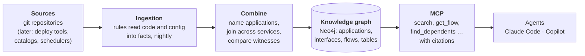
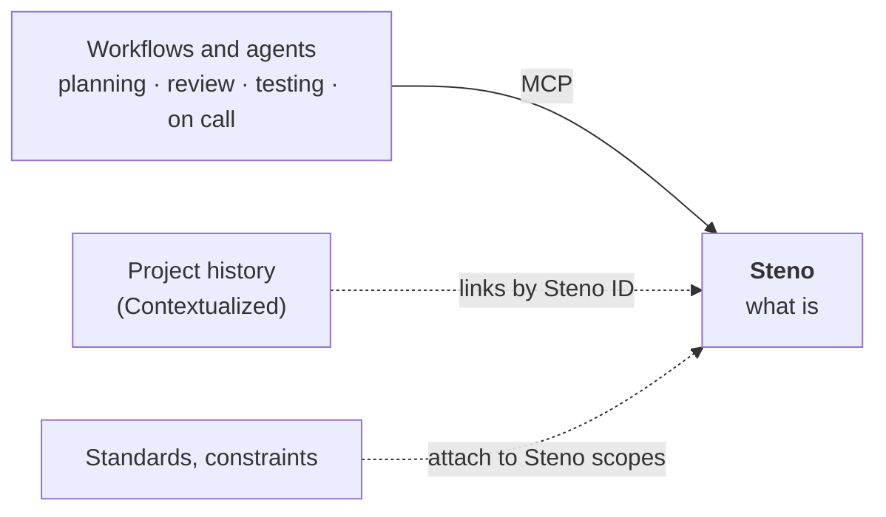

# Steno

**An organization-wide context engine for AI agents.** Steno reads an organization's repositories (and, later, the systems around them), works out how all the software fits together, and serves that to agents over MCP: what exists, how it communicates, what happens when something is triggered, and what a change will affect. Every answer cites where it came from.

> **In one minute**
> - Agents are strong inside one repository and blind beyond it. Most of what matters for a change (who consumes this topic, which flows cross this service, what breaks downstream) lives outside it.
> - Steno answers **what is**, for the people and agents who plan, implement, review, test, and operate software. Five lead use cases set the bar: PR review with context, breaking-change checks, "grill me" planning, delta-driven testing, and stack trace to flow.
> - It builds a **knowledge graph** bottom-up: applications first, then spaces, then the organization. Rules read the code deterministically; nothing is guessed silently. Steno drafts new rules itself as the code changes, and a person approves each one.
> - **Steno is the breadth, agents are the depth:** Steno maps the whole organization and points to the exact code; agents reason over it without cloning everything.
> - **Accuracy is the bar.** An answer is either correct, or it says exactly what it couldn't see.
> - **Status:** proof of concept. Python and Java ingest end to end; MCP tools are live. See [Plan](./plan/README.md).

---

## How it works, in five boxes

1. **Sources.** Git repositories today. Later, the systems an organization already keeps: deployment tools, Kafka permission files, artifact repositories, schedulers, catalogs.
2. **Ingestion.** Declarative rules, bundled in rule packs, recognize code patterns ("this method is an HTTP endpoint", "this call publishes to a topic"). Per-language symbol resolvers work out what names and types mean. The result is facts with exact citations.
3. **Combine.** Steno joins senders to receivers across services (a producer to its consumers, a caller to an endpoint). Being built in the POC: a stable identity and the real name for every application, and comparison of independent sources ("witnesses") so disagreements show up.
4. **Knowledge graph.** One Neo4j graph: architecture nodes (what the software does) and code nodes (how it's built). Each flow stores the ordered list of functions it runs. Search covers the main architecture nodes plus function names inside flows.
5. **MCP.** Agents ask in a few calls. Results carry citations to file, line, and commit, and say what's incomplete.

## Where Steno fits

Steno answers **what is**: the architecture as it runs today, derived from code. Project history (*what changed and why*), standards and constraints (*what should be*), and the workflows built on top are separate systems that link to Steno by stable IDs. How they combine into an agent-first SDLC is designed in a separate project. See [Where Steno fits](./purpose/where-steno-fits.md).

## Read on

| Section | Read it for | Start at |
|---|---|---|
| **Purpose** | What Steno is for, the lead use cases in detail, where it fits, and what it offers systems built on it | [purpose/README.md](./purpose/README.md) |
| **Concepts** | The ideas, without implementation: the graph, witnesses and facets, identity, what "accurate" means | [concepts/README.md](./concepts/README.md) |
| **How it works** | The implementation: the ingestion pipeline stage by stage, rules and resolvers, the graph schema, MCP, storage | [how-it-works/README.md](./how-it-works/README.md) |
| **Plan** | Where we are and where we're going: onboarding, the POC and its exit criteria, v1 and v2, every decision and open question | [plan/README.md](./plan/README.md) |

Each section opens with a hub page: a summary, a diagram, and links to go deeper.

## Reading the status markers

Every design point carries two markers.

| Marker | Meaning |
|---|---|
| **Decided** | Agreed. Build on it. |
| **Proposed** | Suggested, not yet confirmed. Raise it before relying on it. |
| **Open** | Not decided yet. |
| `POC` | Part of the proof of concept (now) |
| `v1` | First delivery to a client organization |
| `v2` | Later: parked until the POC and v1 prove out |

Decisions are numbered (`D61`) and listed in the [decision log](./plan/decisions.md).

## Glossary

| Term | Meaning |
|---|---|
| **Organization → Space → Application** | The three layers. A **space** is however an org divides itself (it can nest). An **application** is an independently deployable unit. |
| **Interface** | Something that can be called or subscribed to: an HTTP endpoint, gRPC method, topic, queue, or an org's own channel |
| **Flow** | A unit of work: a trigger, the entry function it starts, and everything that function reaches, as ordered steps |
| **Trigger** | What starts a flow: an interface or a schedule (or, when nothing in the code starts it, *inferred*) |
| **Step / Trace** | A flow's significant functions as nodes (L2), and the full ordered list of every function it runs (L3) |
| **Rule / Rule pack** | "When you see this pattern, emit this fact", in YAML; a versioned bundle of rules for one framework or org |
| **Rule curation** | Steno's job that drafts rules for what no rule explains, proves them, and queues them for a person's approval |
| **Pattern** | One kind of thing no rule explains (an annotation, a library call, a file convention), counted across the organization |
| **Interceptor** | Code a framework runs around entry points without their code calling it: a filter, a response wrapper, an error handler |
| **Contract** | What an interface takes and returns: an entity, and how this interface uses it |
| **Symbol resolver** | Per-language code that answers *what is this?*: which symbol a name is, a value's type, a constant's value |
| **Clue / Assembler** | A partial fact a rule emits (a router's URL prefix); the code that combines clues into complete facts |
| **Witness** | One concrete source of statements about the system at one organization: an application's code, the XLD repository, `component_manifest.yaml`, an admin |
| **Witness type** | A witness's kind: CODE, PLATFORM, DECLARED, ADMIN, OBSERVED |
| **Facet** | One fixed question Steno answers about every organization (Components, Messaging, Schedules, …) |
| **Steno ID / canonical name** | An application's permanent internal ID, and the name it's deployed as |
| **Join / join rate** | A send matched to its receiver by a shared key; the share of sends that join |
| **Stub** | A placeholder for a target not ingested yet; it merges with the real node by stable ID |
| **Transport** | *How* an interface communicates: REST, gRPC, Kafka, an internal framework |
| **Rollup** | A higher-layer fact derived from lower-layer facts (a space's "who talks to whom") |
| **Delta** | The facts added, removed, or changed by one ingestion run (`fact_change`) |
| **Connector** | Access to a source: where it is and a reference to its credentials |
| **Rule engine** | Runs every enabled rule pack over every file in the extract stage |
| **Claim** | One witness's statement for a facet, tagged with its witness type and citation; claims are combined into facts |
| **Coverage report** | What no rule explained, ranked by how many applications one fix would help |
| **Card** | A fixed-size summary of a node used for search: deterministic facts plus, for flows and applications, LLM-written purpose |
| **Citation** | Where a claim comes from: space, app, repo, file, lines, commit, and a link |
| **Sources** | The repositories (or other sources) an answer's citations come from, with what to fetch |
