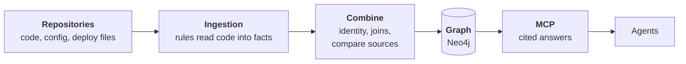

# Steno

**A map of an organization's software, for AI agents.** Steno reads repositories, works out how the software connects, and serves that over MCP with citations.

> **In one minute**
> - **The problem:** agents are strong inside one repository and blind beyond it. Who consumes this topic? What breaks downstream? That lives elsewhere.
> - **The answer:** a graph of Organization → Space → Application, with interfaces, flows, and tables, built by deterministic rules.
> - **The bar:** accuracy. An answer is correct, or it says what it couldn't see.
> - **Status:** POC stage A. Python and Java ingest end to end, and MCP tools are live. See the [plan](./plan/README.md).

## The design on one page

These are the ideas everything else follows from.

| # | Idea | What it means | Decision |
|---|---|---|---|
| 1 | **Breadth, not depth** | Steno is the map. Agents read the code it points to, and clone only what a task needs. Steno never runs an agent to answer. | D119 |
| 2 | **Compute deep, store the surface, point to the body** | Stored: placement, surface (every way in and out of an application), reach (what each flow touches), search text, and pointers. Everything else is read from the code. | D136 |
| 3 | **Deterministic first** | Rules produce facts. An LLM writes summaries and drafts rules, never facts. | D120, D147 |
| 4 | **Gaps are visible, never silent** | Steno may miss things. It must never miss them silently. | D71, D146 |
| 5 | **Interfaces are nodes** | Two applications connect when one sends to something the other receives on: a topic, an endpoint, a table. Nobody declares the link. | D3, D61 |
| 6 | **Functions aren't nodes** | The call graph lives in memory for one run. Each flow keeps a trace of the functions it runs. | D60 |
| 7 | **Code is one witness** | Deploy files, ACLs, and manifests are also evidence. Independent sources are compared, and disagreements are findings. | D76, D80 |
| 8 | **Permanent identity** | Each application has a Steno ID that survives renames and moves. Every child ID is built on it. | D81 |
| 9 | **Passive** | Steno asks nothing of an organization's repositories. | D75 |
| 10 | **Neo4j is rebuildable** | Postgres holds what Steno is told and did. Neo4j holds what it knows, and can be rebuilt from Postgres plus git. No file contents are stored. | D17, D36 |

**The scope test:** a feature belongs in Steno only if a [use case](./purpose/use-cases.md) needs it.

## The moving parts

Use this table to see what each part is for and what it costs.

| Part | Job | Where the cost is | Page |
|---|---|---|---|
| **Symbol resolvers** | Say what names, types, and values mean. Java needs a JVM helper. | Time and memory grow with the repository | [Resolvers](./how-it-works/ingestion/resolvers.md) |
| **Rule engine and packs** | Turn code shapes into facts (90 rules, 33 packs) | Every rule runs on every file; rules need upkeep | [Rules](./how-it-works/ingestion/rules-and-packs.md) |
| **Assemblers** | Combine facts spread across files | Small and fixed | [Stages](./how-it-works/ingestion/stages.md) |
| **Identity registry** | Give applications permanent IDs and real names | Small | [Identity](./concepts/identity.md) |
| **Flow builder** | Walk the call graph from every entry point into flows, traces, and steps | **The slowest stage.** Cost grows with flows × what each flow reaches | [Large repositories](./how-it-works/ingestion/large-repositories.md) |
| **Graph writer** | Write only what changed, in small batches | Reads every existing node's properties on each run | [Stages §7](./how-it-works/ingestion/stages.md#7-write) |
| **Claims and reconcile** | Compare code with other witnesses | Runs per job, on the subjects it touched | [Claims](./how-it-works/ingestion/claims-and-reconcile.md) |
| **Coverage and patterns** | Report what no rule explained | About 20 kinds of signal | [Coverage](./how-it-works/ingestion/coverage-report.md) |
| **Routing** | Take a vague question to the right flows | Jev per candidate (optional), keyword search, optional embeddings | [Retrieval](./how-it-works/retrieval-and-mcp.md) |

**Open now:** a real organization's run was stopped after more than 8 hours in the flows stage, and the cause isn't known. See [Large repositories §3c](./how-it-works/ingestion/large-repositories.md#3c-flows-work-done-once).

## Where to read next

| Section | Read it for |
|---|---|
| [Purpose](./purpose/README.md) | What Steno is for, its use cases, and where it's going |
| [Concepts](./concepts/README.md) | The ideas: the graph, witnesses and facets, identity, trust |
| [How it works](./how-it-works/README.md) | The implementation: pipeline, rules, schema, MCP, storage |
| [Plan](./plan/README.md) | Roadmap, onboarding, and every decision |

## Status markers

| Marker | Meaning |
|---|---|
| **Decided** | Agreed. Build on it. |
| **Proposed** | Suggested. Raise it before relying on it. |
| **Open** | Not decided. |
| `POC` / `v1` / `v2` | The proof of concept (now) / first client delivery / later |

Decisions are numbered (`D61`) and listed in the [decision log](./plan/decisions.md).

## Glossary

| Term | Meaning |
|---|---|
| **Organization → Space → Application** | The three layers. A space is however an organization divides itself. An application is one deployable unit. |
| **Interface** | Something that can be called or subscribed to: an endpoint, gRPC method, topic, or queue |
| **Flow** | A trigger, its entry function, and everything that function reaches |
| **Trigger** | What starts a flow: an interface, a schedule, or *inferred* when nothing in the code starts it |
| **Step / Trace** | A flow's significant functions as nodes / the ordered list of every function it runs |
| **Digest** | A flow's short, deterministic text for search and routing |
| **Reach** | What a flow touches: its trigger, effects, and functions with lines, without order |
| **Rule / Rule pack** | "See this pattern, emit this fact" in YAML / a versioned bundle of rules |
| **Clue / Assembler** | A partial fact from a rule / the code that combines clues into complete facts |
| **Symbol resolver** | Per-language code that answers *what is this?* |
| **Witness / Witness type** | One source of statements / its kind: CODE, PLATFORM, DECLARED, ADMIN, OBSERVED |
| **Claim** | One statement a witness makes |
| **Facet** | A fixed question Steno answers about every organization |
| **Steno ID / canonical name** | An application's permanent ID / the name it's deployed as |
| **Join / join rate** | A send matched to its receiver by a shared key / the share of sends that join |
| **Stub** | A placeholder for a target not ingested yet |
| **Coverage report / pattern** | What no rule explained / one kind of gap, counted across the organization |
| **Rule curation** | The `rule-pack-author` skill works the coverage report, and a person approves its rules on a pull request |
| **Interceptor** | Code a framework runs around entry points: a filter, a wrapper, an error handler |
| **Contract** | What an interface takes and returns |
| **Connector** | Access to a source: where it is and a reference to its credentials |
| **Delta** | What one run added, removed, or changed (`fact_change`) |
| **Citation / Sources** | Where a claim comes from / the repositories behind an answer and what to fetch |
| **Jev** | A fast decision model that answers typed questions with probabilities |
