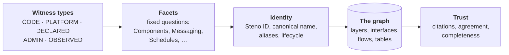

# Concepts

The ideas Steno is built on, without implementation detail. Read these to understand *what* Steno models and *why*; [How it works](../how-it-works/README.md) covers *how*.

> **In one minute**
> - **The graph:** an organization is modeled as Organization → Space → Application, with interfaces, flows, and tables. Facts are stored at the application level; everything above is rolled up.
> - **Witnesses and facets:** code is one source of evidence among several. Steno asks a fixed set of questions (facets) about every organization, and each organization says where the answers live (its witnesses: the XLD repository, a manifest).
> - **Identity:** every application gets a permanent Steno ID and the name the organization actually deploys it as, so renames, moves, and removals never create duplicates or dead flows.
> - **Trust:** an answer is either correct or says what it couldn't see. Independent witnesses are compared, gaps are never silent, and every claim is cited.

## Pages

| Page | What it covers |
|---|---|
| [The graph](./graph.md) | Layers, architecture vs. code nodes, interfaces and joins, flows from trigger to trace, application kinds |
| [Witnesses and facets](./witnesses-and-facets.md) | The five kinds of evidence, the facets Steno answers, which witness answers which facet, and how claims combine |
| [Identity](./identity.md) | Steno ID, canonical name, display name, aliases; how names are found; renames, moves, removals across nightly runs |
| [Trust](./trust.md) | What "accurate" means: deterministic first, citations, agreement states, completeness signals, the join rate, how it's measured |

## Principles that run through all of them

| Principle | Status |
|---|---|
| **Deterministic first.** Rules extract facts. Decisions rules can't make go to a decision model (stand-ins in the POC, Jev later). An LLM writes text and drafts rules a person approves; it never produces facts (D120). | Decided |
| **Breadth, not depth.** Steno is the map of the organization; agents reason over the code it points them to (D119). | Decided |
| **Built bottom-up, searched top-down.** Applications are ingested first; spaces and the organization are rollups. Queries start at the highest layer a question needs. | Decided |
| **Agnostic core, organization-specific rules.** The graph schema and facets never change per organization. Rule packs and witnesses do. | Decided |
| **Passive.** Nothing is required of an organization's repositories. Steno reads what already exists. | Decided |
| **Gaps are visible, never silent.** | Decided |
| **No file contents stored.** Code is read from the git host at the ingested commit. | Decided |
