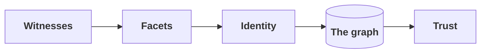

# Concepts

The ideas Steno is built on, without implementation detail.

> **In one minute**
> - **The graph:** Organization → Space → Application, with interfaces, flows, and tables. Facts live at the application level, and everything above is a rollup.
> - **Witnesses and facets:** Steno asks fixed questions (facets), and each organization says where the answers live (witnesses).
> - **Identity:** a permanent ID and the deployed name for every application.
> - **Trust:** an answer is correct or says what it couldn't see.

## Pages

| Page | Covers |
|---|---|
| [The graph](./graph.md) | Layers, node kinds, interfaces, flows, how deep it goes |
| [Witnesses and facets](./witnesses-and-facets.md) | Kinds of evidence and how claims combine |
| [Identity](./identity.md) | IDs, names, renames, and removals |
| [Trust](./trust.md) | Citations, agreement, completeness, measurement |

## Principles (all Decided)

- **Deterministic first.** An LLM writes text and drafts rules, never facts (D120).
- **Breadth, not depth.** Compute deep, store the surface, point to the body (D119, D136).
- **Built bottom-up, searched top-down.** Applications first; spaces and the organization are rollups (D2).
- **Agnostic core, organization-specific rules.** The schema and facets never change per organization.
- **Passive.** Steno reads what already exists.
- **Gaps are visible, never silent.**
- **No file contents stored.**
