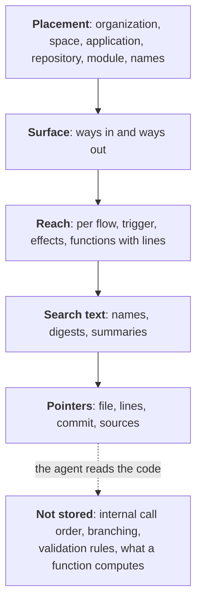

# The graph

How Steno models an organization. Full schema: [graph reference](../how-it-works/graph-reference.md).

> **In one minute**
> - **Three layers:** Organization → Space → Application. Applications are ingested; the rest are rollups.
> - **Two kinds of nodes in one graph:** architecture (what the software *does*) and code (how it's *built*).
> - **Interfaces are nodes.** Two applications connect when they share a topic, endpoint, or table.
> - **A flow** is a trigger plus everything its entry function reaches.
> - **Functions aren't nodes.** Each flow stores the functions it runs.

```
Organization
 └ Space  (can nest)
    ├ DataStore → Table, KafkaTopic / Queue
    ├ Application
    │   ├ Interface, Entity, Schedule, Interceptor
    │   └ Flow  {trace}                  architecture: what it DOES
    │      └ Step  {symbol, file, lines}
    └ Repository ── Module ◀── BUILT_FROM ── Application
                     └ File              code: how it's BUILT
```

## 1. Three layers

| Layer | What it is |
|---|---|
| **Organization** | The whole organization |
| **Space** | However it divides itself. Can nest. Owns shared data stores and topics. |
| **Application** | One independently deployable unit. A repository can hold several. |

**Built bottom-up, searched top-down (D2).** Facts live at the lowest level, so there's one source of truth.

## 2. Architecture nodes and code nodes

**The test:** if you refactored without changing behavior, would the node change? Yes → code node. No → architecture node.

| | Architecture | Code |
|---|---|---|
| Kinds | Organization, Space, Application, Interface, Schedule, Flow, Step, Entity, Interceptor, DataStore, Table, ExternalSystem | Repository, Module, File |
| Searched | Flows, applications, spaces, organization, interfaces, entities, tables, data stores, external systems, interceptors (D104, D116) | Never |

Search also covers **function names inside traces**: searching `create_job` returns the flows that run it. Any node can be opened by name with `get_node`.

## 3. Interfaces join applications

Every communication has three parts (D61):

| Part | Example | In the graph |
|---|---|---|
| **Sender** | `kafkaTemplate.send(topic, …)`, an HTTP call | `Step -PRODUCES-> Interface` or `CALLS` |
| **Receiver** | `@KafkaListener`, an HTTP handler | `Interface -STARTS-> Flow` |
| **Shared key** | Topic name, method and path, table | The interface's stable ID |

An organization's own messaging framework needs one sender rule and one receiver rule.

- **Contracts:** an `Entity` (the class, with its fields) plus how an interface uses it. Validity is read from the code (D115, D137).
- **Interceptors:** code a framework runs around entry points. Which applications turn it on is stored; what it requires is read from the code (D116, D138).
- **Stubs:** a target not ingested yet. The real node merges in later. A call whose host is runtime data goes to a stub per calling class (D64).
- **Internal or external** is derived from where both ends sit in the tree.

## 4. Flows

There's no "Job" or "Subflow" type. Flows differ only by trigger.

| Trigger | Example |
|---|---|
| An interface | `POST /v1/clients`, a consumed topic |
| A schedule | `@Scheduled`, a CronJob |
| *Inferred* (D74) | Work nothing in the code starts. It's marked inferred and listed in coverage until a rule names its trigger. |

| Level | Answers | Produced by |
|---|---|---|
| **L1 Rollup** | What does it touch? | Deterministic |
| **Digest** (D143) | Search and routing text | Deterministic |
| **L2 Steps** | What happens, in order? | Deterministic: `Step` nodes for significant functions |
| **L3 Trace** | Every function it runs | Deterministic: stored on the flow |

**Across services, a flow points to another flow and never contains it** (`LEADS_TO`, computed when read). A path across ten services is a chain of per-application flows.

**Measured in stage A (D140):** whether full traces and Steps beat reach alone.

## 5. Application kinds

Labels worked out from a flow's triggers, not exclusive (D85). No trigger found means no kind and a coverage item.

| Label | Means | Status |
|---|---|---|
| `:Service` | Exposes HTTP or gRPC | Built |
| `:Consumer` | Reacts to messages | Built |
| `:Gateway` | Routes requests to other applications (D132) | Built for Spring Cloud Gateway |
| `:Job` | Runs to completion, confirmed by PLATFORM | Waits for a PLATFORM witness |
| `:Frontend` | A UI | `v2` |

An in-code `@Scheduled` method is a trigger, not a kind.

## 6. What's modeled later

`Project` and `CHANGED` edges (`v1`); `Team`, `Environment`, table columns, and frontends (`v2`).

## 7. How deep the graph goes (Decided, D136)

**Compute deep, store the surface, point to the body.** Ingestion may analyze as deeply as it needs. What's stored stops at five layers:



- **The line is an application's edge.** A table only one application uses is still surface.
- **Below the line is the agent's** (`view_flow_code`, `sources`, D119).
