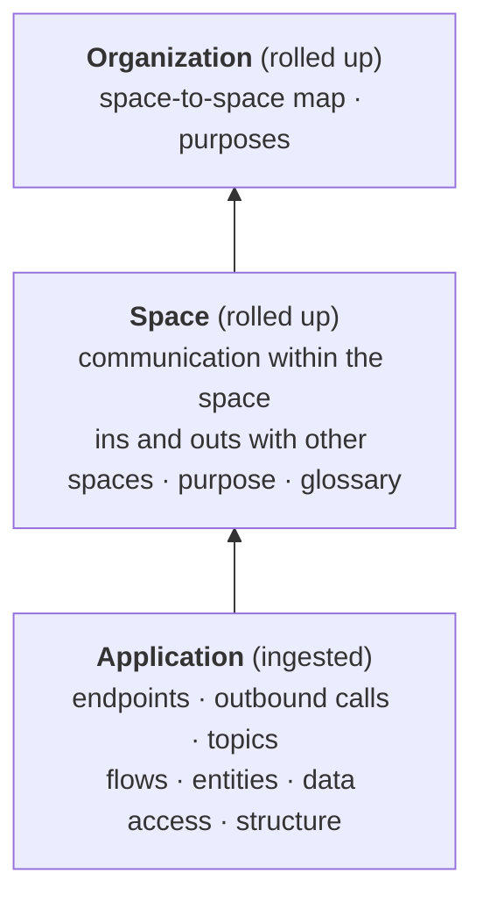
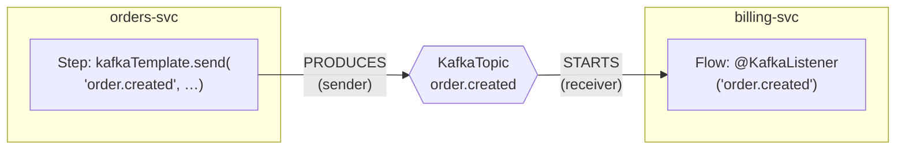

# The graph

How Steno models an organization: three layers to zoom through, two kinds of nodes, interfaces that join applications, and flows that describe what happens when something is triggered.

> **In one minute**
> - **Three layers:** Organization → Space → Application. Applications are ingested; spaces and the organization are rolled up from them.
> - **Two kinds of nodes in one graph:** architecture nodes (what the software *does*: applications, interfaces, flows, steps, tables, data stores, external systems) and code nodes (how it's *built*: repositories, modules, files). Functions are neither: each flow stores the ordered list of functions it runs (its trace).
> - **Search** covers the searchable architecture nodes (flows, applications, spaces, the organization, interfaces, entities, tables, data stores, external systems, interceptors) plus function names inside traces, which lead back to their flow. Code nodes aren't searched; any node can still be opened by name with `get_node`.
> - **Interfaces are nodes.** Two applications are connected when one sends to an interface the other receives on: a topic, an endpoint, a table. No one declares the connection; it falls out of shared keys.
> - **A flow** is a trigger plus everything its entry function reaches, as ordered steps, with a trace of every function it runs.
>
> Full schema: [graph reference](../how-it-works/graph-reference.md).

---

## 1. Three layers

| Layer | What it is |
|---|---|
| **Organization** | The whole organization, made up of spaces |
| **Space** | However an organization divides itself: a domain, a department, a product line. It can nest, or an organization can have only one. Spaces own shared data stores and topics. |
| **Application** | An independently deployable unit. One repository can contain several (a microservices monorepo). |

**Built bottom-up, searched top-down (Decided, D2).** Ingestion understands each application fully, then rolls up. Facts are stored only at the lowest level, so there's one source of truth; a space's "who talks to whom" is computed from its applications' facts.



Queries enter at the highest layer the question needs: a question clearly about one application goes straight there; an unclear one starts at the organization and narrows.

## 2. Architecture nodes and code nodes

One Neo4j graph holds two kinds of nodes, both hanging off the same containment tree:

```
Organization
 └ Space  (can nest)
    ├ DataStore → Schema → Table, KafkaTopic / Queue
    ├ Application
    │   ├ Interface, Entity, Schedule, Interceptor
    │   └ Flow  {trace: every function, in order}      architecture: what it DOES
    │      └ Step  {symbol, file, lines}
    └ Repository ── Module (:Deployable ◀── BUILT_FROM ── Application)
                     └ File                               code: how it's BUILT
```

**The test for which side a node is on:** if you refactored the code without changing behavior (split a class, moved a file), would the node change? Yes → code node. No → architecture node.

| | Architecture nodes | Code nodes |
|---|---|---|
| Kinds | Organization, Space, Application, Interface, Schedule, Flow, Step, Entity, Interceptor, DataStore, Table, ExternalSystem | Repository, Module, File |
| Answers | What exists, what it does, what it touches | Where the code lives and how it's organized |
| Searched | Flows, applications, spaces, the organization, interfaces, entities, tables, data stores, external systems, and interceptors (D104, D116). Not steps or schedules. | Never directly |

**What search covers, exactly.** Search looks at the names (and, later, cards) of the searchable architecture nodes, **plus function names inside every flow's trace**: searching `create_job` returns the flows that run it. Data stores and external systems are searchable too ("who calls Plaid?", D104). Interceptors are searchable too ("which endpoints use the tenant filter?", D116). Code nodes aren't searched, and nor are steps or schedules, though any node can be opened by name or ID with `get_node`.

**Functions are not nodes (D60).** The call graph is built in memory during each run and discarded. What survives is each flow's **trace**: the ordered list of functions it runs, with file and lines. A refactor that changes no behavior writes no graph nodes.

## 3. Interfaces join applications

Every kind of communication has the same three parts (D61):



| Part | Example | In the graph |
|---|---|---|
| **Sender** | `kafkaTemplate.send(topic, …)`, an HTTP client call, `messenger.post(channel, …)` | `Step -PRODUCES-> Interface` (or `CALLS`) |
| **Receiver** | `@KafkaListener`, an HTTP handler, `@OnMessage("x")` | `Interface -STARTS-> Flow` |
| **Shared key** | The topic name, the method and path, the channel, the table | The interface's stable ID |

Two applications are connected exactly when their keys match. An organization's own messaging framework needs one sender rule and one receiver rule. The same pattern later joins a library to the services that depend on it (the artifact coordinate is the key) and a gateway route to the service behind it.

**Contracts.** What an interface takes and returns is an `Entity` (the class, stored once) plus how this interface uses it (validated or not, which validation groups, wrapped how), so one class shared by two endpoints can carry two different contracts (D115).

**Interceptors.** Code a framework runs around entry points (a JWT filter, a response wrapper, an error handler) is an `Interceptor` node. Applications activate it, by defining it or by turning on a shared library's, and it runs around the endpoints its scope covers (D116).

**Stubs.** When a target isn't ingested yet, the sender points at a stub keyed by its natural key. When the owning application is ingested, the real node merges into the stub. An HTTP call whose host is runtime data is never merged with others: it goes to a stub per calling class, with its URL template (D64).

**Internal vs. external** is derived from where both ends sit in the tree: same application, same space, different spaces, or outside the organization.

## 4. Flows

A **flow** is a unit of work: a **trigger** starts an **entry function**, and the flow is everything that function reaches. There's no "Job" type and no "Subflow" type; flows differ only by trigger.

| Trigger | Example |
|---|---|
| An interface | `POST /v1/clients`, a consumed topic, a gRPC method |
| A schedule | Spring `@Scheduled`, a Kubernetes CronJob, an enterprise scheduler (later) |
| *Inferred* (D74) | Work nothing in the code starts (a worker loop, a CLI command). It still gets a flow, marked inferred, and the coverage report lists it until a rule names its trigger. |

A flow is described at four levels:

| Level | Answers | Produced by |
|---|---|---|
| **L0 Headline** | What is this, in one line? | Trigger (deterministic) + purpose (LLM) |
| **L1 Signature + narrative** | What goes in, what comes out, what does it touch? What does it do, in plain words? | Facts (deterministic) + narrative (LLM) |
| **L2 Steps** | What happens, in what order, where exactly? | Deterministic: `Step` nodes for significant functions |
| **L3 Trace** | Every function it runs | Deterministic: stored on the flow |

**Across services, a flow points to another flow and never contains it.** A step that calls `POST /auth/verify` leads to the flow that endpoint starts in another application (`LEADS_TO`, sync or async). A path across ten services is a chain of per-application flows, stitched when read.

## 5. Application kinds

An application is still one node type, with **labels for its kinds**, worked out from the triggers of its flows (Decided). Labels aren't exclusive: a typical Spring service has endpoints, listeners, and a scheduled method.

Decided (D85). **Built (2026-10-27):** `:Service` and `:Consumer` from the triggers of an application's flows, with the list in its `kinds` property; an in-code schedule is a trigger, not a kind; `:Job` waits for a PLATFORM witness (a CronJob), and `:Frontend` is `v2`. An application with no known trigger gets no kind, never a default, and is a coverage item (`no_trigger_application`).

| Label | Means | Known from |
|---|---|---|
| `:Service` | Exposes HTTP or gRPC | Flows started by endpoints |
| `:Consumer` | Reacts to messages | Flows started by topics or queues |
| `:Job` | Runs to completion: starts, works, exits | CODE hints (web server off plus a `CommandLineRunner`, Spring Batch, a CLI framework), confirmed by PLATFORM (a CronJob, a scheduler entry) |
| `:Frontend` | A UI | UI routes (`v2`) |

An in-code `@Scheduled` method is a trigger, not an application kind. An application where Steno finds no trigger keeps its kind **unknown** and appears in the coverage report: it usually means a missing rule, not a job. See [Identity](./identity.md) for how applications get their names.

## 6. What's modeled later

| Later addition | Scope |
|---|---|
| `Team` (ownership), `Environment` (what's deployed where, on what) | `v2` |
| Columns, constraints, and purpose for tables (data store schemas) | `v2` |
| Frontend applications and UI routes | `v2` |
| `Project` nodes linked by `CHANGED` edges | With the [Contextualized integration](../purpose/integration.md) |
