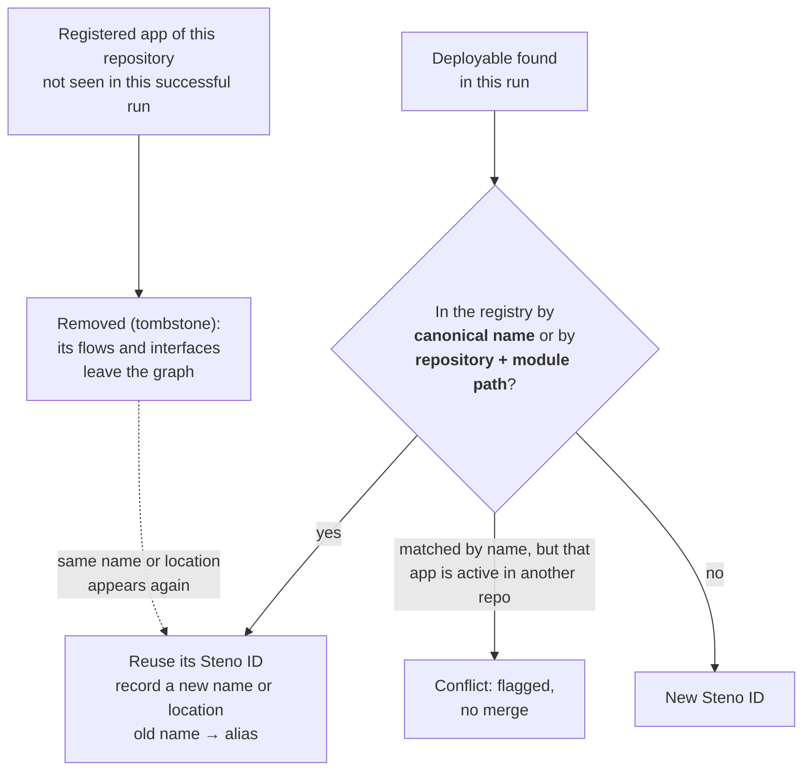
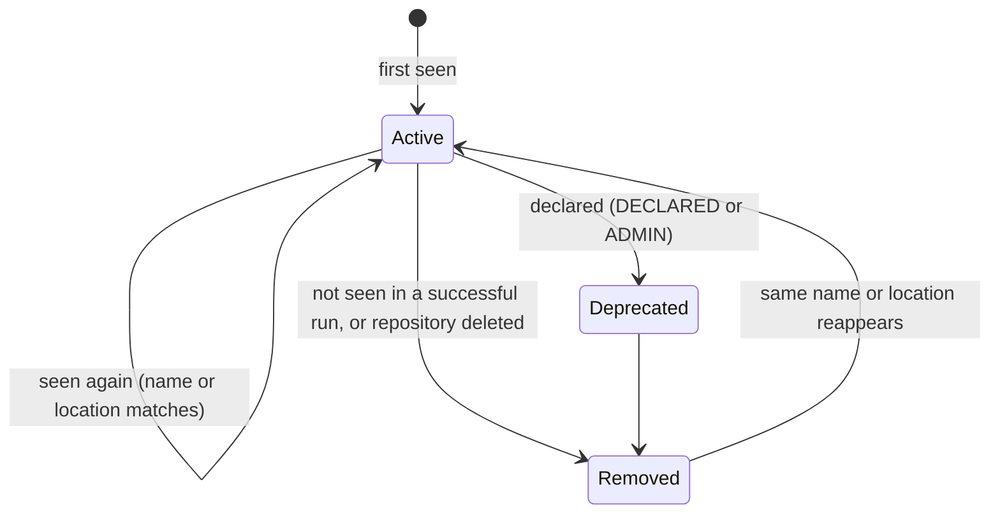

# Identity

How every application gets one permanent identity and the name the organization actually uses, so that references from other systems match exactly, and renames, moves, and removals across nightly runs never create duplicates or dead flows.

> **In one minute**
> - Identity over time ("is this the same deployable as last night?") and naming ("what is it called, and which application does `org-svc-users` in XLD mean?") are **two separate jobs**.
> - Each application has four parts: a permanent **Steno ID**, a **canonical name** (the name it's deployed as, used for matching), a **display name**, and **aliases** (every other name a source states).
> - The canonical name is found with a **name ladder**: admin, then the deploy name, then the manifest, then the build artifact name, then the runtime self-name, then the folder (provisional).
> - Each nightly run matches deployables by **canonical name or location**. Unmatched → new ID. Not seen → removed (and restored if it comes back). Admins can declare renames.
> - Everything under an application (endpoints, flows) is built on its Steno ID, so other systems can depend on it.
>
> Status: **Decided** (2026-10-10), **built** (2026-10-14). Scope: `POC` stage A. Not built yet: naming patterns, admin links through an API or UI, and anchoring on the git host's repository ID ([identify](../how-it-works/ingestion/identify-and-reconcile.md#2-identify)).

---

## 1. Four parts

| Part | What it is | Used for |
|---|---|---|
| **Steno ID** | An opaque ID Steno assigns the first time it sees a deployable. Never changes. Stored in an identity registry in Postgres. | Every ID beneath the application: endpoints, flows, entities, schedules. Never shown to people. |
| **Canonical name** | The name the organization builds and deploys it as, e.g. `org-svc-users`. Exact, unique within the organization. | **Matching.** Other systems' references join on it directly. |
| **Display name** | A human label, e.g. "User Management" from a manifest. Falls back to the canonical name. | What people and agents read |
| **Aliases** | Every other name a source states, each with its source, plus every past name | Matching names that aren't the canonical one; history |

**Most matching is exact, not inference.** A name a source actually states (`settings.gradle`, `spring.application.name`, XLD's deployable name) is an exact alias. Matching `org-svc-users` against it is a lookup. Inference happens only when Steno has to transform a name, and declared naming patterns remove most of that.

One deployable can easily have seven names:

| Source | Name |
|---|---|
| Steno ID | `app_7f3c…` (internal) |
| XLD deploy name (PLATFORM) → **canonical** | `org-svc-users` |
| Manifest display name (DECLARED) | User Management |
| Manifest ID (DECLARED) | `USR-01` |
| Gradle project name (CODE) | `org-svc-users` |
| `spring.application.name` (CODE) | `users-service` |
| Derived from the folder | `microservices-users` |

## 2. Finding the canonical name: the name ladder

Steno defines **slots** for name sources, ordered by witness type. Packs fill the slots for their ecosystem; an organization can reorder them.

| Priority | Source (examples) | Witness type |
|---|---|---|
| 1 | Admin override | ADMIN |
| 2 | Deploy unit name: XLD deployable, Helm release, Kubernetes Deployment | PLATFORM |
| 3 | Component identity from a manifest or catalog (`component_manifest.yaml` ID) | DECLARED |
| 4 | Build artifact name: Gradle project / `rootProject.name`, Maven `artifactId`, Jib or Docker image, `pyproject` name | CODE |
| 5 | Runtime self-name: `spring.application.name`, `service.name` | CODE |
| 6 | Derived from the repository and folder, marked **provisional** | — |

**Example:** a monorepo holds `microservices/services/users`. The Gradle pack reads that module's project name and finds `org-svc-users` (priority 4). XLD deploys it under the same name (priority 2), which confirms it. The folder-derived `microservices-users` becomes an alias.

**Naming patterns make derived names exact.** Organizations usually have a convention: "the deploy name is `org-svc-{module}`", "the Datadog name is `{name}-{env}`". Declared once in the org pack, a pattern produces exact names. Normalized guessing (ignoring `-svc`, case) happens only if the organization turns it on, and the result is always marked inferred.

## 3. Matching names from other systems

When a source names an application (XLD says `usr-svc` consumes a topic), Steno tries, in order:

1. The **canonical name** or an **exact alias**
2. A **declared mapping** (an admin entry or an org pack pattern)
3. A **normalized match**, only if enabled, marked inferred
4. Otherwise the **unmatched-names list**, for someone to resolve

**No silent fuzzy matching.** A wrong match creates a false dependency, which is worse than a missing one.

**Conflicts are flagged, never resolved silently:**

- Two sources give one deployable different names: both become exact aliases; the higher priority is canonical.
- Two deployables claim the same canonical name (a fork, or a migration with both repositories live): flagged as a conflict, with no merge and no duplicate, until PLATFORM (which is deployed) or an admin settles it.

## 4. The identify step: recognizing the same deployable each night

Nightly runs only re-analyze repositories whose main branch moved (D59), so only those repositories' deployables go through this step. It runs after structure detection and before write.

| What happened | Caught by | Result |
|---|---|---|
| Nothing changed | Name and location | Same ID |
| Renamed, same folder | Location | Same ID; the old name becomes an alias. Flows and endpoints keep their IDs, because they're built on the Steno ID. |
| Moved, same name | Name | Same ID |
| Moved to another repository, same name | Name, once the old repository's run has marked it removed | Same ID |
| Renamed **and** moved in one change | Neither | Old one removed, new one created. Listed in the run's change report as "removed X, added Y in the same run". An admin can link them (§6). |
| A rule-pack change stops recognizing a service, and a fix brings it back | Name or location | Removed, then restored with the same ID. No duplicate. |
| Split into two | The one keeping the name or location | Keeps the ID; the other is new |
| Two repositories claim one name | Name, but both active | Conflict, flagged |

**No fingerprints or heuristics.** Two exact lookups only. Renamed-and-moved-together is rare, visible, and fixable by hand; that's the trade for rules that are simple and deterministic.

## 5. Lifecycle

- **Not seen means removed**, because a run only writes after a successful ingestion at a new commit. A failed job writes nothing, so it can't remove anything.
- **Removed is a tombstone**, not a deletion. The Steno ID, names, and last commit stay in the registry, so project history and plans that link to it still resolve, and it can come back without a duplicate.
- **A caller still pointing at a removed service** becomes an unjoined send: "this calls something that no longer exists." That's a useful finding.
- **Deprecated** is declared, never inferred. Answers carry it ("deprecated; use X").
- **Deleted or archived repositories** are found by listing each connector's repositories, and all their applications are removed.

## 6. Manual renames (Decided)

An admin can tell Steno two deployables are the same, recorded as an ADMIN decision with who, when, and why:

- **After the fact:** link a removed application to the new one. The new one takes over the old Steno ID; the old name becomes an alias. Nothing depending on that ID breaks.
- **Ahead of time:** declare "`users-svc` becomes `org-svc-identity`" before the change merges, and the next nightly run maps it.

## 7. What else has identity

| Node | Identity | Why no registry |
|---|---|---|
| Topics, queues, channels | Their name (and cluster) | The name *is* the topic |
| Tables | Data store, schema, name | Natural key |
| Endpoints, gRPC methods | Application's Steno ID + method + path | A changed path really is a different endpoint for its callers: not seen → removed, new → added |
| Flows | Application's Steno ID + trigger | Same as endpoints |
| Spaces, the organization | Postgres row ID | Declared |
| External systems | Host, or the service name an HTTP signature gives | Natural key |

Applications need the registry because their names aren't intrinsic.

## 8. Where it lives

- **An identity registry in Postgres:** Steno ID, anchors (canonical name, location: repository + module path), every name with its source and slot, past names, lifecycle state, conflicts, admin links, and names no application matched. It has to be in Postgres because Steno IDs can't be recreated from git, and Neo4j must stay rebuildable from Postgres and git (D36).
- **Child IDs use the Steno ID.** The application node is `app:{steno_id}`, and every endpoint, flow, entity, and schedule ID is built on it, so renames and moves don't change them. The first run with identify rewrote the old name-based IDs once.
- **Proven** in memory for rename, move, rename-and-move, split, removal, restoration, a declared rename, and two repositories claiming one name; the stage B stub organization adds them as scripted git changes.

Implementation detail: [identify and reconcile](../how-it-works/ingestion/identify-and-reconcile.md).
