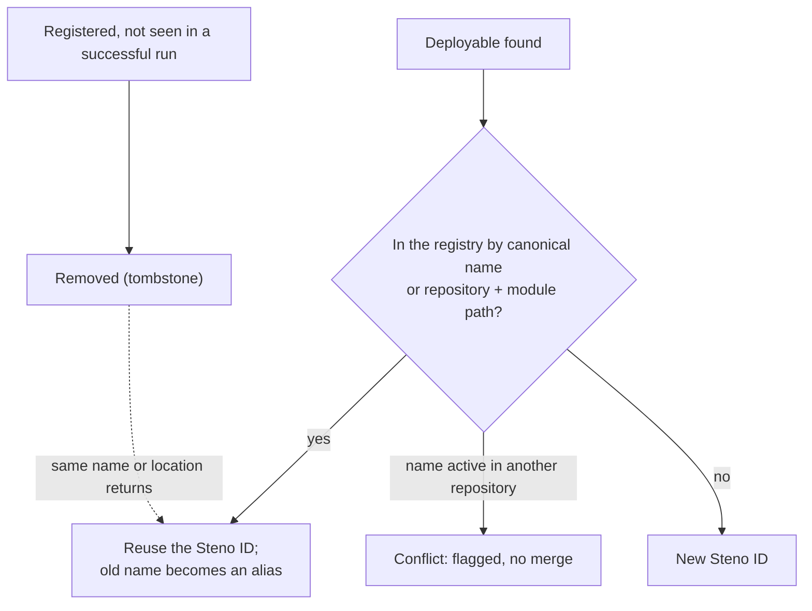

# Identity

How every application gets one permanent identity and its real name, so renames, moves, and removals never create duplicates or dead flows. Decided (D81–D84), built. Mechanics: [identify](../how-it-works/ingestion/identify-and-reconcile.md).

> **In one minute**
> - Four parts: a permanent **Steno ID**, a **canonical name** (as deployed), a **display name**, and **aliases**.
> - The canonical name comes from a **name ladder**.
> - Each run matches deployables by **canonical name or location**. Two exact lookups, no heuristics.
> - Everything under an application is built on its Steno ID.

## 1. Four parts

| Part | What it is | Used for |
|---|---|---|
| **Steno ID** | Opaque, assigned on first sight, never changes | Every child ID |
| **Canonical name** | The deployed name, e.g. `org-svc-users`. Unique. | Matching |
| **Display name** | "User Management". Falls back to the canonical name. | Reading |
| **Aliases** | Every other name a source states, plus past names | Matching, history |

**Most matching is exact.** A name a source states is a lookup, not an inference.

## 2. Finding the canonical name: the name ladder

| Priority | Source | Witness type |
|---|---|---|
| 1 | Admin override | ADMIN |
| 2 | Deploy unit name (XLD, Helm, Deployment) | PLATFORM |
| 3 | Manifest or catalog ID | DECLARED |
| 4 | Build artifact name (Gradle, Maven, `pyproject`) | CODE |
| 5 | Runtime self-name (`spring.application.name`) | CODE |
| 6 | Repository and folder, **provisional** | — |

**Naming patterns** ("`org-svc-{module}`") make derived names exact (not built).

## 3. Matching names from other systems

Tried in order: canonical name or exact alias → declared mapping → normalized match, only if enabled and marked inferred → the unmatched-names list.

**No silent fuzzy matching.** A wrong match creates a false dependency, which is worse than a missing one.

Two sources giving different names both become aliases. Two deployables claiming one name are flagged, with no merge, until PLATFORM or an admin settles it.

## 4. The identify step: recognizing the same deployable each night

| What happened | Caught by | Result |
|---|---|---|
| Renamed, same folder | Location | Same ID; old name is an alias |
| Moved, same name | Name | Same ID |
| Moved to another repository | Name, once the old run removed it | Same ID |
| Renamed **and** moved at once | Neither | New ID, listed as "removed X, added Y"; an admin can link them |
| Split in two | The one keeping the name or location | Keeps the ID; the other is new |
| Two repositories claim one name | Name, both active | Conflict |

## 5. Lifecycle

- **Not seen means removed,** because only a successful run writes. A failed job removes nothing.
- **Removed is a tombstone.** The ID and names stay, so it can return without a duplicate.
- **A caller of a removed service** becomes an unjoined send.
- **Deprecated** is declared, never inferred.
- **Deleted repositories** are handled in `v2`.

## 6. Manual renames (Decided)

An admin can link a removed application to a new one after the fact, or declare a rename ahead of time. Recorded with who, when, and why. No API or UI yet.

## 7. What else has identity

| Node | Identity |
|---|---|
| Topics, queues | Name |
| Tables | Data store, schema, name |
| Endpoints, gRPC methods | Steno ID + method + path |
| Flows | Steno ID + trigger |
| Spaces, the organization | Postgres row ID |
| External systems | Host or service name |

Applications need a registry because their names aren't intrinsic.

## 8. Where it lives

An identity registry in Postgres, because Steno IDs can't be recreated from git (D36).
