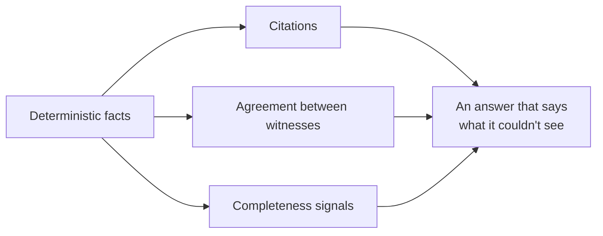

# Trust

What "accurate" means, and how it's achieved and measured. A confidently wrong answer is the worst outcome.

> **In one minute**
> - **Deterministic first:** rules produce facts, and nothing is guessed silently.
> - **Every claim is cited.**
> - **Gaps are never silent:** they show in answers and in the coverage report.
> - **Independent witnesses are compared.**
> - **It's measured:** a question set, a comparison without Steno, and idempotency checks.



## 1. Who does what

| Work | Done by | When |
|---|---|---|
| Extracting facts | Rules | Ingestion |
| Routing a question | Search proposes; Jev or a stand-in judges (D142, D150) | Query |
| Other decisions rules can't make | Stand-ins now, Jev in `v2` | Ingestion |
| Writing summaries | The organization's LLM (D143, D149) | Ingestion |
| Drafting rules | The `rule-pack-author` skill, then proof, then a person's approval (D147) | A developer's machine |
| Reasoning and the final answer | The client's LLM | Query |

Steno runs no LLM at query time. Every decision can be switched off.

## 2. Citations and confidence

Every result cites its claims to a repository, file, lines, and commit (D29). See [Citations](../how-it-works/retrieval-and-mcp.md#citations-decided-built).

**Confidence (Open):** every fact is 1.0 except inferred flows (0.5, D74). A low-confidence fact must never look certain.

## 3. Agreement between witnesses

| CODE | Other witness | State | Likely causes |
|---|---|---|---|
| ✓ | ✓ | **Confirmed** | Highest confidence |
| ✓ | ✗ | **Code only** | Missing or stale declaration |
| ✗ | ✓ | **Declared only** | A missed rule, a stale grant, or a name mismatch |

A disagreement means **look here**. A source generated from code confirms nothing.

## 4. Every signal that something is incomplete

| Signal | Meaning |
|---|---|
| **Unresolved calls** | A flow stopped at a call nothing could follow (D71) |
| **Unjoined sends** | A call or publish with no known receiver |
| **Orphan receivers** | An endpoint or consumer nothing sends to |
| **Disagreements** | Code-only or declared-only facts |
| **Unmatched names** | A name that matches no application |
| **Unknown triggers** | Work nothing in the code starts (D74) |
| **Stale witnesses** | A source that failed or is old |

**The join rate** is the share of sends that reach a known receiver. It's the main number for how connected a graph is.

**The ledger (D101).** Every I/O-capable library call and framework hook is explained by a rule, declared harmless by a pack, or shown as a gap.

## 5. What an agent sees

Answers carry a **completeness block** (D118) that says what was checked and what wasn't, and never claims to be complete.

```
find_dependents(payment.settled, downstream)
  Reconciliation · Finance   confirmed      code + XLD
  Ledger · Finance           declared only  XLD grant; no consumer in code
  Audit Trail · Risk         code only      not in XLD
  Not checked: Fraud Screening's config. Unexplained in Ledger: 2 framework hooks.
```

**Can Steno still be wrongly confident?** Yes, when no signal detects a miss. Answers saying what was checked, coverage, and the question set are what limit it.

## 6. How accuracy is measured

| Measure | What it checks | Status |
|---|---|---|
| **Question set** | 10–15 questions per target, answers written first | Stage A |
| **Comparison without Steno** | The same questions with repositories checked out | Stage A onward |
| **Gold set** | Hand-labeled facts for one application | `POC` |
| **Known graph** | The stub organization's correct graph | Stage B |
| **Idempotency** | The same commit writes nothing | Built |
| **Join rate, agreement** | How connected, how often witnesses agree | Stages B–D |
| **Calibration** | Predicted confidence against accuracy | `v2` |

## 7. What static analysis can't see

Reflection, routing chosen by runtime data, and a host in a database row can be marked unknown but not filled in. PLATFORM witnesses close part of that; runtime evidence (`v2`) closes most of the rest.
