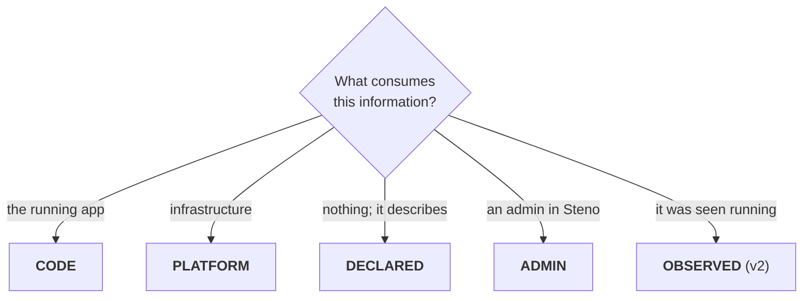

# Witnesses and facets

How Steno learns an organization without being rebuilt for each one. Decided (D76–D80, D112); the mechanics are in [claims and reconcile](../how-it-works/ingestion/claims-and-reconcile.md).

> **In one minute**
> - A **facet** is a fixed question Steno answers about every organization.
> - A **witness** is one concrete source at one organization (the XLD repository, `component_manifest.yaml`).
> - Its **witness type** is decided by **what consumes the information**.
> - Independent witnesses are **compared**. Disagreement points at a missed rule, a stale declaration, or a name mismatch.

## 1. Three separate questions

| Question | Answered by | Example |
|---|---|---|
| Where is it stored? | A **connector** | The git host |
| How is it read? | A **rule or adapter** | An ast-grep rule, a YAML path rule |
| What kind of claim is it? | The **witness type** | "The platform has this set up" |

## 2. Witness types

| Type | Sources | Strong at | Weak at |
|---|---|---|---|
| **CODE** | Source, its own config, its build | What actually happens, to the line | Names, intent, external config |
| **PLATFORM** | Deploy definitions, ACLs, gateways, schedulers | What's actually set up | One adapter per tool; names differ |
| **DECLARED** | Manifests, catalogs, CODEOWNERS, hand-written specs | Names, boundaries, intent | Goes stale |
| **ADMIN** | Entries in Steno | Authority | Doesn't scale |
| **OBSERVED** (`v2`) | Traces, logs | Which calls really happen | Only what ran |

Each pack states its witness type. A spec generated from code is not independent. Anything stored in a repository comes through the git connector.

## 3. Facets

| Facet | Answers | Kind | When |
|---|---|---|---|
| **Behavior** | What happens when something is triggered | Evidence | `POC` |
| **Structure** | Which spaces exist; where repositories belong | Authority | `POC` |
| **Components** | Which deployables exist; their names | Both | `POC` |
| **Artifacts** | Who builds and depends on which library (D108) | Evidence | `POC` (link); `v1` (shared models) |
| **Interfaces** | Endpoints, methods, payloads | Evidence | `POC` |
| **Messaging** | Topics, who may produce and consume | Evidence | `POC` |
| **Routing** | How a request reaches a service (D132) | Evidence | `POC` |
| **Data** | Stores, tables, access | Evidence | `POC` |
| **Schedules** | What runs on a timer | Evidence | `POC` |
| Ownership, Environments, flags and access policy | Later | | `v2` |

**The rule:** every graph type is fed by a facet, and a facet exists only if the graph models what it feeds. Frameworks and constraints aren't facets.

## 4. Which type answers which facet

| Facet | CODE | PLATFORM | DECLARED | ADMIN |
|---|---|---|---|---|
| Behavior | **Primary** | | | |
| Structure | | | Fills in | **Primary** |
| Components | **Primary** (existence) | **Primary** (name) | Names | Overrides |
| Artifacts | **Primary** | Second | | Fills in |
| Interfaces | **Primary** | Second | Second | |
| Messaging | **Primary** | Second | | |
| Routing | Fills in | **Primary** | | Fills in |
| Data | **Primary** | Fills in | | |
| Schedules | **Primary** (in code) | **Primary** (external) | | |

## 5. Combining claims

| Kind | Question | How claims combine |
|---|---|---|
| **Evidence** | Does this happen? | Compared: `confirmed`, `code only`, `declared only` |
| **Authority** | Who decides? | A precedence ladder; losers are kept as aliases |

**Default ladders:**

- **Canonical name:** ADMIN → PLATFORM deploy name → DECLARED manifest ID → CODE build artifact → CODE runtime name → path (provisional).
- **Display name and placement:** ADMIN → DECLARED → PLATFORM → CODE → path.

**Admin overrides** win in authority facets. In evidence facets they're stored with who, when, and why, and still compared with the code.

## 6. Witnesses and setup

Onboarding fills in a **setup sheet**: which witnesses each facet uses, in what order. See [Onboarding](../plan/onboarding.md). Catalogs such as Backstage are DECLARED witnesses, and Steno never competes with them (D96).

## 7. When each facet arrives

| Facet | Stage |
|---|---|
| Identity, witness types | A |
| Artifacts link, Schedules, Data ownership, Messaging agreement | B |
| Routing, Components names | C |
| `component_manifest.yaml`, XLD repository, flows into libraries | D |
| API-reached systems, catalogs | `v1` |
| OBSERVED, Ownership, Environments, schemas | `v2` |
