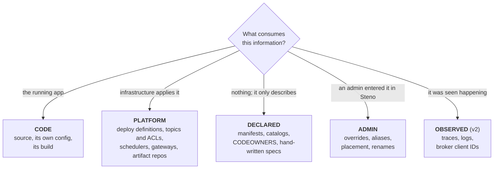
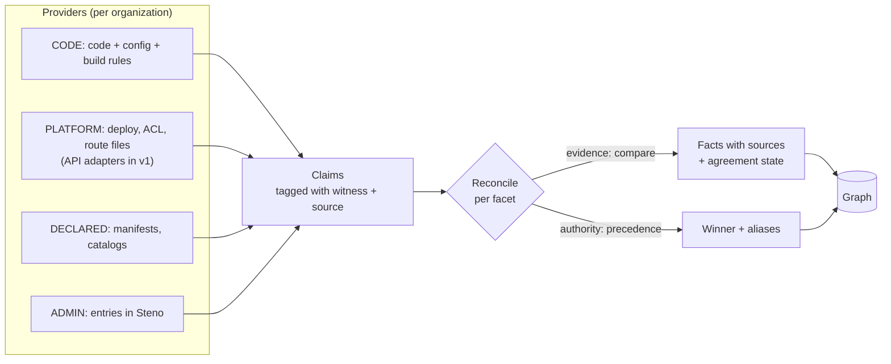

# Witnesses and facets

How Steno learns an organization without being rebuilt for each one: a fixed set of questions (**facets**), several kinds of evidence (**witnesses**), and per-organization sources (**providers**).

> **In one minute**
> - **Code is one witness.** Much of an architecture is recorded elsewhere: deploy tools, Kafka permission files, artifact repositories, schedulers, manifests.
> - A **witness type** is the kind of claim, decided by **what consumes the information**: the running app (CODE), the infrastructure (PLATFORM), nobody, it only describes (DECLARED), an admin in Steno (ADMIN), or seen at runtime (OBSERVED, `v2`).
> - A **facet** is a fixed question Steno answers about every organization: Behavior, Structure, Components, Artifacts, Interfaces, Messaging, Routing, Data, Schedules.
> - A **provider** is one concrete source for a facet at one organization (the XLD repo, `component_manifest.yaml`). Facets never change; providers do, and most are shared.
> - When two independent witnesses answer the same question, Steno **compares** them. Agreement raises confidence; disagreement points at a missed rule, a stale declaration, or a name mismatch.
>
> Status: the model is **Decided**. How claims are stored and combined (reconcile) is **Open**: its technical design comes before POC stage B. See [identify and reconcile](../how-it-works/ingestion/identify-and-reconcile.md).

---

## 1. Three separate questions about any piece of information

| Question | Answered by | Example |
|---|---|---|
| **Where is it stored?** | A **connector** | The git host; XLD's server API; the artifact repository |
| **How is it read?** | A **rule or adapter** | An ast-grep code rule; a YAML path rule; an API adapter |
| **What kind of claim is it?** | The **witness type** | "The software does this"; "the platform has this set up"; "someone says this" |

These are independent. The same repository can hold all three witness types, and one system read two ways is still one witness. (Decided)

## 2. The five witness types (Decided)

**The test: what consumes the information?**

| Witness | Strong at | Weak at |
|---|---|---|
| **CODE** | What actually happens: flows, calls, effects. Precise to the line. Always matches main. | Names people use, intent, timing set elsewhere, anything configured outside the code, reflection |
| **PLATFORM** | What's actually set up: topics and permissions, schedules, published artifacts, routes. Disagreeing with CODE often means a real production problem. | One adapter per tool; names differ from code |
| **DECLARED** | Names, aliases, boundaries, intent | Goes stale; coarse; sometimes generated from code |
| **ADMIN** | Authority: names, placement, overrides, things nobody recorded | Doesn't scale; goes stale |
| **OBSERVED** (`v2`) | Ground truth about which calls really happen | Only what ran; needs instrumentation |

The types **fail differently**, which is why comparing them is worth something: CODE vs. PLATFORM disagreeing is often a real bug (code consumes a topic with no ACL granting it) or a missing rule; CODE vs. DECLARED disagreeing is usually stale documentation.

### Classifying real files

| Source | Witness | Read by | Stored in |
|---|---|---|---|
| Java and Python source | CODE | Code rules + symbol resolver | Git |
| The app's own `application.yml` | CODE (the app reads it) | Config rules | Git |
| `build.gradle`, `dependencies.gradle`, `libs.versions.toml`, `pom.xml` | CODE (the build runs it) | Code or file rules | Git |
| Flyway / Liquibase migrations | CODE | File rules | Git |
| Helm values, Kubernetes manifests, CronJobs, Ingress | PLATFORM | File rules | Git (config repos) |
| Gateway routes (Spring Cloud Gateway, Kong) | PLATFORM | File rules | Git |
| XLD topic and ACL definitions (repo) | PLATFORM | File rules | Git (the XLD repo) |
| XLD server, Kafka admin API, artifact repository, scheduler API | PLATFORM | API adapter (`v1`) | The system |
| `component_manifest.yaml`, Backstage `catalog-info.yaml` | DECLARED | File rules | Git |
| Hand-written OpenAPI spec | DECLARED | File rules | Git |
| OpenAPI spec **generated from the code** | Not independent: marked generated | File rules | Git |
| CODEOWNERS | DECLARED | File rules | Git |
| An alias or rename an admin enters | ADMIN | — | Steno (Postgres) |

A file that looks like a build file but that the build never loads is DECLARED. **Each provider states its witness type explicitly** in its pack; Steno doesn't guess. Edge cases exist (Helm values set environment variables the app reads; Steno calls them PLATFORM), and the pack author decides.

**Anything stored in a repository needs no new connector.** The git connector reads it. New connectors are only for systems reached through an API (`v1`).

### One system, two copies: the XLD case

The XLD repository (desired state, at a commit) and the XLD server (what was applied) are **the same witness: PLATFORM**. They never count as two votes. If both are connected, they merge into one claim; a difference between them is **drift** (a failed or hand-edited deploy), reported on its own, not as evidence for or against the code. The POC reads the XLD repository through git: no new credentials, every claim cites a file and line. (Decided)

## 3. Facets

A **facet** is one fixed question with a fixed answer shape, defined once by Steno. (Decided)

| Facet | Answers | Feeds in the graph | Kind | When |
|---|---|---|---|---|
| **Behavior** | What happens when something is triggered, step by step | `Flow`, `Step`, traces, `LEADS_TO` | Evidence (code only) | `POC` |
| **Structure** | Which spaces exist; where each repository belongs | `Space`, `BELONGS_TO` | Authority | `POC` (admin) |
| **Components** | Which deployables exist; their kind, canonical name, aliases | `Application` + kind labels, `ExternalSystem` | Authority for names; evidence for existence | `POC` |
| **Artifacts** | Which repository builds which library or image; who depends on it, and how: builds against it, or uses its shared models (D108) | `DEPENDS_ON` across repositories; image → repository | Evidence | `POC` (A1 link); A2 and shared models `v1` |
| **Interfaces** | Endpoints, RPC methods, payloads | `HttpEndpoint`, `GrpcMethod`, `USES_ENTITY` | Evidence | `POC` |
| **Messaging** | Topics, clusters, who may produce and consume | `KafkaTopic`, `PRODUCES`, `CONSUMES` | Evidence | `POC` |
| **Routing** | How a request reaches a service: gateway routes, hosts, env values | Completes `CALLS` joins; marks public endpoints | Evidence | `POC` |
| **Data** | Data stores, tables, owners, access | `DataStore`, `Table`, `READS_FROM`, `WRITES_TO` | Evidence | `POC` (V2 schemas later) |
| **Schedules** | What runs on a timer, when, and what it runs | `Schedule`, `STARTS` | Evidence | `POC` |
| Ownership | Which team owns each component | `Team` | Authority | `v2` |
| Environments | What's deployed where, on which servers, with what resources; flows per environment (D107) | `Environment` | Evidence | `v2` |
| Feature flags, access policy | Which paths are on (D107); who may call what (code-level access is built, D103) | Flags on steps; auth on interfaces | Evidence | `v2` |

**Is the list complete?** It can't be proven, but one rule keeps it honest: every node and edge type in the graph must be fed by at least one facet, and a facet is added only when the graph models what it would feed. A facet that feeds nothing would be a CMDB in disguise.

**Frameworks aren't a facet.** An organization's in-house frameworks don't describe the architecture; they're how the CODE witness learns to read the organization. An internal messaging library is taught with a sender rule, a receiver rule, and its shared key (D61), in an org rule pack.

**Constraints and standards aren't facets.** Facets describe what *is*; constraints describe what *should be*. They live in other systems, which attach them to Steno's scopes by ID ([Where Steno fits](../purpose/where-steno-fits.md)).

## 4. Which witness answers which facet

| Facet | CODE | PLATFORM | DECLARED | ADMIN | OBSERVED (`v2`) |
|---|---|---|---|---|---|
| **Behavior** | **Primary** | — | — | — | Second |
| **Structure** | — | — | Fills in: git host projects, catalog domains | **Primary** | — |
| **Components** | **Primary**: existence, kind, build artifact name, `spring.application.name` | **Primary** for the canonical name: deploy unit name (XLD, Helm release, Deployment) | Names, aliases, boundaries (manifest) | Overrides | Second: service names |
| **Artifacts** | **Primary**: build files on both sides | Second: artifact repository, registry, CI | — | Fills in | Second: deployed image |
| **Interfaces** | **Primary** | Second: schema registry, gateway catalog | Second: hand-written specs | — | Second |
| **Messaging** | **Primary** | Second: XLD, broker ACLs, Strimzi, Terraform | — | — | Second: client IDs |
| **Routing** | Fills in: URL templates | **Primary**: Ingress, gateway routes, Helm values, service registry | — | Fills in: "host X is app Y" | Second |
| **Data** | **Primary**: who reads and writes; migrations: who owns | Fills in: database catalog (V2), Terraform | — | — | Second |
| **Schedules** | **Primary** for in-code schedules | **Primary** for external ones: CronJob, scheduler definitions | — | — | Second: run history |

**Primary**: the main source. **Second**: independent evidence compared with the primary. **Fills in**: supplies what the primary can't see.

## 5. Combining claims

Every provider produces **claims** in its facet's shape, tagged with its witness type and source. Claims are combined per facet, in one of two ways (Decided):

| Kind | Question | How claims combine |
|---|---|---|
| **Evidence** | Does this actually happen? | Witnesses are **compared**. Each fact gets an agreement state: `confirmed`, `code only`, or `declared only`. See [Trust](./trust.md#3-agreement-between-witnesses). |
| **Authority** | Who decides? (names, placement, ownership) | A **precedence order**. The winner is used; the others are kept as aliases or for reference. Each facet has a default ladder that an organization can reorder. |

**Default ladders:**

- **Canonical name** (Components): ADMIN → PLATFORM deploy name → DECLARED manifest ID → CODE build artifact name → CODE runtime self-name → path-derived (provisional). See [Identity](./identity.md#2-finding-the-canonical-name-the-name-ladder).
- **Display name and placement:** ADMIN → DECLARED → PLATFORM → CODE → path-derived.

**Admin overrides (Decided).** In authority facets an admin's choice wins. In evidence facets an admin can assert or suppress a fact ("this host is the Billing app", "ignore this false edge"), but the override is stored with who, when, and why, cited as ADMIN in answers, and **still compared with the code**: overrides go stale too, and an asserted edge the code no longer has is flagged.

## 6. Providers and setup

A provider is a small adapter in a pack, with tests, like a rule. Onboarding an organization means filling in a **setup sheet**: for each facet, which providers it uses and in what precedence. See [Onboarding](../plan/onboarding.md).

| Facet | Providers at our organization (illustrative, to verify against real files) |
|---|---|
| Behavior | Spring and Kafka packs; org packs for in-house frameworks |
| Structure | Admin entry now; Bitbucket project convention later |
| Components | `component_manifest.yaml` (DECLARED) + service-module detection and Gradle names (CODE) + XLD deploy names (PLATFORM) |
| Artifacts | Gradle coordinates (CODE); artifact repository later (PLATFORM) |
| Interfaces | Spring rules; OpenAPI files where they exist |
| Messaging | Kafka rules (CODE) + the XLD repository (PLATFORM) |
| Routing | Config repositories and gateway config (PLATFORM) |
| Data | JPA rules; migrations |
| Schedules | `@Scheduled` (CODE) + the organization's scheduler (PLATFORM) |

**Catalogs as providers.** Where an organization already uses a catalog (Backstage, Cortex), it's a DECLARED provider for Components, Structure, and later Ownership. Steno reads it and never competes with it (`v1`). See [decision D96](../plan/decisions.md).

## 7. When each facet arrives

Each facet comes in at the POC stage whose target needs it and where the result can be checked against a known answer. Summary (details in the [roadmap](../plan/roadmap.md)):

| Facet | First at |
|---|---|
| Identity foundations, witness types on facts | Stage A |
| Artifacts A1 (dependency link by coordinate), Schedules (CronJob), Data ownership, Messaging agreement (an ACL file) | Stage B (stub organization) |
| Routing (Spring Cloud Gateway, Eureka `lb://` names), Components names | Stage C (petclinic-microservices) |
| `component_manifest.yaml`, the XLD repository, Artifacts A2 (flows into library code) | Stage D (our organization) |
| API-reached systems, catalogs as providers | `v1` |
| OBSERVED, Ownership, Environments, Data V2 | `v2` |
