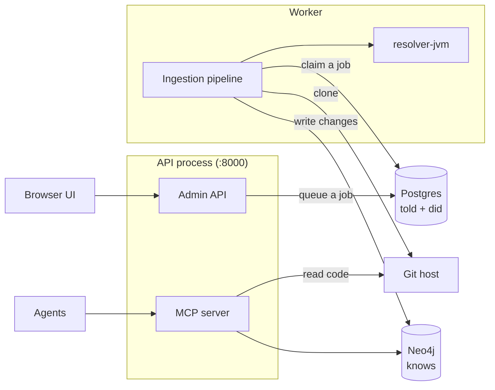

# How it works

The implementation. Read [Concepts](../concepts/README.md) first.

> **In one minute**
> - **Two processes, two databases.** An API process and a worker never call each other. They meet in Postgres (jobs) and Neo4j (the graph).
> - **Ingestion** clones a repository and runs stages. Only the write stage changes the graph.
> - **Retrieval** is read-only: Neo4j plus code from the git host at the ingested commit.

## 1. The map



| Component | Job | Code |
|---|---|---|
| **UI** | Onboarding, jobs, coverage, Settings, Visualize | `frontend/src/pages/` |
| **Admin API** | Configuration, jobs, coverage triage | `backend/src/steno/api/` |
| **MCP server** | Agent tools, every call logged | `backend/src/steno/mcp/` |
| **Worker** | Claims jobs, runs stages | `ingestion/` |
| **Rule engine, resolvers, assemblers** | Code into facts | `extraction/`, `resolvers/`, `assemblers/` |
| **Graph builder and writer** | Facts and call graph into nodes and edges | `graph/` |
| **resolver-jvm** | Resolves a repository's Java (D69) | `resolver-jvm/` |
| **Identity, claims, reconcile** | IDs and names; comparing witnesses | `identity/`, `claims/`, `reconcile/` |
| **Routing and decisions** | Stand-in or Jev behind one interface (D142, D150) | `routing/`, `decisions/` |
| **LLM** | The organization's choice, through LiteLLM (D149) | `llm/`, `summaries/` |

## 2. Pages

| Page | Covers |
|---|---|
| [Ingestion](./ingestion/README.md) | The pipeline and its sub-pages |
| [Graph reference](./graph-reference.md) | Every node, property, and relationship |
| [Retrieval and MCP](./retrieval-and-mcp.md) | Tools, routing, search, citations, cost |
| [Storage](./storage.md) | Postgres and Neo4j |
| [Security](./security.md) | Code, secrets, data leaving the organization |

## 3. Technology choices

| Area | Choice | Status |
|---|---|---|
| Graph | Neo4j | Decided; **Open**: edition |
| State and queue | Postgres (`SKIP LOCKED`, no broker, D35) | Decided |
| Code rules | ast-grep YAML | Decided |
| Symbol resolution | Steno's own per language. Java: JavaParser in a JVM helper. Python: `ast`. No SCIP (D51, D69, D70). | Decided |
| Code at query time | Git host API at the ingested commit; no stored contents (D17, D90) | Decided |
| Decisions | Stand-in by default; Jev optional at query time (D142, D150) | Built |
| Summaries | The organization's LLM through LiteLLM (D52, D149) | Built; **Open**: which model |
| Rule drafting | The `rule-pack-author` skill (D147) | Decided |
| Embeddings | Local model, optional, stored in Neo4j (D23, D150) | Built; **Open**: model |
| Agent interface | MCP over Streamable HTTP | Decided |
| Languages | Python, TypeScript, a small JVM helper | Decided |
| UI | React + Vite; React Flow + ELK (D53) | Decided |

## 4. Where data lives

| Place | Holds | Lives |
|---|---|---|
| **Postgres** | Configuration, jobs, identity, claims, coverage, history, logs | Permanent: back it up |
| **Neo4j** | The graph | Rebuildable |
| **Memory** | Symbol tables, facts, call graph, plan | One job |
| **Disk** | The clone, the resolver's index, `job-N-facts.json` | Clone and index: one job |

The UI and `get_node` read views computed by `GraphViews` (`graph/views.py`).

## 5. When the graph looks wrong

Walk down and stop at the first place it's wrong:

| # | Source | Where to look |
|---|---|---|
| 1 | Code | The node's source link |
| 2 | Facts | `job-N-facts.json` |
| 3 | Stage counts | `ingestion_stage.metrics` |
| 4 | Graph | Neo4j Browser (:7474) |
| 5 | View JSON | `/api/graph/*` |
| 6 | Layout | `frontend/src/components/graph/` |

The facts file is the most useful artifact: every fact with its rule and line, and every dropped match with its reason. Produce it without a database:

```bash
cd backend && uv run steno extract <folder> --json out.json
```

## 6. Commands

From the repository root: `make up`, `make migrate`, `make graph-init`, `make dev`, `make start`, `make api`, `make worker`, `make web`, `make dry-run REPO=<name>`, `make test`, `make lint`, `make resolver`, `make graph-stats`, and `make reset-graph` (**destructive**: deletes the graph after you type its name). Rules: `cd backend && uv run steno rules test [pack]`.
