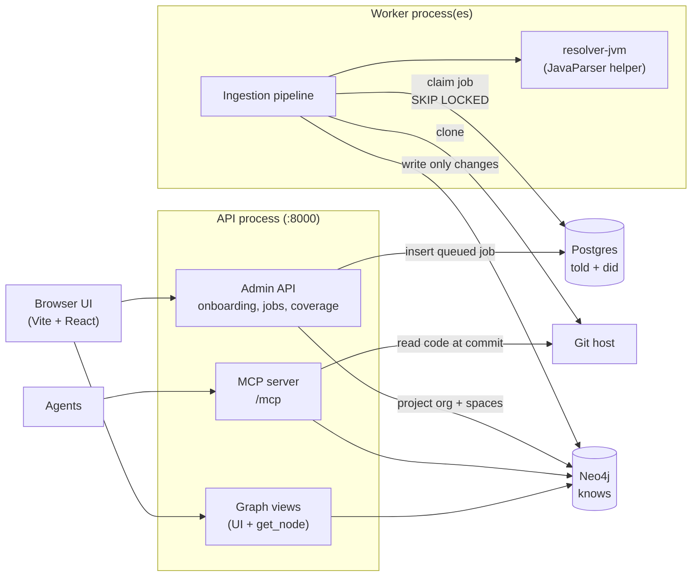

# How it works

The implementation: the processes and databases, the ingestion pipeline stage by stage, rules and resolvers, the graph schema, the MCP tools, and storage. Read [Concepts](../concepts/README.md) first for the ideas these implement.

> **In one minute**
> - Steno is **two processes and two databases**: an API process (Admin API, UI backend, MCP server) and a worker process (ingestion). They never call each other; they meet in **Postgres** (job rows, the work queue) and **Neo4j** (the graph).
> - **Ingestion** clones a repository and runs stages: parse the code once, run rule packs (ast-grep) to extract facts and clues, assemble clues into complete facts, build flows from an in-memory call graph, write only what changed, report coverage.
> - **Retrieval** is read-only: MCP tools query Neo4j and read code from the git host at the ingested commit. No file contents are stored.
> - Neo4j can always be **rebuilt** from Postgres plus git.

---

## 1. The map



**Write path (ingestion, background, heavy):** a nightly schedule or a person queues a job → a worker claims it → clone → analyze → write the graph → record the job in Postgres. **Read path (queries, interactive, fast):** agents call MCP tools → Neo4j queries and git host reads → cited results.

| Component | Responsibility | Status | Code |
|---|---|---|---|
| **Browser UI** | Onboarding (organization → spaces → connectors → repositories), the Jobs list, the Coverage page, the Visualize tab | Built | `frontend/src/pages/` |
| **Admin API** | Connectors, repositories, spaces, jobs, coverage triage. `POST /api/jobs` only inserts a queued row. | Built | `backend/src/steno/api/` |
| **MCP server** | Agent tools; stateless; every call logged | Built: `search`, `get_node`, `get_flow`, `view_flow_code`, `find_dependents` | `backend/src/steno/mcp/` |
| **Graph views** | Neo4j turned into one layer at a time for the UI; MCP's `search` uses the same search view, while the other MCP tools query the graph directly (sharing views is D53's intent) | Built | `graph/views.py`, `mcp/tools.py` |
| **Worker** | Claims the oldest queued job, runs the stages, marks it succeeded or failed. More processes, more parallel jobs. | Built | `ingestion/worker.py`, `queue.py`, `pipeline.py` |
| **Rule engine + symbol resolvers** | Runs rule packs over the clone; Python and Java resolvers answer what names and types mean | Built | `extraction/`, `resolvers/`, `assemblers/` |
| **Graph builder + writer** | Stable IDs, structure, call graph, flows, traces, steps; writes only differences | Built | `graph/build.py`, `graph/writer.py`, `graph/ids.py` |
| **resolver-jvm** | Resolves a repository's Java in one pass from source and the JDK, Lombok included (D69, D72) | Built | `resolver-jvm/` |
| **Identity registry, claims, reconcile** | Steno IDs and names; what other witnesses say, compared with the code. See [identify and reconcile](./ingestion/identify-and-reconcile.md) | Built | `identity/`, `claims/`, `reconcile/` |
| **Rule curation** | A job that drafts rules for what coverage couldn't explain, proves them, and queues them for approval; commits approved rules (D120) | Not built | — |
| **Decision model and LLM** | Stand-ins, then Jev (`v2`); LiteLLM for text and for rule drafting (D52); the Claude Agent SDK as the default rule drafter (D124) | Not built: everything is deterministic today | `decisions/`, `llm/` |

## 2. Pages

| Page | What it covers |
|---|---|
| [Ingestion](./ingestion/README.md) | The pipeline: principles, how a job runs, the stages, nightly updates, idempotency. Sub-pages for each part. |
| ↳ [Connectors and sources](./ingestion/connectors.md) | Access, selection, placement; cloning; what config produces; connectors to other systems |
| ↳ [Stages, step by step](./ingestion/stages.md) | Each stage taken apart, with real output: parse, extract, assemble, flows, write, coverage |
| ↳ [Rules and rule packs](./ingestion/rules-and-packs.md) | The rule format (ast-grep `match` + Steno `emit`), clues, config rules, packs, tests, the pack catalog |
| ↳ [Rule curation](./ingestion/rule-curation.md) | How Steno drafts rules for what no rule explains, proves them, and has a person approve them |
| ↳ [Large repositories](./ingestion/large-repositories.md) | How a very large repository is ingested within memory, and how work fits the machine |
| ↳ [Symbol resolvers](./ingestion/resolvers.md) | How Python and Java resolution work, the questions they answer, DI, config values, hosts |
| ↳ [Joins across applications](./ingestion/joins.md) | Senders, receivers, shared keys, stubs, HTTP targets; artifacts and routing joins |
| ↳ [Identify and reconcile](./ingestion/identify-and-reconcile.md) | The identity registry and the identify step; claims, the claim store, and reconcile |
| ↳ [Coverage report](./ingestion/coverage-report.md) | What no rule explained, triage, the agreement view, and patterns across the organization |
| [Graph reference](./graph-reference.md) | Every node, property, and relationship; traces; flows; data stores; example queries |
| [Retrieval and MCP](./retrieval-and-mcp.md) | The MCP tools and how they work together, breadth vs. depth, search, cards, citations, code access, latency, LLM use and cost |
| [Storage](./storage.md) | Postgres and Neo4j: what each holds, how they meet, every table, rebuilding |
| [Security and privacy](./security.md) | Source code, secrets, data leaving the organization, access control |

## 3. Technology choices

| Area | Choice | Why | Status |
|---|---|---|---|
| Knowledge graph | **Neo4j** | An architecture *is* a graph; variable-length paths (a flow chain across ten services); built-in vector and full-text indexes | Decided; **Open**: edition and licensing |
| Application state | **Postgres** | Connectors, jobs, change history, logs; also the work queue (`SKIP LOCKED`, no broker, D35) | Decided |
| Code-pattern rules | **ast-grep** YAML rules (tree-sitter) | Declarative, many languages, organizations can write their own | Decided |
| Config rules | YAML / properties key-path rules | Topics, URLs, and placeholders live in config | Decided |
| Symbol resolution | **Steno's own, per language, behind one interface** (D70). Java: JavaParser in a JVM helper, source and JDK first, JARs later (D69). Python: Python's `ast` (D51). | Resolves calls without running builds | Decided (SCIP not planned) |
| DI resolution | Per-framework rules (Spring first), then a decision for what's left | The compiler can't know which bean is injected | Decided |
| Source access | **git clone** into a temporary workspace | Full source for resolution; one request instead of thousands | Decided |
| Code access at query time | Git host API at the ingested commit, in-memory cache. **No stored file contents.** | Code always matches the graph | Decided |
| Code search at query time | **The git host's search API** when the graph has no lead | No stored index, consistent with no stored contents (D90) | Decided |
| Decisions | Stand-ins in the POC; **Jev** later | Typed, calibrated, fast decisions | Jev: `v2` |
| Text (cards) | LLM via **LiteLLM**; small model by default, Batch API, prompt caching; model chosen after the dry run | Flow purposes decide whether flows can be found | Proposed; **Open**: model |
| Rule drafting | **Claude Agent SDK** by default, or a fixed sequence of calls through LiteLLM (`STENO_RULE_DRAFTER`); proof and approval outside both | Agents work out unfamiliar frameworks; rules then run deterministically | Decided (D124) |
| Embeddings | Stored in Neo4j's vector index | One store for vectors and traversal | Decided; **Open**: model |
| Agent interface | **MCP** over Streamable HTTP | Claude Code, Copilot, custom agents | Decided |
| Implementation language | **Python** (backend), TypeScript (UI), a small JVM helper | MCP SDK, Neo4j driver, ast-grep bindings, LiteLLM | Decided |
| UI | React + Vite; React Flow + ELK for structured views (D53) | | Decided |
| Schema replay (Data V2) | Testcontainers: replay migrations into a temporary database, read its catalog | | Proposed (`v2`) |

## 4. Where data lives

Knowing which place holds a thing is most of debugging.

| Place | Holds | Lives | Written by |
|---|---|---|---|
| **Postgres** | The organization, spaces, connectors, repositories; every job and stage with timings and counts; coverage items; change history; logs | Permanent: back this up | API (configuration, new jobs), worker (claims, stages, results) |
| **Neo4j** | The graph: organization, spaces, repositories, modules, files, applications, interfaces, flows (with traces), steps, entities, tables, data stores, external systems | Until a later run changes or removes a fact | Worker (write stage); API (organization and space projection) |
| **Memory** | The symbol tables, every extracted fact, the call graph (never stored), the graph plan | One job | Worker |
| **Disk** | The clone (`/tmp/steno-workspaces/job-N/`) and the facts file (`job-N-facts.json`) | Clone: one job. Facts file: until deleted | Worker |

No facts go to Postgres: the graph lives only in Neo4j and can always be produced again from git. Details: [Storage](./storage.md).

### Reading the graph back

The UI and `get_node` never show Neo4j directly. Every screen is a view computed by `GraphViews` (`graph/views.py`):

| Endpoint | Shows | How it's computed |
|---|---|---|
| `/graph/overview`, `/graph/space` | One level of the containment tree and the links between its children | Loads the containment tree and every effect edge, then rolls each deep node up to the child of this level that contains it |
| `/graph/application` | An application's interfaces, flows, tables, outbound targets (or, with `layer=code`, its modules and files) | Queries around one Application; groups endpoints by resource |
| `/graph/flow` | A flow as steps in the order they run, with what each reads and writes | Reads the flow's stored trace; shows its Steps by default, every function on request |
| `/graph/node` | One node's properties, provenance, and a link to the source line at the ingested commit | One node plus its edges (a trace entry is read from its flow) |
| `/graph/search` | Name matches, and flows whose trace contains a matching function | The full-text index, plus `trace_symbols` on flows |

## 5. When the graph looks wrong

Something odd on screen or in an answer came from one of six places. Walk down the list and stop at the first one where it's already wrong:

| # | Source | Question | Where to look |
|---|---|---|---|
| 1 | **Code** | Is it really in the code at that commit? | The node's source link |
| 2 | **Facts** | Did a rule match, or get dropped, and why? | `job-N-facts.json` |
| 3 | **Stage counts** | Did the numbers jump between parse, extract, assemble, flows, write? | `ingestion_stage.metrics` |
| 4 | **Graph** | Is the node or edge in Neo4j, with the right ID? | Neo4j Browser (:7474) |
| 5 | **View JSON** | Did the view roll it up, hide it, or merge it? | `/api/graph/*` |
| 6 | **Layout** | Is it in the JSON but drawn badly? | `frontend/src/components/graph/` |

Steps 1–4 are ingestion problems; 5–6 are visualization problems. The facts file is the most useful single artifact: every node, edge, clue, and entry point with the rule and line that produced it, plus every dropped match and why. Produce it without a database:

```bash
cd backend
uv run steno extract ~/projects/contextualized --json out.json   # parse, extract, assemble only
```

## 6. Commands

Run from the repository root (see `Makefile`): `make up`, `make migrate`, `make graph-init`, `make dev`, `make api`, `make worker`, `make web`, `make dry-run REPO=<name>`, `make test` (includes every rule pack's test cases), `make lint`, `make resolver` (build the JVM helper). Rules: `cd backend && uv run steno rules test [pack]`.
