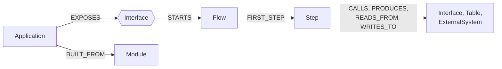

# Graph reference

Every label, property, and relationship. The source of truth for what rules may emit (the `rule-pack-author` skill reads §3–4). The ideas: [Concepts: the graph](../concepts/graph.md).

> **In one minute**
> - Every node has **labels** (what it is), **one `BELONGS_TO`** (where it lives), and **interaction edges** (what it does).
> - Flows store a **trace** instead of Function nodes; significant functions are `Step` nodes.
> - Applications are keyed by a permanent **Steno ID**.
> - Marked **not built:** contracts and interceptor nodes.



## 1. Modeling principles (Decided)

- **Facts live at the lowest level;** higher layers are rollups.
- **Interfaces are nodes.**
- **Exactly one owner in the tree.**
- **Labels for abstraction,** no `IS_A` edges (D16). The category is a label; the vendor is a property.
- **Every fact records its origin:** repository, file, line, commit, the rule that produced it, and confidence.

## 2. Architecture and code nodes

**Test:** would a refactor that keeps behavior change it? Yes → code. No → architecture.

| | Architecture | Code |
|---|---|---|
| **Kinds** | Organization, Space, Application, Interface, Flow, Step, Entity, DataStore, Table, ExternalSystem, … | Repository, Module, File |
| **Queried** | Search covers the `:Searchable` ones | After narrowing |
| **History** | Every change logged | Trace changes per flow |

**`:Searchable`:** Flow, Application, Space, Organization, Interface, Entity, Table, DataStore, ExternalSystem, Interceptor, Route (D104, D116, D132), plus function names in traces. Steps and schedules aren't searched, but `get_node` opens any node.

**Functions are not nodes (D60).** An Application is the deployable unit; a Module is the build unit.

## 3. Node types

| Node (labels) | Owner | Key properties | Notes |
|---|---|---|---|
| `Organization` | none | `name`, `summary`, `summary_line` | Root |
| `Space` | Organization or Space | `name`, `summary`, `summary_line` | Can nest |
| `Repository` | Space | `url`, `default_branch`, `last_ingested_sha` | |
| `Application` + `:Service`, `:Consumer`, `:Gateway`, `:Job`; `:Frontend` in `v2` | Space | `name` (canonical), `steno_id`, `display_name`, `aliases`, `alias_text`, `provisional_name`, `conflict_with`, `kinds`, `summary`, `summary_line`; a stub has `stub`, `declared_only`, `note` | D81–D85 |
| `Module` + role | Repository | `path`, `build_tool` | The build unit |
| `File` | Module | `path`, `language`, `content_hash` | |
| `Interface` + `HttpEndpoint` | Application | `method`, `path`, `access` | |
| `Interface` + `GrpcMethod` | Application | `service`, `method` | |
| `Interface` + `KafkaTopic` / `Queue` | **a Space** | `name` | See Topic ownership |
| `Interface` + org label | a Space | `name` | e.g. `:PxChannel` (D61) |
| `Schedule` | Application | `kind`, `expression` | |
| `Flow` | Application | `name`, `entry_symbol`, `entry_file`, `entry_lines`, `trace`, `trace_entries`, `trace_files`, `trace_symbols`, `trigger_kind`, `inferred`, `incomplete`, `unresolved_calls`, `digest` | See §6 |
| `Step` | Flow | `path`, `symbol`, `file`, `lines`, `effects`, `branch_raw` | A significant function; effects are edges from it |
| `DataStore` + `Relational` / `Document` / `KeyValue` / `Search` / `Graph` / `Vector` | Space | `vendor`, `version`, `host`, `database` | |
| `Schema` | DataStore | `name` | Not built: a table property today |
| `Table` | Schema or DataStore | `name`, `kind` (table / collection / index), `stub` | Stubs until Data V2 |
| `Column` | Table | `name`, `type`, `nullable` | `v2` |
| `Entity` | Application or library module | `name`, `symbol`, `fields` | One node per class |
| `Interceptor` | Application or library module | `kind`, `phase`, `scope`, `activation`, `symbol`, `file`, `lines` | Not built: steps today (D116, D138) |
| `Route` | Its gateway | `path`, `methods`, `strip_prefix`, `rewrite`, `prefix`, `target`, `router`, `route_id`, `sources` | Written by reconcile (D132) |
| `Gateway` | Organization | `name`, `router` | Infrastructure router; otherwise a `:Gateway` application |
| `ExternalSystem` | Organization | `host`, `name`, `called_from`, `config_keys`, `paths`, `host_note` | By host or service name |
| `KafkaCluster` | Organization | `name` | Not built |

Later: `Project` (`v1`), `Team`, `Environment` (`v2`). A type is added only with the facet that feeds it.

### Trace entries

A flow's **trace** (L3) is a depth-first walk of the call graph from the entry function, ordered by call site, once per call site. Stored compact on the `Flow` (D60, D63), decoded by `graph/trace.py`, and replaced whole each run.

| Field | Meaning |
|---|---|
| `path` | Position (`1.2.1`) |
| `symbol` | Qualified name, with parameter types where the language overloads |
| `bound_to` | The subclass an inherited method runs as (D58) |
| `name`, `container` | Short name, and its class or module |
| `file`, `start_line`, `end_line`, `call_line` | Where it is, and the call site |
| `conditional`, `in_loop`, `async`, `ambiguous`, `candidate` | How it's called |
| `effects` | What it does directly: `[{edge: WRITES_TO, target: table:…}]` |
| `significant`, `utility`, `validates` | Derived tags |
| `step` | Which occurrence of its Step |
| `unresolved` | Calls it couldn't follow that may matter (D71) |
| `repeat`, `recursive` | Listed, not expanded again |
| `body_hash` | Syntax-tree hash, for change history |
| `doc` | First sentence of its doc comment |
| `lang` | Language-specific extras |

**Not stored:** bodies, locals, third-party or generated code, tests, and functions no entry point reaches. `utility` callees aren't expanded.

### Properties every fact carries

| Property | Purpose |
|---|---|
| `id` | Stable, from natural keys |
| `repo` | The repository that wrote it |
| `ingestion_job` | The job that last changed it |
| `commit` | The commit it describes |
| `extracted_by` | The rule or pipeline step |
| `source_file`, `source_line` | Citations |
| `confidence` | 0–1. Rules 1.0, inferred flows 0.5. Levels are Open. |
| `first_seen`, `last_seen` | When seen |
| `sources`, `agreement` | On reconciled edges (D76, D80) |

| Node | ID |
|---|---|
| Organization, Space | `org:1`, `space:3` |
| Application | `app:{steno_id}`; without a registry, the path name |
| HttpEndpoint | `endpoint:{steno_id}:{METHOD}:{path}` |
| Topic, queue, channel | `{label}:{name}` (by name alone, D61) |
| Flow | `flow:{steno_id}:{trigger}` |
| Step | `step:{flow}:{symbol}[@bound_to][#n]` |
| Entity | `entity:{steno_id}:{symbol}` |
| Table | `table:{datastore}:{schema}:{name}` |
| Module, File | `module:{repo}:{path}`, `file:{repo}:{path}` |

Shared nodes keep the repository that wrote them first.

### Card properties

**Search text on searchable nodes.**

| Property | On | Purpose |
|---|---|---|
| `digest` | Flow | Built (D143), see §6 |
| `summary`, `summary_line` | Application, Space, Organization | Built: LLM-written (D143) |
| `summary_hash`, `summary_model` | The same | Inputs' hash, and the model |
| `name_words` | Searchable nodes | Identifiers split into words |
| `card`, `card_hash`, `card_embedding`, `card_embedding_model` | Designed for any searchable node | Not built as cards; optional embeddings cover flow digests (D150) |

### Module roles

| Role | Detected by | Treatment |
|---|---|---|
| `:Deployable` | A module with an entry point | Gets an `Application` |
| `:Library` | Others depend on it; no deployable | Stored once |
| `:Contract` | `.proto`, OpenAPI, Avro | Rules read it |
| `:Migrations` | Flyway, Liquibase | Read in stage B and Data V2 |
| `:Test` | Test sources | Excluded from flows |
| `:Build` | Parent POM, BOM, Helm | Structure only |

### Topic ownership

A topic `BELONGS_TO` the Space that declares it, else the producer's Space, else the Organization. *Today:* the space of the first repository that wrote it.

### Communication of any kind (Decided)

Sender, receiver, shared key (D61, [Concepts](../concepts/graph.md#3-interfaces-join-applications)). Shared state needs nothing extra: both point at one `Table`.

### Contracts (Decided, D115; narrowed by D137; not built)

| Where | Holds |
|---|---|
| `Entity.fields` | `name`, `json_name`, `type`; superclass fields merged. Today: `[{name, type}]`. |
| `Entity -HAS_FIELD-> Entity` | `field`, `many`. Self-references stop expanding. |
| `Interface -USES_ENTITY-> Entity` | `role` (request / response / message), `wrapper` |

**Not stored:** `required`, constraints, validation groups, or JSON views. Routing conditions make separate interfaces; a polymorphic payload is a `oneOf` with a discriminator.

### Interceptors (Decided, D116; narrowed by D138; not built)

| Concern | In the graph |
|---|---|
| What it is | An `Interceptor` node |
| Who turns it on | `Application -ACTIVATES {how, evidence}-> Interceptor` |
| Where it runs | `Interface -INTERCEPTED_BY {phase, order}-> Interceptor` |

What it requires is read from its code.

## 4. Relationship types

| Relationship | From → To | Properties | Meaning | Status |
|---|---|---|---|---|
| `BELONGS_TO` | child → owner | | The tree | Built |
| `BUILT_FROM` | Application → Module | | What builds it | Built |
| `DEPENDS_ON` | Module → Module | `scope` | Build dependency | Not built (A1) |
| `EXPOSES` | Application → Interface; Application or Gateway → Route | | Serves it | Built |
| `FORWARDS_TO` | Route → Application | | After the rewrite (D132) | Built |
| `CALLS` | Step → Interface / ExternalSystem | `transport`, `confidence`, `linked_by`, `certainty` | A network call | Built |
| `PRODUCES` / `CONSUMES` | Step → channel | `consumer_group` | Messaging; `CONSUMES` is polling | Built |
| `READS_FROM` / `WRITES_TO` | Step → Table / DataStore | `operation` | Data access | Built |
| `STARTS` | Interface / Schedule → Flow | | What starts a flow | Built |
| `FIRST_STEP`, `NEXT`, `SUBSTEP` | Flow → Step, Step → Step | | L2 order | Built |
| Rollups: `WRITES_TO`, `READS_FROM`, `CALLS`, `PRODUCES` | Flow → target | `conditional` | What the flow touches | Built |
| `LEADS_TO` | Flow → Flow | `mode`, `via` | A step reaches an interface that starts it | Computed when read |
| `USES_ENTITY`, `HAS_FIELD` | Interface → Entity, Entity → Entity | See Contracts | | Not built |
| `ACTIVATES`, `INTERCEPTED_BY` | See Interceptors | | | Not built |
| `MAPS_TO` | Entity → Table | | ORM mapping | Built |
| `HOSTED_ON` | KafkaTopic → KafkaCluster | | Placement | Not built |
| `PRODUCES` / `CONSUMES` | Application → channel | `agreement`, `sources`, `witness_types`, `reconciled` | Owned by reconcile | Built |

**`CALLS`** is code over the network. **`STARTS`** kicks off a flow. **`LEADS_TO`** is one flow causing another. **`INVOKES`** exists only in the in-memory call graph.

### Internal vs. external

Walk both ends to their lowest common ancestor: same application, same space, different spaces, or an `ExternalSystem`.

### Stubs

A target not ingested is a stub with `stub: true`, merged by stable ID later. A witness's unmatched name is `app:declared:{name}`.

**An HTTP call whose target can't be named is never merged (D64).** The target is the host when constant, named by an HTTP signature when known. With a runtime host, the call goes to a stub per calling class (`external:unresolved:{class}`), with its URL templates, `config_keys`, and `paths` (D100). `get_flow` lists matching endpoints as `possible_targets`: a hint, never an edge.

## 5. Example queries

```cypher
// Who consumes this topic?
MATCH (t:KafkaTopic {name: 'user.created'})-[:STARTS]->(:Flow)-[:BELONGS_TO]->(a:Application)
RETURN DISTINCT a.name
```

## 6. Flows

**A flow** is a unit of work: an entry function, its trigger, and everything it reaches. No `Job` or `Subflow` type (D7). `(:Interface)-[:STARTS]->(:Flow)`, `(:Schedule)-[:STARTS]->(:Flow)`, or inferred (D74): no `STARTS`, `trigger_kind: inferred`, confidence 0.5.

| Level | Where | Produced by |
|---|---|---|
| **L1 Rollup** | Rollup edges | Deterministic |
| **L2 Steps** | `Step` nodes | Deterministic |
| **L3 Trace** | `trace` | Deterministic |

The LLM purpose and narrative levels of D24 and D31 were replaced by digests (D143). Lazily written purposes are Proposed.

#### The flow digest (Built, D143)

A short deterministic text for keyword search and routing (`graph/digest.py`):

```
POST /api/projects/{project_id}/data-sources/{data_source_id} · contextualized-backend
TRIGGER   http POST /api/projects/…
DOC       Associate an existing Data Source with a Project.
WRITES    chroma @ localhost (insert), … (+2 more)
READS     data_source (select), … (+4 more)
CALLS     api.github.com, Unknown host · JiraDataProvider (jira.py)
ENTITIES  DataSource, … (+6 more)
UNIQUE    link_data_source, ProjectService.link_data_source_to_project
FUNCTIONS link_data_source, … (+122 more)
NOTE      70 calls Steno couldn't follow: the flow may do more
```

- **`DOC`:** the entry's and its direct steps' first doc sentences, at most 3.
- **`UNIQUE`:** targets and functions no other flow in the application has.
- **Bounded by construction:** at most 8 targets per line and 12 function names.
- **Interceptors are left out** of `DOC`, `UNIQUE`, and `FUNCTIONS`.
- **No line numbers,** so it changes only when facts change.

#### Business context from Projects (`v1`)

`(:Project)-[:CHANGED {kind, pr, commit}]->(element)`, attached at the granularity of what a project changed ([Integration](../purpose/integration.md)).

### Depth and storage (Decided: traces, not Function nodes)

Function nodes would be most of the graph and change on nearly every merge. **The ordered trace is under measurement (D140):** if reach scores as well, traces are stored as reach. Function-to-flow lookup stays either way.

### Significance is a derived tag (Decided)

| Tag | Rule |
|---|---|
| `significant` | An entry point, or an interaction at or below it |
| `utility` | Called by 3 or more functions, with no interaction below |
| `validates` | Checks input before the first effect (D117; not built) |

### Order (Decided)

Calls carry their call site's position, and traces and steps are a depth-first walk by it. **Limit:** this is source order. Branches and loops are marked, but which one runs isn't known.

### Flows across services (Decided)

A flow **points to** another flow and never contains it. Sync expansion nests the target's steps when read; async is marked. A topic starts every consumer's flow.

### Anchors (Decided)

Steps and trace entries point to symbols at an ingested commit, with that commit's file and lines.

## 7. Data stores

Today: `MAPS_TO`, table-level reads and writes, and `Table` stubs. Relational stores are identified from datasource config, otherwise a placeholder per repository. **Data V2 (`v2`):** columns, relationships, and a catalog or replayed migrations.
