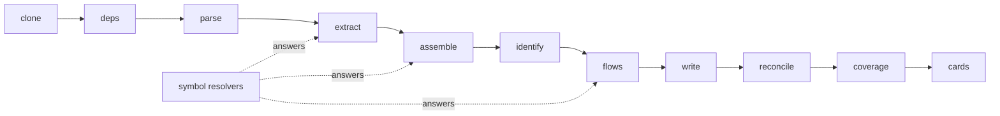

# Ingestion

How repositories become graph facts: deterministically, idempotently, and extensibly.

> **In one minute**
> - A worker claims a job, clones the repository, and runs stages in order. Every stage records a row in Postgres.
> - **Flows are derived, not extracted.** Rules mark where a flow starts; the flows stage walks the call graph from every entry point.
> - Each night, every repository whose main branch moved is **re-analyzed in full**, and only differences are written (D59).
> - Re-ingesting the same commit writes nothing.

## 1. Principles (all Decided)

- **Bottom-up.** Applications first; spaces and the organization are rollups.
- **Deterministic first.** An LLM writes prose and drafts rules, never facts (D120).
- **Agnostic core.** Organizations extend rule packs and witnesses.
- **Passive.** Nothing is required of a repository.
- **Idempotent.** Re-running yields the same graph.
- **Whole repository, nightly** (D59).
- **Static only for now.**
- **Secret values are never ingested.**

## 2. The pipeline

| Stage | Question | Leaves behind | Status |
|---|---|---|---|
| **clone** | What's the code, at which commit? | A folder; the commit SHA | Built |
| **deps** | Which library types does the code use? | JARs | Skipped (D69) |
| **parse** | Which packs apply? What's in the code? | File list, symbol tables | Built |
| **extract** | What does each code shape mean? | Facts, facts with blanks, clues | Built |
| **assemble** | What fills each blank? | Completed facts, the facts file | Built |
| **identify** | Which deployables exist? Same as last time? | Structure, Steno IDs, names | Built |
| **flows** | What does each entry point reach? | A graph plan, with digests | Built |
| **write** | What must change in Neo4j? | The graph, `fact_change`, claims | Built |
| **reconcile** | Do witnesses agree? | Agreement, stubs, cross-repository links | Built (Messaging, names, routes, HTTP links) |
| **coverage** | What did no rule explain? | `coverage_item`, patterns | Built |
| **cards** | What does each application do, in words? | LLM summaries, optional embeddings | Built |

**Resolve and assemble are different jobs (D56).** A symbol resolver answers *what is this?* and isn't a stage: extract, assemble, and flows ask it questions. Assemblers combine clues from different files.

**Why this order:** files are read in any order, so blanks are filled after everything is collected. Flows wait for assemble because they're named after their full trigger path.

## 3. How a job runs

Asking for a run adds a row to a Postgres table, and a separate worker picks it up (D35).

- **Two workers never get the same job** (`SKIP LOCKED`).
- **Work fits the machine** (D128, D134). See [Large repositories §5](./large-repositories.md#5-failures-and-fitting-the-machine-d128-d134).
- **A failed stage stops the job,** and nothing is removed from the graph. A resolver that fails as a whole fails the job, so the last good graph stays.
- **Stopping a worker** lets the current job finish; a job can be canceled from the UI.

| Trigger | What it does |
|---|---|
| `dry_run` | Every stage including write; LLM text is only counted (D26) |
| `full` | The same, plus LLM text |
| `nightly` | A full run for every repository whose branch moved (`STENO_NIGHTLY_AT`) |

## 4. Nightly updates (Decided, D59)

- **Only repositories that changed:** one `git ls-remote` each.
- **Whole repositories.** Flows depend on the whole call graph, so full analysis can't drift from a fresh ingest.
- **Only differences are written.**
- **The commit range is for attribution.** A missed night heals itself.
- **Keeping it cheap (Proposed):** per-file caches, a mirror per repository, scoping monorepos to changed applications.

## 5. Idempotency (Decided)

- Every node and edge has a **stable ID from natural keys**.
- The new plan is compared with the graph by ID: new and changed facts are written, and gone facts removed. Shared nodes go only when nothing references them.
- **`fact_change`** logs the delta. The same commit must produce zero rows, and a test checks that.
- **The write is many small transactions (D135).** A write that stopped partway is finished by the next run. See [Stages §7](./stages.md#7-write).

**Steno owns re-ingestion (D11).** Only Steno's rules produce facts.

## 6. Where the time goes

| Target | Size | Result |
|---|---|---|
| Contextualized (Python) | 190 files, 486 functions | 33 flows, about 12 s; flows is 5.3 s of that |
| budgeting-app (Java) | 205 files | 54 flows, about 5 s |
| ThingsBoard (Java) | About 5,500 files | 1,623 flows; see [Large repositories](./large-repositories.md) |

**Flows is the slowest stage.**

## 7. Sub-pages

| Page | Covers |
|---|---|
| [Connectors](./connectors.md) | What Steno reads and how |
| [Stages](./stages.md) | Each stage, with real output |
| [Rules and packs](./rules-and-packs.md) | The rule format and catalog |
| [Rule curation](./rule-curation.md) | How rules keep up (D147) |
| [Resolvers](./resolvers.md) | Python and Java resolution |
| [Joins](./joins.md) | How applications connect |
| [What Steno must see](./what-steno-must-see.md) | The completeness catalog |
| [Identify and reconcile](./identify-and-reconcile.md) | The identity registry |
| [Claims and reconcile](./claims-and-reconcile.md) | Comparing witnesses |
| [Coverage report](./coverage-report.md) | What no rule explained |
| [Large repositories](./large-repositories.md) | Memory, time, and scale |
