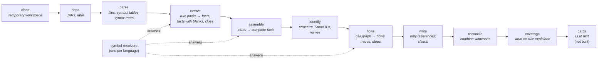
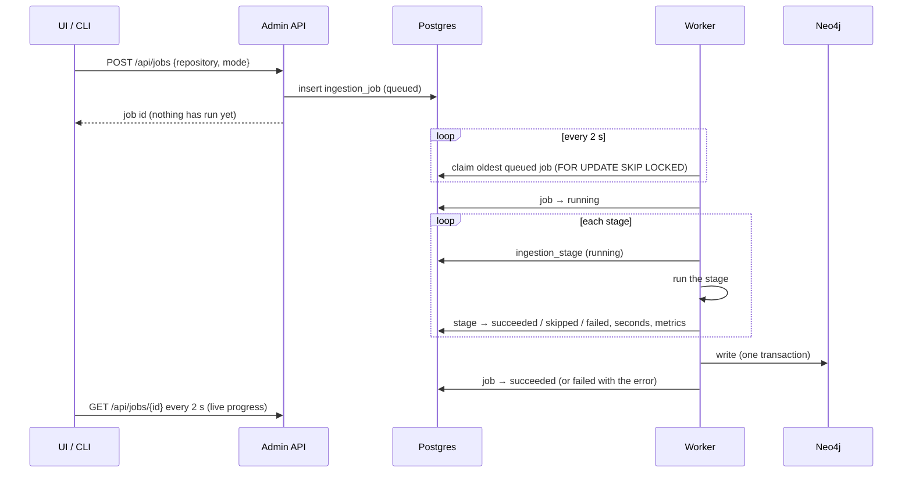

# Ingestion

How Steno turns repositories into graph facts: deterministically, idempotently, and in a way any organization can extend.

> **In one minute**
> - A worker claims a queued job, clones the repository, and runs stages in order. Only **write** touches Neo4j; every stage records a row in Postgres.
> - **Parse** reads the code once. **Extract** runs every rule of every enabled rule pack over every file. **Assemble** fills in facts whose pieces were in different files. **Flows** builds the call graph in memory and derives every flow. **Write** compares with the graph by stable ID and writes only differences. **Coverage** reports what no rule explained.
> - Each night, every repository whose main branch moved is re-analyzed in full; only changes are written. Re-ingesting the same commit writes nothing.
> - **Identify** gives every application a permanent Steno ID and its real name; **reconcile** compares the code with other witnesses (deploy and ACL files, manifests). See [identify and reconcile](./identify-and-reconcile.md) and [claims and reconcile](./claims-and-reconcile.md).

---

## 1. Principles

| Principle | Status |
|---|---|
| **Build bottom-up.** Applications first; space and organization views are rollups. | Decided |
| **Deterministic first.** Rules extract facts. A decision model decides only what rules can't. An LLM only writes prose. | Decided |
| **Agnostic core, organization-specific rules.** The core defines fact types and facets; rule packs and witnesses are what organizations extend. | Decided |
| **Passive.** Nothing is required of an organization's repositories. No OpenTelemetry, Terraform, or annotations. | Decided |
| **Idempotent.** Re-running any ingestion yields the same graph. | Decided |
| **Whole repository, nightly.** A repository that changed is re-analyzed in full; only differences are written (D59). | Decided |
| **Static only for now.** Code and config. Runtime evidence (OBSERVED) is `v2`. | Decided |
| **Secret values are never ingested.** | Decided |

## 2. The pipeline



| Stage | Question it answers | Leaves behind | Status |
|---|---|---|---|
| **clone** | What's the code, at which commit? | A folder on disk; the commit SHA | Built |
| **deps** | Which library types does the code use? (Java) | Dependency JARs | Skipped (D69: source and JDK first) |
| **parse** | Which rule packs apply, and what's in the code? | File list, symbol tables, syntax trees | Built |
| **extract** | What does each code shape mean? | Facts, facts with blanks, clues | Built |
| **assemble** | What goes in each blank? | Completed facts; the facts JSON | Built |
| **identify** | Which deployables exist, is each the same application as last time, and what's it called? | Structure (modules, applications); Steno IDs, canonical names, aliases, lifecycle | Built |
| **flows** | What does each entry point reach? | A graph plan: nodes and edges with stable IDs | Built |
| **write** | What does Neo4j need to change? | The updated graph; `fact_change`; this run's claims in the claim store | Built |
| **reconcile** | Do independent witnesses agree? | Application-level edges with agreement and sources; stubs for unmatched names | Built (Messaging, Components names) |
| **coverage** | What did no rule explain? | `coverage_item` rows; completeness numbers | Built |
| **cards** | What does each flow do, in words? | LLM purposes and narratives | Not built |

Each stage is taken apart, with real output, in [Stages, step by step](./stages.md).

> **Resolve and assemble are different jobs (D56).** The **symbol resolver** (one per language) answers *what is this?*: which symbol a name refers to, a value's type, the constant it holds. It isn't a stage: it's built during parse and asked questions by extract, assemble, and flows. **Assemblers** (one per clue type, the same for every language) combine clues found in different files into complete facts. Nothing else is called a resolver.

### Why this order

- **Facts with blanks wait for assemble.** No single file has the whole story (an endpoint's path is in one file, its router's prefix in another, the mount in a third), and files are read in any order. Collecting everything first and filling the blanks afterwards works regardless of order, so rules never need to know about each other.
- **Flows wait for assemble.** Flows are named after their trigger (`POST /api/jobs/projects/{project_id}`), and that full path exists only after assemble.
- **Flows are derived, not extracted.** Rules only mark where a flow starts (entry points). The flows stage walks the call graph from every entry point at once.

## 3. How a job runs

Ingestion never runs inside the API. Asking for a run adds a row to a Postgres table; a separate worker picks it up. The table is the queue (D35).



- **Two workers never get the same job** (`SKIP LOCKED`), so more worker processes run more jobs in parallel.
- **A failed stage stops the job**, marks it failed with the error, and the clone is deleted either way. Nothing is written to Neo4j, so a failed job can't remove anything.
- **Stopping a worker** (Ctrl+C) lets the current job finish first.

| Mode / trigger | What it does |
|---|---|
| `dry_run` | Every stage, including write: the graph is real. Only LLM text is skipped; the cards stage reports what it would have cost (D26). |
| `full` | The same, plus LLM cards once they're built |
| `nightly` (a trigger) | Each night (`STENO_NIGHTLY_AT`, UTC; `steno job nightly` by hand) a full run for every repository whose branch moved |
| `make dry-run REPO=x` | Enqueues a dry run from the command line |

## 4. Nightly updates (Decided, D59)

```mermaid
sequenceDiagram
    participant Sch as Nightly schedule
    participant Orc as Orchestrator
    participant Git as Git host
    participant Wk as Worker
    participant Neo as Neo4j
    participant PG as Postgres
    Sch->>Orc: start the nightly run
    Orc->>PG: last_ingested_sha per repository
    Orc->>Git: has the default branch moved? (git ls-remote)
    Orc->>PG: queue a job per changed repository
    Wk->>Wk: analyze the whole repository at the new head
    Wk->>Neo: compare by stable ID; write only changes, remove what's gone
    Wk->>PG: fact_change; map commits to PRs (not built)
    Wk->>PG: last_ingested_sha = new head
```

- **Only repositories that changed.** Checking is one `git ls-remote` per repository, no clone. Unchanged repositories aren't touched.
- **Whole repositories, no per-file re-derivation.** Flows depend on the whole call graph, so a full analysis is simpler and can't drift from a fresh ingest.
- **Only differences are written.** A day of refactoring that changes no behavior writes traces but no architecture nodes and regenerates no cards.
- **The commit range is for attribution.** Commits in `last_ingested_sha..head` map to PRs; that's the bridge to projects later. A missed night heals itself on the next one.
- **Manual runs** (initial ingestion, a re-run after a rule pack changes) use the same job.
- **Keeping it cheap (Proposed):** cache parse and extract results per file by git blob SHA plus pack versions; keep a mirror per repository and `git fetch` instead of cloning; scope very large monorepos to the applications whose files changed.

## 5. Idempotency (Decided)

- Every node and edge has a **stable ID derived from natural keys**, so re-ingesting finds the same nodes. (Applications move to a Steno ID from the identity registry; see [Identity](../../concepts/identity.md).)
- Re-ingesting a repository compares the new facts with what the graph holds for it, by stable ID: new and changed facts are written, facts gone from the code are removed. **Shared nodes** (topics, tables, data stores, external systems) are removed only when nothing references them.
- **The delta** (added, removed, changed) is logged in `fact_change`. Re-ingesting the same commit must produce **zero rows**: an automated idempotency test.
- **The whole write is one Neo4j transaction.** A failed write changes nothing.

**Steno owns re-ingestion (Decided, D11).** Only Steno's rules produce facts in Steno's model. Contextualized later adds *which project* and *why*; it never supplies structural facts.

## 6. Where the time goes

Measured runs, for scale:

| Target | Size | Result |
|---|---|---|
| Contextualized (Python) | 190 files, 112 modules, 486 functions | About 500 nodes, 1,300 edges, and 33 flows (counts vary slightly by commit and rule version), about 12 s end to end. In one run: parse 0.16 s, extract 1.8 s, assemble 1.7 s, flows 5.3 s. |
| budgeting-app (Java) | 205 Java files | 54 flows (53 endpoints, one schedule), all 15 entities mapped to tables, 94.6% of I/O calls explained, about 5 s; the JVM helper takes about 2 s |

**Flows is the slowest stage**: it asks the symbol resolver for every call in every function. **Assemble's** time is mostly the client assembler visiting every method call. Scale work (one pass per language for all rules, lazy indexing, per-file caching) is planned when a large repository shows it matters.

## 7. Sub-pages

| Page | Covers |
|---|---|
| [Connectors and sources](./connectors.md) | What Steno reads and how it reaches it |
| [Stages, step by step](./stages.md) | Every stage, with real output from Contextualized |
| [Rules and rule packs](./rules-and-packs.md) | The rule format and the pack catalog |
| [Symbol resolvers](./resolvers.md) | Python and Java resolution, DI, config values, hosts |
| [Joins across applications](./joins.md) | How applications connect |
| [Identify and reconcile](./identify-and-reconcile.md) | Application identity; combining witnesses |
| [Claims and reconcile](./claims-and-reconcile.md) | What other witnesses say, the claim store, and agreement with the code |
| [Coverage report](./coverage-report.md) | What no rule explained, and agreement between witnesses |
