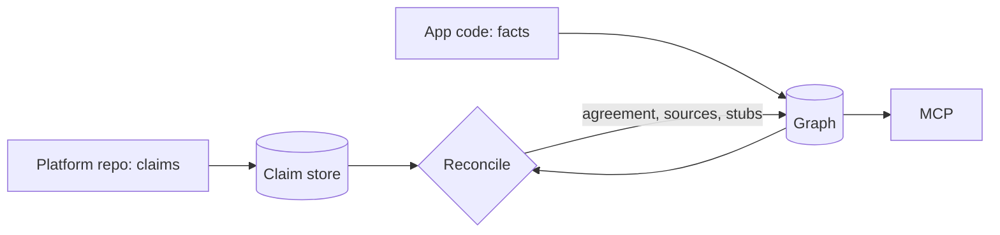

# Claims and reconcile

How other sources' statements are stored, compared with the code, and shown to agents. Built for Messaging, Components names, routes, and HTTP links (D109, D114). The ideas: [Witnesses and facets](../../concepts/witnesses-and-facets.md).

> **In one minute**
> - Rules produce **facts** (straight to the graph) or **claims** (compared with the code first).
> - Claims are rows in a **Postgres claim store** (D109). Each run replaces its repository's claims.
> - After each job, **reconcile** recomputes the subjects it touched and writes agreement into Neo4j. Agents read only the graph.
> - Claims are tied to **subjects**, not spaces.



## 1. What's decided

- Other witnesses' claims go to Postgres because admin and API data can't be rebuilt from git (D36, D109).
- Evidence facets get agreement; authority facets resolve by precedence (D80).
- Admin overrides are claims like any other.
- In the POC, platform files come from git. API connectors are `v1` (D77, D110, D113).

## 2. A worked example

| Source | Says |
|---|---|
| `payments-svc` code | Sends to `payment.settled` |
| `recon-svc` code | Listens on `payment.settled` and `refund.issued` |
| Platform repository | Topics exist; `payments-svc` may write; `recon-svc` and `ledger-svc` may read `payment.settled` |

| Edge | Agreement | Why |
|---|---|---|
| `payments-svc` produces `payment.settled` | **confirmed** | Code + platform |
| `recon-svc` consumes `payment.settled` | **confirmed** | Code + platform |
| `ledger-svc` consumes `payment.settled` | **declared only** | Only the platform; a stub application |
| `recon-svc` consumes `refund.issued` | **code only** | No grant; likely to fail when deployed |

The result is the same in any ingestion order, and re-ingesting writes nothing.

## 3. Claims

Claim types are a fixed set (`claims/types.py`). An invalid claim is dropped with a reason.

| Facet | Claim | Fields | Compared with | Reconciled |
|---|---|---|---|---|
| Messaging | `channel` | `channel`, `cluster?`, `attributes?` | Makes the channel checked | Yes |
| Messaging | `may_produce` | `application`, `channel` | A flow's step produces to it | Yes |
| Messaging | `may_consume` | `application`, `channel`, `group?` | A flow it starts, or a consuming step | Yes |
| Components | `deployable` | `application`, `kind?`, `display_name?` | An application with the name | Stubs, display names |
| Components | `name` | `application`, `name`, `slot` (`admin`, `deploy`, `manifest`, `build_artifact`, `runtime`, `path`) | The name ladder | Through identify |
| Schedules | `schedule` | `application`, `cron` or `every`, `command?` | An in-code schedule | Not yet |
| Routing | `route` | `path`, `target`, `gateway?`, `id?`, `methods?`, `strip_prefix?`, `rewrite?`, `prefix?`, `router?` | Written as `Route` nodes (D132). Stored even from CODE. | One witness so far |

**A permission isn't a use.** An ACL says an application *may* consume; code says it *does*.

**CODE claims** are rare and go to identity, not the store.

## 4. Writing claims in a pack

```yaml
# pack.yaml
name: steno-pack-strimzi
language: any
witness_type: PLATFORM         # CODE (default) | PLATFORM | DECLARED; one per pack
facets: [Messaging]
enabled_when:
  files: ["**/*.yaml", "**/*.yml"]
  content: "kafka\\.strimzi\\.io/"
```

```yaml
id: strimzi-acl-consume
kind: config
match:
  each: "spec.authorization.acls[*]"     # one match per entry
  when:                                   # every condition must hold
    "$doc.kind": KafkaUser
    "$.resource.type": topic
    "$.resource.patternType": { not_in: [prefix] }
    "$.operations": { in: [Read, All] }
emit:
  - claim: may_consume
    application: $doc.metadata.name
    channel: { KafkaTopic: $.resource.name }
```

| Form | Means |
|---|---|
| `topics[*]` | Every list item, or mapping value |
| `$` | The document |
| `*` | Every child structure; in XML, every child element |
| `$.field.sub` | A field; `$.list[*]` fans out, one claim per entry |
| `$.@key` | The mapping key the record was under |
| `$.@tag` | An XML element's tag |
| `$doc.field` | A field of the document |
| `{from: $.filters, regex: "^StripPrefix=(\\d+)$"}` | Matching values, as the first group; `split: ","` splits each |
| `when` | Equals, `contains`, `in`, `not_in`, `matches`, `exists: true/false` |

Every claim cites its line. XML reads like YAML. Tests list `claims:`. `generated: true` marks a source that's never a second witness. Secrets are skipped.

**Core packs:** `steno-pack-strimzi`, `steno-pack-backstage`, `spring-application-name`, and `steno-pack-spring-cloud-gateway`. Organization formats (XLD, `component_manifest.yaml`) are org packs.

## 5. The claim store

| Column | Meaning |
|---|---|
| `claim_type`, `facet` | From §3 |
| `fields` (json) | As written |
| `subjects` (text[], GIN) | Keys it's about (§6) |
| `witness_type`, `witness` | The pack that read it, or `admin` |
| `repository_id`, `commit`, `file`, `line` | Citation |
| `generated` | Not independent |
| `key` | A hash of type, fields, and file: the same claim next run |
| `first_seen_job`, `last_seen_job`, `removed_job` | Its life |

Each run replaces its repository's claims (`claims/store.py`). The subjects of what changed are what reconcile recomputes. Admin claims are left alone.

## 6. Subjects and names

| Subject | Key |
|---|---|
| Topic, queue, org channel | `channel:kafkatopic:payment.settled` |
| Application | `application:ledger-svc` |

**Names resolve at reconcile time,** through the registry: canonical name, else exact alias. An ambiguous name resolves to nothing.

**An unmatched name** becomes a stub (`app:declared:{name}`) and a coverage item.

## 7. Reconcile

**When:** after write, in every job, under one lock (`reconcile/run.py`), for the subjects of changed claims and the job's applications.

**How**, per channel (`reconcile/compare.py`):

1. Claims about it. None means **not checked**, and nothing is written.
2. What code shows, lifted to the application.
3. What claims grant, resolved through identity.
4. Both → `confirmed`; code only → `code_only`; claims only → `declared_only`.

**Writes** (`repo: "reconcile"`): application-level `PRODUCES` / `CONSUMES` with `agreement`, `sources`, `witness_types`, `reconciled: true`; stub channels; `Route` nodes and `FORWARDS_TO` (D132); and HTTP calls joined across repositories (`reconcile/links.py`).

Step- and flow-level edges keep their code citations; agreement sits on the application's edge.

## 8. What agents and admins see

- **`get_node`** on an application: names and `messaging` with agreement. On a topic: `uses`, or "not checked". `claims=true` adds raw claims.
- **`find_dependents`** on a topic: agreement per application; declared-only uses make the answer incomplete.
- **Organization and space views:** messaging links.
- **Coverage:** `disagreement` goes to the repository that can fix it; `unmatched_name` to the one using the name.

## 9. Not built yet

Declared topic placement; comparing schedules; wider coverage from the setup sheet; naming patterns; an admin API; change history for reconcile's writes; organization packs (XLD, `component_manifest.yaml`).
