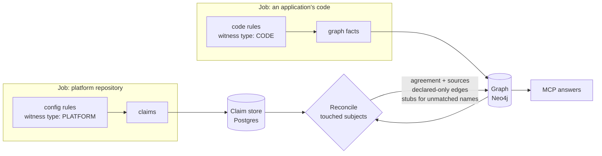

# Claims and reconcile

How what other sources say about the system (deploy definitions, ACL files, manifests, admin entries) is stored, compared with the code, and shown to agents. Part of [Ingestion](./README.md); the ideas are in [Witnesses and facets](../../concepts/witnesses-and-facets.md) and [Trust](../../concepts/trust.md#3-agreement-between-witnesses).

> **In one minute**
> - A **claim** is one witness's statement about the system: "the platform repository grants `ledger-svc` consume on `payment.settled`". A **witness** is the source making it; its **witness type** is its kind (`PLATFORM`, `DECLARED`). Rules produce **facts** (graph-shaped, written straight to the graph) or **claims** (facet-shaped, compared with the code first).
> - Claims are rows in a **claim store in Postgres** (D109). Each run replaces its repository's claims.
> - After each job writes the graph, **reconcile** recomputes only the subjects that job touched: it lines up every stored claim and every code fact about a topic and writes the result **into Neo4j**: an application-level edge with an agreement state (`confirmed`, `code only`, `declared only`) and one citation per witness. Agents read only the graph.
> - Claims are tied to **subjects**, not spaces: one file can describe topics and applications in any space; reconcile finds them wherever they live, by the names identity links.
> - **Status: built** (2026-10-14) for Messaging (topics and ACLs) and for Components names (they feed [identify](./identify-and-reconcile.md#2-identify)). Not built yet: listed in [§9](#9-not-built-yet).



---

## 1. What's decided

- **Every witness produces claims** in its facet's shape, tagged with its witness type, the witness, and a citation (D76, D87, D112).
- **Code facts stay in the graph; other witnesses' claims go to a claim store in Postgres** (D109). Reconcile writes its results into Neo4j, so MCP reads only the graph and the graph stays rebuildable from Postgres + git (D36).
- **Evidence facets** get an agreement state per fact; **authority facets** resolve by precedence (D80).
- **Admin overrides are claims like any other**, with who, when, and why, still compared with the code.
- **In the POC, platform files come from git** through the existing connectors. API connectors (the XLD server, Kafka admin, Artifactory) are `v1` (D77, D110), and the XLD repository and server are separate witnesses (D113).
- **The design choices** (declared-only facts as edges, agreement on application-level edges, what counts as checked, reconcile in every job, claim types owned by Steno, `each` for list-shaped files, ACLs as permissions) are adopted as D114.

## 2. A worked example

Two applications in different spaces, and a platform repository in a third. This is the stub organization reconcile was proven on:

| Source | What it says |
|---|---|
| `payments-svc` code (Space A) | `kafka.send("payment.settled", …)` from `POST /payments/{id}/settle` |
| `recon-svc` code (Space B) | `@KafkaListener(topics = "payment.settled")` and `@KafkaListener(topics = "refund.issued")` |
| Platform repository, Strimzi files (Space Platform) | topics `payment.settled` and `refund.issued`; `KafkaUser` ACLs: `payments-svc` may write `payment.settled`; `recon-svc` and `ledger-svc` may read it |

What the agent sees after all three are ingested, in any order:

| Edge | Agreement | Sources |
|---|---|---|
| `payments-svc` produces to `payment.settled` | **confirmed** | `PaymentController.java:16` (code), `kafka/users.yaml:9` (platform) |
| `recon-svc` consumes from `payment.settled` | **confirmed** | `ReconListener.java:6` (code), `kafka/users.yaml:20` (platform) |
| `ledger-svc` consumes from `payment.settled` | **declared only** | `kafka/users.yaml:31` (platform). `ledger-svc` matches no application: a stub application, "known from steno-pack-strimzi, not ingested or not matched" |
| `recon-svc` consumes from `refund.issued` | **code only** | `ReconListener.java:9` (code). The topic is declared, but no ACL grants `recon-svc` read: likely to fail when deployed |

When someone fixes the platform files (removes the `ledger-svc` grant, grants `recon-svc` read on `refund.issued`) and the platform repository is re-ingested, the declared-only edge and its stub disappear, and `refund.issued` becomes **confirmed**. Re-ingesting any of the three at the same commit writes nothing.

## 3. Claims

A claim has a fixed shape. Its **type** comes from a small set owned by Steno, like [clue types](./rules-and-packs.md#clue-types-are-a-fixed-set-owned-by-steno): each type knows its facet, its fields, its subject keys, and what in the code it's compared with. A pack emits them; a new type is a core change (`claims/types.py`). The engine checks every claim against its type and drops an invalid one with a reason (a missing field, an unresolved `${placeholder}`).

| Facet | Claim | Fields | Compared with (CODE) | Kind | Reconciled |
|---|---|---|---|---|---|
| Messaging | `channel` | `channel` (`{KafkaTopic: name}`), `cluster?`, `attributes?` | Makes the channel checked | Evidence | Yes |
| Messaging | `may_produce` | `application`, `channel` | The application has a flow whose steps produce to it | Evidence | Yes |
| Messaging | `may_consume` | `application`, `channel`, `group?` | The application has a flow it starts, or a step that consumes it | Evidence | Yes |
| Components | `deployable` | `application`, `kind?`, `display_name?` | An application with the name exists; else a stub | Evidence (existence) | Stubs and display names |
| Components | `name` | `application`, `name`, `slot` (`admin`, `deploy`, `manifest`, `build_artifact`, `runtime`, `path`) | Feeds the name ladder in identify | Authority | Through identify |
| Schedules | `schedule` | `application`, `cron` or `every`, `command?` | An in-code schedule in the application | Evidence | Not yet |
| Routing | `route` | `path`, `target`, `gateway?`, `id?`, `methods?`, `strip_prefix?`, `rewrite?`, `prefix?`, `router?` | A gateway's route rule (D132): requests on `path` go to `target` after the rewrite. **Stored even from CODE** (a gateway's own config), because reconcile writes it into the graph: `Route` nodes and `FORWARDS_TO` the target application across repositories. A `${…}` in `rewrite` is the gateway's own syntax, not a placeholder | Evidence | No (one witness so far) |

**A permission isn't a use.** An ACL says an application *may* consume; code says it *does*. That's why the claims are `may_produce` and `may_consume`, and why each mismatch means something different: `declared only` is an unused or stale grant, an application not ingested, or a missed listener; `code only` is a use nothing grants.

**CODE claims** are rare and go to identity, not the claim store: `spring.application.name` is a CODE `name` claim at the `runtime` slot.

## 4. Writing claims in a pack

```yaml
# pack.yaml
name: steno-pack-strimzi
language: any
witness_type: PLATFORM         # CODE (default) | PLATFORM | DECLARED; one per pack
facets: [Messaging]
enabled_when:
  files: ["**/*.yaml", "**/*.yml"]
  content: "kafka\\.strimzi\\.io/"   # only files whose text matches: Strimzi resources, not any YAML
```

Platform files are usually **lists of records**, so a config rule can match records instead of keys. `each` walks to every record; the emits read its fields:

```yaml
id: strimzi-acl-consume
kind: config
match:
  each: "spec.authorization.acls[*]"     # one match per ACL entry
  when:                                   # every condition must hold
    "$doc.kind": KafkaUser
    "$.resource.type": topic
    "$.resource.patternType": { not_in: [prefix] }
    "$.operations": { in: [Read, All] }
emit:
  - claim: may_consume
    application: $doc.metadata.name       # the whole document: the KafkaUser's name
    channel: { KafkaTopic: $.resource.name }
```

| In `each` and emits | Means |
|---|---|
| `topics[*]` | Every item of a list, or every value of a mapping (`topics: {payment.settled: {…}}`) |
| `$` | The document itself (a file of one resource, or each `---` document) |
| `*` | Every child structure; in XML, every child element (XL Deploy's `jee.War` has a dot, so it's filtered by `$.@tag`, not named in a path) |
| `$.field.sub` | A field of the record; `$.list[*]` fans out: one claim per entry |
| `$.@key` | The mapping key the record was found under (`payment.settled`) |
| `$doc.field` | A field of the record's document |
| `{from: $.filters, regex: "^StripPrefix=(\\d+)$"}` | The values of `from` that match the regex, as its first group; `split: ","` then splits each into several (one claim per part). For list entries written as strings (`Path=/api/vet/**`) |
| `when` | Equals a value, `contains`, `in`, `not_in`, `matches` (a regex), or `exists: true/false` |

- **Every claim cites its line:** the line of the value it came from, so a fanned-out claim cites its own list entry. Key-based config matches cite their line too.
- **XML** (`deployit-manifest.xml`) reads like YAML: elements nest, attributes are fields, an element's tag is `@tag`, and flat key rules see it as dotted keys.
- **Tests:** an `expected.yaml` lists the `claims:` a case must produce (fields, plus `line` and `witness_type` when listed).
- **Generated sources** (an OpenAPI spec built from the code): `generated: true` in `pack.yaml`; their claims are stored but never count as a second witness.
- **Secrets** are skipped as in every config rule.
- **Core packs today:** `kafka/steno-pack-strimzi` (PLATFORM: `KafkaTopic`, `KafkaUser` ACLs), `catalog/steno-pack-backstage` (DECLARED: `catalog-info.yaml` Components), `spring-application-name` in the Spring Boot pack (CODE name), and `java/steno-pack-spring-cloud-gateway` (CODE `route` claims from a gateway's YAML, D132). Organization-specific formats (an XLD repository's custom types, `component_manifest.yaml`) are org packs.

## 5. The claim store

| Column | Meaning |
|---|---|
| `claim_type`, `facet` | From §3 |
| `fields` (json) | The claim's fields as written: `{"application": "ledger-svc", "channel": {"KafkaTopic": "payment.settled"}}` |
| `subjects` (text[], GIN index) | The subject keys it's about (§6), for "every claim about topic X" |
| `witness_type`, `witness` | `PLATFORM`, `steno-pack-strimzi`: the pack that read it, which with `repository_id` names the witness; `admin` for admin entries |
| `repository_id`, `commit`, `file`, `line` | Its citation |
| `generated` | Not an independent witness |
| `key` | Its type, fields, and file, hashed: what makes it the same claim next run (not its line) |
| `first_seen_job`, `last_seen_job`, `removed_job` | Its life |

**Each run replaces its repository's claims** (`claims/store.py`): an unchanged claim keeps its row (its line and commit are updated if they moved), a new one is added, a returning one is reactivated, and one no longer found gets `removed_job` (kept for history, never compared). The subjects of what was added or removed are what reconcile recomputes. CODE claims aren't stored, and admin claims (`witness: admin`) are left alone by repository runs.

## 6. Subjects and names

A **subject** is what a claim is about, keyed the way the graph keys it:

| Subject | Key | Notes |
|---|---|---|
| Topic, queue, org channel | `channel:kafkatopic:payment.settled` | The graph's channel ID (D61), name alone |
| Application | `application:ledger-svc` | The name the witness uses; resolved to a Steno ID at reconcile time |

**Names are resolved at reconcile time, not when the claim is read**, through the identity registry: an application's canonical name, else an exact alias (a past name still counts). Nothing partial, and an ambiguous name (two applications have it) resolves to nothing. Resolving late means a claim stored before its application is ingested, or before a witness links a name, matches as soon as it can.

**A name that matches no application** becomes a stub application (`app:declared:{name}`, `stub: true`, `declared_only: true`, "known from {witness}, not ingested or not matched"), recorded in `unmatched_name` (open, then mapped once it resolves) and reported in the coverage report, so a declared-only edge always points somewhere visible.

## 7. Reconcile

**When:** a stage after **write**, in every job, under one lock (`reconcile/run.py`). The subjects it recomputes:

- the subjects of claims this job added or removed;
- the job's applications: the channels their flows produce to or are started by, the channels reconcile linked them to before (so a use that disappeared is recomputed), and claims that name any of their names.

Code facts are in the graph and claims are in Postgres, so jobs can run in any order and the result converges.

**How:** for each channel (`reconcile/compare.py`, pure):

1. **Claims about it** (active, not generated). None: the channel isn't checked, and nothing is written. A topic no witness mentions isn't `code only`; nobody looked.
2. **What the code shows**, lifted to the application: a step that produces to it, a flow it starts, a step that consumes it; each with its rule, file, line, repository, and commit.
3. **What claims grant**: `may_produce` and `may_consume`, each application resolved through identity (or a stub).
4. **Per application and role:** both → `confirmed`; code only → `code_only`; claims only → `declared_only`.

**What it writes to Neo4j**, all owned by `reconcile` (`repo: "reconcile"`), which no repository's write stage reads or removes:

| Result | In the graph |
|---|---|
| An application produces to or consumes from a checked channel | `(:Application)-[:PRODUCES\|CONSUMES]->(channel)` with `agreement`, `sources` (JSON, one entry per witness: type, rule or pack, file, line, repository, commit), `witness_types`, `reconciled: true` |
| Declared only | The same edge, from the application or its stub, with no flow behind it |
| A channel a witness declares and no code mentions | A stub channel node, so its edges have somewhere to point; taken over by the first repository whose code names it |
| Names | Through identify: canonical name, display name, and aliases on the application |

Stale edges for a recomputed channel are deleted. Stub applications whose name now resolves, or that nothing refers to any more, are removed; stub channels with no edges too.

Step- and flow-level edges keep their code citations and get no agreement of their own: "does the platform agree?" is about the application, and the answer sits on the application's edge.

**Shared nodes keep their first writer.** A topic both a producer's and a consumer's repositories name belongs to the repository that wrote it first; the other's runs don't rewrite it, so neither run writes anything when nothing changed.

## 8. What agents and admins see

- **`get_node` on an application:** `names` (display name, aliases, whether the name is provisional), and `messaging`: each channel it produces to or consumes from, with `agreement`, its witnesses, and a citation per witness; `agreement_means` says what each state means. A stub application says it isn't ingested and which witness knows it.
- **`get_node` on a topic:** `uses` (every application's agreement), or "not checked" when no other witness mentions it.
- **`get_node(..., claims=true)`:** the raw claims behind the node, each cited.
- **`find_dependents` on a topic:** `agreement` for every application; declared-only uses make the answer incomplete (`completeness.declared_only`), since Steno may be missing a consumer.
- **The organization and space views:** messaging between applications is a link ("via 1 topic") alongside calls and data, so a producer in one space and a consumer in another are connected.
- **Coverage report:** two signals. `disagreement` (code only or declared only) goes to the repository that can fix it: a use nothing grants to the application's repository, a stale grant to the platform repository. `unmatched_name` goes to the repository whose claims use the name.

## 9. Not built yet

| Item | Today |
|---|---|
| Topic placement: a declared topic `BELONGS_TO` the space that declares it ([topic ownership](../graph-reference.md#topic-ownership)) | The space of the repository that wrote it first |
| Schedules: comparing `schedule` claims with in-code schedules | Claims are stored, not compared |
| Wider coverage from the setup sheet ("this witness lists every topic on cluster X", so a missing topic is `code only`) | A witness covers the subjects it mentions |
| Naming patterns ("deploy name = `{runtime}-prod`") | Exact names only, linked by a witness that states both |
| Admin entries: claims with `witness: admin`, and linking a removed application to a new one | The tables exist; no API or UI yet |
| Change history for reconcile's writes | Reconcile's edges aren't in `fact_change` |
| Organization-specific packs (XLD repository, `component_manifest.yaml`) | Written against the real files at the organization |
