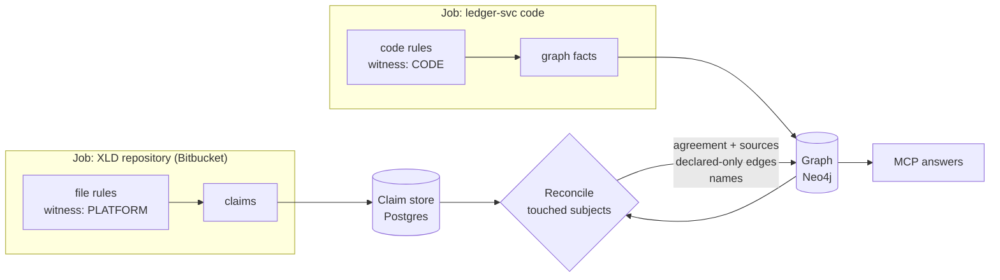

# Claims and reconcile

How what other sources say about the system (deploy definitions, ACL files, manifests, admin entries) is stored, compared with the code, and shown to agents. Part of [Ingestion](./README.md); the ideas are in [Witnesses and facets](../../concepts/witnesses-and-facets.md) and [Trust](../../concepts/trust.md#3-agreement-between-witnesses). It replaces the open design list in [identify and reconcile §3](./identify-and-reconcile.md#3-reconcile).

> **In one minute**
> - A **claim** is one source's statement about the system: "the XLD repository grants `ledger-svc` consume on `payment.settled`". Packs produce claims the way they produce facts; the pack says which **witness** it is (`PLATFORM`, `DECLARED`).
> - Claims are rows in a **claim store in Postgres** (D109). Code facts stay in the graph as today.
> - After each job writes the graph, **reconcile** recomputes only the subjects that job touched (a topic, an application): it lines up every stored claim and every code fact about the subject and writes the result **into Neo4j**: an agreement state (`confirmed`, `code only`, `declared only`) and one citation per witness. Agents read only the graph.
> - Claims are tied to **subjects**, not spaces: one XLD file can describe topics and applications in any space, and reconcile finds them wherever they live.
> - **Status:** what's marked Decided is in the [decision log](../../plan/decisions.md); everything else on this page is **Proposed**, for review, with the choices to make listed in [§9](#9-choices-to-make). Nothing is built.



---

## 1. What's decided

- **Every provider produces claims** in its facet's shape, tagged with witness type, provider, and source location (D76, D87).
- **Code facts stay in the graph; other witnesses' claims go to a claim store in Postgres** with an as-of time (D109, option A). Reconcile writes its results into Neo4j, so MCP reads only the graph and the graph stays rebuildable from Postgres + git (D36).
- **Evidence facets** get an agreement state per fact; **authority facets** resolve by precedence (D80).
- **The same system read two ways is one witness** (D78): the XLD repository and the XLD server merge; a difference is drift.
- **Admin overrides are claims like any other**, with who, when, and why, still compared with the code.
- **In the POC, platform files come from git** through the existing connectors: the XLD definitions in Bitbucket. API connectors (the XLD server, Kafka admin, Artifactory) are `v1` (D77, D110).
- **Claims are packs' output, not a new kind of pack.** A pack declares its witness; code packs are CODE by default.

## 2. A worked example

Two applications in different spaces, and the XLD repository in a third:

| Source | What it says |
|---|---|
| `payments-svc` code (Space A) | `kafkaTemplate.send("payment.settled", …)` |
| `recon-svc` code (Space B) | `@KafkaListener(topics = "payment.settled")` |
| XLD repository, `topics/payment.yaml` (Space Platform) | topic `payment.settled`; `payments-svc-prod` may produce; `recon-svc-prod` and `ledger-svc-prod` may consume |

What the agent sees after all three are ingested, in any order:

| Edge | Agreement | Sources |
|---|---|---|
| `payments-svc` produces `payment.settled` | **confirmed** | `PaymentPublisher.java:41` (code), `topics/payment.yaml:6` (XLD) |
| `recon-svc` consumes `payment.settled` | **confirmed** | `ReconListener.java:12` (code), `topics/payment.yaml:9` (XLD) |
| `ledger-svc` consumes `payment.settled` | **declared only** | `topics/payment.yaml:10` (XLD). Either `ledger-svc` isn't ingested, a rule missed its listener, or the grant is unused. |

And if `recon-svc` also consumed `refund.issued`, which XLD grants nobody: **code only**, likely to fail when deployed, worth a look before it ships.

`payment.settled` `BELONGS_TO` Space Platform, the space that declares it ([topic ownership](../graph-reference.md#topic-ownership)), not the space of whichever repository happened to be ingested first.

## 3. Claims

A claim is a row with a fixed shape. Its **type** comes from a small set owned by Steno, like [clue types](./rules-and-packs.md#clue-types-are-a-fixed-set-owned-by-steno): each type knows its fields, its subject keys, and what in the code it's compared with. A pack can emit them; a new type is a core change.

**Claim types for the POC:**

| Facet | Claim | Fields | Compared with (CODE) | Kind |
|---|---|---|---|---|
| Messaging | `channel` | `channel` (`{KafkaTopic: name}`), `cluster?`, attributes | A topic node exists | Evidence |
| Messaging | `may_produce` | `application`, `channel` | The application has a flow whose steps produce to it | Evidence |
| Messaging | `may_consume` | `application`, `channel`, `group?` | The application has a flow started by it, or a step that consumes it | Evidence |
| Components | `deployable` | `application`, `kind?` | Structure found a deployable for it | Evidence (existence) |
| Components | `name` | `application`, `name`, `slot` (deploy name, manifest ID) | Feeds the name ladder in identify | Authority |
| Schedules | `schedule` | `application`, `cron` or `every`, `command?` | An in-code schedule in the application, or none | Evidence |

**A permission isn't a use.** An ACL says an application *may* consume; code says it *does*. That's why the claims are `may_produce` and `may_consume`, and why each mismatch means something different: `declared only` is an unused or stale grant (or a missed listener); `code only` is a use nothing grants.

**Routing** (gateway routes, Ingress) and **Data** claims (a database catalog) follow the same pattern when a target needs them (stages B–C).

## 4. Writing claims in a pack

```yaml
# pack.yaml
name: acme-xld
source: org
witness: PLATFORM              # CODE (default) | PLATFORM | DECLARED
facets: [Messaging, Components]
```

Platform files are usually **lists of records** ("topics: each with a name, producers, consumers"), which today's config rules can't express: they match one dotted key at a time. A config rule gains `each`, which walks a list and gives the rule each record's fields:

```yaml
id: xld-topic-acls
kind: config
files: ["topics/**/*.yaml"]
match:
  each: "topics[*]"                 # one match per item of the list
emit:
  - claim: channel
    channel: { KafkaTopic: $.name }   # $.field: a field of the current record
  - claim: may_consume
    application: $.consumers[*]     # one claim per list entry
    channel: { KafkaTopic: $.name }
```

- **XML** (XL Deploy's `deployit-manifest.xml`) is flattened like YAML, so the same rules read it. Other formats are added when a provider needs them.
- **Tests** work as for any rule: an `expected.yaml` lists the `claims:` a case must produce.
- **Generated sources** (an OpenAPI spec built from the code) are marked `generated: true` in the pack and never count as a second witness.
- **Secrets** are skipped as in every config rule.

## 5. The claim store

| Column | Meaning |
|---|---|
| `id` | |
| `claim_type`, `facet` | From §3 |
| `fields` (json) | The claim's fields as written: `{"application": "ledger-svc-prod", "channel": {"KafkaTopic": "payment.settled"}}` |
| `subjects` (text[]) | The subject keys it's about, for "every claim about topic X" (§6) |
| `witness`, `provider` | `PLATFORM`, `acme-xld` |
| `repository_id`, `commit`, `file`, `line` | Its citation |
| `generated` | Not an independent witness |
| `first_seen_job`, `last_seen_job`, `removed_job` | Its life, like the identity registry's |

**Each run replaces its own claims.** A job's claims for its repository and provider replace the previous run's: unchanged ones keep their row, new ones are added, and ones no longer found get `removed_job` (kept for history, never compared). That's how a grant deleted from XLD stops counting, and re-ingesting the same commit changes no rows. Admin claims (`provider: admin`, with who and why) are kept until an admin removes them; API snapshots (`v1`) replace per provider the same way.

## 6. Subjects and names

A **subject** is what a claim is about, keyed the way the graph keys it, so claims from any repository line up with code facts:

| Subject | Key | Notes |
|---|---|---|
| Topic, queue, org channel | `kafkatopic:payment.settled` | The graph's channel key (D61), name alone |
| Application | its Steno ID | Resolved from the name the claim uses (below) |

**Names are resolved at reconcile time, not when the claim is read.** XLD says `ledger-svc-prod`; the graph knows `ledger-service`. Identify's name ladder and aliases link them ([Identity](../../concepts/identity.md)): a deploy name from XLD is itself a `name` claim for that application. Resolving late means a claim stored before its application is ingested, or before an admin links a name, matches as soon as it can. This is why **identity comes before reconcile** in the build order.

**A name that matches no application** becomes a stub application (`stub: true`, "known from XLD, not ingested"), listed in the identity registry's `unmatched_name` and in the coverage report, so a declared-only edge always has somewhere visible to point.

## 7. Reconcile

**When:** a stage after **write**, in every job, on the subjects that job touched: the subjects of claims it added or removed, and the applications whose facts it changed. Code facts are in the graph and claims are in Postgres, so either job can go first and the result converges: the XLD job reconciles `payment.settled` with whatever code is in the graph; the next code job reconciles its applications with whatever claims are stored. One lock keeps two jobs from reconciling the same subject at once.

**How, per facet kind:**

- **Evidence** (Messaging, Schedules, Components existence): compare at the grain the claim speaks at. An ACL speaks per **application**, so code facts are lifted to the application ("some flow of `recon-svc` is started by `payment.settled`"). Each pair gets `confirmed`, `code only`, or `declared only`.
- **Authority** (names): the name ladder picks the winner; the rest become aliases (identify uses this).

**What it writes to Neo4j:**

| Result | In the graph |
|---|---|
| An application produces or consumes a channel | An application-level edge, `(:Application)-[:PRODUCES\|CONSUMES]->(:KafkaTopic)`, with `agreement` and `sources` (one entry per witness: rule or provider, file, line). App-level edges were already planned as rollups ([graph reference §4](../graph-reference.md#4-relationship-types)); reconcile materializes them for messaging. |
| Declared only | The same edge, `agreement: declared_only`, with no flow behind it |
| A channel a platform source declares | The topic `BELONGS_TO` the declaring space |
| Names | Through identify: canonical name and aliases |

Step- and flow-level edges keep their code citations and get no agreement of their own: the question "does XLD agree?" is about the application, and the answer sits on the application's edge.

**Only checked subjects get an agreement state.** A topic no platform source mentions isn't `code only`; nothing checked it, and the edge simply has no `agreement` property. A provider covers the subjects it mentions; the [setup sheet](../../plan/onboarding.md) can declare wider coverage ("the XLD repository lists every topic on cluster X"), and then a topic missing from it is `code only` too.

**Removals:** a claim marked removed recomputes its subjects; a declared-only edge with no claims left is deleted; an agreement falls back to none or `code only`.

**Drift** (`v1`): when the XLD repository and the XLD server are both connected, their claims merge as one PLATFORM witness first; where they differ, that's drift, reported on its own, not as a vote for or against the code.

## 8. What agents and admins see

- **`get_node` on an application or topic:** producers and consumers with `agreement` and citations per witness; `get_node(..., claims=true)` lists the raw claims behind a fact.
- **`find_dependents`:** declared-only consumers are listed, marked as such, so "who consumes this?" includes what only XLD knows, and says so.
- **Completeness:** an answer that relies on a declared-only edge or an unmatched name says so (D105's pattern).
- **Coverage report:** a new signal, **disagreements**, triaged like coverage items: many in one direction for one framework means a missing rule; scattered ones mean stale declarations ([agreement view](./coverage-report.md#3-the-agreement-view-proposed-poc-stages-bd)).

## 9. Choices to make

| # | Choice | Recommendation | Alternative |
|---|---|---|---|
| 1 | How declared-only facts appear | **As graph edges** marked `declared_only`, so agents see them | Only in the claim store and the agreement view |
| 2 | Where agreement lives | **On new application-level edges** | On every step-level edge (noisy: one ACL fact copied onto many steps) |
| 3 | What counts as checked | **Subjects a provider mentions**, widened by the setup sheet | Every subject in the provider's facet (`code only` floods where a provider is partial) |
| 4 | When reconcile runs | **In every job**, touched subjects, one lock | Once per night after all jobs (stale between runs; nothing reconciles on a manual run) |
| 5 | Who defines claim types | **Steno, a fixed set** like clue types | Packs define their own (no shared comparison logic) |
| 6 | List-of-records files | **`each` in config rules**, XML flattened like YAML | A new rule kind |
| 7 | ACLs as claims | **`may_produce` / `may_consume`** (permission) | `produces` / `consumes` (treats a grant as a use) |

## 10. Build order

1. **Identity first** (stage A): Steno IDs, the registry, aliases; names in claims resolve through it.
2. **Claims:** the `claim` table, `witness` and `facets` in `pack.yaml`, `each` and XML in config rules, the `claim` emit, and `claims:` in test cases.
3. **Reconcile:** the stage, Messaging first, then Components (names feed identify) and Schedules.
4. **MCP and coverage:** agreement and sources in answers, the disagreements signal.
5. **Prove it on the stub organization** (stage B): generic files (a topic and ACL file, a Kubernetes CronJob, a manifest) with deliberate mismatches, checked against the known correct graph.
6. **Then the work trial:** XLD and `component_manifest.yaml` are org packs, written against the real files.
