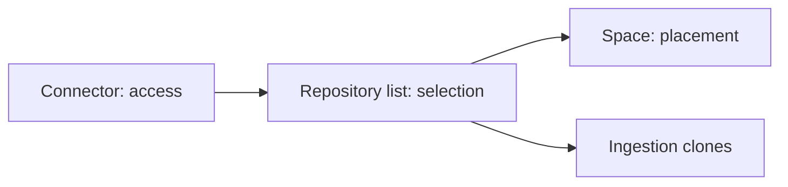

# Connectors and sources

What Steno reads, how it reaches it, and how repositories are placed.

> **In one minute**
> - A **connector** says where a source is and how to reach it. It doesn't interpret.
> - Access, selection, and placement are **separate choices** (D39).
> - Anything in a repository comes through the **git connector**. New connectors are only for API-reached systems (`v1`).
> - Ingestion **clones**. Queries never clone.

## 1. Connectors (Decided)

A connector is a source system plus a scope (a Bitbucket project, a GitHub organization) and a reference to credentials. Credentials never live in Steno's database.

| Concern | Question | Where |
|---|---|---|
| **Access** | What can Steno see? | The connector |
| **Selection** | What gets ingested? | Explicit list (`POC`); discovery (`v1`) |
| **Placement** | Which space? | The repository's space; placement rules with discovery |

**Placement rules** (built with discovery): connector + host grouping + optional name pattern → space. An explicit assignment wins, and unmatched repositories go to an unassigned queue.

## 2. Witnesses and connectors

| Source | Connector | Witness type |
|---|---|---|
| Application source, config, build | Git | CODE |
| Helm, Kubernetes, gateway routes, the XLD repository | Git | PLATFORM |
| `component_manifest.yaml`, `catalog-info.yaml`, CODEOWNERS | Git | DECLARED |
| XLD server, Kafka admin, artifact repository, scheduler, catalog API | New (`v1`) | PLATFORM or DECLARED |

**API connector (`v1`):** an adapter pulls a snapshot, turns it into claims, and stores them with an as-of time. Prefer a git copy when one exists.

## 3. Cloning (Decided)

Workers clone into a temporary workspace, because resolution needs the full tree and a clone is one request. Today: a shallow clone of the default branch. A cache of bare clones is an optional optimization.

**Queries never clone** ([Retrieval §4](../retrieval-and-mcp.md#4-code-access-and-breadth-decided-d17-d119)).

## 4. What a config file produces

| Config value | Becomes |
|---|---|
| Topic names, consumer groups | `KafkaTopic`, edge properties |
| Downstream base URLs | A host for `CALLS` targets |
| Datasource URLs | `DataStore` identity |
| Cron expressions | `Schedule` properties |
| Every property, per profile | `property` clues, re-read every job |
| Secrets | **Never read** |

**Deployment values (Proposed).** Admins supply values code reads at runtime. Credentials are stripped and refused, and values never reach an LLM.

## 5. What admins declare

The organization, spaces, connectors, repositories and placement, aliases and renames (planned), and glossary terms.

**Glossary (Decided: human-declared).** Vocabulary that appears nowhere in code, such as a nickname for an application. **Open:** the format.
