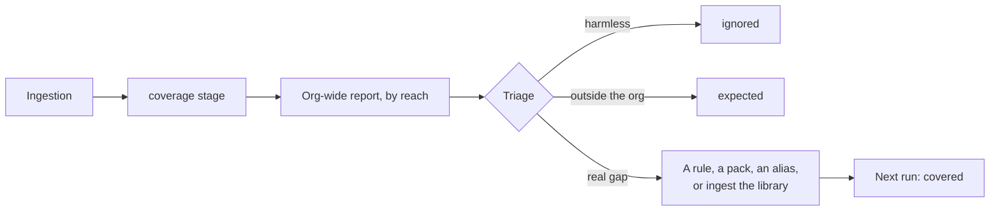

# Coverage report

After every ingestion, Steno reports **what no rule explained**, so gaps are measured instead of discovered by accident. It's how Steno keeps its promise to [never miss silently](./what-steno-must-see.md).

> **In one minute**
> - **Every item points at something on an application's surface** Steno might be missing, connections between applications first (D146).
> - Items are grouped into org-wide **patterns** and **ranked by reach**, because one rule fixes every repository with the gap.
> - **Triage persists,** so the report converges instead of staying noisy.
> - **It's the rule author's worklist** (D147).

## 1. Signals (Decided, D62, D65, D146)

Sections, in the report's order. Code: `coverage/collect.py`, `coverage/runs.py`.

| Section | Signal | Catches |
|---|---|---|
| **Connections** | `one_sided` | A topic produced and never consumed, or the reverse; a call to an endpoint no application exposes. Computed when read. |
| | `unknown_host` | HTTP calls whose host is runtime data, one per calling class (D64) |
| | `disagreement` | Code and another witness disagree (D109) |
| | `unmatched_name` | A witness's name that matches no application |
| **Repositories** | `silent_repository` | No applications, claims, or library modules. Usually an unread witness. |
| | `silent_witness` | A PLATFORM or DECLARED pack that matched files and stated nothing |
| **Libraries** | `internal_library` | The organization's library, not followed (by `STENO_INTERNAL_PREFIXES` and the repository's own roots) |
| | `external_library` | A public library with calls no rule explains |
| | `library` | An I/O library no pack covers |
| **Ways in** | `unknown_hook` | Framework code a rule doesn't explain (D101) |
| | `inferred_entry` | Work nothing in the code starts (D74), one per class |
| | `no_trigger_application` | An application with no known trigger |
| | `unreachable_effect` | A surface effect no entry point reaches |
| **Ways out** | `external_call` | I/O calls crossing the edge, one per library |
| | `config_unset` | A key a surface fact needs, set outside the repository |
| | `unread_config` | Keys under a communication prefix nothing read (D122) |
| | `dropped_match` | A match that dropped a surface fact |
| | `file_call` | Local file I/O, quiet unless several applications use it |
| **Rule health** | `version_untested`, `version_unknown` | A pack on an untested or unknown version (D106) |
| **Hidden** | `unread_file` | Files no rule read. Shown when it may be a real miss: a language no pack reads, or a config-shaped file with evidence (D148). |

**Numbers, not items:** unreachable code in general, other dropped matches, unparsed files, and unresolved chains through library types.

**One item per thing to look at.** Nothing is said twice, and `tests/test_coverage_noise.py` guards it.

## 2. How it runs

A `coverage` stage after `write` stores a `coverage_item` per gap, keyed by kind and target, with sample locations. Status carries over from the last run. The metrics are the repository's completeness numbers: % of I/O calls explained, % of functions reached, and item counts.

The Admin API serves the org-wide report (`GET /api/coverage`, `PUT /api/coverage/triage`), read by scope (D67). The UI's Coverage page shows both.

**What it can't see:** behavior that leaves no trace in code.

## 3. The agreement view (Proposed; POC stages B–D)

Disagreements and unmatched names are items today. A dedicated view would add identity conflicts, possible renames, and drift between a repository and its server (`v1`).

## 4. Turning a coverage item into a rule (Decided, D147)

See [Rule curation](./rule-curation.md).

## 5. Patterns (D121, D122; built)

Each coverage stage folds its items into org-wide patterns.

- **Fingerprint: what it is, never where.** `signal:target`, e.g. `unknown_hook:com.acme.messaging.AcmeHandler`.
- **Occurrence key: each place.** `(file, enclosing symbol, application)`. No lines, so moved code isn't new.
- **Reach is the current state.** Each run replaces its repository's occurrences, and reach is recounted.
- **New code** is the occurrences a run saw first (`first_seen_job`).

**Score:** `weight(signal) × (100 × repositories + 10 × applications + ln(1 + occurrences)) × (1 + 4 × pieces of evidence)`. Hooks and I/O weigh 3, disagreements 2.5, inferred triggers and libraries 2, unread files 0.5.

**Owner:** what clusters patterns into a framework (D123): the library for I/O calls and libraries; `config:` plus two key segments for config; the first three package segments for hooks; none for the application's own code.

**Evidence** raises a score: `referenced_by_code`, `names_known_things`, `in_internal_library`.

**Noise** comes from packs' `noise` blocks and `core/steno-pack-noise`. Migrations, API contracts, and deploy files are never noise, and a test checks that.

**Reading and triage:** `GET /api/patterns?state=open&limit=50`; `PUT /api/patterns/triage`; `steno coverage patterns|show|mark`.

**Limitations:**

| Change | Effect | Severity |
|---|---|---|
| Lines shift, or a body changes | None | — |
| A function or file is renamed or moved | Looks like one removed and one new | Low |
| Two uses in one function | One occurrence | Low |
| A framework renames its type | A new pattern; the old becomes `covered` | Medium |

**Open:** carrying an occurrence's history across renames.

## 6. Focusing the report on the surface (Decided, D146)

The signals above are the result. The ideas behind them:

### 6.1 Library gaps: internal and external

| | **Internal** | **External** |
|---|---|---|
| The gap means | Steno hasn't read the library | No pack knows it |
| Item | One per library, with calls and apps | One per library |
| Fixed by | Ingest and link it (A1, A2), or a rule in the org pack | A rule in a core pack (D129) |
| Rank | **First**: it can connect any two applications | By calls, then applications |

The skill does the learning. Steno's worker never downloads libraries. Coordinates in build files will link a library to its repository once A1 is built.

### 6.2 Silent repositories

Usually an unread witness, an unlinked library, or nothing to say. The item lists what the repository contains. An admin can mark it expected.

### 6.3 The plan

**Built:** the sections in §1, one-sided joins (topics and HTTP endpoints), and pattern scoring in the report's order.

**Not built:** new-since-last-run shown first, and rule health alarms (D126).

**The catalog grows:** a miss found any other way gets a [catalog](./what-steno-must-see.md#3-when-a-miss-is-found) row and a signal before its fix.
