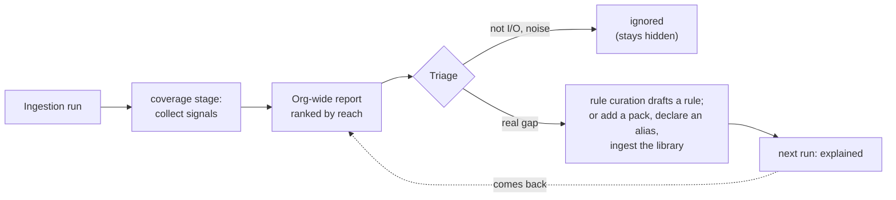
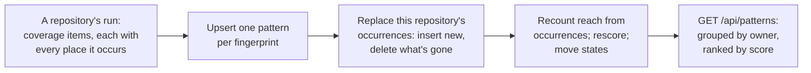

# Coverage report

After every ingestion, Steno reports **what no rule explained**, so gaps are measured instead of discovered by accident. It's the main tool for onboarding an organization and for deciding which rule to write next. Part of [Ingestion](./README.md).

> **In one minute**
> - Eight signals, each a place a fact could hide: unknown hosts, unexplained external calls, libraries with no pack, unknown triggers, unreachable code, matches Steno couldn't check, unparsed files, unresolved library types.
> - Items are **aggregated across the organization** (one fix helps every repository that has the gap) and **ranked by reach**: applications, then spaces, then occurrences.
> - Every item has a **triage state** (unexplained / ignored / explained) that persists, so the report converges instead of staying noisy. Planned (D121): items become org-wide **patterns** with occurrence keys and states that [rule curation](./rule-curation.md) works from.
> - Disagreements between witnesses (code only, declared only) and unmatched names are items like any other; a dedicated **agreement view** next to the report is planned.
> - **The report feeds rule curation** (D120): Steno drafts rules for its top patterns, and a person approves them.



---

## 1. Signals (Decided, D62, D65)

**Aggregated across the organization (D62).** One rule fixes the same gap in every repository that has it, so items are grouped by target across all repositories and **ranked by total occurrences**:

```
UNEXPLAINED (org-wide, top 3)
  437 call sites in 61 repos → com.yourorg.messaging.Publisher#send(String, Object)
  112 methods in 18 repos    → annotated @PxMessageHandler
   38 call sites in 9 repos  → com.yourorg.http.ServiceProvider#invoke(...)
```

**Triage states (D62).** Every item is **unexplained**, **ignored** (looked at; not I/O, e.g. a logging or string helper), or **explained** (a rule now covers it). The state persists across runs, so ignored noise stays hidden and the open count per repository trends toward zero instead of staying noisy forever. Each repository gets completeness numbers from it: % of external calls explained, % of functions reachable from an entry point, open items.

**What it looks for.** Each signal is a place a fact could hide. The first version (D65) builds six of them; the other two need more of the org ingested or config rules first.

| Signal | What it catches | Built |
|---|---|---|
| **Unknown hosts** | HTTP calls whose host is runtime data (D64), one item per calling class, with each call's URL template. Listed first: they're the `Unknown host` nodes in the graph. | Yes |
| **Disagreements** (D109) | Where the code and another witness disagree: an application uses a topic no ACL grants (`code only`), or a witness grants a use no code shows (`declared only`). Each goes to the repository that can fix it: the application's, or the platform repository's. See [claims and reconcile](./claims-and-reconcile.md#8-what-agents-and-admins-see). | Yes |
| **Unmatched names** | A name a witness uses (an ACL's user, a manifest's component) that matches no application: not ingested, or named differently. Listed for the repository whose claims use it; resolved by a matching name, an exact alias, or an admin link. | Yes |
| **Framework hooks no rule explains** (D101) | Code a framework runs without the code calling it: a class extending a framework type (`OncePerRequestFilter`, `ConstraintValidator`), a framework annotation or decorator (`@EnableWebSecurity`, `@mcp.tool()`). One item per framework type, so one rule (or a pack's `harmless` entry) settles all of them. Listed first: an unknown hook can touch anything. | Yes |
| **Unexplained external calls** | Library calls that can do I/O, declared by core lists and packs' `library.io` (D101), where no rule matched the call and the library's pack recorded nothing in the same function. Grouped by the library function called. Constructors and exception types aren't I/O. | Yes |
| **Config set outside the repository** (D101) | Config keys a fact needs (a topic, a host, a datasource) that no config file in the repository sets: set where the app runs. One item per key. | Yes |
| **Libraries with no pack** | I/O libraries the code imports that no rule pack covers, or any library with unexplained I/O calls (`redis imported in 4 files, no pack`) | Yes |
| **Untested or unknown versions** (D106) | A pack ran on a library version outside the range it's tested on (`version_untested`: "org.springframework.boot 4.0.1 · steno-pack-spring-web is tested on >=2.0, <4"), or no build file states the version (`version_unknown`). The rules ran; nothing says the syntax they match is what that version uses. | Yes |
| **Unknown triggers** | Work inside an application that nothing in the code starts: a worker loop, a CLI command, a callback a framework registers. It still gets a flow, marked inferred (D74); a rule naming its trigger makes the flow certain. | Yes |
| **Unreachable code** | Functions with effects that no entry point reaches (after D74: dead methods of classes in use, and code outside every application). Clusters usually mean a missing entry-point (receiver) rule, or runtime dispatch the call graph can't follow. | Yes |
| **Couldn't check** | Matches a rule found but couldn't complete because Steno couldn't tell (a condition it couldn't check, a name it couldn't resolve). Drops that are a rule working as designed (`table_of` on something that isn't an entity) aren't listed. | Yes |
| **Unparsed files** | Files Steno couldn't read at all: nothing in them is in the graph | Yes |
| **Unresolved library types** | A number in the metrics, not items (D101): calls that ran through a library type Steno can't see. The library call each chain starts from is what's accounted for; the count informs the dependency-JAR decision (D69). | Yes (metric) |
| **Cross-app inconsistencies** | A topic or channel produced but never consumed, or consumed but never produced; a call to an endpoint the target app doesn't expose. Each means one side was missed. | Later: needs several applications (POC stage B) |
| **Config no rule read** (D122) | Config keys no rule read, grouped by prefix (`acme.messaging.*`) | Planned |
| **Unread files** (D122) | Files no rule looked at, grouped by extension and location convention across the organization (`*.xyz under resources/flows/`); source code in a language no pack reads is one item per language (`*.js`). Noise (images, Markdown, lock files, CSS, editor and CI settings), build files, and test code aren't listed; SQL is, because the Data facet reads migrations. Ranked low until something says it matters. | Yes |

**By application, at any scope (D67).** Each item records the applications it occurs in (from its files' service modules), and the stage records each application's numbers. The report reads like the graph: the organization (its spaces, worst first), a space (its sub-spaces and applications), or one application, each with rolled-up numbers. Items are ranked by reach: how many applications, then spaces, one fix would help.

## 2. How it runs

**How it runs.** A `coverage` stage after `write` collects the items (`coverage/collect.py`) and stores one `coverage_item` per gap, keyed by kind and target, with up to five sample locations. Each item takes its status from the repository's previous run, so an ignored item stays ignored; an item marked explained that comes back is open again (a rule didn't cover it after all). The stage's metrics are the repository's completeness numbers: **% of I/O calls explained**, **% of functions reached** from an entry point, and the item counts. The Admin API serves the org-wide report (`GET /api/coverage`: each repository's latest run, items grouped across repositories) and triage (`PUT /api/coverage/triage`, applied everywhere the item appears); the UI's Coverage page shows both.

The most frequent items are exactly the internal frameworks worth covering. Each can be fixed by:
1. **Adding a rule** to the org pack, or
2. **Ingesting the library's repository**, so calls resolve into its code (how traces continue across repositories is Open).

Until then, they stay visible as coverage items (later, a decision model could cover them at low confidence).

**What it can't see.** Behavior that leaves no trace in the code (reflection, routing chosen entirely by runtime config) can only be marked unknown, not filled in. Runtime signals (deferred) are what close that gap.

## 3. The agreement view (Proposed; POC stages B–D)

Once a facet has a second witness, every disagreement is an item, triaged the same way:

| Item | Example | Usually means |
|---|---|---|
| **Code only** | A consumer in code with no ACL in XLD | The declaration is missing or stale, or a real permission problem |
| **Declared only** | An XLD grant with no consumer in code | A missed rule, a stale grant, or a name mismatch |
| **Unmatched name** | XLD names `svc-recon`; no application has that name or alias | Not ingested yet, or needs an alias |
| **Identity conflict** | Two repositories claim `org-svc-users` | A fork, or a migration with both live |
| **Possible rename** | "Removed X, added Y in the same run" | Link them, or confirm they're different |
| **Drift** | The XLD repository and the XLD server disagree (`v1`) | A failed or hand-edited deploy |

It's read by scope like the coverage report. Many disagreements in one direction for one framework point at a rule; scattered ones point at stale declarations. See [Trust](../../concepts/trust.md#3-agreement-between-witnesses).

## 4. Turning a coverage item into a rule (Decided, D120–D122)

Rules for coverage items are drafted by Steno's **[rule curation](./rule-curation.md)** job and approved by a person. In short:

- Items become **patterns** across the organization, named by what's unexplained (an annotation, a type, a library call, a file convention), with **occurrence keys** so reach reflects today's code and new code is exactly what changed since the last run (D121). Pattern states replace per-item triage.
- Patterns are **scored, not excluded**: signals such as "the code refers to this file" or "this file names topics already in the graph" rank them, noise is decided once per pattern, and low scorers stay visible at no cost (D122).
- Patterns are **clustered into frameworks**, investigated once per framework, drafted per pattern, **proven deterministically**, and reviewed as plain-English outcomes sorted by impact (D120, D123).

A person can still write any rule by hand, or with the `rule-pack-author` skill ([Rules §8](./rules-and-packs.md#8-writing-rules-by-hand-with-the-skill-or-by-curation-decided)); a hand-written rule closes any proposal it covers.

## 5. Patterns, as built (D121, D122; built 2026-10-21)

Every coverage stage folds its items into the organization's **patterns**: what's unexplained across every repository, kept from run to run. This is what rule curation works from, and it's all deterministic.



**Fingerprint: what it is, never where.** `signal:target`, for example `unknown_hook:com.acme.messaging.AcmeHandler`, `external_call:psycopg2.connect`, `unread_file:.xyz@resources/flows/`. The same gap in another repository or another run is the same pattern.

**Occurrence key: each place it occurs.** `(file, enclosing symbol, application)`, stored per repository in `coverage_occurrence`. The symbol, not the line, so an edit that moves lines isn't new code. A coverage item keeps every key, not just its five samples.

**Recording a run** (`coverage/patterns.py`, `record`):

1. Upsert a `coverage_pattern` row per fingerprint (label refreshed, owner set on creation, evidence merged).
2. Replace this repository's occurrences: rows for keys seen for the first time are inserted with the job that first saw them (`first_seen_job`), and rows this run didn't see are deleted.
3. Recount reach for every pattern touched (from this run, or losing rows): distinct repositories, distinct applications, occurrences.
4. Rescore, and move states (below).

**Reach is the current state, never a running total.** Re-reading old code inserts nothing; deleted code deletes rows. "New code since a date" is the occurrences whose `first_seen_job` is newer.

**States.** A pattern starts `open`. With no occurrences left, an `open`, `queued`, `drafting`, `proposed`, or `needs_person` pattern becomes `covered` (a rule explains it now, or the code is gone); a `covered` or `approved` pattern that occurs again goes back to `open`, with a note saying so. Ignoring an item in the coverage report ignores its pattern. The other states belong to rule curation ([rule curation §2](./rule-curation.md#2-patterns-decided-d121)).

**Score.** `weight(signal) × (100 × repositories + 10 × applications + ln(1 + occurrences)) × (1 + 4 × pieces of evidence)`. Repositories count most, since one rule fixes every repository with the pattern; the weight favors what can change the map (framework hooks and I/O calls 3, disagreements 2.5, inferred triggers and libraries 2, … unread files 0.5).

**Owner: what clusters patterns into a framework** (D123):

| Signal | Owner |
|---|---|
| Unexplained I/O call | The library the call goes into (`psycopg2`), else the target's package root |
| Library with no pack, untested or unknown version | The library |
| Config set outside the repository | `config:` plus the key's first two segments |
| Framework hook, and anything else naming a type | The package root: the first three package segments (`com.acme.messaging`) |
| The application's own code (inferred triggers, unreachable effects, unknown hosts, dropped matches, unparsed or unread files) | None: stands alone |

**Unread files** (a coverage signal since 2026-10-21): files no rule looked at (the engine records every file a code or config rule reads), grouped by extension and location convention (`*.xyz under resources/flows/`). Code in a language no pack reads is one pattern per language (`*.js`). A built-in noise list skips images, Markdown, lock files, CSS, editor and CI files; build files and test code aren't listed; SQL is, because migrations matter to the Data facet.

**Evidence** (D122): an unread file whose name appears in the code (`getResource("flows/order.xyz")`) gets `referenced_by_code`, which multiplies its score by five.

**Reading them:** `GET /api/patterns?state=open&limit=50` returns patterns grouped by owner, each group ranked by its summed score; patterns no library owns stand alone.

### Limitations of fingerprints and occurrence keys

| Change to the code | Effect | Severity |
|---|---|---|
| Lines shift (code added above, reformatting) | None: the key has no line numbers | — |
| A function's implementation changes but it keeps its name and file | None: same key | — |
| **A function is renamed, its file is renamed or moved, or the code is extracted into a new helper** | The place counts as one occurrence removed and one new: its `first_seen_job` becomes this run's, so old code looks new | Low today: reach stays correct, and a known pattern never goes back to the LLM. It matters once anything reads "new since" (the curation job's nightly comparison) |
| Two uses of a pattern inside one function | One occurrence: the unit is the enclosing function, not the call site | Low: fine for ranking, not call-site precise |
| **A rule's target is renamed** (a framework renames `AcmeHandler` to `MessageHandler`) | A new fingerprint: a new pattern, while the old one becomes `covered` | Medium: the new pattern is proposed again, though a person may have decided on the old one. Rule health (D126) should catch the old rule's drop in matches |
| A repository's first run | Every occurrence is new | Intended: that's the first run |

**To investigate (Open):** carrying an occurrence's history across renames and moves, the way identity carries an application's Steno ID (D83). Within one run and one pattern, pair each removed occurrence with an added one when the enclosing function's body is unchanged (its `body_hash`, already computed for traces) or its symbol differs only by name or path, and keep the original `first_seen_job`. Ambiguous pairs stay unpaired, so a mistake can only make old code look new, never hide new code. A renamed fingerprint is harder: it could be linked to the old one when the old rule's matches drop as the new pattern appears in the same places.
