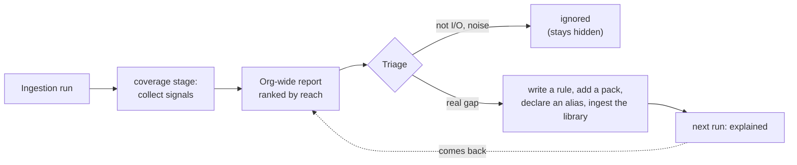

# Coverage report

After every ingestion, Steno reports **what no rule explained**, so gaps are measured instead of discovered by accident. It's the main tool for onboarding an organization and for deciding which rule to write next. Part of [Ingestion](./README.md).

> **In one minute**
> - Eight signals, each a place a fact could hide: unknown hosts, unexplained external calls, libraries with no pack, unknown triggers, unreachable code, matches Steno couldn't check, unparsed files, unresolved library types.
> - Items are **aggregated across the organization** (one fix helps every repository that has the gap) and **ranked by reach**: applications, then spaces, then occurrences.
> - Every item has a **triage state** (unexplained / ignored / explained) that persists, so the report converges instead of staying noisy.
> - Planned: an **agreement view** next to it, listing every disagreement between witnesses (code only, declared only) and every unmatched name.



---

## 1. Signals (Decided, D62, D65)

**Aggregated across the organization (D62).** One rule fixes the same gap in every repository that has it, so items are grouped by target across all repositories and **ranked by total occurrences**:

```
UNEXPLAINED (org-wide, top 3)
  437 call sites in 61 repos → com.yourorg.messaging.Publisher#send(String, Object)
  112 methods in 18 repos    → annotated @PxMessageHandler
   38 call sites in 9 repos  → com.yourorg.http.ServiceProvider#invoke(...)
```

**Triage states (D62).** Every item is **unexplained**, **ignored** (looked at; not I/O, e.g. a logging or string helper), or **explained** (a rule now covers it). The state persists across runs, so ignored noise stays hidden and the open count per repository trends toward zero instead of staying noisy forever. Each repository gets completeness numbers from it: % of external calls explained, % of functions reachable from an entry point, open items.

**What it looks for.** Each signal is a place a fact could hide. The first version (D65) builds six of them; the other two need more of the org ingested or config rules first.

| Signal | What it catches | Built |
|---|---|---|
| **Unknown hosts** | HTTP calls whose host is runtime data (D64), one item per calling class, with each call's URL template. Listed first: they're the `Unknown host` nodes in the graph. | Yes |
| **Framework hooks no rule explains** (D101) | Code a framework runs without the code calling it: a class extending a framework type (`OncePerRequestFilter`, `ConstraintValidator`), a framework annotation or decorator (`@EnableWebSecurity`, `@mcp.tool()`). One item per framework type, so one rule (or a pack's `harmless` entry) settles all of them. Listed first: an unknown hook can touch anything. | Yes |
| **Unexplained external calls** | Library calls that can do I/O, declared by core lists and packs' `library.io` (D101), where no rule matched the call and the library's pack recorded nothing in the same function. Grouped by the library function called. Constructors and exception types aren't I/O. | Yes |
| **Config set outside the repository** (D101) | Config keys a fact needs (a topic, a host, a datasource) that no config file in the repository sets: set where the app runs. One item per key. | Yes |
| **Libraries with no pack** | I/O libraries the code imports that no rule pack covers, or any library with unexplained I/O calls (`redis imported in 4 files, no pack`) | Yes |
| **Untested or unknown versions** (D106) | A pack ran on a library version outside the range it's tested on (`version_untested`: "org.springframework.boot 4.0.1 · steno-pack-spring-web is tested on >=2.0, <4"), or no build file states the version (`version_unknown`). The rules ran; nothing says the syntax they match is what that version uses. | Yes |
| **Unknown triggers** | Work inside an application that nothing in the code starts: a worker loop, a CLI command, a callback a framework registers. It still gets a flow, marked inferred (D74); a rule naming its trigger makes the flow certain. | Yes |
| **Unreachable code** | Functions with effects that no entry point reaches (after D74: dead methods of classes in use, and code outside every application). Clusters usually mean a missing entry-point (receiver) rule, or runtime dispatch the call graph can't follow. | Yes |
| **Couldn't check** | Matches a rule found but couldn't complete because Steno couldn't tell (a condition it couldn't check, a name it couldn't resolve). Drops that are a rule working as designed (`table_of` on something that isn't an entity) aren't listed. | Yes |
| **Unparsed files** | Files Steno couldn't read at all: nothing in them is in the graph | Yes |
| **Unresolved library types** | A number in the metrics, not items (D101): calls that ran through a library type Steno can't see. The library call each chain starts from is what's accounted for; the count informs the dependency-JAR decision (D69). | Yes (metric) |
| **Cross-app inconsistencies** | A topic or channel produced but never consumed, or consumed but never produced; a call to an endpoint the target app doesn't expose. Each means one side was missed. | Later: needs several applications (POC stage B) |
| **Config no rule read** | Config keys that look like hosts, URLs, topics, or queues that no rule read | Later: needs config rules |

**By application, at any scope (D67).** Each item records the applications it occurs in (from its files' service modules), and the stage records each application's numbers. The report reads like the graph: the organization (its spaces, worst first), a space (its sub-spaces and applications), or one application, each with rolled-up numbers. Items are ranked by reach: how many applications, then spaces, one fix would help.

## 2. How it runs

**How it runs.** A `coverage` stage after `write` collects the items (`coverage/collect.py`) and stores one `coverage_item` per gap, keyed by kind and target, with up to five sample locations. Each item takes its status from the repository's previous run, so an ignored item stays ignored; an item marked explained that comes back is open again (a rule didn't cover it after all). The stage's metrics are the repository's completeness numbers: **% of I/O calls explained**, **% of functions reached** from an entry point, and the item counts. The Admin API serves the org-wide report (`GET /api/coverage`: each repository's latest run, items grouped across repositories) and triage (`PUT /api/coverage/triage`, applied everywhere the item appears); the UI's Coverage page shows both.

The most frequent items are exactly the internal frameworks worth covering. Each can be fixed by:
1. **Adding a rule** to the org pack, or
2. **Ingesting the library's repository**, so calls resolve into its code (how traces continue across repositories is Open).

Until then, they stay visible as coverage items (later, a decision model could cover them at low confidence).

**What it can't see.** Behavior that leaves no trace in the code (reflection, routing chosen entirely by runtime config) can only be marked unknown, not filled in. Runtime signals (deferred) are what close that gap.

## 3. The agreement view (Proposed; POC stages B–D)

Once a facet has a second witness, every disagreement is an item, triaged the same way:

| Item | Example | Usually means |
|---|---|---|
| **Code only** | A consumer in code with no ACL in XLD | The declaration is missing or stale, or a real permission problem |
| **Declared only** | An XLD grant with no consumer in code | A missed rule, a stale grant, or a name mismatch |
| **Unmatched name** | XLD names `svc-recon`; no application has that name or alias | Not ingested yet, or needs an alias |
| **Identity conflict** | Two repositories claim `org-svc-users` | A fork, or a migration with both live |
| **Possible rename** | "Removed X, added Y in the same run" | Link them, or confirm they're different |
| **Drift** | The XLD repository and the XLD server disagree (`v1`) | A failed or hand-edited deploy |

It's read by scope like the coverage report. Many disagreements in one direction for one framework point at a rule; scattered ones point at stale declarations. See [Trust](../../concepts/trust.md#3-agreement-between-witnesses).

## 4. Turning a coverage item into a rule (Deferred)

**In the POC, a person writes each rule,** by hand or with the `rule-pack-author` skill ([Rules §8](./rules-and-packs.md#8-writing-rules-by-hand-or-with-the-skill-decided)), and the coverage report says which rule to write next. **AI suggestions during onboarding** (an LLM reading samples and drafting rules for a person to approve) are `v1`; see [Onboarding](../../plan/onboarding.md). Steno never generates rules on its own without approval. The template approach below is a later enhancement for when many organizations write their own rules:

There's **no LLM scanning the repository.** It works like this:

1. **Deterministic ingestion runs** with the enabled rule packs.
2. **The coverage report is computed deterministically**, then filtered by a decision (a naming heuristic today; Jev I8 in `v2`):
   - call sites whose target is an external or unresolved method **and** that look like I/O (the target's package, method names like `send` / `publish` / `invoke` / `execute`, networking or messaging imports)
   - public methods with annotations no rule recognizes

   Items are grouped by target and ranked by how often they occur.
3. **A person reviews the report** and says what an item means, using a form, not a prompt.
4. **Most org rules fit a few templates**, so the rule is generated **without an LLM**:

| Template | The person fills in | Example |
|---|---|---|
| **Call → interaction** | Method, fact type (`PRODUCES` / `CALLS` / `READS_FROM` / `WRITES_TO`), which argument holds the topic, URL, or table | `Publisher#send`, `PRODUCES`, topic = arg 0 |
| **Annotation → entry point** | Annotation, trigger kind, which attribute holds the topic or path | `@PxMessageHandler`, consumes topic, topic = `value` |
| **Annotation → entity / table** | Annotation, which attribute holds the table name | `@PxTable`, table = `name` |
| **Config key → fact** | Key pattern, fact type | `px.messaging.topics.*` → `KafkaTopic` |

5. **Steno validates the rule automatically:** it must match every example from the report, and it shows how many other places it matches, to catch false positives.
6. A person approves it, and it's added to the org pack.

**An LLM is only a fallback** for patterns no template fits. Even then it translates the person's stated intent plus the concrete examples into rule syntax, once per pattern, for a negligible cost. Hand-written rules are always supported.
