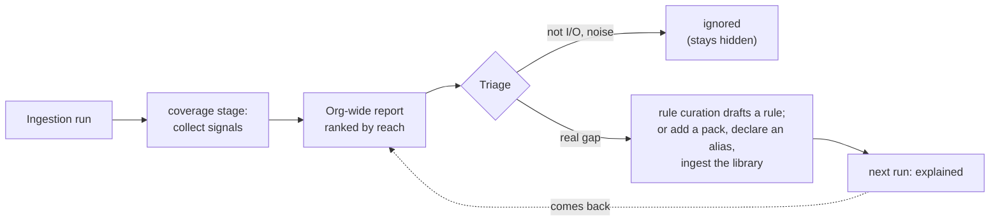
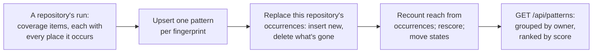

# Coverage report

After every ingestion, Steno reports **what no rule explained**, so gaps are measured instead of discovered by accident. It exists because Steno's bar is not "never misses" but "never misses silently" ([what Steno must see](./what-steno-must-see.md#why-this-page-exists-never-miss-silently)). It's the main tool for onboarding an organization and for deciding which rule to write next. Part of [Ingestion](./README.md).

> **In one minute**
> - Signals reported as items, each a place a fact could hide (§1, and the new ones in §6): unknown hosts, disagreements, unmatched names, unknown hooks, unexplained external calls, config set outside the repository, libraries with no pack, and more. Unresolved library types are a metric; cross-application inconsistencies are planned.
> - Items are **aggregated across the organization** (one fix helps every repository that has the gap) and **ranked by reach**: applications, then spaces, then occurrences.
> - Every item has a **triage state** (unexplained / ignored / explained) that persists, so the report converges instead of staying noisy. Planned (D121): items become org-wide **patterns** with occurrence keys and states that [rule curation](./rule-curation.md) works from.
> - Disagreements between witnesses (code only, declared only) and unmatched names are items like any other; a dedicated **agreement view** next to the report is planned.
> - **The report is the rule author's worklist** (D147): the `rule-pack-author` skill works its open items locally, learns what each needs, writes and checks the rule, and opens a pull request a person approves ([rule curation](./rule-curation.md)).
> - **What it must catch** is specified in [what Steno must see](./what-steno-must-see.md): every way into and out of an application, and the signal when one is missed. The report is how Steno keeps its promise to **never miss silently**.
> - **Decided (D146, §6):** the report is focused on the surface: new items for internal and external library gaps, silent repositories and witnesses, and one-sided joins; other signals become numbers, hidden input for rule authors, or rule health.



---

## 1. Signals (Decided, D62, D65)

**Aggregated across the organization (D62).** One rule fixes the same gap in every repository that has it, so items are grouped by target across all repositories and **ranked by total occurrences**:

```
UNEXPLAINED (org-wide, top 3)
  437 call sites in 61 repos → com.yourorg.messaging.Publisher#send(String, Object)
  112 methods in 18 repos    → annotated @PxMessageHandler
   38 call sites in 9 repos  → com.yourorg.http.ServiceProvider#invoke(...)
```

**Triage states (D62).** Every item is **unexplained**, **ignored** (looked at; not I/O, e.g. a logging or string helper), or **explained** (a rule now covers it). The state persists across runs, so ignored noise stays hidden and the open count per repository trends toward zero instead of staying noisy forever. Each repository gets completeness numbers from it: % of external calls explained, % of functions reachable from an entry point, open items.

**What it looks for.** Each signal is a place a fact could hide. The first version (D65) builds six of them; the other two need more of the org ingested or config rules first.

| Signal | What it catches | Built |
|---|---|---|
| **Unknown hosts** | HTTP calls whose host is runtime data (D64), one item per calling class, with each call's URL template. Listed first: they're the `Unknown host` nodes in the graph. | Yes |
| **Disagreements** (D109) | Where the code and another witness disagree: an application uses a topic no ACL grants (`code only`), or a witness grants a use no code shows (`declared only`). Each goes to the repository that can fix it: the application's, or the platform repository's. See [claims and reconcile](./claims-and-reconcile.md#8-what-agents-and-admins-see). | Yes |
| **Unmatched names** | A name a witness uses (an ACL's user, a manifest's component) that matches no application: not ingested, or named differently. Listed for the repository whose claims use it; resolved by a matching name, an exact alias, or an admin link. | Yes |
| **Framework hooks no rule explains** (D101) | Code a framework runs without the code calling it: a class extending a framework type (`OncePerRequestFilter`, `ConstraintValidator`), a framework annotation or decorator (`@EnableWebSecurity`, `@mcp.tool()`). One item per framework type, so one rule (or a pack's `harmless` entry) settles all of them. Listed first: an unknown hook can touch anything. | Yes |
| **Unexplained external calls** | Library calls that can do I/O, declared by core lists and packs' `library.io` (D101), where no rule matched the call and the library's pack recorded nothing in the same function. Grouped by the library function called. Constructors and exception types aren't I/O. | Yes |
| **Config set outside the repository** (D101) | Config keys a fact needs (a topic, a host, a datasource) that no config file in the repository sets: set where the app runs. One item per key. | Yes |
| **Libraries with no pack** | I/O libraries the code imports that no rule pack covers, or any library with unexplained I/O calls (`redis imported in 4 files, no pack`) | Yes |
| **Untested or unknown versions** (D106) | A pack ran on a library version outside the range it's tested on (`version_untested`: "org.springframework.boot 4.0.1 · steno-pack-spring-web is tested on >=2.0, <4"), or no build file states the version (`version_unknown`). The rules ran; nothing says the syntax they match is what that version uses. | Yes |
| **Unknown triggers** | Work inside an application that nothing in the code starts: a worker loop, a CLI command, a callback a framework registers. It still gets a flow, marked inferred (D74); a rule naming its trigger makes the flow certain. | Yes |
| **Unreachable code** | Functions with effects that no entry point reaches (after D74: dead methods of classes in use, and code outside every application). Clusters usually mean a missing entry-point (receiver) rule, or runtime dispatch the call graph can't follow. | Yes |
| **Couldn't check** | Matches a rule found but couldn't complete because Steno couldn't tell (a condition it couldn't check, a name it couldn't resolve). Drops that are a rule working as designed (`table_of` on something that isn't an entity) aren't listed. | Yes |
| **Unparsed files** | Files Steno couldn't read at all: nothing in them is in the graph | Yes |
| **Unresolved library types** | A number in the metrics, not items (D101): calls that ran through a library type Steno can't see. The library call each chain starts from is what's accounted for; the count informs the dependency-JAR decision (D69). | Yes (metric) |
| **Cross-app inconsistencies** | A topic or channel produced but never consumed, or consumed but never produced; a call to an endpoint the target app doesn't expose. Each means one side was missed. | Planned with the rebuild (§6.3); needs several applications ingested |
| **Config no rule read** (D122) | Config keys set in the repository that nothing read: no rule stated a fact from them, and no `${placeholder}` or settings lookup used them (the shared property map records every key read). Grouped by prefix (`acme.messaging.*`); the packs' noise prefixes (`logging`, `management`, `spring.jpa`, …) aren't listed. | Yes |
| **Unread files** (D122) | Files no rule looked at, grouped by extension and location convention across the organization (`*.xyz under resources/flows/`); source code in a language no pack reads is one item per language (`*.js`). Noise (the packs' `noise.files` globs: images, Markdown, lock files, CSS, editor and CI settings), build files, and test code aren't listed; SQL is, because the Data facet reads migrations. Ranked low until evidence says it matters. | Yes |

**By application, at any scope (D67).** Each item records the applications it occurs in (from its files' service modules), and the stage records each application's numbers. The report reads like the graph: the organization (its spaces, worst first), a space (its sub-spaces and applications), or one application, each with rolled-up numbers. Items are ranked by reach: how many applications, then spaces, one fix would help.

## 2. How it runs

**How it runs.** A `coverage` stage after `write` collects the items (`coverage/collect.py`) and stores one `coverage_item` per gap, keyed by kind and target, with up to five sample locations. Each item takes its status from the repository's previous run, so an ignored item stays ignored; an item marked explained that comes back is open again (a rule didn't cover it after all). The stage's metrics are the repository's completeness numbers: **% of I/O calls explained**, **% of functions reached** from an entry point, and the item counts. The Admin API serves the org-wide report (`GET /api/coverage`: each repository's latest run, items grouped across repositories) and triage (`PUT /api/coverage/triage`, applied everywhere the item appears); the UI's Coverage page shows both.

The most frequent items are exactly the internal frameworks worth covering. Each can be fixed by:
1. **Adding a rule** to the org pack, or
2. **Ingesting the library's repository**, so calls resolve into its code (how traces continue across repositories is Open).

Until then, they stay visible as coverage items (later, a decision model could cover them at low confidence).

**What it can't see.** Behavior that leaves no trace in the code (reflection, routing chosen entirely by runtime config) can only be marked unknown, not filled in. Runtime signals (deferred) are what close that gap.

## 3. The agreement view (Proposed; POC stages B–D)

Once a facet has a second witness, every disagreement is an item, triaged the same way:

| Item | Example | Usually means |
|---|---|---|
| **Code only** | A consumer in code with no ACL in XLD | The declaration is missing or stale, or a real permission problem |
| **Declared only** | An XLD grant with no consumer in code | A missed rule, a stale grant, or a name mismatch |
| **Unmatched name** | XLD names `svc-recon`; no application has that name or alias | Not ingested yet, or needs an alias |
| **Identity conflict** | Two repositories claim `org-svc-users` | A fork, or a migration with both live |
| **Possible rename** | "Removed X, added Y in the same run" | Link them, or confirm they're different |
| **Drift** | The XLD repository and the XLD server disagree (`v1`) | A failed or hand-edited deploy |

It's read by scope like the coverage report. Many disagreements in one direction for one framework point at a rule; scattered ones point at stale declarations. See [Trust](../../concepts/trust.md#3-agreement-between-witnesses).

## 4. Turning a coverage item into a rule (Decided, D121, D122, D147)

Rules for coverage items are written by the **`rule-pack-author` skill**, run by a developer, and approved by a person on a pull request ([rule curation](./rule-curation.md)). In short:

- Items become **patterns** across the organization, named by what's unexplained (an annotation, a type, a library call, a file convention), with **occurrence keys** so reach reflects today's code and new code is exactly what changed since the last run (D121). Pattern states replace per-item triage.
- Patterns are **scored, not excluded**: signals such as "the code refers to this file" or "this file names topics already in the graph" rank them, noise is decided once per pattern, and low scorers stay visible at no cost (D122).
- Patterns are **clustered into frameworks**, so the skill learns a framework once and writes its rules together; every rule is **proven deterministically** (`steno rules test`, then `steno rules check` over every file the pattern occurs in) before its pull request opens (D123, D147).

A person can still write any rule by hand ([Rules §8](./rules-and-packs.md#8-writing-rules-by-hand-with-the-skill-or-by-curation-decided)); once it runs, the patterns it explains become `covered`.

## 5. Patterns, as built (D121, D122; built 2026-10-21)

Every coverage stage folds its items into the organization's **patterns**: what's unexplained across every repository, kept from run to run. This is what the rule author works from, and it's all deterministic.



**Fingerprint: what it is, never where.** `signal:target`, for example `unknown_hook:com.acme.messaging.AcmeHandler`, `external_call:psycopg2.connect`, `unread_file:.xyz@resources/flows/`. The same gap in another repository or another run is the same pattern.

**Occurrence key: each place it occurs.** `(file, enclosing symbol, application)`, stored per repository in `coverage_occurrence`. The symbol, not the line, so an edit that moves lines isn't new code. A coverage item keeps every key, not just its five samples.

**Recording a run** (`coverage/patterns.py`, `record`):

1. Upsert a `coverage_pattern` row per fingerprint (label refreshed, owner set on creation, evidence merged).
2. Replace this repository's occurrences: rows for keys seen for the first time are inserted with the job that first saw them (`first_seen_job`), and rows this run didn't see are deleted.
3. Recount reach for every pattern touched (from this run, or losing rows): distinct repositories, distinct applications, occurrences.
4. Rescore, and move states (below).

**Reach is the current state, never a running total.** Re-reading old code inserts nothing; deleted code deletes rows. "New code since a date" is the occurrences whose `first_seen_job` is newer.

**States.** A pattern starts `open`. With no occurrences left, an `open` or `proposed` pattern becomes `covered` (a rule explains it now, or the code is gone); a `covered` pattern that occurs again goes back to `open`, with a note saying so. Ignoring an item in the coverage report ignores its pattern. `expected` is for a gap that's legitimately outside the organization, and `proposed` means a rule's pull request is open ([rule curation §2](./rule-curation.md#2-patterns-decided-d121)).

**Score.** `weight(signal) × (100 × repositories + 10 × applications + ln(1 + occurrences)) × (1 + 4 × pieces of evidence)`. Repositories count most, since one rule fixes every repository with the pattern; the weight favors what can change the map (framework hooks and I/O calls 3, disagreements 2.5, inferred triggers and libraries 2, … unread files 0.5).

**Owner: what clusters patterns into a framework** (D123):

| Signal | Owner |
|---|---|
| Unexplained I/O call | The library the call goes into (`psycopg2`), else the target's package root |
| Library with no pack, untested or unknown version | The library |
| Config set outside the repository | `config:` plus the key's first two segments |
| Framework hook, and anything else naming a type | The package root: the first three package segments (`com.acme.messaging`) |
| The application's own code (inferred triggers, unreachable effects, unknown hosts, dropped matches, unparsed or unread files) | None: stands alone |

**Unread files and unread config** (coverage signals since 2026-10-21/22): files no rule looked at (the engine records every file a code or config rule reads), grouped by extension and location convention (`*.xyz under resources/flows/`), with code in a language no pack reads as one pattern per language (`*.js`); and config keys nothing read, grouped by prefix (`acme.messaging.*`).

**Noise comes from the packs.** A pack's `noise` block lists file globs and config key prefixes the report never lists; the core pack `rule-packs/core/steno-pack-noise` holds the universal list, and an organization's pack can add its own. A test checks it against the facets: migrations, API contracts and schemas, deploy, Helm, topic, and catalog files are never noise.

**Evidence** (D122), each multiplying a pattern's score (× 5 for one, × 9 for two, …):

| Evidence | Means | For |
|---|---|---|
| `referenced_by_code` | The code mentions the file's name (`getResource("flows/order.xyz")`) | Unread files |
| `names_known_things` | The file's text or the config value names a topic, endpoint path, table, or application already in this run's graph (a name with a separator, or at least 8 characters, so ordinary words don't count) | Unread files, unread config |
| `in_internal_library` | It occurs inside one of the repository's library modules | Any pattern |

**Triage on patterns.** `PUT /api/patterns/triage` with `{fingerprints, state: ignored | open, note}` ignores or reopens whole patterns in bulk, recording why. The same items in every repository's latest coverage run follow, so the report and the patterns agree, and later runs keep the decision. The other states belong to rule curation.

**Reading them:** `GET /api/patterns?state=open&limit=50` returns patterns grouped by owner, each group ranked by its summed score; patterns no library owns stand alone.

### Limitations of fingerprints and occurrence keys

| Change to the code | Effect | Severity |
|---|---|---|
| Lines shift (code added above, reformatting) | None: the key has no line numbers | — |
| A function's implementation changes but it keeps its name and file | None: same key | — |
| **A function is renamed, its file is renamed or moved, or the code is extracted into a new helper** | The place counts as one occurrence removed and one new: its `first_seen_job` becomes this run's, so old code looks new | Low today: reach stays correct, and a known pattern never goes back to the LLM. It matters once anything reads "new since" (the report's new-since-last-run view, D146) |
| Two uses of a pattern inside one function | One occurrence: the unit is the enclosing function, not the call site | Low: fine for ranking, not call-site precise |
| **A rule's target is renamed** (a framework renames `AcmeHandler` to `MessageHandler`) | A new fingerprint: a new pattern, while the old one becomes `covered` | Medium: the new pattern is proposed again, though a person may have decided on the old one. Rule health (D126) should catch the old rule's drop in matches |
| A repository's first run | Every occurrence is new | Intended: that's the first run |

**To investigate (Open):** carrying an occurrence's history across renames and moves, the way identity carries an application's Steno ID (D83). Within one run and one pattern, pair each removed occurrence with an added one when the enclosing function's body is unchanged (its `body_hash`, already computed for traces) or its symbol differs only by name or path, and keep the original `first_seen_job`. Ambiguous pairs stay unpaired, so a mistake can only make old code look new, never hide new code. A renamed fingerprint is harder: it could be linked to the old one when the old rule's matches drop as the new pattern appears in the same places.

## 6. Focusing the report on the surface (Decided, D146)

Today's signals were added one at a time, so the report also lists things that can't change the map (unparsed files, version warnings). D146 makes **every item point at something on an application's surface Steno might be missing**, with connections between applications first; everything else becomes a number, hidden input for rule authors, or rule health. What the report must catch is the [catalog](./what-steno-must-see.md); this section is how the report catches it.

### 6.1 Library gaps: internal and external

When code calls into a library, the resolver knows **which** method it calls from the imports (in Java, even without the library's JAR; [resolvers](./resolvers.md)). It doesn't know **what that method does**. Library gaps are split by who owns the code, because each kind is fixed a different way:

| | **Internal** (the organization's code, by prefix. Java: packages `com.acme.*` and coordinates `com.acme:*`. Python: packages such as `acme_*`) | **External** (public and vendor libraries) |
|---|---|---|
| What the gap means | Steno hasn't read the library | No rule pack knows the library |
| The item | One per internal library: "`com.acme:orders-client`: 140 calls in 12 apps, not followed" | One per external library with calls not explained, apart from harmless ones (`HARMLESS`, or triaged as harmless) |
| Where the source is | The repository that publishes the coordinate (Artifacts A1), or "no repository publishes this" | Its public source repository or package |
| How it's fixed | Ingest and link the library's repository (A1, then A2), or a rule in the organization pack | A rule in a core pack (D129) |
| Rank | **Above external.** Internal frameworks first: an internal hook or sender can connect any two applications | By calls, then applications |

**Which code is internal.** `STENO_INTERNAL_PREFIXES` lists the organization's prefixes, any number and of any kind (`com.acme, io.kbavis, com.acme:*, acme_`). The repository's own package roots count too, so a solo developer with no consistent prefix needs no setting. Onboarding takes the list over in `v1`. Everything else is external.

**Coverage flags the miss; the skill does the learning (D147).** The item says where the library's source is when Steno knows. The `rule-pack-author` skill reads it there, clones it, or reads the public library's source, on the developer's machine. Steno's worker never downloads libraries.

**How Steno finds the publishing repository.** The library's build file says what it publishes (Java: `groupId:artifactId` in Maven, `group` and the project name in Gradle; Python: the name in `pyproject.toml`). The consumer's build file says what it depends on (`build.gradle`, `pom.xml`, `pyproject.toml`, `requirements.txt`). The coordinate joins them like a topic ([joins §5](./joins.md#5-planned-joins)). Gradle coordinates computed in scripts are a known weak spot (an open question).

Versions are left to the Constraints pillar (which versions are available in which environment).

### 6.2 Silent repositories

**A silent repository** has no applications, no claims, and no linked library modules. Usually it is one of three things:

1. A witness no pack reads (a config, deploy, ACL, or mesh repository). This is the most important case: a whole source of statements is missing.
2. A library that isn't linked yet (§6.1).
3. A repository with nothing to say (docs, tooling, an archived project).

The item lists what the repository contains (`*.xml under deploy/`, `*.yaml under k8s/`), so the cause is easy to see. An admin can mark it **expected silent**, and that state persists. The item ranks higher when something else points at the repository (a dependency on its coordinate, or a name that matches it). A variant is the **silent witness**: a pack that matched files but stated nothing, which means the witness is broken, not missing.

### 6.3 The plan

| Change | Signals |
|---|---|
| **Keep as items** | `unknown_host`, `disagreement`, `unmatched_name`, `inferred_entry`, `no_trigger_application`; `config_unset` only for keys a surface fact needs (topics, hosts, URLs, datasources) |
| **Narrow, then keep** | `external_call`: calls that cross the application's edge (network, messaging, databases, object stores), one item per library. `file_call`: local file I/O, one item per file library, quiet unless more than one application in the repository uses it (a model one writes and another loads). `library`: I/O libraries only. `unknown_hook`: ranked by whether the hook can start work (listeners, handlers, schedulers, entry filters). `unreachable_effect`: only effects on the surface (usually a missed entry-point rule). `unread_config`: only under a known communication prefix (`spring.cloud.stream.*`, `*.url`, `*.host`, `*.topic`). `dropped_match`: only when it dropped a surface fact (a table, a topic, a route) |
| **New items** | Internal and external library gaps (§6.1); silent repositories and silent witnesses (§6.2); **one-sided joins**, computed from the graph when the report is read, built now rather than in stage B (a topic produced but never consumed, or the reverse; a call to an endpoint no application exposes) |
| **Numbers on the application, not items** | Unreachable code in general; other `dropped_match`; `unparsed`; unresolved chains through a library's types |
| **Hidden, for rule authors** | `unread_file` unless it may be something missed (code in a language no pack reads; a config-shaped file the code refers to, or that names things in the graph: a compose file, an nginx config; D148), other `unread_config`, `file_call` within one application: kept as patterns, left out of the report, listed for the skill on request |
| **Rule health** | `version_untested`, `version_unknown` |

**One-sided joins are built with the rebuild.** They're the only check that catches a miss without knowing the mechanism: an internal framework's sender that no rule understands still leaves its receiver with no producer. It's a query over the graph, run when the report is read, so it needs no new rules and is never stale. Topics and HTTP endpoints first. An end that's legitimately outside the organization (an endpoint only external clients call, a topic a vendor consumes) is triaged **expected**, and that state persists.

**One item per thing to look at (no noise).** A report that lists the same gap many times trains people to ignore it, so:
- **"No known trigger" is one item per class or module**, with the number of functions ("SqlRegistry (11 functions)"). A function a framework calls through an unknown hook (a CLI command, an MCP tool) isn't listed: the hook's item counts it.
- **Unexplained I/O is one item per library**, with its methods inside ("neo4j (6 methods)"). One pack fixes them all.
- **Nothing is said twice:** a config key an unknown host's URL is built from is on that host's item; an I/O library with calls is its calls' item; a settings class's fields (`settings.X`, read by code) aren't "config no rule read".
- **A guard test** (`tests/test_coverage_noise.py`) builds each shape that once produced many items and fails if it does again.

**Grouped by what was missed.** The report follows the [catalog's](./what-steno-must-see.md#2-the-catalog) groups: ways in, calls and messages out, data stores and files, external systems, libraries and internal frameworks, routing, witnesses, repositories. Items are ranked: connections between applications first, then internal before external, then by applications and calls. Pattern scoring (`coverage/patterns.py`) ranks the same way, so the skill works items in the report's order.

**Staying on top of it.**
- **Every run** produces items. A developer runs the `rule-pack-author` skill on the top ones; it opens pull requests, and a person approves them (D147). The next run shows them as explained.
- **New since the last run** is shown first, so a new library or a new repository is noticed the day it appears.
- **Per application:** the count of open items, and a short list of what Steno couldn't see, served in each answer's `completeness` block (D118).
- **Organization-wide:** the join rate, unjoined sends, and orphan receivers ([joins §6](./joins.md#6-measuring-joins)).
- **The catalog grows:** a miss found any other way (the trial, a user's report, a wrong answer) gets a row in [the catalog](./what-steno-must-see.md#3-when-a-miss-is-found) and a signal before it gets a fix. A row with no signal is listed as a blind spot.
