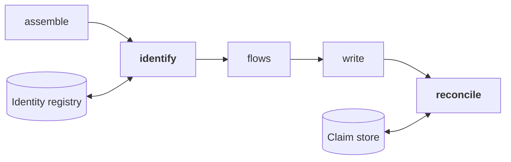

# Identify and reconcile

**Identify** gives every application a permanent ID and its real name. **Reconcile** combines witnesses. The ideas are in [Identity](../../concepts/identity.md).

> **In one minute**
> - **Identify** runs after assemble. It picks each deployable's canonical name, looks it up in a Postgres registry, and reuses or assigns a Steno ID.
> - **Reconcile** runs after write, on subjects the job touched. See [claims and reconcile](./claims-and-reconcile.md).

## 1. Where they sit

Identify needs the completed facts and feeds child IDs to flows. Reconcile runs later, because witnesses for one subject come from repositories ingested at different times.

## 2. Identify

Code: `identity/identify.py`, `registry.py`, `names.py`.

**Names read:** path (provisional), build artifact (Gradle `rootProject.name`, Maven `artifactId`, `pyproject`, `package.json`), runtime (`spring.application.name`), and others' `name` claims, linked exactly.

**Steps:**

1. **Pick the canonical name** by the ladder. Everything else is an alias.
2. **Look it up,** by **location** first, then by **name**: found elsewhere in this repository is moved; found removed is restored; active in another repository is a conflict, never merged; a pending admin rename continues that ID; otherwise a new ID (12 hex characters).
3. **Mark removed** every active application not seen, after the write succeeds.
4. **Report** new, renamed, moved, removed, restored, conflicts, and `possible_renames`.

**Output:** `app:{steno_id}` with `name`, `display_name`, `aliases`, `alias_text`, `provisional_name`, and `conflict_with`. Without a registry (`steno extract`, tests), IDs use the path name.

| Table | Columns |
|---|---|
| `application_identity` | `steno_id`, `canonical_name`, `display_name`, `repository_id`, `module_path`, `state`, `conflict_with`, `first_seen_job`, `last_seen_job`, `removed_job` |
| `application_alias` | `steno_id`, `name`, `slot`, `witness_type`, `source`, `is_past_name`, `first_seen_job`, `last_seen_job` |
| `application_link` | `from_steno_id`, `to_steno_id` or `pending_name`, `kind`, `by`, `at`, `reason`, `applied_job` |
| `unmatched_name` | `name`, `sources`, `first_seen`, `last_seen`, `status`, `mapped_to` |

**Proven** in `tests/test_identify.py`. **Not built:** naming patterns, an admin API or UI, and anchoring on the git host's repository ID.

## 3. Reconcile

See [Claims and reconcile](./claims-and-reconcile.md) (D109, D114).
