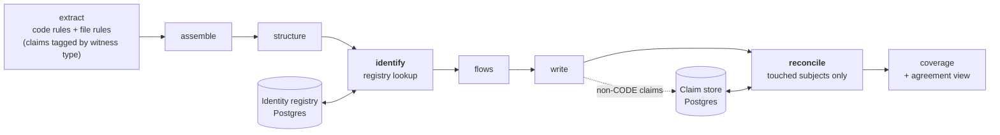

# Identify and reconcile

Two planned additions to the pipeline. **Identify** gives every application a permanent Steno ID and its real name. **Reconcile** combines claims from different witnesses into facts with sources and agreement states. Part of [Ingestion](./README.md); the ideas are in [Identity](../../concepts/identity.md) and [Witnesses and facets](../../concepts/witnesses-and-facets.md).

> **In one minute**
> - **Identify** (Decided; `POC` stage A) runs after structure detection. It looks each deployable up in a Postgres **identity registry** by canonical name or by repository + module path, reuses or assigns a Steno ID, and marks unseen applications removed. Everything under an application is then keyed by its Steno ID.
> - **Reconcile** (direction Decided, design **Proposed**: [claims and reconcile](./claims-and-reconcile.md)) handles the fact that witnesses for one subject come from **different repositories ingested on different nights**: the XLD repo describes a topic; a consumer's code lives elsewhere. Each run stores its claims; reconcile recomputes only the subjects a run touched, from every stored claim about them.
>
> Neither is built yet.

---

## 1. Where they sit

## 2. Identify (Decided)

**Input:** the deployables structure detection found in this repository, each with its anchors: location (git host repository ID + module path), and every name claim from the name ladder (deploy name, manifest ID, build artifact name, runtime self-name).

**Steps:**

1. **Pick each deployable's canonical name** from its name claims, by ladder priority (ADMIN → PLATFORM → DECLARED → CODE build name → CODE runtime name → path, provisional). Apply declared naming patterns. Every other name becomes an alias with its source.
2. **Look it up** in the registry by canonical name or by location.
   - Found → reuse the Steno ID; record a changed name or location; the old name becomes an alias.
   - Found by name, but active in another repository → **conflict**, flagged; no merge.
   - A pending admin rename ("`users-svc` becomes `org-svc-identity`") matches → reuse that Steno ID.
   - Not found → assign a new Steno ID.
3. **Mark removed** every registered application of this repository not seen in this run (a tombstone). A removed application whose name or location appears again is restored with its old ID.
4. **Report** to the run's change report: new, renamed, moved, removed, restored, conflicts, and "removed X, added Y in the same run" (a possible rename-and-move for an admin to link).

**Output:** each deployable's Steno ID, canonical name, display name, aliases, kind labels. The flows stage builds every child ID (endpoint, flow, entity, schedule) on the Steno ID.

**Registry (Postgres, proposed shape):**

| Table | Columns |
|---|---|
| `application_identity` | `steno_id`, `canonical_name`, `display_name`, `repository_id`, `module_path`, `state` (active / removed / deprecated), `first_seen_job`, `last_seen_job`, `removed_job` |
| `application_alias` | `steno_id`, `name`, `source` (witness type + witness + file/line), `slot` (ladder slot), `is_past_name` |
| `application_link` | `from_steno_id`, `to_steno_id` or `pending_name`, `kind` (rename / same), `by`, `at`, `reason` |
| `unmatched_name` | `name`, `source`, `first_seen`, `status` (open / mapped / ignored), `mapped_to` |

**Migration from today:** application IDs are `app:{repo}[-{module}]` and every child ID embeds that name. Stage A assigns Steno IDs to existing applications by their current location, rewrites child IDs once, and from then on IDs never depend on names.

**Proving it** (stage B): scripted rename, move, rename-and-move, split, removal, restoration, and two repositories claiming one name; after each, re-ingest and check no duplicates, no dead flows, expected IDs.

## 3. Reconcile

The design is on its own page: **[Claims and reconcile](./claims-and-reconcile.md)** (Proposed, for review). In short: packs that read deploy definitions, ACL files, and manifests emit **claims**, stored in Postgres (D109); after each job, reconcile lines up every claim and code fact about the subjects the job touched and writes agreement states, citations per witness, and declared-only edges into the graph. Its open choices (how declared-only facts appear, where agreement lives, what counts as checked, when reconcile runs) are listed there with recommendations.
