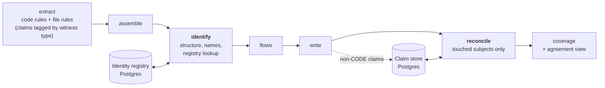

# Identify and reconcile

Two stages of the pipeline. **Identify** gives every application a permanent Steno ID and its real name. **Reconcile** combines claims from different witnesses into facts with sources and agreement states. Part of [Ingestion](./README.md); the ideas are in [Identity](../../concepts/identity.md) and [Witnesses and facets](../../concepts/witnesses-and-facets.md).

> **In one minute**
> - **Identify** (built 2026-10-14) runs after assemble. It finds the deployables (structure), collects their names, picks each one's canonical name by the name ladder, looks it up in a Postgres **identity registry** by repository + module path or by canonical name, and reuses or assigns a Steno ID. Applications no longer found are tombstoned once the run has succeeded. Everything under an application is keyed by its Steno ID.
> - **Reconcile** (built 2026-10-14) runs after write: witnesses for one subject come from **different repositories ingested at different times** (a platform repository declares a topic; a consumer's code lives elsewhere). Each run stores its claims; reconcile recomputes only the subjects a run touched. See [claims and reconcile](./claims-and-reconcile.md).

---

## 1. Where they sit

## 2. Identify

Code: `identity/identify.py` (the algorithm, over a registry interface), `identity/registry.py` (Postgres), `identity/names.py` (names from build files).

**Input:** the deployables structure detection found in this repository (a module with entry points is a deployable), each with its location (repository + module path) and every name this run gives it:

| Name | Slot | Read from |
|---|---|---|
| Repository + folder (`budgeting-app-backend`) | `path` (provisional) | Structure |
| Build artifact name | `build_artifact` | The module's own build file: Gradle `rootProject.name` (`settings.gradle`), Maven `artifactId`, `pyproject.toml` / `setup.cfg` name, `package.json` name. A Gradle subproject's default name (its folder) doesn't count: it says no more than the path |
| Runtime self-name | `runtime` | CODE `name` claims from files in the module (`spring.application.name`) |
| Deploy name, manifest name, … | `deploy`, `manifest`, `admin` | Other witnesses' `name` claims, from the claim store and this run, **linked exactly**: a claim whose application or name equals one of the deployable's names adds its names, repeatedly |

**Steps:**

1. **Pick each deployable's canonical name** by the name ladder: admin → deploy → manifest → build artifact → runtime → path; on one rung, the more authoritative witness type. Every other name is an alias, with its source. The display name is a declared one (`deployable` claims' `display_name`, by ADMIN → DECLARED → PLATFORM), else the canonical name.
2. **Look it up**, in two passes: first by **location** for every deployable (so a rename in place keeps its ID even if another deployable takes its old name), then by **canonical name**:
   - found in this repository at another path → **moved**;
   - found removed → **restored** (and moved, if elsewhere);
   - active in another repository → **conflict**, flagged (`conflict_with`), never merged; the deployable gets its own ID;
   - a pending admin rename (`application_link` with a `pending_name`) matches → that Steno ID continues;
   - otherwise → a **new** Steno ID (12 hex characters, never derived from a name).
   A changed canonical name is recorded: the old one stays an alias, marked `is_past_name`.
3. **Mark removed** every active application of this repository not seen, **after the graph write succeeds** (a failed run removes nothing). A removed application whose name or location appears again is restored with its old ID.
4. **Report** in the stage's metrics: new, renamed, moved, removed, restored, conflicts, and "removed X, added Y in the same run" (`possible_renames`, for an admin to link).

**Output:** each deployable's Steno ID, canonical name, display name, and names. The application node is `app:{steno_id}` with `name` (canonical), `steno_id`, `display_name`, `aliases`, `alias_text` (so search finds old and other names), `provisional_name` when only the folder names it, and `conflict_with`. The flows stage builds every child ID (endpoint, flow, entity, schedule) on the Steno ID. Without a registry (`steno extract`, tests), IDs fall back to the path-derived name.

**Registry (Postgres):**

| Table | Columns |
|---|---|
| `application_identity` | `steno_id`, `canonical_name`, `display_name`, `repository_id`, `module_path`, `state` (active / removed / deprecated), `conflict_with`, `first_seen_job`, `last_seen_job`, `removed_job` |
| `application_alias` | `steno_id`, `name`, `slot`, `witness_type`, `source` (witness, file, line), `is_past_name`, `first_seen_job`, `last_seen_job` |
| `application_link` | `from_steno_id`, `to_steno_id` or `pending_name`, `kind` (rename / same), `by`, `at`, `reason`, `applied_job` |
| `unmatched_name` | `name`, `sources`, `first_seen`, `last_seen`, `status` (open / mapped / ignored), `mapped_to` |

**Migration:** the first run with identify assigned Steno IDs by location and rewrote every child ID once (one large delta per repository); from then on IDs never depend on names, and re-ingesting the same commit writes nothing.

**Proven** in memory (`tests/test_identify.py`): unchanged, renamed in place, moved within a repository, moved to another repository after the old one removed it, renamed and moved at once (new, with a hint), a declared rename ahead of time, a split, two repositories claiming one name (a conflict), and a platform deploy name linked exactly becoming canonical. The stage B stub organization adds the same changes as scripted git commits.

**Not built yet:** naming patterns ("deploy name = `org-svc-{module}`"), an API or UI for admin links and overrides, anchoring on the git host's repository ID (so a repository rename keeps its location), and removing every application of a repository deleted from Steno.

## 3. Reconcile

Reconcile has its own page: **[Claims and reconcile](./claims-and-reconcile.md)** (built). In short: packs that read deploy definitions, ACL files, and manifests emit **claims**, stored in Postgres (D109); after each job, reconcile lines up every claim and code fact about the subjects the job touched and writes agreement states, citations per witness, and declared-only edges into the graph (D114).
