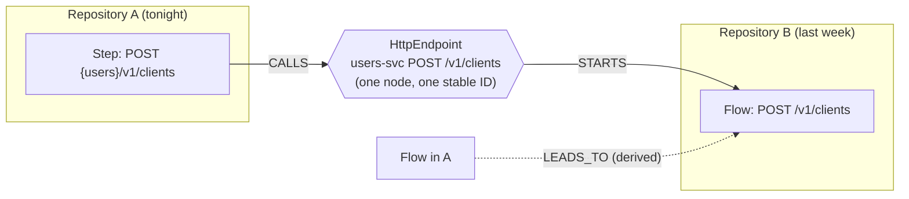
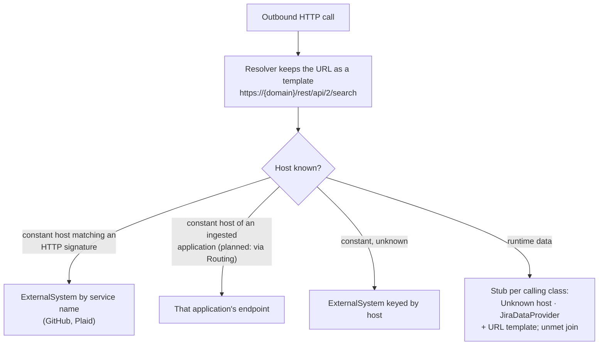
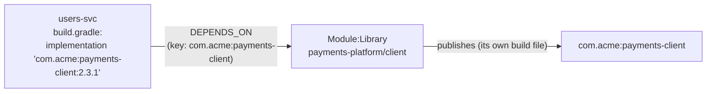

# Joins across applications

How applications get connected in the graph without anyone declaring the connection: every sender and receiver is keyed by the thing they share, and matching keys meet on one node. Part of [Ingestion](./README.md).

> **In one minute**
> - A **join** is a sender matched to a receiver by a **shared key**: a topic name, an HTTP method and path, a channel, a table, and (planned) an artifact coordinate or a gateway route.
> - Joins happen **in the graph, by stable ID**: each repository's run writes its side, and when the other side's repository is ingested, they meet on the same node. Targets not ingested yet are **stubs** that merge later.
> - An HTTP call whose host is runtime data is never merged with anything; it's a stub per calling class, listed as an unmet join.
> - The **join rate**, the share of sends that reach a known receiver, is the main measure of how connected an organization's graph is.

---

## 1. Shared keys (Decided, D3, D61)

| Kind | Sender | Receiver | Shared key → node |
|---|---|---|---|
| HTTP | An HTTP client call (`RestTemplate`, `WebClient`, Feign, httpx, …) | A handler (`@PostMapping`, `@router.post`) | Method + path on the target application → `HttpEndpoint` |
| gRPC | A stub call (not covered yet) | An `ImplBase` method | Service + method → `GrpcMethod` |
| Kafka, queues | `send`, `ProducerRecord`, `convertAndSend` | `@KafkaListener`, `@JmsListener`, `@RabbitListener` | Topic or queue name → `KafkaTopic` / `Queue` |
| An org's own messaging | One sender rule | One receiver rule | Channel name → an org-defined `Interface` label |
| Shared state | `WRITES_TO` | `READS_FROM` (polling) | Table → `Table` |
| Libraries (planned, Artifacts A1) | A build file's dependency | The producing repository's build file | Coordinate → `Module:Library` |
| Gateway routes (planned, Routing) | A call to a public path | The gateway's route table | Public path → internal service + path |

**Topics and channels are keyed by name across applications** (`kafkatopic:{name}`). A channel whose name can't be resolved is dropped (and listed in the coverage report) rather than merged with unrelated channels. Topics belong to a **space**, never an application: the space that declares them (a PLATFORM definition, from stage B), else the producer's space, else the organization. *Today:* the space of the first repository whose run wrote the topic.

**`LEADS_TO` is derived, and computed when read** (not stored today): it holds exactly when a step in flow A `CALLS` or `PRODUCES` to an interface that `STARTS` flow B, marked sync or async. App-level and space-level "who talks to whom" are rollups of these.

## 2. Stubs

When a call's target isn't ingested yet, it points at a **stub** keyed by its natural key (method + URL, topic name, table name), with `stub: true`. When the owning application is ingested, the real node merges into the stub by stable ID. The same pattern is used for `Table` nodes until a data store is identified.

## 3. Where an HTTP call goes (D64, D73)

- **URL templates.** The resolver keeps every constant part of a URL, with runtime parts as `{placeholders}`, following values through parameters and `self.x`.
- **HTTP signatures** (an `http.yaml` in a pack) name well-known services by their **hosts**. Paths never name a service: an internal service can use the same API shape.
- **Feign `@FeignClient("service")`:** the service name is the host, which joins to the application with that canonical name once [identity](../../concepts/identity.md) is in place.
- **Declarative clients whose source is in the repository** (Feign, `@HttpExchange`) get `CALLS` on the interface method itself, so callers' flows step into the call. **Generated clients and internal SDKs** use the `client` clue with `calls` and `base` (D73).
- **Naming the service behind an unknown-host stub is Open:** an LLM or decision reading the calling class, or an admin's declaration ("host X is Billing", ADMIN).

## 4. Internal vs. external

Derived from where both ends sit in the tree: same application, same space, different spaces, or outside the organization (`ExternalSystem`). Internal organization hosts vs. vendors: a list of known organization domains, plus a decision for anything not on it (later).

## 5. Planned joins

### Artifacts A1: libraries (POC stage B)

Today a dependency on another repository's library is a name with nothing behind it. With Artifacts A1, the producing repository's build file says it publishes the coordinate, and the consumer's build file says it depends on it: the coordinate is the shared key, joined like a topic. "Which services use this library?" and "what does a change to `payments-platform` affect?" then work across repositories. An artifact repository (PLATFORM, `v1`) can confirm. The same join tells Steno which applications turn on a library's **interceptors** (a shared JWT filter, a response wrapper): each dependent is checked against the interceptor's activation conditions (D116). Library **entities** (DTOs in a shared model library) join the same way, so a contract defined once is found from every interface that uses it (D115). **A2** (flows continuing into the library's code) is a separate, later design.

### Routing: the URL the caller uses isn't the endpoint's path (POC stages B–C)

A caller sends `/api/onboarding/v1/clients`; the gateway strips `/api/onboarding` and forwards to `onboarding-svc` at `/v1/clients`. Gateway route config (Spring Cloud Gateway, Kong, Ingress) is read as a **translation table** (PLATFORM), and the call joins through it. The same facet resolves `${USERS_URL}` through Helm values, and Eureka `lb://customers-service` names through canonical names. Routing also marks which endpoints are **public**, so "no internal caller" isn't mistaken for "unused".

### Config repositories (Decided, D91)

A config repository describes *other* applications. Its facts attach to **what they describe** (a topic, an application), with the config repository as their source in citations. The repository itself sits at the narrowest scope covering everything it describes; when the spaces it covers share no parent, that's the organization. A name in it that matches no application goes to the unmatched-names list.

## 6. Measuring joins

| Measure | Meaning |
|---|---|
| **Join rate** | Share of sends that reach a known receiver or a known external system |
| **Unjoined sends** | Calls or publishes with no receiver: a target not ingested, a host that's runtime data, or a missed receiver rule |
| **Orphan receivers** | Endpoints or consumers nothing sends to: unused, called from outside (public), or a missed sender rule |
| **Cross-app inconsistencies** | A topic produced but never consumed (or the reverse); a call to an endpoint the target doesn't expose. Built once several applications are ingested (stage B). |

See [Trust](../../concepts/trust.md#4-every-signal-that-something-is-incomplete).
