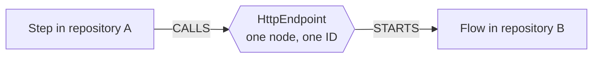

# Joins across applications

How applications connect without anyone declaring it: senders and receivers share a key, and matching keys meet on one node.

> **In one minute**
> - A **join** is a sender matched to a receiver by a **shared key**.
> - Joins happen **in the graph, by stable ID.** Targets not ingested yet are **stubs** that merge later.
> - An HTTP call whose host is runtime data is a stub per calling class.
> - The **join rate** is the main measure of how connected a graph is.

## 1. Shared keys (Decided, D3, D61)

| Kind | Sender | Receiver | Key |
|---|---|---|---|
| HTTP | A client call | A handler | Method + path on the application |
| gRPC | A stub call (not covered) | An `ImplBase` method | Service + method |
| Kafka, queues | `send`, `convertAndSend` | `@KafkaListener`, … | Name |
| Own messaging | One sender rule | One receiver rule | Channel name |
| Shared state | `WRITES_TO` | `READS_FROM` | Table |
| Libraries (planned, A1) | A dependency | The publishing build file | Coordinate |
| Gateway routes (D132) | A public path | A route | Path → service |

A channel whose name can't be resolved is dropped and listed in coverage, never merged with others.

**`LEADS_TO` is computed when read:** a step in flow A calls or produces to an interface that starts flow B.

## 2. Stubs

A target not ingested yet points at a stub (`stub: true`) keyed by natural key. The real node merges into it by stable ID.

## 3. Where an HTTP call goes (D64, D73)

| Host | Result |
|---|---|
| Constant, matching an HTTP signature | `ExternalSystem` by service name |
| Names an application in this repository, by exact method and path (`lb://vets-service`, a Feign name, a cluster host) | That application's endpoint |
| Names an application in another repository | Linked in reconcile (`reconcile/links.py`, built) |
| Constant, unknown | `ExternalSystem` by host |
| Runtime data | A stub per calling class, keeping URL templates |

- **Paths and config key names never name a service** (D150). Measured: a wrong link by path scored higher than a right one.
- **Certainty on links across repositories:** `confirmed` for an exact name, `inferred` for a name with a runtime part that fits one application. Several fits make no link.
- **Declarative clients in the repository** (Feign, `@HttpExchange`) get `CALLS` on the interface method. **Generated clients** use the `client` clue (D73).
- **Naming the service behind an unknown host is Open.**

## 4. Internal vs. external

Derived from where both ends sit in the tree.

## 5. Planned joins

**Artifacts A1 (stage B):** a consumer's dependency joins the publishing build file by coordinate. It also tells Steno who turns on a library's interceptors (D116) and where shared entities live (D115). **A2**, flows continuing into library code, is later.

**Routing:** gateway config is a translation table (D132). Spring Cloud Gateway is built; nginx, Ingress, and completing `CALLS` through routes are to come.

**Config repositories (D91):** facts attach to what they describe, cited to the repository.

## 6. Measuring joins

| Measure | Meaning |
|---|---|
| **Join rate** | Share of sends reaching a known receiver or external system |
| **Unjoined sends** | No receiver: not ingested, a runtime host, or a missed rule |
| **Orphan receivers** | Nothing sends to it: unused, public, or a missed rule |
| **One-sided joins** | A topic produced but never consumed, or the reverse; a call to an endpoint no application exposes (D146) |
