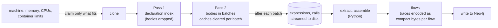

# Large repositories

How Steno ingests a very large repository without running out of memory, and fits its work to whatever machine it runs on. Part of [Ingestion](./README.md). Decided (D127, D128, and D63 refined); built 2026-10-21 unless marked otherwise.

> **In one minute**
> - Measured on ThingsBoard (5,494 Java files, 466k lines): the original single pass ran the Java resolver out of memory at a 2 GB heap, and the job came back hollow. Once that was fixed, the worker peaked at 4.6 GB, almost all of it flow traces.
> - Five changes fixed it, each keeping the graph identical: **two-pass Java resolution** in batches, **streaming** the resolver's output, **compact traces**, **a failed resolver fails the job**, and **workers sized to the machine**.
> - ThingsBoard now ingests at a 2 GB heap with a 1.5 GB worker peak (from 4.6 GB), producing the same 1,623 flows and 116,269 nodes.
> - Every run records its peak memory per stage, so a repository outgrowing its budget shows up before it fails.
> - **A second round (2026-10-31), for monorepos the size of Elasticsearch (21,229 Java files):** the helper releases tokens after parsing (§2), its output is indexed on disk instead of loaded whole (§3), extraction holds one syntax tree at a time (§3a), a repository that still fails is resolved module by module (§3b), and repeated work in the flows stage is done once (§3c). On ThingsBoard, with an identical graph: flows 2,459 → 125 s, extract 119 → 74 s, parse 193 → 120 s, Python's peak 1.6 → 0.8 GB.

---

## 1. The problem, measured

| Stage | What filled memory | ThingsBoard, before |
|---|---|---|
| Java resolver (JVM) | Every file's full syntax tree, kept for the whole run; caches with no limit; the whole result built before writing it | Out of memory at 2 GB: no entry points, so the job wrote a hollow graph |
| Extraction (Python) | The resolver's output loaded at once (222 MB of JSON, 447k expression records) | About 1 GB |
| Flows (Python) | Each flow's trace: every function it runs, once per call site, as JSON, all held until write | 4.6 GB peak; 2.5 GB of trace JSON; one flow had 47,803 entries |

The memory went where the design said it would grow: with the size of the whole repository, more than once.

## 2. Two-pass Java resolution (D127)

Resolving a call needs other files' **declarations** (types, fields, method signatures), never their **bodies**. So the JVM helper resolves in two passes:

1. **A declaration index.** Every file is parsed, and every method's body is replaced with an empty block. Constructor bodies are kept, because a field's value may be assigned there. A method with a body still has one, so "is it abstract?" reads the same.
2. **Bodies in batches.** For a batch of files (200 by default), each file is read again and its methods' bodies are put back into the same declaration nodes, matched by where each method starts. The batch is resolved, the bodies are dropped again, and the resolver's caches are cleared, so nothing keeps them alive.

Methods inside other bodies (local and anonymous classes) are never stripped separately; they come and go with the body they're in. The first version got this wrong, and the differential check caught it.

**Proven equal, not assumed.** `steno resolver-check <folder>` resolves a repository in one pass and in batches and compares every type, function, call site, expression, import, and error; a test runs the same check with every file in its own batch. budgeting-app shows no differences.

**When it's on:** `STENO_RESOLVER_JVM_BATCH_FILES` (0 = one pass), and automatically for a repository whose last run ran out of JVM memory (§5).

**Tokens released after parsing** (built 2026-10-31). JavaParser links every token of a file into one list that every node points into, so dropping a method's body kept its tokens alive with the rest of the file, and the declaration index held nearly every token of the repository. The helper now releases each file's tokens as soon as it's parsed and keeps every node's line range (ranges come from tokens, so each is put back; turning tokens off in the parser drops ranges too, and pass 2 matches bodies by position). Nothing in the helper reads tokens.

| | Live heap before | After | Time |
|---|---|---|---|
| Keycloak (5,772 files) | 1,791 MB | 473 MB | 107 → 83 s |
| ThingsBoard (5,498 files) | 1,611 MB | 560 MB | 123 → 110 s |

Keycloak now resolves within a 600 MB heap. The outputs match call for call except a handful of generic types that resolve differently (one call of 184,724 on Keycloak became unresolved; on ThingsBoard two expressions got a more precise type): never a different target.

**Stable names for anonymous classes.** JavaParser names an anonymous class `Anonymous-` and a random UUID, which reached the symbols of expressions inside one, so the same commit read differently on every run. They're written as `Outer.Anonymous`.

## 3. The resolver's output, on disk (D127)

The resolver's two largest outputs, every expression a rule may capture and every function's calls, are written to disk after each batch instead of held until the end (on ThingsBoard this cut the live heap from 1.9 to 1.6 GB). They used to be joined into one JSON file that Python loaded whole, at about 4.5 times its size: Keycloak's 223 MB took 994 MB, and Elasticsearch's 2 GB would have taken about 9 GB.

Now (built 2026-10-31) the helper leaves them as JSON Lines (`--parts`), and the Java resolver reads each line once into a SQLite file beside them (`resolvers/disk_index.py`):

| Table | Key | Asked |
|---|---|---|
| `exprs` | (file, start line, start column, end line, end column), and (file, start line, end line) for the same-width fallback | When a rule's capture needs a symbol, type, or value: a small share of all expressions |
| `calls` | the function's symbol | By the flow walk, once per function and call site (the last 20,000 functions' calls are cached, decoded); in full by coverage |

The rest of the resolver asks the same questions it asked of the dictionaries. The index lives under the workspaces folder (`STENO_WORKSPACE_DIR/indexes/`) for as long as the resolver does. A worker that's stopped mid-job leaves its clone and index behind (gigabytes on a large repository); `steno job recover`, run at startup when no worker is running, marks its jobs failed and removes both.

## 3a. Extraction, a file at a time

Every file's syntax tree (ast-grep) used to be built in the parse stage and kept until the last rule had run. Now extraction builds a file's tree, runs every code rule on it, and drops it. Each rule's matches go to a buffer of its own, joined in rule order at the end, so the facts come out in exactly the order running each rule over every file gave. A file that can't be parsed is reported once instead of once per rule.

## 3b. A module that can't be resolved (D127)

If the helper still fails for the whole repository after the retry in batches with more heap (§5), the parse stage tries once more, **one build module at a time**: each Java file belongs to the nearest folder with a `pom.xml`, `build.gradle`, or `build.gradle.kts`. A module that fails is a gap: it's in the resolver's errors, in `resolvers.java.modules_failed` (module, files, error), and in the coverage report as an `unparsed` item; every other module is resolved. Read this way, a call from one module into another can't be resolved and is counted as unresolved. A job fails only if no module can be resolved.

## 3c. Flows: work done once

On ThingsBoard the flows stage took 41 of a job's 46 minutes. Three things repeated work that depends on one function, not the flow (built 2026-10-31):

- **A path from the repository root** was computed for every trace entry (5.96 million on ThingsBoard); it's now remembered per file, here and in extraction (the same cost was half of extraction's time).
- **A function's gaps** (calls it couldn't follow, I/O no rule explains) were worked out again in every flow that runs it; now once per function, each trace getting its own copy.
- **Does this function reach an effect?** was a fresh search per uncalled function, quadratic on a large repository; it's now one backward walk from every function with an effect.

| ThingsBoard, same graph (116,395 nodes, 246,687 edges, every property equal) | Before | After |
|---|---|---|
| parse | 193 s | 120 s |
| extract | 119 s | 74 s |
| flows | 2,459 s | 125 s |
| Python's peak memory | 1,644 MB | 839 MB |

**The helper's time limit** grows with the repository: `STENO_RESOLVER_JVM_TIMEOUT` (1,800 s) plus `STENO_RESOLVER_JVM_TIMEOUT_PER_FILE` (0.25 s) per Java file, so a monorepo isn't cut off for being large (Elasticsearch's 21,229 files ran past the old fixed 30 minutes).

## 4. Compact traces (D63, refined)

A trace lists every function a flow runs, once per call site, so a large flow repeats the same functions thousands of times. Each trace is now stored as:

- **a table of the flow's functions**, each stored once: name, file, lines, doc, hash, effects, and calls Steno couldn't follow;
- **one short row per call site**: its parent row, its number under the parent, the function, the call line, flag bits (conditional, in a loop, async, candidate, repeat, recursive, unfollowed calls), the step, and, for an interceptor, its kind.

Paths (`1.2.3`) are rebuilt from the parent rows. The result is zlib-compressed and stored as bytes on the `Flow` node. `graph/trace.py` decodes it into exactly the entries readers have always seen, and still reads the older JSON form. The trace is encoded as soon as each flow is built, so only one flow's full trace is ever in memory.

ThingsBoard's traces went from 2.5 GB to 61 MB, and Neo4j stores the same 40-times-smaller bytes. Re-ingesting the same commit still records no changes.

## 5. Failures, and fitting the machine (D128)

**A resolver that fails as a whole fails the job.** Before, an out-of-memory resolver was an error string and the job carried on, so the write stage would have removed the repository's flows. Now parse stops the job, nothing is written, and the last good graph stays.

**Jobs fit the memory free now (D134).** The totals above say what the machine has; what matters is what is free at the moment, which excludes Neo4j, Postgres, and the other jobs. A job starts only if its reservation fits the free memory less a headroom (`STENO_MEMORY_HEADROOM_MB`, 768 MB), **even when it is alone**:

- If the plan from its last run doesn't fit, the JVM heap is cut to what does and the resolver runs in batches (Keycloak resolves in 600 MB), but never below what the repository is known to need (its last live heap plus 10%, or the heap that already ran out).
- If nothing fits, the job stays queued and says why on itself (`stats.resources.waiting_for_memory`: what it needs, what is free). A job bigger than the machine's whole budget fails at once with the numbers.
- When the Java step starts, free memory is read again, because Neo4j may have grown since the claim: the heap is cut, or the step waits up to `STENO_MEMORY_WAIT_MINUTES` (30) and then fails naming what was needed and what was free.
- After an out-of-memory failure the retry with a doubled heap is bounded by the free memory, and is never smaller than the run that failed.

**Workers take only what fits.** When a worker claims a job, it reads its machine:

- the memory limit (a container's cgroup limit when there is one, otherwise physical memory);
- the memory free right now;
- the CPUs it may use (a container's CPU quota included).

The job reserves what its repository needed last time (peak memory per stage, plus the JVM helper's), with 25% headroom, or 3 GB on a first run. It's claimed only when that fits what the machine's budget (80% of its memory) has left after the jobs running there, what's free right now, and one job per CPU. A job alone on a machine always starts, and the oldest job waits at the head of the queue rather than let smaller ones pass, so large repositories aren't starved.

**Out of memory, then recovery.** The JVM heap is sized per repository: 1.5 times the live heap it needed last time. A repository with more than `STENO_RESOLVER_JVM_BATCH_ABOVE_FILES` Java files (3,000) resolves in batches from its first run. If the resolver still runs out of memory, the parse stage retries once **in the same job**, in batches with twice the heap (within the budget), and records it in the job's plan so later runs start there (built 2026-10-27; before, the job failed and only the next run recovered). The stage's `java_memory` metric says how it ran: Java files, batched, heap, retried.

| Setting | Default | Means |
|---|---|---|
| `STENO_WORKER_MEMORY_FRACTION` | 0.8 | Share of the machine's memory jobs may reserve |
| `STENO_JOB_MEMORY_DEFAULT_MB` | 3072 | What a never-measured repository reserves |
| `STENO_WORKER_PROCESSES` | one per CPU, up to 8 | Worker processes; idle ones only poll |
| `STENO_MAX_PARALLEL_JOBS` | 16 | A ceiling across every machine |
| `STENO_RESOLVER_JVM_MAX_HEAP` | 2g | The heap when a repository has no history |
| `STENO_RESOLVER_JVM_BATCH_FILES` | 0 | Files per batch (0: one pass, unless the repository is large or ran out of memory) |
| `STENO_RESOLVER_JVM_BATCH_ABOVE_FILES` | 3000 | Java files above which a repository resolves in batches from its first run |

Each job's reservation, the machine it saw, and why are in `ingestion_job.stats.resources`, and `host` and `memory_reserved_mb` are columns on the job.

## 6. What's measured on every run

| Where | Metric |
|---|---|
| Every stage | `rss_peak_mb`: the worker's peak resident memory during that stage (reset at the start of each stage on Linux) |
| Parse stage, `resolvers.java.memory` | `heap_live_peak_mb` (the most heap that survived a collection: what the repository really needs), `heap_limit_mb`, `rss_peak_mb` of the helper, and `near_limit` when the live heap passes 80% of the limit |
| Parse stage, `resolvers.java` | `batches`, `files`, `functions`, call and expression counts |
| Flows stage | `trace_entries` |

## 7. Results

| ThingsBoard | Before | After |
|---|---|---|
| Java resolver at a 2 GB heap | Out of memory, hollow job | Done in about 2.5 minutes |
| JVM live heap at its peak | — | 1.6 GB |
| Worker peak | 4.6 GB | 1.5 GB |
| Trace data | 2.5 GB | 61 MB |
| Graph | — | 1,623 flows, 5.96M trace entries, 116,269 nodes, 246,393 edges: identical before and after the trace change |

**Keycloak** (2026-10-27; 13,558 files, 5,925 Java sources outside tests, a multi-module Maven monorepo), on an 8 GB machine:

| | Result |
|---|---|
| First run, one pass at a 2 GB heap | Out of memory after 8 minutes; nothing written |
| Next run, in batches at a 3.3 GB heap (the budget's cap) | Succeeded in 5.5 minutes: resolver 97 s over 30 batches, JVM live heap 1.75 GB (3.4 GB resident), worker peak 1.5 GB |
| Coverage stage | 147 s, nearly as long as parse; then **11 s**: one step (whether code names an unread file) matched every file name as one regular expression against all the code; it now reads each file once and looks its file-name tokens up. The stage's `timings` metric gives seconds per step |
| Whole job, batched from the first run | 3.1 minutes |
| What it found | 0 flows: Keycloak uses Quarkus and JAX-RS, which no pack covers; 861 patterns (304 framework annotations, 111 unexplained I/O calls, 410 groups of unread files) |

With batching from the first run above 3,000 Java files, Keycloak's first run is the batched one.

## 8a. Writing the graph to Neo4j (measured 2026-11-02)

A repository's graph is written in **one transaction**, so a failed write changes nothing ([stages §7](./stages.md)). Neo4j must hold the whole write in memory, and it limits a transaction to `dbms.memory.transaction.total.max`, 70% of the heap by default. ThingsBoard's graph (116,389 nodes, 246,687 edges, 351 MB of properties: 207 MB in the 1,567 flows' compressed traces, 84 MB in the steps) was written to Neo4j in a dry run of the whole job:

| Neo4j | Result |
|---|---|
| Default heap (about 2 GiB), limit 1.4 GiB | Out of transaction memory, 55 s into the write: the write is refused and rolled back |
| 3 GB heap, limit 2.1 GiB | Same, at 95 s |
| 4 GB heap, limits 2.3, 2.7, 3.3 GiB | Same, during the edges |
| 4 GB heap, **no limit** (a throwaway server) | Written in 60 s |
| 3.1 GB heap, **no limit** (the real job) | **The database crashed.** The transaction was committed to Neo4j's log, then the heap ran out while applying it to the store (`OutOfMemoryError: Java heap space`) and Neo4j needed a restart. On restart it replayed the logged transaction (at a 4 GB heap) and the graph was complete, but the job had already recorded a failure |

So **one ThingsBoard-size write needs about 3.5 GiB of transaction memory** (between 3.3 GiB, where it failed, and a 4 GB heap, where it passed): about ten times its properties. At Neo4j's default limit that means a heap of about 5.5 GB.

**Keep Neo4j's default transaction limit.** It is what turns a write that is too large into a refused, rolled-back write. Without it the same write can crash the database mid-commit. `deploy/docker-compose.yml` sets the heap from the machine (`make up` computes `NEO4J_HEAP_MB`, 40% of memory, starting at 512 MB) and leaves the limit at its default, so on a machine with 8 GB a repository the size of ThingsBoard is refused with a clear error. A shared Neo4j should be sized for its largest repository: a heap of about 1.6 times the transaction memory it must hold.

- The write stage records `transaction_estimate_mb`, Neo4j's own estimate of the transaction at its end (ThingsBoard: about 2,000 MB). It **understates what the limit counts** (that run failed at a 3.3 GiB limit), so use it to compare repositories, not to size the limit.
- Running out of transaction memory is not retried (the driver retries transient errors, which only repeated the work for 30 s) and fails with a message naming the setting to raise.
- Two ways to remove the ceiling are open and need a decision ([decisions](../../plan/decisions.md), open questions): writing in several transactions (gives up "a failed write changes nothing"), and keeping the flows' traces, 59% of the properties, out of the Neo4j transaction.

## 8. Not built yet

- **Flows per application** in a monorepo, so the call graph is never held for the whole repository at once.
- **Eclipse JDT**, only if the two-pass JavaParser helper fails a larger benchmark (Open).
