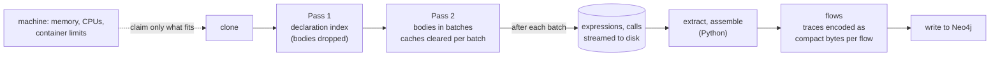

# Large repositories

How Steno ingests a very large repository without running out of memory, and fits its work to whatever machine it runs on. Part of [Ingestion](./README.md). Decided (D127, D128, and D63 refined); built 2026-10-21 unless marked otherwise.

> **In one minute**
> - Measured on ThingsBoard (5,494 Java files, 466k lines): the original single pass ran the Java resolver out of memory at a 2 GB heap, and the job came back hollow. Once that was fixed, the worker peaked at 4.6 GB, almost all of it flow traces.
> - Five changes fixed it, each keeping the graph identical: **two-pass Java resolution** in batches, **streaming** the resolver's output, **compact traces**, **a failed resolver fails the job**, and **workers sized to the machine**.
> - ThingsBoard now ingests at a 2 GB heap with a 1.5 GB worker peak (from 4.6 GB), producing the same 1,623 flows and 116,269 nodes.
> - Every run records its peak memory per stage, so a repository outgrowing its budget shows up before it fails.

---

## 1. The problem, measured

| Stage | What filled memory | ThingsBoard, before |
|---|---|---|
| Java resolver (JVM) | Every file's full syntax tree, kept for the whole run; caches with no limit; the whole result built before writing it | Out of memory at 2 GB: no entry points, so the job wrote a hollow graph |
| Extraction (Python) | The resolver's output loaded at once (222 MB of JSON, 447k expression records) | About 1 GB |
| Flows (Python) | Each flow's trace: every function it runs, once per call site, as JSON, all held until write | 4.6 GB peak; 2.5 GB of trace JSON; one flow had 47,803 entries |

The memory went where the design said it would grow: with the size of the whole repository, more than once.

## 2. Two-pass Java resolution (D127)

Resolving a call needs other files' **declarations** (types, fields, method signatures), never their **bodies**. So the JVM helper resolves in two passes:

1. **A declaration index.** Every file is parsed, and every method's body is replaced with an empty block. Constructor bodies are kept, because a field's value may be assigned there. A method with a body still has one, so "is it abstract?" reads the same.
2. **Bodies in batches.** For a batch of files (200 by default), each file is read again and its methods' bodies are put back into the same declaration nodes, matched by where each method starts. The batch is resolved, the bodies are dropped again, and the resolver's caches are cleared, so nothing keeps them alive.

Methods inside other bodies (local and anonymous classes) are never stripped separately; they come and go with the body they're in. The first version got this wrong, and the differential check caught it.

**Proven equal, not assumed.** `steno resolver-check <folder>` resolves a repository in one pass and in batches and compares every type, function, call site, expression, import, and error; a test runs the same check with every file in its own batch. budgeting-app shows no differences.

**When it's on:** `STENO_RESOLVER_JVM_BATCH_FILES` (0 = one pass), and automatically for a repository whose last run ran out of JVM memory (§5).

## 3. Streaming the resolver's output (D127)

The resolver's two largest outputs, every expression a rule may capture and every function's calls, are written to disk after each batch instead of held until the end. The output file reads exactly as before, so the Python side didn't change. On ThingsBoard this cut the live heap from 1.9 to 1.6 GB and made the run faster.

## 4. Compact traces (D63, refined)

A trace lists every function a flow runs, once per call site, so a large flow repeats the same functions thousands of times. Each trace is now stored as:

- **a table of the flow's functions**, each stored once: name, file, lines, doc, hash, effects, and calls Steno couldn't follow;
- **one short row per call site**: its parent row, its number under the parent, the function, the call line, flag bits (conditional, in a loop, async, candidate, repeat, recursive, unfollowed calls), the step, and, for an interceptor, its kind.

Paths (`1.2.3`) are rebuilt from the parent rows. The result is zlib-compressed and stored as bytes on the `Flow` node. `graph/trace.py` decodes it into exactly the entries readers have always seen, and still reads the older JSON form. The trace is encoded as soon as each flow is built, so only one flow's full trace is ever in memory.

ThingsBoard's traces went from 2.5 GB to 61 MB, and Neo4j stores the same 40-times-smaller bytes. Re-ingesting the same commit still records no changes.

## 5. Failures, and fitting the machine (D128)

**A resolver that fails as a whole fails the job.** Before, an out-of-memory resolver was an error string and the job carried on, so the write stage would have removed the repository's flows. Now parse stops the job, nothing is written, and the last good graph stays.

**Workers take only what fits.** When a worker claims a job, it reads its machine:

- the memory limit (a container's cgroup limit when there is one, otherwise physical memory);
- the memory free right now;
- the CPUs it may use (a container's CPU quota included).

The job reserves what its repository needed last time (peak memory per stage, plus the JVM helper's), with 25% headroom, or 3 GB on a first run. It's claimed only when that fits what the machine's budget (80% of its memory) has left after the jobs running there, what's free right now, and one job per CPU. A job alone on a machine always starts, and the oldest job waits at the head of the queue rather than let smaller ones pass, so large repositories aren't starved.

**Out of memory, then recovery.** The JVM heap is sized per repository: 1.5 times the live heap it needed last time. A run that ran out of JVM memory makes the next run of that repository get twice the heap (within the budget) and batched resolution, so it recovers instead of failing every night.

| Setting | Default | Means |
|---|---|---|
| `STENO_WORKER_MEMORY_FRACTION` | 0.8 | Share of the machine's memory jobs may reserve |
| `STENO_JOB_MEMORY_DEFAULT_MB` | 3072 | What a never-measured repository reserves |
| `STENO_WORKER_PROCESSES` | one per CPU, up to 8 | Worker processes; idle ones only poll |
| `STENO_MAX_PARALLEL_JOBS` | 16 | A ceiling across every machine |
| `STENO_RESOLVER_JVM_MAX_HEAP` | 2g | The heap when a repository has no history |
| `STENO_RESOLVER_JVM_BATCH_FILES` | 0 | Files per batch (0: one pass, unless the last run ran out of memory) |

Each job's reservation, the machine it saw, and why are in `ingestion_job.stats.resources`, and `host` and `memory_reserved_mb` are columns on the job.

## 6. What's measured on every run

| Where | Metric |
|---|---|
| Every stage | `rss_peak_mb`: the worker's peak resident memory during that stage (reset at the start of each stage on Linux) |
| Parse stage, `resolvers.java.memory` | `heap_live_peak_mb` (the most heap that survived a collection: what the repository really needs), `heap_limit_mb`, `rss_peak_mb` of the helper, and `near_limit` when the live heap passes 80% of the limit |
| Parse stage, `resolvers.java` | `batches`, `files`, `functions`, call and expression counts |
| Flows stage | `trace_entries` |

## 7. Results

| ThingsBoard | Before | After |
|---|---|---|
| Java resolver at a 2 GB heap | Out of memory, hollow job | Done in about 2.5 minutes |
| JVM live heap at its peak | — | 1.6 GB |
| Worker peak | 4.6 GB | 1.5 GB |
| Trace data | 2.5 GB | 61 MB |
| Graph | — | 1,623 flows, 5.96M trace entries, 116,269 nodes, 246,393 edges: identical before and after the trace change |

## 8. Not built yet

- **Flows per application** in a monorepo, so the call graph is never held for the whole repository at once.
- **An on-disk index** for the resolver's output on the Python side (extraction still holds about 1 GB on ThingsBoard).
- **Module isolation**: a module that still fails is recorded as a gap while the rest continues.
- **Turning batching on by default**, once the differential check has run on more large repositories. Today it's on by setting, or after a run runs out of memory.
- **Eclipse JDT**, only if the two-pass JavaParser helper fails a larger benchmark (Open).
