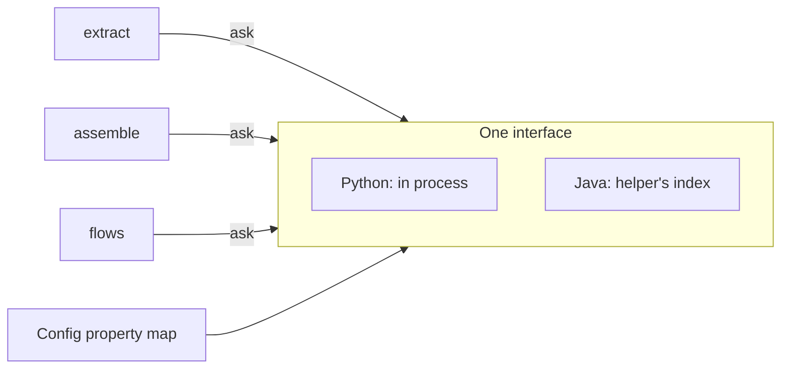
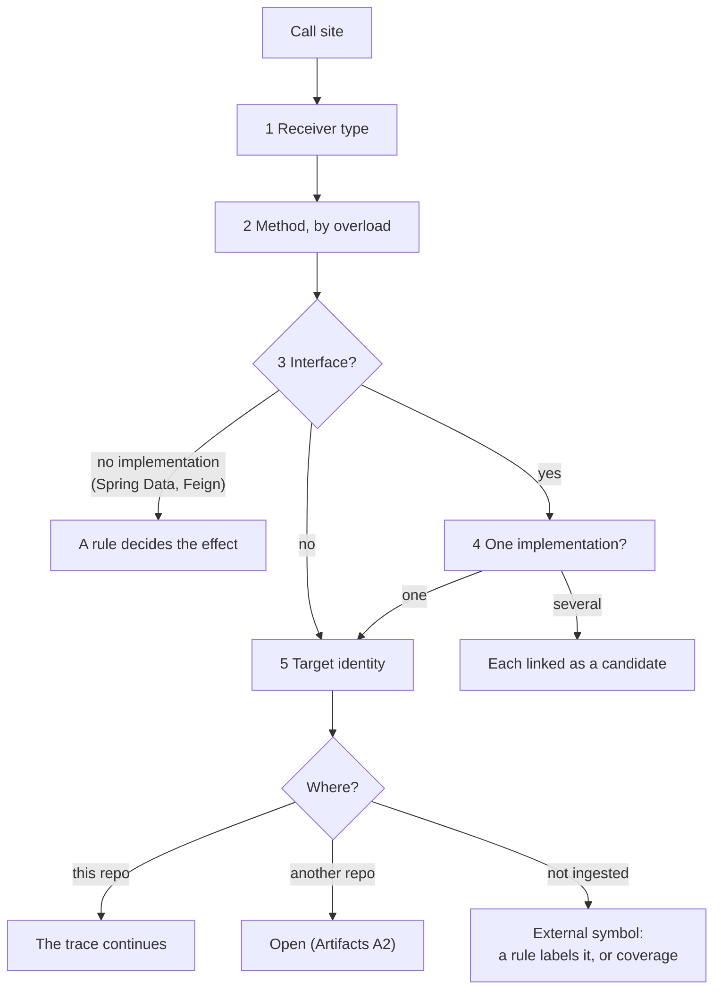

# Symbol resolvers

How Steno works out what code means: which function a call reaches, a value's type, a string's constant, and which service an HTTP call goes to.

> **In one minute**
> - ast-grep sees **shapes**; the resolver supplies **meaning**.
> - **One resolver per language, behind one interface** (D70). Python's uses `ast`. Java's reads a JVM helper's output (D69).
> - **Lazy, recursive, and it never guesses.** When it doesn't know, the gap stays visible (D71).
> - SCIP isn't planned. JARs come later, as coverage shows they matter.



## 1. The questions every resolver answers

| Question | Answers | Gives up on |
|---|---|---|
| `enclosing(file, line)` | The function and class a line is in | Nested functions (attributed to the outer) |
| `symbol_of(expr)` | The qualified name | `getattr`, `*` imports |
| `type_of(expr)` | A value's type | Argument-dependent types, untyped parameters |
| `class_of(expr)` | The class an expression names | Classes chosen at runtime |
| `value_of(expr)` | The constant it holds | Runtime values |
| `is_subclass(type, targets)` | Inheritance | Inside unread libraries |
| `invocations(fn, self_type?)` | Every first-party call, in order, flagged conditional or in-loop | Which implementation runs: each is linked as a `candidate` |

## 2. How the resolver answers

Look it up in the symbol table; if the answer depends on something else, ask a smaller question first.

```
symbol_of(svc.run_project_jobs)
├─ class_of(svc) → none (a parameter)
├─ type_of(svc) → its annotation → app.services.job.JobService
└─ find run_project_jobs on it
→ app.services.job.JobService.run_project_jobs
```

A runtime-only value is `UNRESOLVED`, never a guess. A function parameter inside a string becomes a placeholder: `…/pull-requests/{pr_id}`.

## 3. Choosing an approach (Decided)

| Option | Tradeoff | Status |
|---|---|---|
| **JavaParser + symbol solver** | Runs without builds; weaker on complex generics | **Chosen** |
| SCIP | Most accurate; every repository must build | Not planned |
| jdtls | Accurate, slow, hard to run | Not planned |

**Other languages (Open):** leaning tiered, with rules degrading to "no resolver" rather than failing.

## 4. Python (Decided, built)

Steno's own resolver on `ast` (D51).

- **Names:** imports, aliases, and module assignments.
- **Types:** annotations, `x = Job()`, `with … as x`, `self.x`, tuple unpacking, nearest earlier assignment.
- **Methods:** walk base classes. A call on a base type to a subclass-only method lists each implementation as a `candidate`.
- **DI:** FastAPI's `Depends`.
- **Functions passed through a parameter** are followed back to each caller.

Clues teach it config values (`property`) and library return types (`client … returns`).

## 5. Java

### 5.1 The call resolution plan

**Goal:** every call points to one exact function or a marked set of candidates.



**Built:** an interface method with one implementation runs that one; with several, each is a `candidate`. **Not covered yet:** `@Qualifier`, `@Primary`, and `@Profile` choices.

**Known gaps, marked not guessed:** reflection, dynamic proxies, event dispatch, and lambdas through generic code.

**Internal libraries:** in the same repository, analyzed with the services. In another, a boundary rule by default; continuing the trace is Open (A2).

### 5.2 Source first (Decided, built)

**Resolved once, then looked up (D69).** The helper reads the repository once and writes every call target and every expression's type and value, keyed by position. Python looks them up.

| Reads | When | Resolves |
|---|---|---|
| The repository's source, every module | Now | First-party calls |
| The JDK | Now | Streams, `Optional`, collections |
| Dependency JARs | Later, by coverage data | Library return types |

Without JARs, a library type is still **named** from imports. What's lost is what a library method **returns**.

- **Lombok (D72):** the helper adds generated members itself.
- **Java version:** read from build files, else the newest JavaParser knows (21).
- **Order:** JavaParser's solver, then Steno's own lookups when a library type is missing.
- **Config values:** `@Value("${key}")` is filled in from the shared property map.

**Gaps are visible (D71).** Every resolver reports calls it couldn't follow, with the reason: `library type`, `unknown type`, `unknown method`, or `function value`. A flow's trace lists them under `unresolved`, the flow carries `incomplete` and `unresolved_calls`, and `get_flow` shows them as `stops`.

**Dependencies, in order (Proposed):** public JARs from Maven Central without running builds; internal libraries linked to their source; a private repository connector last.

### 5.3 Large repositories (Decided, D127; partly built)

See [Large repositories](./large-repositories.md). Flows per application is next.

## 6. DI rules are per-framework

Other frameworks get their own rule sets, so the pipeline stays agnostic. What rules can't settle is linked to every candidate, marked `ambiguous` (a decision in `v2`).

## 7. Config values, identity, and hosts

| Job | Done by |
|---|---|
| Config placeholders | Resolver, from `property` clues |
| DI candidates | Resolver and DI rules |
| Identity and stubs | Graph builder |
| Internal or vendor hosts | Graph builder, with HTTP signatures |
| Which service a call reaches | Resolver keeps the URL template; builder names the target ([Joins](./joins.md)) |

**A host that's runtime data can't be found statically.** The call is described by its class and URL template (D64, D100).

**Secret values are never ingested.**
