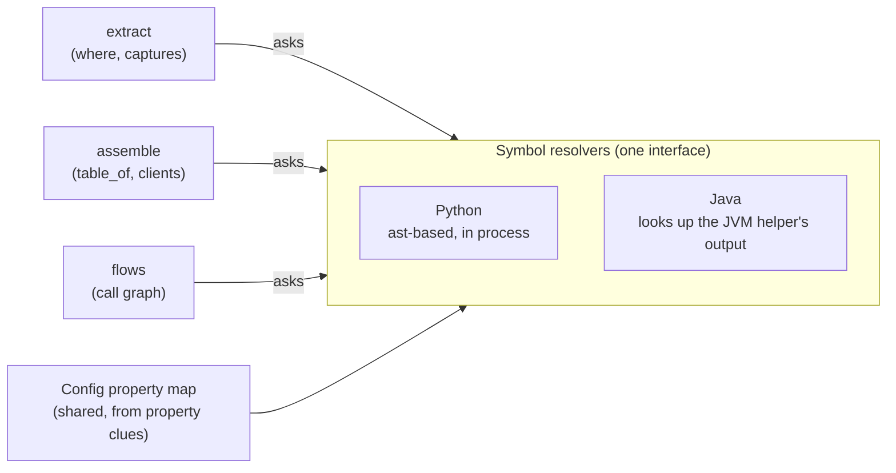
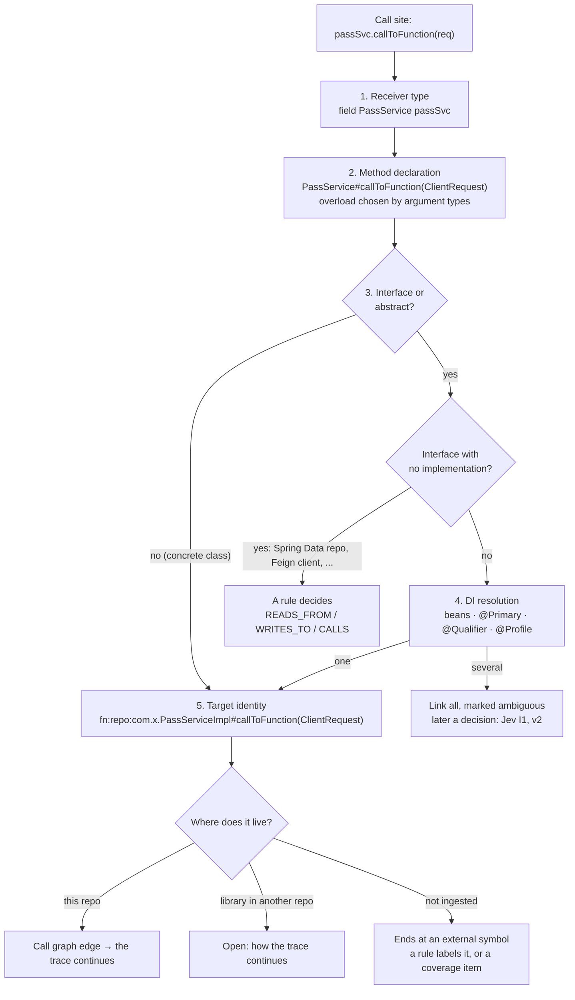

# Symbol resolvers

How Steno works out what the code means: which function a call reaches, what type a value has, what constant a string holds, which implementation DI injects, and which service an HTTP call goes to. Part of [Ingestion](./README.md).

> **In one minute**
> - ast-grep sees **shapes**; the **symbol resolver** supplies **meaning**. It answers a fixed set of questions (`symbol_of`, `type_of`, `class_of`, `value_of`, `is_subclass`, `invocations`, `enclosing`) for the rule engine, the assemblers, and the call graph.
> - **One resolver per language, behind one interface** (D70). Python's is built on Python's `ast`; Java's reads the output of a JVM helper (JavaParser) that resolves a whole repository in one pass (D69).
> - It's **lazy** (nothing computed until asked), **recursive** (answers built from smaller answers), and **never guesses**: when it doesn't know, it says so, and the gap stays visible in the flow (D71).
> - SCIP is not planned; JARs for Java come later, in the order the coverage report shows they matter.



---

## 1. The questions every resolver answers

| Question | Answers | Gives up on |
|---|---|---|
| `enclosing(file, line)` | The function and class a line belongs to; a function's span starts at its first decorator. This is where the `@function` / `@class` anchors come from. | Nested functions (attributed to the outer one) |
| `symbol_of(expr)` | The qualified name a name or attribute refers to: local → module definition → import (following re-exports) → builtin; `a.b` through a module, a class, or a typed value | `getattr`, `*` imports, names built at runtime |
| `type_of(expr)` | The type of a value: `self`, parameter annotations, `x: T`, `x = Cls()` / `x = f()` (return annotation), `with … as x` (a context manager's yielded type), `self.x`, library return hints | Types that depend on arguments (`session.get(Job, …)`), untyped parameters, generics |
| `class_of(expr)` | The class an expression names (repository classes, and library names that look like classes) | Classes chosen at runtime |
| `value_of(expr)` | The constant a value holds: literals, f-strings, `+`, single assignments, module constants across imports, class defaults, `os.getenv(key, default)`; a parameter inside a string becomes `{name}` | Values that exist only at runtime |
| `is_subclass(type, targets)` | Whether a type is, or inherits from, one of the targets (repository bases walked; library bases by name) | Inheritance inside libraries that aren't read |
| `invocations(fn, self_type?)` | Every first-party call in a function, closures included, in execution order, flagged conditional or in-loop: the (in-memory) call graph. With `self_type`, an inherited method is read as that subclass, so `self.execute()` in `Task.run` finds `DiffTaskRunner.execute`; a call to an abstract method lists its implementations as candidates (D58) | Which implementation runs when the code doesn't say (a factory returning the base type): every candidate is linked instead |


## 2. How the resolver answers: worked examples

Every question is answered the same way: look it up in the symbol table from parse, and if the answer depends on something else, ask a smaller question first.

**Example 1 · Which function is `svc.run_project_jobs`?** Asked while emitting the background-task edge in `job.py`:

```python
from app.services.job import JobService                     # line 8
async def run_project_jobs(project_id: UUID, background_tasks: BackgroundTasks,
                           svc: JobService = Depends(get_job_svc)):
    background_tasks.add_task(svc.run_project_jobs, project_id)   # line 28
```

```
symbol_of(svc.run_project_jobs)          an attribute a.b: work out a, then find b on it
├─ is svc an imported module? no
├─ class_of(svc) → none                   a parameter: it names a value, not a class
├─ type_of(svc)                           a parameter's type is its annotation
│  └─ symbol_of(JobService) → app.services.job.JobService   (from the imports)
└─ find run_project_jobs on JobService     its methods, then its base classes
→ app.services.job.JobService.run_project_jobs
```

**Example 2 · What type is `session`, and what is `job`?** Asked by a SQLAlchemy rule's `where`, then by assemble's `table_of`:

```python
async with get_async_db_session_context() as session:   # returns AsyncGenerator[AsyncSession, None]
    job = Job(project_id=…, status=…)
    session.add(job)                                     # line 53
```

```
type_of(session)
├─ bound by `async with … as session`
├─ return annotation of get_async_db_session_context → AsyncGenerator[AsyncSession, None]
└─ a generator: `with` binds its first type argument
→ sqlalchemy.ext.asyncio.AsyncSession

type_of(job)
├─ bound by job = Job(…): a call to a class makes an instance
└─ class_of(Job) → symbol_of(Job) → app.models.job.Job
→ app.models.job.Job
```

**Example 3 · What string does a URL hold?**

```
value_of(os.getenv("OLLAMA_BASE_URL", settings.OLLAMA_LOCAL_HOST_URL) + "/api/tags")
├─ value_of(os.getenv(…))
│  ├─ OLLAMA_BASE_URL set by a config property clue? no
│  └─ value_of(settings.OLLAMA_LOCAL_HOST_URL)   the Settings class declares a default
│     → "http://localhost:11434"
├─ value_of("/api/tags") → "/api/tags"
→ "http://localhost:11434/api/tags"
```

When a piece exists only at runtime (a URL built from a database row), the answer is `UNRESOLVED`, never a guess. A function parameter inside a string becomes a placeholder: `…/pull-requests/{pr_id}`.

| Property | Means |
|---|---|
| **Lazy** | Nothing is computed until asked. Most of the symbol table is never touched. |
| **Recursive** | Each answer is built from smaller answers; a guard stops a question that ends up asking itself. |
| **Never guesses** | When it doesn't know, the answer is `None` or `UNRESOLVED`, and the rule decides what that means: skip the match, drop the fact, or record `<unresolved>`. |

## 3. Choosing an approach (Decided)

**Steno does its own resolution. SCIP is not planned.**

| Option | How | Tradeoff | Status |
|---|---|---|---|
| **JavaParser + symbol solver + dependency JARs** | Resolves types from source and the JDK first; dependency JARs are added later (D69, [§5.2](#52-source-first-decided-built)). | Resolves most calls, including through library types once JARs are added. Weaker on complex generics, lambdas, and reflection. Runs as a small JVM helper process called from Python. | **Chosen** |
| SCIP (`scip-java`, …) | Runs the real compiler over a full build and outputs every reference | Most accurate, but needs every repo to build in the ingestion environment, which is a large operational effort at org scale | Not planned. Possible future option if measured gaps justify it. |
| Headless language server (jdtls) | Queries an LSP server | Accurate, slow, harder to run | Not planned |

Each additional language needs its own symbol resolver, a cost of skipping SCIP's shared format.


**How resolution could scale to more languages (Open).** Hand-written resolvers cost real work per language. Options: own resolvers for the languages that matter most (Java, Python, probably TypeScript); a resolver backed by the language's standard language server (LSP) for the long tail; SCIP indexers where a build works; or no resolver (rules on syntax alone, fewer and lower-confidence facts). Leaning: tiered, with rules always degrading to "no resolver" rather than failing.

## 4. Python (Decided, built)

Steno's own small symbol resolver, built on Python's `ast` module (D51); rules still match with ast-grep. It answers the same questions as the Java plan with Python's rules:

0. **Source roots:** module names are relative to each Python project in the repository (a folder with `pyproject.toml`, `setup.py`, `setup.cfg`, or `requirements*.txt`, or its `src/`), so `apps/backend/app/models.py` in a monorepo is `app.models`.
1. **Names:** follow `import` / `from … import … as …` and module-level assignments, so `job_router` in `__init__.py` and `router` in `job.py` are the same symbol.
2. **Types:** from annotations (`client: httpx.AsyncClient`, `-> Ollama`), constructor assignments (`x = Job()`), `with … as x`, and `self.x` attributes set in `__init__`.
3. **Methods:** find the method on the resolved type, walking base classes in the repository and, by name, in libraries.
4. **DI:** FastAPI's `Depends(provider)` uses the parameter's annotation when it's concrete; otherwise the provider's return type.

It also follows (2026-10-07): **tuple unpacking** of a function annotated `-> tuple[A, B]`; a local reassigned in each branch, typed by its **nearest earlier assignment**; a call on a base type to a method **only its subclasses define** (each implementation, marked `candidate`); and a **function passed through a helper's parameter** (`_build_tool(async_fn=self._grep)`), back to what each caller passes.

What it can't follow (dynamic attribute access, values built at runtime, untyped parameters) is marked unresolved and shows up in the coverage report. Pyright or Jedi are options only if those gaps turn out to matter.

**How it works.** At the start of the parse stage the resolver reads every source file once into a symbol table: source roots and module names, and per module its imports, classes (bases, methods, class values, `self.x` attributes), functions (parameters, annotations, return types, line spans), and module-level values. Nothing is resolved in advance; each question is answered when the engine, an assembler, or the call graph asks it, by recursively asking smaller questions. Clues teach it two things during the run: configuration values (`property`) and library return types (`client` … `returns`).


## 5. Java

### 5.1 The call resolution plan

**Goal:** every call site in a flow points to **one exact function** (or an explicitly marked set of candidates), never to "some function called `callToFunction`." Resolving what an interface call actually runs (DI) is one step of the same pipeline, not a separate problem.



1. **Receiver type.** `passSvc` is declared as `private final PassService passSvc;` (or a constructor parameter), so its type is `com.x.PassService`. The JavaParser symbol solver finds this from the repo's source and the JDK, and later the **dependency JARs** (D69).
2. **Method declaration.** It finds `PassService#callToFunction(ClientRequest)`, choosing between overloads by argument types, and following inherited methods up the class hierarchy.
3. **Interface or abstract?** If the declared type is a concrete class, go to step 5.
4. **DI resolution:** which implementation does the framework inject?
   1. Candidates: classes implementing the interface, found in the repo and the dependency JARs.
   2. Keep only registered beans: `@Service` / `@Component` / `@Repository`, or `@Bean` methods returning the type.
   3. `@Qualifier` at the injection point matching a bean name, otherwise `@Primary`.
   4. `@Profile` / `@ConditionalOnProperty` evaluated against the app's config.
   5. One left: resolved. Several: today, link to all of them, marked `ambiguous`; later a decision (Jev I1, `v2`) chooses, linking to all below its threshold.
   - **Interfaces with no implementation in the code** are generated by the framework at runtime: Spring Data repositories, Feign clients, gRPC stubs. **Rules** handle them: a `JpaRepository<User, …>` method becomes `READS_FROM` / `WRITES_TO` the `users` table; a `@FeignClient` method becomes `CALLS` an endpoint. This is where DI resolution and extractor rules meet.
5. **Target identity.** Every function has a stable ID built from its fully qualified name **and parameter types**: `fn:{repo}:com.x.PassServiceImpl#callToFunction(com.x.ClientRequest)`. So a call always points to **one specific, already-known function** in the call graph, and two calls to it point to the same function.
6. **Where the target lives:**
   - this repo: an edge in the run's call graph, so the flow's trace continues into it
   - a library in another repository: **Open** (functions aren't stored as nodes, so another run can't link to them; one option is a per-library summary of each public function's effects)
   - not ingested: the call ends at an **external symbol**, unless a rule recognizes it (e.g. `KafkaTemplate#send` → `PRODUCES`); frequent ones show up in the coverage report

**Known gaps**, marked instead of guessed:
- reflection
- dynamic proxies beyond the ones rules cover
- event dispatch (`ApplicationEventPublisher` → `@EventListener`), which needs a rule to link publisher and listener
- lambdas passed through generic code, when their target can't be determined


**Internal libraries:**
- **In the same repository** (a monorepo's `plugins/`): analyzed with the services, so their functions and facts are part of each flow's trace.
- **In another repository:** a boundary rule by default (see [Internal communication frameworks](./rules-and-packs.md#internal-frameworks-decided)); continuing the trace into an ingested library is Open.
- **Neither:** the call ends at the external symbol, which shows up in the coverage report.


### 5.2 Source first (Decided, built)

Built 2026-10-07: the shared interface (`resolvers/base.py`), the JVM helper (`resolver-jvm/`, `make resolver`), and the Java resolver that reads its output (`resolvers/java.py`). On budgeting-app (205 Java files) the helper takes about 2 seconds.

**One resolver per language, behind one interface (D70).** The engine asks every resolver the same questions (which symbol a name is, an expression's type and class, a constant's value, a URL template, the enclosing function), and the graph builder and coverage report ask the same call-graph questions (functions, the calls each makes, the calls it couldn't follow, the library calls it makes). It keeps one resolver per language and picks one by the file's language, so a repository with `.py` and `.java` files runs both. Calls between languages aren't resolved: they cross by HTTP or messaging, which the graph already joins. The **property map** from config rules belongs to the engine and is shared by every resolver, so Spring's `@Value("${x}")` reads `application.yml` the same way Python reads settings.

**Resolved in one pass, then looked up (D69).** The Python resolver answers each question in-process when it's asked. Java's symbol table lives in the JVM helper, and asking it one question at a time would cost a round trip per question. Instead, the helper reads the repository once and writes everything the engine could ask: for every call site, the method it calls (overload chosen) or why it couldn't tell; for every expression a rule may capture, its type and constant value. The results are keyed by file and position. The Java resolver on the Python side looks answers up and offers the same interface as the Python one. Nightly runs already re-analyze a repository in full (D59), so this changes nothing about how runs scale.

**What it reads (D69):**

| Source | When | What it resolves |
|---|---|---|
| The repository's own source, every module (Maven or Gradle) | Now | All first-party calls, which flows are made of; a monorepo's services and libraries see each other |
| The JDK (JavaParser reads it from the running JVM) | Now | Streams, `Optional`, collections, lambdas over them: `users.stream().map(this::toDto)` resolves |
| Dependency JARs | Later, decided by coverage data | Library return types: fluent clients (`WebClient`, Reactor's `Mono`/`Flux`), builders, inherited library methods |

The helper takes a list of JARs that starts empty, so adding them later is configuration, not a redesign. Without JARs, a library type is still **named** from the imports (`private final KafkaTemplate<…> kafkaTemplate;` is `org.springframework.kafka.core.KafkaTemplate`), so rules on declared library types and annotation rules work. What's lost is what a library method **returns**, so a chain through one stops there.

**Lombok (D72).** Lombok generates methods that aren't in the source (`@Getter`, `@Setter`, `@Data`, `@Value`, `@Builder`, `@RequiredArgsConstructor`, `@AllArgsConstructor`), and JavaParser doesn't run annotation processors, even with JARs. The helper adds those members to its symbol table itself, so `user.getEmail()` and constructor injection through `@RequiredArgsConstructor` resolve.

**Gaps are visible, never silent (D71).** A flow that looks complete but stopped partway through is worse than a missing edge, because people trust it. Every resolver reports the calls it couldn't follow, with the line and the reason: `library type` (and which library), `unknown type`, `unknown method`, or `function value` (a function held in a parameter). In a flow's trace, the entry of the function that makes the call lists it under `unresolved` when it may matter: the method is named like a first-party function (a step may be missing) or like I/O (an effect may be). A chain of builder calls (`web.post().uri(…).retrieve()`) therefore shows up once, at `retrieve()`, not call by call. The flow carries `incomplete` and `unresolved_calls`, and `get_flow` shows each stop on the nearest step (`stops`). The coverage report counts every library-type stop under **Unresolved library types**. This applies to every language: in Python the usual gap is a database session whose type isn't annotated (`session.commit()`); `data.get("key")` on parsed JSON isn't listed.

**What the helper resolves, in order.** JavaParser's symbol solver first (generics, lambdas, overloads), then Steno's own lookups when the solver gives up because a library type isn't available: a name's declaration (locals, parameters, fields of the class and its ancestors, static imports), a type name through nested types, imports, the same package, `java.lang`, and on-demand imports; the element type of a stream or collection from declared generics (`order.getItems().stream().filter(i -> …)`); and a method on a repository type or its ancestors by name and argument count. A call to an interface method with one implementation in the repository runs that one (DI can only inject it); with several, each is a `candidate`. A call on `this` from an inherited method, read as a subclass, runs the subclass's version (D58). Lombok-generated members resolve, so types flow through them, but they aren't steps, the way reading a field isn't. Values: string constants and `+`, `String.format`, `formatted`, `concat`, fields with an initializer or assigned once in a constructor, and `@Value("${key}")` on fields and parameters, which the engine fills in from config.

**Dependencies, in order (Proposed, not yet built):**
1. **Public libraries** (Spring, Reactor, Jackson, Kafka clients) come from Maven Central, which needs no credentials. They're fetched by coordinates without running the repository's build. Running Gradle or Maven on the worker would execute every repository's build scripts, which is a security problem. Exact versions matter little for signatures.
2. **Internal libraries** (an org's shared models and clients) are linked to their **source** in another ingested repository, by matching an artifact's coordinates to the repository that publishes it. This is better than a compiled JAR: real code, citations, and "who depends on these entities?" The version a dependent asked for is recorded, since the library is ingested at its own head. This connects to the Open question of continuing traces across repositories.
3. **A private artifact repository** (JFrog, Nexus) as a new kind of connector, with credentials, only for gaps the first two leave.

Each step is taken only when the **Unresolved library types** signal shows it's worth it.


## 6. DI rules are per-framework

Step 4 of the Java plan is Spring's set of rules. Other frameworks (Guice, Dagger, .NET DI) are separate rule sets with their own registration and selection, so the pipeline stays agnostic. Choices rules can't settle go to a decision (Jev I1 later; today every candidate is linked, marked `ambiguous`).

## 7. Config values, identity, and hosts

There is no separate "resolver" component for these (D56). Each job belongs to one of the parts above:

| Job | Done by | How |
|---|---|---|
| **Config placeholders** | Symbol resolver, from `property` clues | `${kafka.topics.orders}` is answered by walking `application.yml` → `application-{env}.yml` → `${X:default}` defaults |
| **DI candidates** | Symbol resolver + per-framework DI rules (§5); remaining choices marked `ambiguous` (a decision later) | See §5 |
| **Identity and stubs** | Graph builder | Outbound calls and topics get stable IDs, and stubs are created for targets not yet ingested |
| **Internal vs. vendor hosts** | Graph builder | HTTP signatures and a list of known organization domains; a decision for anything else later |
| **Which service an HTTP call reaches** | Symbol resolver + graph builder | The resolver keeps a URL's constant parts as a template (`https://{domain}/rest/api/2/search`), following parameters and attributes; the builder names the target by its host (an [HTTP signature](./rules-and-packs.md#http-signatures-decided-d64) names a known service's own hosts), else a stub per calling class that keeps each call's URL template (D64) |

**A host that's runtime data can't be found statically.** Some hosts are configuration (an `OLLAMA_URL`): deployment values, an admin supplying what the code reads at runtime, would resolve those (Proposed, later). Others are **data**: a customer's own Jira site, stored per row in the application's database. No reading of code or config finds those. For now the call is described by the class that makes it and its URL template; naming the service (an LLM or decision model reading the calling code) and runtime signals (deferred) are later steps.

**Secret values are never ingested.** A value that comes from a vault is recorded as an **unresolved reference** with low confidence. Topic names and URLs are rarely secrets.

