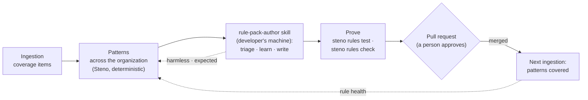

# Rule curation

How Steno's rules keep up with an organization's code. Steno finds what no rule explains and checks every rule; the `rule-pack-author` skill, run by a developer, learns what the code does and writes the rule; a person approves it on a pull request. Part of [Ingestion](./README.md). Decided (D121, D122, D123, D126, D147), `POC`.

> **In one minute**
> - Writing rules by hand doesn't scale to an organization's internal frameworks, and agents are good at working out what unfamiliar code does. So **an LLM drafts rules, never facts**: every fact still comes from a deterministic rule.
> - **Steno finds and checks; the skill learns and writes (D147).** Steno keeps the [coverage report](./coverage-report.md) and its **patterns** (what's unexplained, across the organization) with their triage states. The skill works the open items in the report's order on the developer's machine, where it can clone, search, and read public source with the developer's own credentials.
> - Every rule is **proven deterministically** before its pull request opens: its own tests (`steno rules test`), then `steno rules check`, which runs it over every file its pattern occurs in and refuses a rule that adds or explains no surface fact.
> - **A person approves on the pull request.** Steno runs no drafting job, holds no LLM budget, and pushes nothing.

---

## 1. Principles (Decided, D147)

| Principle | What it means |
|---|---|
| **An LLM drafts rules, never facts** | The graph is built only by deterministic rules |
| **Steno finds and checks; the skill learns and writes** | Learning needs cloning, searching, and public library source, which a local agent has and Steno's worker shouldn't. Steno's worker never downloads libraries and never runs an agent |
| **Proof before review** | A rule whose tests fail, or whose check finds it explains nothing or misses most of its pattern, never reaches a pull request |
| **A person approves every rule** | On the pull request, with the check's output in its description |
| **Rules stay YAML in git** | Postgres holds only state *about* rules: patterns, their triage states, rule health |
| **Only what serves a use case** | A rule names the facet it serves and the use-case question it answers, and records only surface facts (D136, D139) |
| **Gaps stay visible** | Anything not yet covered stays in the coverage report |

## 2. Patterns (Decided, D121)

A **pattern** is one kind of thing no rule explains, named by what it is, never by where it is. Its **fingerprint** is `signal:target`: `unknown_hook:com.acme.messaging.AcmeHandler`, `internal_library:com.acme.client`, `unread_file:.xyz@resources/flows/`. **Each place it occurs** has an **occurrence key** `(repository, file, enclosing symbol)`, so reach is today's code and new code is exactly what changed since the last run. The mechanics are in [coverage report §5](./coverage-report.md#5-patterns-as-built-d121-d122-built-2026-10-21).

**A pattern's state** persists across runs:

| State | Means | Set by |
|---|---|---|
| `open` | Not dealt with yet | Steno, when it first appears or comes back |
| `ignored` | Harmless: not on the surface (a logging helper, a utility library) | The skill or a person, with why |
| `expected` | A real gap that's legitimately outside the organization (an endpoint only external clients call) | The skill or a person, with why |
| `proposed` | A rule's pull request is open; the note links it | The skill |
| `covered` | No occurrences left: a rule explains it, or the code is gone | Steno |

An ignored or expected pattern stays that way across runs and repositories; it reopens only when a person reopens it.

## 3. What's worth a rule (Decided, D122, D139)

**Rank, don't exclude.** Patterns are scored by deterministic signals (the code refers to it, it names things already in the graph, an internal library owns it, it's I/O or a hook, its reach) and worked in score order, which is the report's order (D146).

**A rule must serve a use case.** The skill writes a rule only when it can name the facet it serves ([witnesses and facets](../../concepts/witnesses-and-facets.md)) and the use-case question it helps answer ([use cases](../../purpose/use-cases.md)), and its emits stay within what Steno stores (D136): an entry point, an effect, a name, a pointer to a payload. Validation rules, what an interceptor requires, and how a function computes something are read by the agent from the code, so a pattern that would only add them is marked `ignored`, with the reason.

**Universal noise ships with Steno.** Core packs carry a `noise` list (images, Markdown, lock files, IDE and CI files), each entry checked against the facets first (SQL migrations aren't noise).

## 4. Frameworks: rules that belong together (Decided, D123)

An internal framework shows up as many patterns sharing an owner: `com.acme.messaging.*` annotations, calls, and base types. Patterns are grouped by the library that owns them (its build coordinates once Artifacts A1 is built, else its package root), and `GET /api/patterns` returns them by framework. The skill learns a framework once and writes its rules together, which is cheaper and avoids duplicate rules.

**A framework becomes a pack.** The organization's pack repository holds one pack per internal framework (`acme-messaging/`), with a `framework` block in `pack.yaml` (name, description, library coordinates, source repository). See [rules and packs §6](./rules-and-packs.md#6-packs-and-layout-decided).

**Where a rule goes (D129).** A rule for an organization's own library goes to the organization's pack repository. A rule for a public library (Spring, Kafka clients) goes to that ecosystem's core pack in Steno's `rule-packs/`, so every organization benefits; inside an organization whose code mustn't leave it, it goes to the organization's repository as a core extension marked for upstreaming.

## 5. Working the report (Decided, D147)

A developer asks the skill to work the coverage report ("work the top 10 coverage items"). For each open pattern, in the report's order, a framework at a time:

| # | Step | What happens |
|---|---|---|
| 1 | **Pull** | Open patterns, ranked, with their samples and where the library's source is (`GET /api/patterns`, `steno coverage patterns`) |
| 2 | **Triage** | A rule, harmless (`ignored`), outside the organization (`expected`), needs source (an internal library no ingested repository publishes: say which repository to connect), or a blind spot (a new row in [what Steno must see](./what-steno-must-see.md)) |
| 3 | **Learn** | Read the library: its ingested repository, a local clone, or the public library's source. Check `steno rules list` for a rule to extend |
| 4 | **Write** | The rule and its test cases, positive and negative, from real samples |
| 5 | **Prove** | `steno rules test <pack>`, then `steno rules check <rule> --pattern <fingerprint>` (§6) |
| 6 | **Open the pull request** | One per destination (§4), as the developer, with each rule's check output in the description |
| 7 | **Mark** | The patterns `proposed` (with the pull request), `ignored`, or `expected`, with why (`PUT /api/patterns/triage`) |

**Unattended drafting**, if an organization needs it later, runs the same skill headless on a schedule, so there's one drafter to keep right.

## 6. Proof (Decided, D147)

`steno rules check` is deterministic and runs where the skill runs:

1. **Recall.** The rule runs over every file its pattern occurs in (read from the git host at the ingested commit), and the check lists which occurrences it explains and which it misses.
2. **Surface.** The rule must add or explain at least one surface fact (an entry point, a table, topic, or endpoint effect, an external call, a name). One that doesn't is refused: it should be `ignored`, not a rule.
3. **Identity.** The application names its claims would create; a generic name (`backend`, `api`) or one another repository's application already has is flagged.

The pull request's own CI runs `steno rules test` on the pack. A full shadow run (facts added, changed, and removed across every repository) is still to build.

## 7. Rule health (Decided, D126)

Every run records, per rule, how often it matched and how often another witness confirmed what it produced. Deterministic alarms list a rule as broken, for the next person working the report:

| Alarm | Catches |
|---|---|
| **Matches drop** with no repositories removed | A framework upgrade changed its API, and the rule quietly stopped matching |
| **Confirmation rate falls** | The rule started matching the wrong things |
| **`version_untested`** (D106) | A library version moved beyond what the rule was tested on |

## 8. Measuring it

Measured on Java before the organization depends on it (roadmap): hide a pack we wrote (for example `steno-pack-spring-kafka`) and have the skill re-derive it from the coverage report, with the hand-written pack as the answer key; then frameworks with no pack (FTGO, Axon samples, Spring Cloud Stream samples). Measured: precision and recall of the facts, items explained, and a person's review time per rule.

**Before D147.** Steno ran its own drafting job (the Claude Agent SDK, D130) from a Rule Composer page. On budgeting-app with `steno-pack-spring-web` hidden (2026-10-26), drafting by framework produced 2 rules and 2 ignores for $1.49, and the endpoint rule reproduced all 52 endpoints our pack finds, 0 wrong. It was removed because the drafter couldn't learn what it most needed to: it read only ingested repositories, by exact path, and nothing told it where a library's source was.

## 9. Not built yet

Owners from build coordinates (with Artifacts A1), the full shadow run, rule health, and unattended runs.
