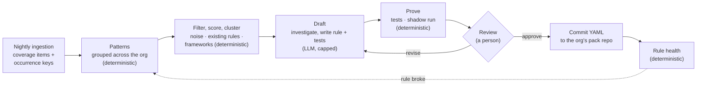

# Rule curation

How Steno keeps its rules up to date as an organization's code changes. Steno finds what no rule explains, an LLM drafts rules for it, and a person approves each rule after Steno proves it. Part of [Ingestion](./README.md). Decided (D120–D126), `POC`; not built yet.

> **In one minute**
> - Writing rules by hand doesn't scale to an organization's internal frameworks. Agents are good at working out what an unfamiliar framework does. So **an LLM drafts rules, never facts**: every fact still comes from a deterministic rule.
> - A **rule curation job**, owned and run by Steno, takes what the coverage report couldn't explain, groups it into **patterns** across the organization, clusters those into **frameworks**, and drafts rules with tests.
> - Every draft is **proven deterministically** (its tests pass; a shadow run across the organization measures its impact) before a person sees it. A person **approves the outcome in plain English**, sorted by impact. Approved rules are committed as YAML, authored by Steno.
> - **Cost follows what's new, not what's committed.** The first run (v0) is the expensive one; after that, only patterns the organization has never seen reach the LLM. Every run has a budget a person approves.

---

## 1. Principles (Decided, D120)

| Principle | What it means |
|---|---|
| **An LLM drafts rules, never facts** | The graph is still built only by deterministic rules. Revises the principle that an LLM only writes text, and D25, D42, and D93. |
| **Proof before review** | A draft that fails its tests, or whose shadow run shows conflicts, never reaches a person as ready |
| **A person approves every rule** | Approval is of the outcome (facts gained, samples, flags), not of ast-grep YAML |
| **Steno owns the loop** | Curation is a job in Steno's own queue. Nobody has to clone repositories or run an agent by hand. |
| **Rules stay YAML in git** | Postgres holds only state *about* rules (patterns, proposals, health). Developers can still write rules by hand at any time. |
| **Cost follows novelty** | Deterministic work (finding, grouping, filtering) is free of tokens; the LLM sees only new patterns, within a budget |
| **Gaps stay visible** | Anything not yet covered stays in the coverage report, whatever its score |

## 2. Patterns (Decided, D121)

A **pattern** is one kind of thing no rule explains, named by what it is, never by where it is. Its **fingerprint** is the fully qualified name of that thing:

| Fingerprint kind | Example | From coverage signal |
|---|---|---|
| Annotation | `annotation:com.acme.messaging.AcmeHandler` | Framework hooks, unknown triggers |
| Extended or implemented type | `extends:com.acme.messaging.BaseConsumer` | Framework hooks |
| Library call | `call:com.acme.messaging.Bus#publish` | Unexplained external calls |
| Unresolved call target | `unresolved:com.acme.client.AcmeClient#send` | Unresolved calls (D71) |
| File convention | `file:.xyz@src/main/resources/flows/` | Unread files (new, §3) |
| Config key prefix | `config:acme.messaging.*` | Config no rule read (new, §3) |

**Each place a pattern occurs** has a stable **occurrence key**: `(fingerprint, repository, file, enclosing symbol)`. The key uses the symbol, not the line, so an edit that shifts lines isn't new code.

- **Reach is the current state**, not a running total: the number of distinct occurrence keys in the latest run of every repository. Re-ingesting old code produces the same keys, so reach doesn't grow; deleted code removes keys.
- **New code is a set difference:** keys in tonight's snapshot that weren't in the last one. Each key keeps `first_seen`, so "new since date X" is a query.
- **A rename or move** shows as one key removed and one added: reach stays right, but the place looks new. Limitations and the improvement to investigate are in [coverage report §5](./coverage-report.md#limitations-of-fingerprints-and-occurrence-keys).

**A pattern's state** persists across runs and replaces per-item triage (refines D62):

| State | Means | The LLM sees it again? |
|---|---|---|
| `open` | Not looked at yet | Yes, when its turn comes |
| `queued` / `drafting` | In the current run | — |
| `proposed` | A proven draft awaits review | No; new occurrences only update its counts |
| `approved` / `covered` | A rule explains it (approved, or written by hand) | No |
| `rejected` | A person rejected the proposal | Only if its reach grows past a threshold the organization sets |
| `ignored` | Noise, decided once (§3) | Only if evidence reopens it (§3) |
| `blocked_vocabulary` | Needs a node, edge, or property Steno doesn't have (§6) | Resumes when the vocabulary is built |
| `needs_person` | The drafter hit its cap or couldn't make a rule work | No; listed for a person |

## 3. What's worth a rule: rank, don't exclude (Decided, D122)

Excluding paths by hand doesn't scale, and a file type that's noise in one organization is an internal framework's wiring in another. So nothing is excluded up front: everything is inventoried as patterns, scored by deterministic signals, and worked on in score order until the budget runs out. Low scorers stay visible in coverage and cost nothing.

**Two new coverage signals** make the inventory complete beyond code and I/O: **unread files** (grouped by extension and location convention across the organization) and **config no rule read** (keys grouped by prefix; this was already planned in the coverage report).

**Scoring signals** (no tokens):

| Signal | Example | Weight |
|---|---|---|
| **The code refers to it** | `getResource("flows/order.xyz")`, `@PropertySource`, `@ImportResource`, a string literal ending in `.xyz`, a `@Value` reading the key | High |
| **It names things already in the graph** | The file mentions known topic names, endpoint paths, table names, or application names | High |
| **The organization's own library reads it** | Loaded by a class from an internal library | High |
| **It's I/O or a framework hook** (D101) | An unexplained `io` call, an unknown hook | High |
| **A consistent convention** | Same location and extension in many repositories | Medium |
| **Reach** | Repositories, applications, occurrences | Multiplier |

**Noise is decided once, per pattern.** Triage proposes `ignore` for whole patterns in bulk ("ignore 35 patterns: CI files, IDE settings, …"), and a person confirms with one action. The decision covers every repository, now and later. An ignored pattern **reopens only on evidence**: a gap reported by a consumer, or a disagreement between witnesses, that traces back to it.

**Universal noise ships with Steno.** Core packs carry a `noise` list (images, Markdown, lock files, IDE and CI files), so organizations handle only their own unusual cases. **Every entry is checked against the facets first:** SQL migrations, for example, are not noise, because the Data facet reads them for table ownership.

**Triage names the facet.** A pattern is worth a rule only if the triage step can name the facet or use case it serves ([witnesses and facets](../../concepts/witnesses-and-facets.md)); otherwise it's proposed as `ignore`. This is the same test as for features: a rule belongs in Steno only if a use case needs it.

## 4. Frameworks: rules that belong together (Decided, D123)

An internal framework shows up as **many patterns sharing a root**: `com.acme.messaging.*` annotations, calls, and base types. Patterns are **clustered deterministically** by the library that owns them:

1. The build coordinates of the artifact the symbol comes from (Artifacts A1), or the ingested repository that defines it.
2. Otherwise, the package root.
3. Patterns that always occur together in the same classes join their cluster.

Patterns left over are worked on alone.

**Curation works at two levels:**

| Level | The drafter's input | Output |
|---|---|---|
| **Framework** (a cluster) | The framework's own source and README when its repository is ingested; samples of all its patterns from several repositories | A **framework card**: what it's for, its concepts (handlers, publishers, config), which facets it touches, which patterns are wiring and which are harmless |
| **Pattern** | The framework card (cached, so cheap to reuse), samples, near misses | One rule with tests, or `ignore`, or a vocabulary proposal |

**The drafter never walks repositories.** Its view of a framework is the framework's own code plus samples chosen by Steno; finding and grouping across thousands of repositories already happened deterministically.

**A framework becomes a pack.** The organization's pack repository holds one pack per internal framework (`acme-messaging/`), with a `framework` block in `pack.yaml` (name, plain-English description, library coordinates, source repository). That makes the framework a named thing: the review shows it as one unit, and its pack links to the library's artifact node, so "what is Acme Messaging and who uses it?" can be answered over MCP. See [rules and packs §6](./rules-and-packs.md#6-packs-and-layout-decided).

**Tier.** A pattern from an organization's own library (its group ID, or a repository ingested in the organization) goes to the **organization pack**. One from a public library goes there too at first, marked **generic candidate**, so it can be contributed to Steno's core packs later. Core packs ship with Steno and run only where `enabled_when` matches (D25), so shipping all of them costs nothing at runtime.

## 5. The curation job (Decided, D120, D124)

A job in Steno's queue, run after the nightly ingestions finish (and on demand). Steps, in order:

| # | Step | Tokens | What happens |
|---|---|---|---|
| 1 | **Diff** | None | Occurrence keys tonight vs. last night: new patterns, grown patterns, patterns whose rules stopped matching (§8) |
| 2 | **Filter** | None | Drop patterns that are `ignored`, already `proposed`, on the noise list, or **already matched by an existing rule** (every pack is run against the samples, enabled or not; a match means "enable the pack" or "widen its version range", which is proposed as such) |
| 3 | **Score and cluster** | None | §3 and §4 |
| 4 | **Budget** | None | Take frameworks and patterns in score order while the run's budget lasts (§9) |
| 5 | **Triage** | Small model | Per pattern: which facet does it serve, or is it noise? Most patterns end here. |
| 6 | **Investigate** | Strong model | Per framework: the framework card |
| 7 | **Draft** | Strong model | Per pattern: rule, tests from real samples (positive and negative), plain-English summary, facet |
| 8 | **Prove** | None | §6 |
| 9 | **Propose** | None | A proposal in the review queue, or `needs_person` |

**The authoring kit** is what the drafter can use. The interactive `rule-pack-author` skill uses the same kit, so a person drafting with Claude Code and the nightly job work the same way:

| Tool | Answers |
|---|---|
| `vocabulary()` | Node types, edge types, properties, emit kinds, clue types, claim types: generated from the code's schema, so it's always current |
| `rules_list`, `rule_get` | Existing rules, searchable by what they match (an index derived from the YAML when packs load) |
| `match_existing(samples)` | Whether any existing rule already matches |
| `samples(pattern, n)`, `near_misses(pattern)` | Varied occurrences across repositories, and similar code that isn't the pattern |
| `read_source(symbol)` | The definition of a symbol, from an ingested repository |
| `test_rule(rule, cases)` | `steno rules test` on a draft |
| `shadow_run(rule)` | The impact diff (§6) |

Code is read from the git host. For near misses, the job makes a shallow, sparse clone of only the few repositories holding the samples.

**Two drafter backends, one contract** (D124). `STENO_RULE_DRAFTER` chooses:

| Backend | How it works | When |
|---|---|---|
| `agent_sdk` | The Claude Agent SDK runs the investigate and draft steps as an agent with the authoring kit as its tools, capped by turns and budget | Default when Claude is the provider |
| `state_machine` | A fixed sequence of LLM calls through `steno/llm` (LiteLLM, any provider), one bounded call per step | Fallback; any provider |

Both receive the same input (the pattern or framework, its samples and signals, the vocabulary) and return the same output (rule YAML, tests, summary, facet). **The proof sits outside both**, so the backend can't let an unproven rule through. Running both on the same patterns compares their quality and cost.

## 6. Proof and review (Decided, D120)

**Proof (deterministic):**

1. The draft's tests pass, including its negative cases.
2. A **shadow run** applies the rule to the latest ingested state of every repository it could apply to, without writing the graph, and produces an **impact diff**: facts added and removed, coverage items explained, confirmation rate against other witnesses (an ACL grants 131 of 140 consumers), and conflicts with existing rules.

A draft that fails is sent back to the drafter (up to its revision cap), then marked `needs_person`.

**Review, in Steno's UI**, sorted by impact. A framework is reviewed as one unit ("Acme Messaging: 6 rules, 2 interceptors, 14 harmless entries; +400 facts across 60 repositories"), with each rule's card inside it:

| Card section | Example | Source |
|---|---|---|
| What it recognizes | "Methods annotated `@AcmeHandler(topic = …)` consume that Kafka topic." | LLM-written |
| Impact | "+140 consumer facts in 22 applications; explains 140 coverage items; 131 confirmed by ACLs; 0 conflicts" | **Deterministic** (shadow run) |
| Evidence | 3–5 matches, each with the fact it became; 1–2 **near misses**: similar code it deliberately doesn't match | **Deterministic** |
| Flags | Very broad match, low confirmation rate, untested library version, generic candidate | **Deterministic** |
| Actions | Approve · Reject · Revise with a comment (the drafter redrafts) · Show the rule (YAML, collapsed) | |

The English summary is an LLM's description and could be wrong. The impact, evidence, and flags come from running the rule, which is what makes the review trustworthy without reading YAML.

**Vocabulary proposals.** When a pattern needs a node, edge, or property Steno doesn't have, the drafter files a vocabulary proposal instead of a rule: what's needed, which facet or use case it serves, and samples. It never applies automatically. A new type needs code (an assembler) and is a design decision, so it goes to the engineering backlog. Its patterns wait as `blocked_vocabulary` and resume once it's built.

## 7. Committing approved rules (Decided, D125)

- **Where:** the organization's pack repository when one is configured (`STENO_RULE_PACK_DIRS` points at a clone of it): Steno commits and pushes there. Otherwise Steno commits to its own repository's `rule-packs/org/`.
- **Authored by Steno.** Every commit names Steno as its author and links the proposal, so history shows which rules a person wrote and which Steno drafted and a person approved.
- **Rules stay YAML.** Nothing about a rule lives only in Postgres. A rule written by hand is loaded on the next run like any other, and any pending proposal it now explains closes as `covered`.
- Steno needs **write access to that one repository**, and only that one ([Security](../security.md)).

## 8. Rule health (Decided, D126)

Every run records, per rule, how often it matched and how often another witness confirmed what it produced. Deterministic alarms send a rule back into curation, on a separate "rule broke" lane:

| Alarm | Catches |
|---|---|
| **Matches drop** with no repositories removed ("140 last week, 90 today") | A framework upgrade changed its API, and the rule quietly stopped matching |
| **Confirmation rate falls** | The rule started matching the wrong things |
| **`version_untested`** (D106) | A library version moved beyond what the rule was tested on |

## 9. Cost (Decided, D121)

The number of patterns is predictable; what each one costs to draft isn't. So cost is **bounded, measured, then projected**:

1. **A cap per framework and per pattern:** tool calls, tokens, revision rounds. A pattern that hits its cap becomes `needs_person`, never a runaway.
2. **A budget per run.** The run stops when it's spent; the rest wait for the next run, in score order.
3. **A pilot calibrates.** The first run drafts the top 10 patterns, records the mean and 90th-percentile cost, and projects the rest.
4. **v0 has a gate.** Before the first full run, Steno shows the number of patterns and frameworks, the worst case (patterns × cap), and the pilot's projection. A person approves a ceiling.

Every LLM call is logged in `llm_call` with its proposal, so the cost per pattern is measured. Levers: the small model for triage, prompt caching (the vocabulary, the rule format, and a framework card are the same for many calls), and batch processing for nightly work. Code samples are sent to the LLM provider, so the organization's data policy applies ([Security](../security.md)).

## 10. Measuring it

Before the rest of the organization depends on it, curation is measured on Java code (roadmap, POC):

1. **Hide a pack we wrote.** Disable, for example, `steno-pack-spring-kafka`, and let curation derive rules from the coverage report. The hand-written pack is the answer key: precision and recall for free.
2. **Frameworks with no pack**, standing in for internal frameworks. Candidates, to check before use: FTGO (`microservices-patterns/ftgo-application`, Eventuate Tram messaging over Kafka), Axon Framework samples (`@CommandHandler`, `@EventHandler`), Spring Cloud Stream samples (handlers bound by config), PiggyMetrics (Feign clients), ThingsBoard (a large codebase with its own queue layer). Each gets a small hand-labeled answer key.

Measured: precision and recall of the facts, coverage items explained, LLM cost per pattern and per framework, a person's review time per rule, and revision rounds per rule. Both drafter backends run on the same patterns.

## 11. Not built yet

**Built (2026-10-21; mechanics in [coverage report §5](./coverage-report.md#5-patterns-as-built-d121-d122-built-2026-10-21)):** patterns and occurrence keys (§2): every coverage stage folds its items into `coverage_pattern` and `coverage_occurrence`, reach is recounted from the occurrences, patterns no longer seen become `covered` and come back `open` if they return, and an item ignored in the coverage report ignores its pattern; scoring by signal weight and reach; clustering by owner (the library a call goes into, an annotation's or type's package root, a config prefix), read at `GET /api/patterns`. The **unread-files** signal is built too, with a built-in noise list (to move into the core packs' `noise` block), and the first piece of **evidence**: an unread file whose name the code mentions is marked `referenced_by_code`, which multiplies its pattern's score. **Not built:** the unread-config signal and the other scoring signals in §3, the packs' `noise` block, the curation job, proposals, the review UI, commits, and rule health. The build order is in the [roadmap](../../plan/roadmap.md#5-build-order-for-d115d127).
