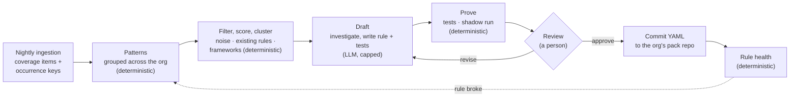

# Rule curation

How Steno keeps its rules up to date as an organization's code changes. Steno finds what no rule explains, an LLM drafts rules for it, and a person approves each rule after Steno proves it. Part of [Ingestion](./README.md). Decided (D120–D126), `POC`; not built yet.

> **In one minute**
> - Writing rules by hand doesn't scale to an organization's internal frameworks. Agents are good at working out what an unfamiliar framework does. So **an LLM drafts rules, never facts**: every fact still comes from a deterministic rule.
> - A **rule curation job**, owned and run by Steno, takes what the coverage report couldn't explain, groups it into **patterns** across the organization, clusters those into **frameworks**, and drafts rules with tests.
> - Every draft is **proven deterministically** (its tests pass; a shadow run across the organization measures its impact) before a person sees it. A person **approves the outcome in plain English**, sorted by impact. Approved rules are committed as YAML, authored by Steno.
> - **Cost follows what's new, not what's committed.** The first run (v0) is the expensive one; after that, only patterns the organization has never seen reach the LLM. Every run has a budget a person approves.

---

## 1. Principles (Decided, D120)

| Principle | What it means |
|---|---|
| **An LLM drafts rules, never facts** | The graph is still built only by deterministic rules. Revises the principle that an LLM only writes text, and D25, D42, and D93. |
| **Proof before review** | A draft that fails its tests, or whose shadow run shows conflicts, never reaches a person as ready |
| **A person approves every rule** | Approval is of the outcome (facts gained, samples, flags), not of ast-grep YAML |
| **Steno owns the loop** | Curation is a job in Steno's own queue. Nobody has to clone repositories or run an agent by hand. |
| **Rules stay YAML in git** | Postgres holds only state *about* rules (patterns, proposals, health). Developers can still write rules by hand at any time. |
| **Cost follows novelty** | Deterministic work (finding, grouping, filtering) is free of tokens; the LLM sees only new patterns, within a budget |
| **Gaps stay visible** | Anything not yet covered stays in the coverage report, whatever its score |

## 2. Patterns (Decided, D121)

A **pattern** is one kind of thing no rule explains, named by what it is, never by where it is. Its **fingerprint** is the fully qualified name of that thing:

| Fingerprint kind | Example | From coverage signal |
|---|---|---|
| Annotation | `annotation:com.acme.messaging.AcmeHandler` | Framework hooks, unknown triggers |
| Extended or implemented type | `extends:com.acme.messaging.BaseConsumer` | Framework hooks |
| Library call | `call:com.acme.messaging.Bus#publish` | Unexplained external calls |
| Unresolved call target | `unresolved:com.acme.client.AcmeClient#send` | Unresolved calls (D71) |
| File convention | `file:.xyz@src/main/resources/flows/` | Unread files (new, §3) |
| Config key prefix | `config:acme.messaging.*` | Config no rule read (new, §3) |

**Each place a pattern occurs** has a stable **occurrence key**: `(fingerprint, repository, file, enclosing symbol)`. The key uses the symbol, not the line, so an edit that shifts lines isn't new code.

- **Reach is the current state**, not a running total: the number of distinct occurrence keys in the latest run of every repository. Re-ingesting old code produces the same keys, so reach doesn't grow; deleted code removes keys.
- **New code is a set difference:** keys in tonight's snapshot that weren't in the last one. Each key keeps `first_seen`, so "new since date X" is a query.
- **A rename or move** shows as one key removed and one added: reach stays right, but the place looks new. Limitations and the improvement to investigate are in [coverage report §5](./coverage-report.md#limitations-of-fingerprints-and-occurrence-keys).

**A pattern's state** persists across runs and replaces per-item triage (refines D62):

| State | Means | The LLM sees it again? |
|---|---|---|
| `open` | Not looked at yet | Yes, when its turn comes |
| `queued` / `drafting` | In the current run | — |
| `proposed` | A proven draft awaits review | No; new occurrences only update its counts |
| `approved` / `covered` | A rule explains it (approved, or written by hand) | No |
| `rejected` | A person rejected the proposal | Only if its reach grows past a threshold the organization sets |
| `ignored` | Noise, decided once (§3) | Only if evidence reopens it (§3) |
| `blocked_vocabulary` | Needs a node, edge, or property Steno doesn't have (§6) | Resumes when the vocabulary is built |
| `needs_person` | The drafter hit its cap or couldn't make a rule work | No; listed for a person |

## 3. What's worth a rule: rank, don't exclude (Decided, D122)

Excluding paths by hand doesn't scale, and a file type that's noise in one organization is an internal framework's wiring in another. So nothing is excluded up front: everything is inventoried as patterns, scored by deterministic signals, and worked on in score order until the budget runs out. Low scorers stay visible in coverage and cost nothing.

**Two new coverage signals** make the inventory complete beyond code and I/O: **unread files** (grouped by extension and location convention across the organization) and **config no rule read** (keys grouped by prefix; this was already planned in the coverage report).

**Scoring signals** (no tokens):

| Signal | Example | Weight |
|---|---|---|
| **The code refers to it** | `getResource("flows/order.xyz")`, `@PropertySource`, `@ImportResource`, a string literal ending in `.xyz`, a `@Value` reading the key | High |
| **It names things already in the graph** | The file mentions known topic names, endpoint paths, table names, or application names | High |
| **The organization's own library reads it** | Loaded by a class from an internal library | High |
| **It's I/O or a framework hook** (D101) | An unexplained `io` call, an unknown hook | High |
| **A consistent convention** | Same location and extension in many repositories | Medium |
| **Reach** | Repositories, applications, occurrences | Multiplier |

**Noise is decided once, per pattern.** Triage proposes `ignore` for whole patterns in bulk ("ignore 35 patterns: CI files, IDE settings, …"), and a person confirms with one action. The decision covers every repository, now and later. An ignored pattern **reopens only on evidence**: a gap reported by a consumer, or a disagreement between witnesses, that traces back to it.

**Universal noise ships with Steno.** Core packs carry a `noise` list (images, Markdown, lock files, IDE and CI files), so organizations handle only their own unusual cases. **Every entry is checked against the facets first:** SQL migrations, for example, are not noise, because the Data facet reads them for table ownership.

**Triage names the facet.** A pattern is worth a rule only if the triage step can name the facet or use case it serves ([witnesses and facets](../../concepts/witnesses-and-facets.md)); otherwise it's proposed as `ignore`. This is the same test as for features: a rule belongs in Steno only if a use case needs it.

## 4. Frameworks: rules that belong together (Decided, D123)

An internal framework shows up as **many patterns sharing a root**: `com.acme.messaging.*` annotations, calls, and base types. Patterns are **clustered deterministically** by the library that owns them:

1. The build coordinates of the artifact the symbol comes from (Artifacts A1), or the ingested repository that defines it.
2. Otherwise, the package root.
3. Patterns that always occur together in the same classes join their cluster.

Patterns left over are worked on alone.

**Curation works at two levels:**

| Level | The drafter's input | Output |
|---|---|---|
| **Framework** (a cluster) | The framework's own source and README when its repository is ingested; samples of all its patterns from several repositories | A **framework card**: what it's for, its concepts (handlers, publishers, config), which facets it touches, which patterns are wiring and which are harmless |
| **Pattern** | The framework card (cached, so cheap to reuse), samples, near misses | One rule with tests, or `ignore`, or a vocabulary proposal |

**The drafter never walks repositories.** Its view of a framework is the framework's own code plus samples chosen by Steno; finding and grouping across thousands of repositories already happened deterministically.

**A framework becomes a pack.** The organization's pack repository holds one pack per internal framework (`acme-messaging/`), with a `framework` block in `pack.yaml` (name, plain-English description, library coordinates, source repository). That makes the framework a named thing: the review shows it as one unit, and its pack links to the library's artifact node, so "what is Acme Messaging and who uses it?" can be answered over MCP. See [rules and packs §6](./rules-and-packs.md#6-packs-and-layout-decided).

**Tier (D129).** A pattern from an organization's own library (its group ID, or a repository ingested in the organization) goes to the **organization pack**. One from a **public library** (Maven Central, PyPI: Spring, Kafka clients) goes to that ecosystem's **core pack** in Steno's `rule-packs/`, so every organization benefits. In a client deployment (`v1`), where Steno can't push to its own repository, generic rules land in a core-extension pack in the client's pack repository, marked for upstreaming. Core packs ship with Steno and run only where `enabled_when` matches (D25), so shipping all of them costs nothing at runtime.

## 5. The curation job (Decided, D120, D124)

A job in Steno's queue, run after the nightly ingestions finish (and on demand). Steps, in order:

| # | Step | Tokens | What happens |
|---|---|---|---|
| 1 | **Diff** | None | Occurrence keys tonight vs. last night: new patterns, grown patterns, patterns whose rules stopped matching (§8) |
| 2 | **Filter** | None | Drop patterns that are `ignored`, already `proposed`, on the noise list, or **already matched by an existing rule** (every pack is run against the samples, enabled or not; a match means "enable the pack" or "widen its version range", which is proposed as such) |
| 3 | **Score and cluster** | None | §3 and §4 |
| 4 | **Budget** | None | Take frameworks and patterns in score order while the run's budget lasts (§9) |
| 5 | **Triage** | Small model | Per pattern: which facet does it serve, or is it noise? Most patterns end here. |
| 6 | **Investigate** | Strong model | Per framework: the framework card |
| 7 | **Draft** | Strong model | Per pattern: rule, tests from real samples (positive and negative), plain-English summary, facet |
| 8 | **Prove** | None | §6 |
| 9 | **Propose** | None | A proposal in the review queue, or `needs_person` |

**The authoring kit** is what the drafter can use. The interactive `rule-pack-author` skill uses the same kit, so a person drafting with Claude Code and the nightly job work the same way:

| Tool | Answers |
|---|---|
| `vocabulary()` | Node types, edge types, properties, emit kinds, clue types, claim types: generated from the code's schema, so it's always current |
| `rules_list`, `rule_get` | Existing rules, searchable by what they match (an index derived from the YAML when packs load) |
| `match_existing(samples)` | Whether any existing rule already matches |
| `samples(pattern, n)`, `near_misses(pattern)` | Varied occurrences across repositories, and similar code that isn't the pattern |
| `read_source(symbol)` | The definition of a symbol, from an ingested repository |
| `test_rule(rule, cases)` | `steno rules test` on a draft |
| `shadow_run(rule)` | The impact diff (§6) |

Code is read from the git host. For near misses, the job makes a shallow, sparse clone of only the few repositories holding the samples.

**Two drafter backends, one contract** (D124). `STENO_RULE_DRAFTER` chooses:

| Backend | How it works | When |
|---|---|---|
| `agent_sdk` | The Claude Agent SDK runs the investigate and draft steps as an agent with the authoring kit as its tools, capped by turns and budget | Default when Claude is the provider |
| `state_machine` | A fixed sequence of LLM calls through `steno/llm` (LiteLLM, any provider), one bounded call per step | Fallback; any provider |

**The tools are internal (D129).** The authoring kit is a Python module of plain functions. The `state_machine` backend calls them directly; the Agent SDK gets them as in-process tools; a local-only command can serve them to Claude Code for the `rule-pack-author` skill. None of them is on the public MCP server.

Both receive the same input (the pattern or framework, its samples and signals, the vocabulary) and return the same output (rule YAML, tests, summary, facet). **The proof sits outside both**, so the backend can't let an unproven rule through. Running both on the same patterns compares their quality and cost.

## 6. Proof and review (Decided, D120)

**Proof (deterministic):**

1. The draft's tests pass, including its negative cases.
2. A **shadow run** applies the rule to the latest ingested state of every repository it could apply to, without writing the graph, and produces an **impact diff**: facts added and removed, coverage items explained, confirmation rate against other witnesses (an ACL grants 131 of 140 consumers), and conflicts with existing rules.

A draft that fails is sent back to the drafter (up to its revision cap), then marked `needs_person`.

**Review, in Steno's UI**, sorted by impact. A framework is reviewed as one unit ("Acme Messaging: 6 rules, 2 interceptors, 14 harmless entries; +400 facts across 60 repositories"), with each rule's card inside it:

| Card section | Example | Source |
|---|---|---|
| What it recognizes | "Methods annotated `@AcmeHandler(topic = …)` consume that Kafka topic." | LLM-written |
| Impact | "+140 consumer facts in 22 applications; explains 140 coverage items; 131 confirmed by ACLs; 0 conflicts" | **Deterministic** (shadow run) |
| Evidence | 3–5 matches, each with the fact it became; 1–2 **near misses**: similar code it deliberately doesn't match | **Deterministic** |
| Flags | Very broad match, low confirmation rate, untested library version, generic candidate | **Deterministic** |
| Actions | Approve · Reject · Revise with a comment (the drafter redrafts) · Show the rule (YAML, collapsed) | |

The English summary is an LLM's description and could be wrong. The impact, evidence, and flags come from running the rule, which is what makes the review trustworthy without reading YAML.

**Vocabulary proposals.** When a pattern needs a node, edge, or property Steno doesn't have, the drafter files a vocabulary proposal instead of a rule: what's needed, which facet or use case it serves, and samples. It never applies automatically. A new type needs code (an assembler) and is a design decision, so it goes to the engineering backlog. Its patterns wait as `blocked_vocabulary` and resume once it's built.

## 7. Publishing approved rules (Decided, D125, D129, D131)

- **Where (D129):** a rule for a public library goes to that ecosystem's core pack in Steno's `rule-packs/`; a rule for an internal framework goes to the organization's pack repository when one is configured (`STENO_RULE_PACK_DIRS` points at a clone of it), otherwise `rule-packs/org/`. A dedicated Steno rules repository is Open for `v1`.
- **How (D131):** approving writes the rule and its test cases into its pack in **Steno's own git worktree** of the destination (under `~/.cache/steno/publish/`), never a checkout someone is using; the pack's tests must pass, or nothing is published. Then it's committed **as Steno** on the `steno/rules` branch, and Steno keeps **one open pull request per destination**, adding each approval to it (`gh` opens or finds it; without `gh`, the result links to a pre-filled pull request). A destination set to `push` (`STENO_RULES_PUBLISH_CORE`, `STENO_RULES_PUBLISH_ORG`) commits straight to its default branch instead, and the UI review is the only review.
- **When it runs:** where it's merged. Once the pull request merges and the checkout Steno loads packs from is updated, the next ingestion runs it.
- **Rules stay YAML.** Nothing about a rule lives only in Postgres. A rule written by hand is loaded on the next run like any other, and any pending proposal it now explains closes as `covered`.
- Steno needs **write access to each destination**, and only those ([Security](../security.md)).

## 8. Rule health (Decided, D126)

Every run records, per rule, how often it matched and how often another witness confirmed what it produced. Deterministic alarms send a rule back into curation, on a separate "rule broke" lane:

| Alarm | Catches |
|---|---|
| **Matches drop** with no repositories removed ("140 last week, 90 today") | A framework upgrade changed its API, and the rule quietly stopped matching |
| **Confirmation rate falls** | The rule started matching the wrong things |
| **`version_untested`** (D106) | A library version moved beyond what the rule was tested on |

## 9. Cost (Decided, D121)

The number of patterns is predictable; what each one costs to draft isn't. So cost is **bounded, measured, then projected**:

1. **A cap per framework and per pattern:** tool calls, tokens, revision rounds. A pattern that hits its cap becomes `needs_person`, never a runaway.
2. **A budget per run.** A run takes every open pattern by default (what a first ingestion needs: account for everything Steno can't explain), optionally capped at a number. It drafts in score order while a worst-case draft (the per-pattern cap) still fits in what's left, so it never spends more than its budget; the rest wait for the next run. Built: $2 per pattern and $10 per run by default (`rule_drafter_max_usd`, `curation_budget_usd`).
3. **A pilot calibrates.** The first run drafts the top 10 patterns, records the mean and 90th-percentile cost, and projects the rest.
4. **v0 has a gate.** Before the first full run, Steno shows the number of patterns and frameworks, the worst case (patterns × cap), and the pilot's projection. A person approves a ceiling.

Every LLM call is logged in `llm_call` with its proposal, so the cost per pattern is measured. Levers: the small model for triage, prompt caching (the vocabulary, the rule format, and a framework card are the same for many calls), and batch processing for nightly work. Code samples are sent to the LLM provider, so the organization's data policy applies ([Security](../security.md)).

## 10. Measuring it

Before the rest of the organization depends on it, curation is measured on Java code (roadmap, POC):

1. **Hide a pack we wrote.** Disable, for example, `steno-pack-spring-kafka`, and let curation derive rules from the coverage report. The hand-written pack is the answer key: precision and recall for free.
2. **Frameworks with no pack**, standing in for internal frameworks. Candidates, to check before use: FTGO (`microservices-patterns/ftgo-application`, Eventuate Tram messaging over Kafka), Axon Framework samples (`@CommandHandler`, `@EventHandler`), Spring Cloud Stream samples (handlers bound by config), PiggyMetrics (Feign clients), ThingsBoard (a large codebase with its own queue layer). Each gets a small hand-labeled answer key.

Measured: precision and recall of the facts, coverage items explained, LLM cost per pattern and per framework, a person's review time per rule, and revision rounds per rule. Both drafter backends run on the same patterns.

**First result (2026-10-26, `STENO_DISABLED_PACKS`, Claude Opus 5.5).** `steno-pack-spring-web` hidden from budgeting-app: 11 `unknown_hook` patterns (one per Spring annotation; the ~60 one-method patterns it also caused are left to coverage). Drafting pattern by pattern: 11 suggestions for $5.81, holding about 3 distinct rules (5 copies of the endpoint rule); 4 of the 5 endpoint rules reproduced all 52 endpoints our pack finds (method and full path, 0 wrong), the fifth only with the drafted prefix rule. Drafting by framework: 4 suggestions (2 rules, 2 ignores) for $1.49, 6 patterns joining a draft at no cost; the endpoint rule alone reproduces all 52, 0 wrong. Not graded: the exception-handler rule, which our pack has no counterpart for.

## 11. Not built yet

**Built (2026-10-21; mechanics in [coverage report §5](./coverage-report.md#5-patterns-as-built-d121-d122-built-2026-10-21)):** patterns and occurrence keys (§2): every coverage stage folds its items into `coverage_pattern` and `coverage_occurrence`, reach is recounted from the occurrences, patterns no longer seen become `covered` and come back `open` if they return, and an item ignored in the coverage report ignores its pattern; scoring by signal weight and reach; clustering by owner (the library a call goes into, an annotation's or type's package root, a config prefix), read at `GET /api/patterns`. The **unread-files** and **unread-config** signals, the packs' `noise` block (the core list in `steno-pack-noise`), three kinds of **evidence** (`referenced_by_code`, `names_known_things`, `in_internal_library`), and **triage on patterns** are built too. **The curation loop is built end to end (2026-10-22).** In the UI, one page, **Rule Composer**:

- **The search, at the top.** Pick the model (Claude Opus 5.5 by default; the choices are `rule_drafter_models`) and click **Find missing rules**: a search over every open pattern, most widespread first, queued and run by a worker. While it runs: patterns done of the total, the one being drafted, and the drafting cost against the run's limit, updated as each suggestion finishes. It stops before its limit, or when the provider can't be used (a usage limit, billing, a failed login); the remaining patterns stay open and the next search continues. Scheduled searches (nightly, not built yet) will use the global `rule_drafter_model`.
- **The cost check (§9).** Beside the model, the projected drafting cost for every open pattern, from past drafts with that model (mean and 90th percentile; `GET /api/curation/estimate`). A search larger than the pilot whose high projection passes the limit, or with no history for its model, asks first: run a **pilot** of the top `curation_pilot` patterns (10) to get a projection, or **search all** with a spending limit the person sets (the worst case, every pattern at its cap, is shown beside it).
- **Parallel drafting, a framework at a time (D123).** A search is a queue of patterns. The first worker to see it lists them and marks them `queued`; then any worker process, on any machine, claims the next one **together with the rest of its framework** (the patterns sharing its owner), up to `curation_parallel` (4) claims at once per search. Different frameworks are drafted in parallel; a framework's patterns in score order by one worker. A pattern that a rule already drafted for the framework explains (in this search, or an earlier one still waiting for review) joins that suggestion with no LLM call: running the draft over the pattern's samples puts a fact within a few lines of each. The others are drafted with the framework's earlier drafts in front of the drafter, so rules aren't repeated. This is the cheap form of §4's framework level; the framework card is still to build. Claiming reserves the per-pattern cap against the limit under a row lock, so parallel drafts never overspend; a claim not finished within `rule_drafter_timeout_min` (a worker died) is drafted again. The page lists every draft in flight.
- **Checks before review (§6).** A drafted rule's own tests prove it on samples it chose; then Steno runs it over every file its pattern occurs in (up to 20, read from the git host). **Recall**: which files it explains and which it misses, linked. **Identity**: the application names its claims would create; a generic name (`backend`, `api`) or one another repository's application already has is a problem. A rule with a problem goes back to the drafter once with what was found (`rule_drafter_revisions`); an identity problem that remains makes it `needs_person`, shown with the reason. The full shadow run (facts added, changed, removed across every repository) is still to build.
- **Ignores are as narrow as the reasoning.** Unread files are grouped by extension and folder (§3), so an approved ignore for that pattern covers only the file names the drafter examined (`ignored_file`), not every file the pattern groups; other names stay visible and reopen it. The review panel says what an ignore covers.
- **To review, by framework (D123).** Suggestions from the same framework (their patterns' owner: a library or package root) are grouped and can be approved or rejected together (`POST /api/proposals/approve`, `/reject` with ids); the rest are listed alone. Each suggestion: what it recognizes, what approving does (which rule, which pack and folder, new or existing, which pull request), the rule, and, folded away, its tests and where the code was found. Approve, or reject with why.
- **Approved.** Approved rules, with their pull request.
- **Past searches.** Every search: when, which model, what it found, how long it took, its drafting cost, and the total across searches; each opens to its suggestions, rejected ones included.

Rejected suggestions stay in `rule_proposal` and their pattern stays `rejected`, so it isn't drafted again. The drafting cost is the one-time LLM cost of writing a suggestion, at API prices; running an approved rule costs nothing. A new core pack goes in the ecosystem folder the drafter chooses (an existing one, or a new name such as `platform/`), with the witness type it gives (PLATFORM for deployment config). A search drafts only patterns a rule could match elsewhere: `inferred_entry` and `unreachable_effect` are one function in one application (dead code, a stub), so they stay in the coverage report; when a framework is what starts such code, its annotation or base type is an `unknown_hook` pattern, and that is drafted. Patterns themselves aren't a page: the Coverage page is where unexplained code is triaged (ignoring an item there ignores its pattern, and reopening reopens it).

The same, from the command line:

| Command | Does |
|---|---|
| `steno curate [--limit N] [--fingerprint F] [--budget $]` | A curation run: every open pattern, or at most N, or the ones named, framework by framework; for each, varied samples read from the git host; an existing rule matching them becomes "enable the pack" (no LLM); otherwise the drafter proposes, and a rule is accepted only when its own cases pass. Stops at the run's budget. |
| `steno proposals [--status S]`, `steno proposal ID` | Proposals, and one in full: summary, rule, tests, proof, cost |
| `steno approve ID [--commit]` | A rule is written into its pack (an existing one, or a new core or organization pack, D129) with its test cases, and the pack's tests must pass, or nothing is kept; `--commit` commits it as Steno. Approving `ignore` ignores the pattern; `vocabulary` keeps it blocked for the backlog. |
| `steno reject ID --why …` | The pattern is rejected, with why |

The drafter is the Claude Agent SDK (D130). First live runs on budgeting-app: `AuthenticationManager#authenticate` → `ignore` ($0.07: an in-process call whose data access the app's own repositories already show), `nginx/*.conf` → `vocabulary` ($0.21: proxy routes are a Routing fact the vocabulary can't express yet), `psycopg2.connect` → a rule with three passing cases, one negative ($0.41). Tables: `curation_run`, `rule_proposal`. Kit tools built: `vocabulary()`, `rules_index` / `find_rules`, `match_existing`, `test_rule`, `read_file`.

**Not built:** owners from build coordinates (with Artifacts A1), reopening an ignored pattern on evidence, `near_misses`, `read_source` by symbol, the shadow run (proof is the rule's own cases for now), runs started by the nightly schedule, proposals, the review UI, commits, and rule health. The build order is in the [roadmap](../../plan/roadmap.md#5-build-order-for-d115d127).
