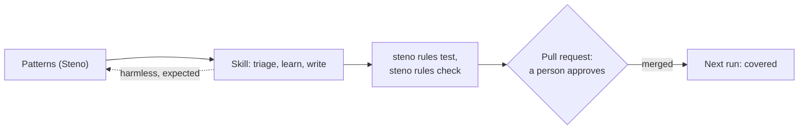

# Rule curation

How rules keep up with an organization's code. Decided (D121–D123, D126, D147, D148), `POC`.

> **In one minute**
> - **An LLM drafts rules, never facts.**
> - **Steno finds and checks; the skill learns and writes (D147).** The `rule-pack-author` skill runs on a developer's machine, where it can clone and read public source.
> - Every rule is **proven deterministically** before its pull request opens.
> - **A person approves on the pull request.** Steno runs no drafting job and pushes nothing.

## 1. Principles (Decided, D147)

- **Steno's worker never downloads libraries or runs an agent.**
- **Proof before review.**
- **Rules stay YAML in git.** Postgres holds only state about them.
- **A rule names its facet and use-case question,** and records only surface facts (D136, D139).
- **Gaps stay visible.**

## 2. Patterns (Decided, D121)

Mechanics: [coverage report §5](./coverage-report.md#5-patterns-d121-d122-built).

| State | Means | Set by |
|---|---|---|
| `open` | Not dealt with | Steno |
| `ignored` | Harmless: not on the surface | The skill or a person |
| `expected` | A real gap outside the organization | The skill or a person |
| `proposed` | A pull request is open | The skill |
| `covered` | No occurrences left | Steno |

**Nobody resolves an item by hand (D148).** Each ingestion asks the git host about `proposed` patterns: merged is `covered` (reopened if it still occurs), declined is `ignored`, otherwise nothing changes.

## 3. What's worth a rule (Decided, D122, D139)

**Rank, don't exclude.** A pattern that would only add depth (validation rules, what an interceptor requires) is `ignored`, with the reason.

## 4. Frameworks: rules that belong together (Decided, D123)

Patterns are grouped by owning library, so the skill learns a framework once. **A framework becomes a pack.**

| The rule is for | Default | Org-only mode (`STENO_RULES_ORG_ONLY`) |
|---|---|---|
| The organization's library | Its pack repository (`STENO_RULE_PACK_DIRS`) | The same |
| A public library | A core pack in `rule-packs/` | **Not committed.** Listed for a person to report, with no organization code |

`steno rules destinations` prints it.

## 5. Working the report (Decided, D147)

| # | Step | What happens |
|---|---|---|
| 1 | **Pull** | Open patterns, ranked (`steno coverage patterns`) |
| 2 | **Triage** | A rule, harmless, outside the organization, needs source, or a blind spot |
| 3 | **Learn** | Read the library: ingested, cloned, or public source |
| 4 | **Write** | The rule and tests, positive and negative |
| 5 | **Prove** | `steno rules test <pack>`, then `steno rules check <rule> --pattern <fingerprint>` |
| 6 | **Open the pull request** | One per destination, as the developer, on GitHub or Bitbucket |
| 7 | **Mark** | `proposed`, `ignored`, or `expected`, with why |

## 6. Proof (Decided, D147)

`steno rules check`:

1. **Recall.** Runs over every file the pattern occurs in, listing what it explains and misses.
2. **Surface.** Must add or explain a surface fact, or it's refused.
3. **Identity.** Flags a generic name or one another application has.

A full shadow run across every repository isn't built.

## 7. Rule health (Decided, D126; not built)

Per rule and run: matches and confirmations. Alarms: matches drop, confirmation falls, `version_untested`.

## 8. Measuring it

Hide a pack we wrote, have the skill re-derive it, and compare; then frameworks with no pack. Measured: precision, recall, items explained, and review time per rule. **Before D147,** a Steno drafting job reproduced all 52 endpoints on budgeting-app for $1.49. It was removed because it couldn't learn what it needed.

## 9. Not built yet

Owners from build coordinates, the shadow run, rule health, and re-ingesting when a pack changes.
