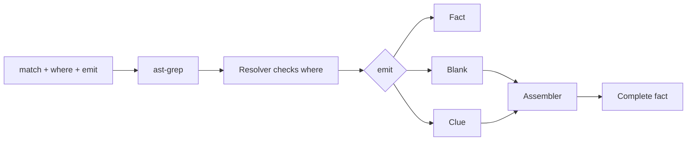

# Rules and Rule Packs

The source of truth for rule syntax. The `rule-pack-author` skill reads this page.

> **In one minute**
> - A rule is an **ast-grep pattern** (`match`) plus **what it means** (`emit`). An optional `where` checks resolved types.
> - Rules never reference each other. Facts across files combine through **clues** and a fixed set of **assemblers**.
> - Rules come in versioned **packs**, auto-enabled, each rule with **test cases**.
> - A person approves every rule on a pull request.



## 1. The idea (Decided)

`match` is plain [ast-grep](https://ast-grep.github.io/) syntax. `emit` uses Steno's vocabulary: the [graph's](../graph-reference.md) nodes and edges, plus clues. Rules are deterministic. No LLM runs during ingestion.

## 2. Anatomy of a rule (Decided)

```yaml
id: fastapi-endpoint                  # unique within the pack
description: A route handler
match:                                # ast-grep: rule + optional constraints / utils
  rule:
    kind: decorated_definition
    has:
      kind: decorator
      has: { pattern: $ROUTER.$METHOD($PATH $$$) }
  constraints:
    METHOD: { regex: "^(get|post|put|patch|delete)$" }
where:                                # optional; checked after resolution
  $ROUTER: { type: [fastapi.APIRouter, fastapi.FastAPI] }
emit:
  - node: [Interface, HttpEndpoint]
    as: endpoint
    method: $METHOD
    path: $PATH
    prefixed_by: $ROUTER
  - edge: EXPOSES
    from: "@app"
    to: endpoint
  - entry_point: { trigger: endpoint, function: "@function" }
```

- **`language`** comes from the pack. A rule may override it.
- **`where`**: `type` is about instances, or subclasses of them. `class` is about classes themselves, or subclasses, for constructor calls. A failed condition skips the match.

## 3. What a rule emits (Decided)

| Emit | What it is | In the graph? |
|---|---|---|
| **`node`** | An endpoint, topic, table, entity | Yes |
| **`edge`** | `EXPOSES`, `CALLS`, `MAPS_TO`, … | Yes |
| **`clue`** | A partial fact | No, an assembler consumes it |
| **`entry_point`** | "This function is started by this trigger" | Flows derive from it |
| **`interceptor`** | Code that runs around entry points (§6) | As steps today |
| **`claim`** | A witness's statement (§11) | Through reconcile |

**Rules never create `Flow` or `Step` nodes.**

### Referring to things inside `emit`

| Form | Meaning | Example |
|---|---|---|
| `$NAME` | A captured value | `path: $PATH` |
| `"literal"` | A fixed value | `method: POST` |
| `@function`, `@class`, `@file`, `@app` | Anchors | `from: "@function"` |
| `as: name` | Names a node for later lines | `as: endpoint` |
| `{Label: {key: value}}` | A reference by identity; a stub if absent | `to: { KafkaTopic: { name: $TOPIC } }` |
| `{Label: {some: value}}` | Only some identity properties: the app's one match. Several: `ambiguous`. None: a stub. | `to: { DataStore: { vendor: chroma } }` |
| `{http: {method, url}}` | An outbound target. No `method` means GET. | `to: { http: { method: $VERB, url: $URL } }` |
| `{http: {method, parts: [...]}}` | A URL from parts joined with one `/`. An unbound part is left out; an unresolved one is a `{placeholder}`. | `parts: [$URL, $PREFIX, $PATH]` |
| `{Function: {symbol: $X}}` | A function referenced, not called (callback, background task). When `$X` is a parameter of the enclosing function, the edge goes from each of the helper's callers to what it passes. | `to: { Function: { symbol: $TASK } }` |
| `{table_of: $X}` | The table an entity maps to. `$X` is the class, an instance, or an attribute. Not a mapped entity: the emit is dropped. | `to: { table_of: $MODEL }` |

- **Edge properties** can be set, such as `operation: insert` on `WRITES_TO`, or `async: true` on `INVOKES`. `INVOKES` goes into the in-memory call graph; a rule's call to an existing call **merges** into it.
- **Optional captures:** a capture bound in only one branch of an `any:` is left out when that branch didn't match. A final catch-all branch makes it optional.
- **Transformed captures:** ast-grep's `transform:` works as documented, and its value is its text. `TABLE: { convert: { source: $CLASS, toCase: snakeCase } }`.
- **Several values, several facts:** a list-valued identity property emits once per value, with its edges and entry points.
- **A channel with an unknown name is dropped,** and shows in coverage as `dropped_match`.
- **Captured values are resolved.** What can't be resolved is recorded as unresolved, with lower confidence.

### Identity: what each node needs

| Node | Identity properties | Notes |
|---|---|---|
| `HttpEndpoint` | `method`, `path` | Plus the exposing app, implied |
| `GrpcMethod` | `service`, `method` | |
| `KafkaTopic` / `Queue` | `name` | `cluster` when known. Not scoped to an application. |
| Org-defined `Interface` label, e.g. `PxChannel` | `name` | Keyed by name, like a topic |
| `Schedule` | `kind`, `expression` | Plus the app |
| `Function` | `symbol` (with parameter types where the language overloads) | In the call graph only (D60) |
| `Entity` | `name` (the symbol) | |
| `Table` | `name` | `schema`, `datastore` when known |
| `DataStore` | `vendor`, `host`, `database` | |
| `ExternalSystem` | `host`, or `name` | A URL is accepted; its host is kept |

### Example: an org's own messaging (D61)

```yaml
# rules/px-send.yaml
id: px-send
match:
  rule: { pattern: "$M.post($CHANNEL, $$$)" }
where:
  $M: { type: com.yourorg.px.Messenger }
emit:
  - edge: PRODUCES
    from: "@function"
    to: { PxChannel: { name: $CHANNEL } }
```

```yaml
# rules/px-receive.yaml
id: px-receive
match:
  rule:
    kind: method_declaration
    has: { pattern: "@OnMessage($CHANNEL)" }
emit:
  - node: [Interface, PxChannel]
    as: channel
    name: $CHANNEL
  - entry_point: { trigger: channel, function: "@function" }
```

## 4. Clues (Decided)

Some facts span files. Each rule reports what it sees, and an assembler combines the pieces. Blanks are `prefixed_by`, `table_of`, and partial references.

**Rules never reference each other.** They meet through a shared label: the symbol a clue is about, which the resolver makes the same in every file. A new pack never has to be wired to existing ones.

**Clue types are a fixed set, owned by Steno.** A new type means new assembler code.

| Clue | Fields | Assembler | Used for |
|---|---|---|---|
| `prefix` | `owner`, `value` | Prefix chain | URL prefixes on routers, controllers |
| `mount` | `parent`, `child`, `prefix?` | Prefix chain | A router mounted inside another |
| `client` | `type`, `target`, `operations?`, `returns?`, `extends?`, `calls?`, `base?` | Client | SDK objects that reach outside without a visible URL (below) |
| `property` | `key`, `value`, `profile?` | Config | Config values for `${placeholders}` |
| `access` | `matchers`, `rule`, `value`, or `function` | Interceptors | An endpoint's `access` property |
| `provides` | `function` | Interceptors | A `@Bean` body standing in for its interface |

**`client`:** a call on an object of `type` or a subclass becomes `CALLS` to an `ExternalSystem` `target`, or `READS_FROM` / `WRITES_TO` per `operations` (method → `read` / `write`) on a `DataStore`. Unlisted methods produce nothing. `returns` (method → type) keeps chained calls typed. `extends` names the client's library bases, the whole chain, so a receiver typed only as a base is a `candidate` (`ambiguous` when several, D66). `calls` (method → `{method, path}`) and `base` (a base URL) cover generated clients and SDKs (D73). `type: "@class"` names the class the rule matched in. Clients with source in the repository need no clue.

**No clue found** adds nothing. If the label can't be worked out, the fact is kept at lower confidence and listed in coverage.

## 5. Config rules (Decided)

```yaml
id: spring-kafka-topic-declared
kind: config                              # code (default) | config
files: ["**/application*.yml", "**/application*.properties"]
match:
  key: "app.kafka.topics.{NAME}"          # {NAME} captures a segment; ** matches many
emit:
  - node: [Interface, KafkaTopic]
    name: $VALUE                          # $KEY and $VALUE are always available
```

Most config needs no rule beyond the framework's own, which turns every key into a `property` clue. Use config rules when **the config alone states a fact**. Keys that look like secrets are skipped by every rule. Record rules (`each`, `when`) are in [claims and reconcile §4](./claims-and-reconcile.md#4-writing-claims-in-a-pack).

## 6. Packs and layout (Decided)

```
rule-packs/<ecosystem>/steno-pack-fastapi/
├─ pack.yaml
├─ rules/fastapi-endpoint.yaml     one rule per file; the file name is the rule id
└─ tests/fastapi-endpoint/nested-prefix/
   ├─ input/                       small copies of real code
   └─ expected.yaml
```

```yaml
# pack.yaml
name: steno-pack-fastapi
version: 0.1.0
language: python
source: core                    # core | org
description: FastAPI routers and endpoints
witness_type: CODE              # CODE (default) | PLATFORM | DECLARED (§11)
versions:                       # what the rules are tested on (D106)
  fastapi: ">=0.100, <1"
enabled_when:                   # any one turns the pack on
  dependencies: [fastapi]       # requirements, pyproject, pom.xml, Gradle, version catalog
  imports: [fastapi]            # imported by any source file
  # always: true                # a language's standard library
  # files: ["**/*.yaml"]        # a matching file exists; with content: "regex"
```

Lock files and test code don't enable packs (D25, D49).

**Where packs live:** `rule-packs/org/`, or any folder in `STENO_RULE_PACK_DIRS`, typically a clone of the organization's pack repository. A name found twice is an error. **Org-only mode (D148):** `STENO_RULES_ORG_ONLY=true` commits nothing to Steno.

**Internal framework (D123):**

```yaml
framework:
  name: Acme Messaging
  description: The messaging layer over Kafka.
  coordinates: [com.acme:acme-messaging]
  repository: acme/acme-messaging
```

**Noise (D122).** Checked against the facets first; SQL migrations aren't noise.

```yaml
noise:
  files: ["**/*.md", "**/*.lock"]
  config: ["logging.*"]
```

### Versions (Decided, D106)

| Key | Matches | Example |
|---|---|---|
| `group:artifact` | That Java dependency | `org.apache.kafka:kafka-clients: ">=2.0, <5"` |
| A group or plugin id | The plugin, parent POM, BOM, and the group | `org.springframework.boot: ">=2.0, <4"` |
| A distribution name | That Python package | `sqlalchemy: ">=1.4, <3"` |

- **Every range is backed by test cases in that version's syntax.**
- **The version in use is read from build files, without building.** A range or BOM-managed version is unknown.
- **Rules still run on any version.** Coverage reports `version_untested` and `version_unknown`.

### Interceptors and access (Decided, D103)

```yaml
emit:
  - interceptor:
      function: "@function"
      kind: filter                     # filter | validation | …
      applies_to: http                 # or { validates: "@class" }
```

**Not built (D116, D138):** an `Interceptor` node, with:

```yaml
      kind: response                   # filter | request | validation | aspect | response | error
      phase: after                     # before (default) | after | on_error
      applies_to: { paths: ["/api/**"] }
      activation:                      # any one turns it on
        dependency: com.acme:acme-web-security
        annotation: com.acme.web.EnableAcmeAuth
        config: { key: acme.auth.enabled, equals: "true" }
        off_when: { config: { key: acme.auth.enabled, equals: "false" } }
```

What it requires is read from its code (D138).

### Contracts (Decided, D115, D137; not built)

An entity rule marks a payload class; the resolver reads its fields. The endpoint or listener rule emits `USES_ENTITY` with `role`. Constraints aren't read into the graph.

### The ledger: I/O and harmless libraries (Decided, D101)

```yaml
library:
  io:        # unexplained calls are gaps
    - org.springframework.security.authentication.AuthenticationManager#authenticate
  harmless:  # never a gap
    - org.springframework.stereotype
    - sqlalchemy.orm.Session.commit
```

Entries are packages, types, or `Type#method` (Python: dotted), matched by prefix. An `io` call must be explained by a rule, or it's a stop on the flow. A framework hook must be matched or `harmless`, or it's an unknown hook.

### HTTP signatures (Decided, D64)

```yaml
# http.yaml, in a pack with language: any and enabled_when: { always: true }
systems:
  - name: GitHub
    hosts: [api.github.com, raw.githubusercontent.com]   # * wildcards allowed
```

**Only hosts count.** Paths never name a service.

## 7. Tests (Decided)

```yaml
# tests/fastapi-endpoint/nested-prefix/expected.yaml
nodes:
  - HttpEndpoint: { method: POST, path: "/api/jobs/projects/{project_id}" }
edges:
  - EXPOSES: { from: "@app", to: "POST /api/jobs/projects/{project_id}" }
entry_points:
  - { trigger: "POST /api/jobs/projects/{project_id}", function: routers.job.run_project_jobs }
```

- A case lists **only the output of the rule it's filed under.** The pack's other rules still run, so their clues are available.
- Sections: `nodes`, `edges`, `entry_points`, `clues`, `claims`. **An omitted section isn't checked;** a listed one must match exactly, and an empty list asserts nothing is emitted.
- Symbols are relative to `input/`. A runtime value is `"<unresolved>"`.
- Include a **negative case** when a pattern could over-match.
- A case needing clues includes the other files.
- **Core-pack test inputs are minimal and synthetic.** Real samples stay in organization packs.

## 8. Writing rules: by hand, with the skill, or by curation (Decided)

A person approves every rule. Write by hand, describe it to the `rule-pack-author` skill, or have the skill [work the coverage report](./rule-curation.md) (D147). New node, edge, or clue types are **proposed**, never invented.

## 9. Rules, assemblers, and plugins

| Mechanism | Covers | Written as |
|---|---|---|
| **Rules** | "See this pattern, emit this fact" | YAML |
| **Assemblers** | Combining clues | Core code |
| **Symbol resolver** | Names, types, values | Core code, per language |
| **Plugins** | Anything beyond both. Rare. | Code, with an org pack |

## 10. Pack catalog

**90 rules across 33 packs.** `steno rules list` is always current.

| Ecosystem | Packs |
|---|---|
| `python/` (12) | `fastapi`, `sqlalchemy`, `llama-index`, `llama-index-chroma`, `chromadb`, `pydantic-settings`, `httpx`, `requests`, `psycopg2`, `neo4j`, `claude-agent-sdk`, `python-stdlib` |
| `java/` (17) | `spring-boot`, `spring-web`, `spring-cloud-openfeign`, `spring-cloud-gateway`, `spring-cloud-stream`, `spring-data`, `spring-kafka`, `spring-jms`, `spring-amqp`, `spring-security`, `jpa`, `bean-validation`, `kafka-clients`, `okhttp`, `apache-httpclient`, `grpc-java`, `java-stdlib` |
| `http/` | `saas-http` (signatures) |
| `kafka/` (PLATFORM) | `strimzi`: topics and ACLs |
| `catalog/` (DECLARED) | `backstage`: `catalog-info.yaml` |
| `core/` | `noise` |
| `org/` | Empty: organization packs |

**Not covered yet (Open):** Spring application events; SQL in `JdbcTemplate` and native `@Query`; RabbitMQ exchanges and routing keys; Kafka Streams; `RouterFunction` routes; `server.servlet.context-path`; gRPC client stubs; DI by `@Qualifier` / `@Primary` / `@Profile`; several datasources in one application; Spring Cloud Stream pollable sources (who polls).

**Rule count grows with distinct frameworks, not repositories.**

### Internal frameworks (Decided)

An org-defined `Interface` label, a sender rule, and a receiver rule (D61). The coverage report finds them: unknown hooks, library gaps, and one-sided joins. Default for an internal library (Proposed): a boundary rule.

## 11. Facts and claims; witness types (Decided, D114; built)

| A rule emits | It produces | Goes to |
|---|---|---|
| `node`, `edge`, `entry_point`, … | A **fact** | The graph |
| `claim:` | A **claim** | The claim store, then reconcile |

- **One pack, one witness type.** Declared, never guessed. Test: what consumes the file?
- **Folders stay by ecosystem.**
- **`generated: true`** marks a source generated from code: never an independent witness.
- **Claim types are fixed** ([claims §3](./claims-and-reconcile.md#3-claims)).
- **Name sources** are `name` claims with a slot.
