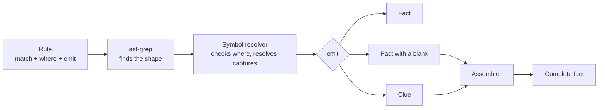

# Rules and Rule Packs

The format of Steno's rules and rule packs: how a rule finds code, what it emits, how facts from different rules are combined, and how a rule proves it works. Part of [Ingestion](./README.md). Status markers: **Decided** · **Proposed** · **Open**. This page is the source of truth for rule syntax (the `rule-pack-author` skill reads it).

> **In one minute**
> - A rule is an **ast-grep pattern** (`match`, unchanged ast-grep syntax) plus **what it means** in Steno's vocabulary (`emit`: nodes, edges, clues, entry points). An optional `where` checks resolved types.
> - Rules never reference each other. Facts spread across files are combined by **clues**, labeled with the symbol they're about, and a fixed set of **assemblers**.
> - Rules come in versioned **packs**, grouped by ecosystem, auto-enabled by dependencies or imports. Every rule ships with **test cases**.
> - Most organizations need only their framework packs plus a small **org pack** for in-house frameworks. See the [catalog](#10-pack-catalog) for what exists.



---

## 1. The idea (Decided)

**A rule is a pattern that finds code, plus what that code means as graph facts.**

```yaml
match:   # WHERE: standard ast-grep, unchanged
emit:    # WHAT IT MEANS: Steno's vocabulary
```

- `match` is plain [ast-grep](https://ast-grep.github.io/) rule syntax (tree-sitter based, many languages). Authors, and their AI assistants, can use ast-grep's docs and playground as they are.
- `emit` is written in **Steno's vocabulary**: the node and edge types of the [knowledge graph](../graph-reference.md), plus clues (below). Whoever writes it has to know that vocabulary; §4 lists it.
- Rules are **deterministic**. They're fixed YAML, executed by code. No LLM runs during ingestion. (An AI assistant may help a person *write* a rule; see §8.)

## 2. Anatomy of a rule (Decided)

```yaml
id: fastapi-endpoint                  # unique within the pack
description: A route handler, e.g. @router.post("/projects/{project_id}")
match:                                # ast-grep: rule + optional constraints / utils
  rule:
    kind: decorated_definition
    has:
      kind: decorator
      has:
        pattern: $ROUTER.$METHOD($PATH $$$)
  constraints:
    METHOD: { regex: "^(get|post|put|patch|delete)$" }
where:                                # optional; checked after symbol resolution
  ...
emit:                                 # one or more outputs
  - ...
```

- **`language`** comes from the pack (`pack.yaml`). A rule may override it, e.g. a YAML config rule inside a Java pack.
- **Captures** (`$PATH`, `$ROUTER`, …) are ast-grep metavariables. In `emit` they stand for the captured code.
- **`where`** holds conditions a pattern can't check, because they depend on **types** or other resolved information:

  ```yaml
  where:
    $CLIENT: { type: [httpx.AsyncClient, httpx.Client] }    # an instance of one of these, or of a subclass
    $CLS:    { class: [llama_index.llms.ollama.Ollama] }    # the class itself, or a subclass (for constructor calls)
  ```

  `type` is about **instances** (`client.get(...)` on an httpx client, not `dict.get(...)`); `class` is about **classes**, so a constructor rule also catches a subclass the app defines (`class Gateway(OpenAILike)`). `where` is checked as soon as the match is found (extract stage), by asking the symbol resolver; a match whose condition fails is skipped.

## 3. What a rule emits (Decided)

| Emit | What it is | Reaches the graph? |
|---|---|---|
| **`node`** | A thing: an endpoint, a topic, a table, an entity | Yes |
| **`edge`** | A connection between two things: `EXPOSES`, `CALLS`, `MAPS_TO`, … | Yes |
| **`clue`** | A partial fact that helps complete other facts: "this router has prefix `/jobs`" | No, it's consumed by an assembler |
| **`entry_point`** | "This function is started by this trigger" | Indirectly: flows are derived from entry points |

**Rules never create `Flow` or `Step` nodes.** Flows are derived in the flows stage by walking the call graph from every entry point ([Ingestion §2](./README.md#2-the-pipeline)). A rule only marks where a flow starts.

### Referring to things inside `emit`

| Form | Meaning | Example |
|---|---|---|
| `$NAME` | A captured value | `path: $PATH` |
| `"literal"` | A fixed value | `method: POST` |
| `@function`, `@class`, `@file`, `@app` | **Anchors**: the function or class the match is in, its file, or the application being ingested | `from: "@function"` |
| `as: name` | Names an emitted node so later lines in the same rule can refer to it | `as: endpoint` … `to: endpoint` |
| `{Label: {key: value}}` | An inline reference to a node by its identity; a stub is created if it doesn't exist yet | `to: { KafkaTopic: { name: $TOPIC } }` |
| `{Label: {some: value}}` with only **some** identity properties | The app's single node that matches. Several matches: marked `ambiguous`; none: a stub. For when code reaches a store without naming it (a framework wrapper around "the" vector store). | `to: { DataStore: { vendor: chroma } }` |
| `{http: {method, url}}` | An outbound HTTP target; the graph builder decides whether it's another app's endpoint or an `ExternalSystem`. Without `method`, GET. | `to: { http: { method: $VERB, url: $URL } }` |
| `{http: {method, parts: [...]}}` | **(Proposed; built 2026-10-07)** A URL from parts joined with one `/` between them, for a base URL and a path that are written in different places (a Feign client's `url` and a method's mapping). An unbound part is left out; one that can't be resolved becomes a `{placeholder}`, so the constant parts survive. | `to: { http: { method: $METHOD, parts: [$URL, $PREFIX, $PATH] } }` |
| `{Function: {symbol: $X}}` | A function that's **referenced, not called** here: a callback, a background task. Symbol resolution turns `$X` into the function's identity. | `to: { Function: { symbol: $TASK } }` When `$X` is a parameter of the enclosing function (a helper that wraps `FunctionTool.from_defaults(async_fn=fn)`), the edge goes from each of the helper's callers to the function it passes. |
| `{table_of: $X}` | The `Table` an entity maps to (through `MAPS_TO`). `$X` may be the entity class, an instance of it, or one of its attributes (`Job.status`). **If `$X` isn't a mapped entity, the emit is dropped**, so a rule can match broadly (`select(...)`) without producing noise. | `to: { table_of: $MODEL }` |

**Edge properties** listed for an edge in [Knowledge Graph §4](../graph-reference.md#4-relationship-types) can be set in the emit, such as `operation: insert` on `WRITES_TO`, or `async: true` on an `INVOKES` between two functions. `INVOKES` goes into the run's in-memory call graph (it isn't stored, D60): a rule's call to a function the code already calls there **merges** into that call, which is how a rule marks an existing call as async; otherwise it adds the call, ordered by its line.

**Optional captures.** A capture bound in only one branch of an `any:` (for example an optional `prefix=` keyword) is simply left out of the emit when that branch didn't match. ast-grep's `any:` stops at the first branch that matches, so a final catch-all branch (`- kind: annotation`) makes a capture optional.

**Transformed captures (Proposed; built 2026-10-07).** ast-grep's `transform:` works as written in its docs, and a transformed variable is used like a capture: `TABLE: { convert: { source: $CLASS, toCase: snakeCase } }` gives `CategoryType` → `category_type`, and `METHOD: { replace: { source: $ANNO, replace: "Mapping$", by: "" } }` gives `PostMapping` → `Post`. Its value is its text.

**Several values, several facts (Proposed; built 2026-10-07).** When an identity property's value is a list (`@KafkaListener(topics = {"refunds", "returns"})`), the node, or the inline reference, is emitted once per value, and the edges and entry points that use it are too.

**A channel with an unknown name is dropped (Proposed; built 2026-10-07).** Topics, queues, and org-defined channels are keyed by name across applications, so one whose name can't be resolved would merge unrelated channels. The emit is dropped instead and shows in the coverage report (`dropped_match`), like D64 for HTTP.

**Captured values are resolved, not taken literally.** When a capture is a variable, a constant, an f-string, a `${placeholder}`, or a settings lookup, the symbol resolver follows it as far as it can (local assignments, constants, config properties). What it can't resolve, such as a URL built from a runtime value, is recorded as **unresolved** with lower confidence and shows up in the coverage report.

### Identity: what each node needs

Steno builds every node's stable ID from its identity properties ([Knowledge Graph §3](../graph-reference.md#properties-every-fact-carries)), so an emitted node must supply them:

| Node | Identity properties | Notes |
|---|---|---|
| `HttpEndpoint` | `method`, `path` | Plus the exposing app, implied |
| `GrpcMethod` | `service`, `method` | |
| `KafkaTopic` / `Queue` | `name` | `cluster` when known. Not scoped to an application: producers and consumers in different apps meet on one node. |
| Org-defined `Interface` label, e.g. `PxChannel` (D61) | `name` | An org's own messaging channel. Emit `node: [Interface, PxChannel]`, or refer to it as `{ PxChannel: { name: $C } }`. Like a topic, it's keyed by name across applications. |
| `Schedule` | `kind`, `expression` | Plus the app, implied |
| `Function` | `symbol` (fully qualified; parameter types where the language has overloading) | A function in the run's call graph; rules refer to existing functions. Functions aren't stored as nodes: they reach the graph through flow traces (D60). |
| `Entity` | `name` (the symbol) | |
| `Table` | `name` | `schema`, `datastore` when known |
| `DataStore` | `vendor`, `host`, `database` | |
| `ExternalSystem` | `host`, or `name` when the host can't be resolved | A URL is accepted; the engine keeps its host |

### Example: an endpoint (node + edge + entry point)

```yaml
emit:
  - node: [Interface, HttpEndpoint]
    as: endpoint
    method: $METHOD
    path: $PATH
    prefixed_by: $ROUTER            # the prefix-chain assembler adds /api/jobs (§4)
  - edge: EXPOSES
    from: "@app"
    to: endpoint
  - entry_point:
      trigger: endpoint
      function: "@function"
```

### Example: an org's own messaging (sender + receiver, D61)

Two rules in the org pack cover an internal framework, whether or not it wraps Kafka. Applications connect wherever the channel names match.

```yaml
# rules/px-send.yaml: messenger.post("orders", payload)
id: px-send
match:
  rule: { pattern: "$M.post($CHANNEL, $$$)" }
where:
  $M: { type: com.yourorg.px.Messenger }
emit:
  - edge: PRODUCES
    from: "@function"
    to: { PxChannel: { name: $CHANNEL } }
```

```yaml
# rules/px-receive.yaml: @OnMessage("orders") on a handler method
id: px-receive
match:
  rule:
    kind: method_declaration
    has: { pattern: "@OnMessage($CHANNEL)" }
emit:
  - node: [Interface, PxChannel]
    as: channel
    name: $CHANNEL
  - entry_point: { trigger: channel, function: "@function" }
```

## 4. Clues (Decided)

Some facts are spread across files. Contextualized's endpoint `POST /api/jobs/projects/{project_id}` is assembled from three places:

```python
# routers/__init__.py
app_router = APIRouter(prefix="/api")
app_router.include_router(job_router)            # mounts it under /api

# routers/job.py
router = APIRouter(prefix="/jobs")
@router.post("/projects/{project_id}")
async def run_project_jobs(...): ...
```

No single pattern sees all of it. So each rule reports what it sees, and an **assembler** combines the pieces afterward. A match produces one of three kinds of output:

| Kind | Example | Done? |
|---|---|---|
| **Fact** | Class `Job` maps to table `job` | Yes: goes on to the graph as it is |
| **Fact with a blank** | Endpoint `POST /projects/{project_id}`, prefixed by `router` | Not yet: its full path waits for the router's prefixes |
| **Clue** | `router` has prefix `/jobs` | Never stored: a note that fills another fact's blank |

Assembling is filling in the blanks. Blanks today: `prefixed_by` (a prefix chain), `table_of` (an entity's table), and partial references like `{DataStore: {vendor: chroma}}`. `client` clues work a little differently: their assembler turns method calls on SDK objects into new edges.

### Rules never reference each other

A rule never calls another rule or names another rule's ID. Rules meet through a **shared label: the identity of the code a clue is about**. Picture a bulletin board:

1. **Extract:** every rule runs on every file, in any order, and pins notes. Each note is labeled with the *thing* it's about, by its fully qualified symbol, never with which rule wrote it:
   ```
   📌 prefix  about app.api.routers.job.router   → "/jobs"
   📌 prefix  about app.api.routers.app_router   → "/api"
   📌 mount   app.api.routers.job.router is inside app.api.routers.app_router
   📌 endpoint POST "/projects/{project_id}", prefixed by app.api.routers.job.router
   ```
2. **Assemble:** each clue type's assembler reads the board and combines notes with the same label, producing `/api` + `/jobs` + `/projects/{project_id}`.

Notes from different files line up because the **symbol resolver** gives the same object the same label: `router` in `job.py` and `job_router` imported in `__init__.py` are both `app.api.routers.job.router`.

This is why a new pack never has to be wired to existing ones: a pack that pins a `prefix` clue on a class or router automatically feeds every endpoint prefixed by it.

### Clue types are a fixed set, owned by Steno

Each clue type has exactly one built-in **assembler** that knows how to combine it. A pack author can **emit** these in YAML but can't define new ones; a new clue type means new assembler code (a plugin or a core change).

| Clue | Fields | Assembler | Used for |
|---|---|---|---|
| `prefix` | `owner`, `value` | **Prefix chain** | URL prefixes on routers, controllers, blueprints: FastAPI `APIRouter(prefix=…)`, Spring class-level `@RequestMapping` |
| `mount` | `parent`, `child`, `prefix?` | **Prefix chain** | One router mounted inside another: `include_router`, Express `app.use("/x", router)` |
| `client` | `type`, `target`, `operations?`, `returns?`, `extends?`, `calls?`, `base?` | **Client** | SDK client objects that talk to something outside the app without a visible URL: LLM APIs, vector stores, cloud SDKs. A method call on an object of `type` (or a subclass) becomes `CALLS` to `target` when it's an `ExternalSystem`, or `READS_FROM` / `WRITES_TO` per `operations` (method → `read` / `write`) when it's a `DataStore`. Methods not listed produce nothing. `returns` (method → type) tells the symbol resolver what a method hands back, so chained calls keep their type: `client.get_collection(...)` returns a `Collection`, whose `query(...)` is then a read. When a receiver is typed only as a library base class (`FunctionCallingLLM`), every client whose `extends` lists that base is a candidate (`candidate: true`); more than one is marked `ambiguous`, like DI. Library code isn't read, so `extends` names the client's library bases, the whole chain (D66). **HTTP clients whose source isn't in the repository** (generated OpenAPI clients, internal SDKs; D69): `calls` maps each method to `{method, path}` and `base` is the base URL (a `${placeholder}` resolves from config), so `usersApi.getUser(id)` becomes `CALLS` to `GET {base}/users/{id}`. Methods not in `calls` produce nothing. `type: "@class"` names the class the rule matched in. Clients whose source *is* in the repository (Feign, `@HttpExchange`) don't need a clue: a rule puts the `CALLS` on the interface method itself, and callers' flows step into it (D73). |
| `property` | `key`, `value`, `profile?` | **Config** | Configuration values, handed to the symbol resolver for `${placeholders}` and settings lookups. Steno emits these automatically for recognized config files; rules emit them only for unusual sources. |

More clue types arrive with the assemblers that need them, e.g. DI bindings with DI resolution ([Ingestion §5](./resolvers.md)).

**If no clue is found,** nothing is added: a router without a prefix simply contributes no prefix, which is correct. If the label itself can't be worked out (the router came from a call the symbol resolver couldn't follow), the fact is still recorded, marked lower-confidence, and listed in the coverage report.

## 5. Config rules (Decided)

Config files (YAML, `.properties`, `.env`) are matched by **key path** instead of a code pattern:

```yaml
id: spring-kafka-topic-declared
kind: config                              # code (default) | config
files: ["**/application*.yml", "**/application*.yaml", "**/application*.properties"]
match:
  key: "app.kafka.topics.{NAME}"          # dotted path; {NAME} captures one segment, ** matches many
emit:
  - node: [Interface, KafkaTopic]
    name: $VALUE                          # $KEY and $VALUE are always available
```

Most configuration needs **no rule beyond the framework's own**. A pack's config rule turns every key and value into a `property` clue (for Spring, `spring-config-properties` in `steno-pack-spring-boot` reads `application*.yml` / `.properties` and `bootstrap*`; profile files sort before the base file, so the base file's value wins), so a code rule like `@KafkaListener(topics = "${app.kafka.topics.orders}")` gets the real topic name from the symbol resolver, which reads the `property` clues. Config rules are for when **the config alone states a fact**: a declared topic, a datasource URL (a `DataStore`), a downstream base URL.

**Secret values are never read (Proposed; built 2026-10-07).** The engine skips any config key that looks like a secret (`password`, `secret`, `token`, `credential`, `private-key`, `api-key`, …) for every config rule, so secrets never reach facts, the facts JSON, or the property map ([Security](../security.md)).

## 6. Packs and layout (Decided)

Rules are published as **versioned packs**, grouped by **ecosystem** (the language plus its config files):

```
rule-packs/
├─ java/                        (built 2026-10-07; see §10)
│  ├─ steno-pack-spring-boot/   config properties, @Scheduled
│  ├─ steno-pack-spring-web/    controllers, RestTemplate / RestClient / WebClient, @HttpExchange
│  ├─ steno-pack-spring-cloud-openfeign/
│  ├─ steno-pack-jpa/           @Entity / @Table
│  ├─ steno-pack-spring-data/   repositories, @Document, Spring Data JDBC tables
│  ├─ steno-pack-spring-kafka/  steno-pack-kafka-clients/
│  ├─ steno-pack-spring-jms/    steno-pack-spring-amqp/
│  ├─ steno-pack-okhttp/        steno-pack-apache-httpclient/
│  ├─ steno-pack-grpc-java/
│  └─ steno-pack-java-stdlib/   java.net.http, work handed to another thread
├─ python/
│  └─ steno-pack-fastapi/
├─ http/                        HTTP signatures: services named by the URLs they're called at
│  └─ steno-pack-saas-http/
└─ org/                         org-specific packs, any language
```

Each pack:

```
steno-pack-fastapi/
├─ pack.yaml
├─ rules/
│  └─ fastapi-endpoint.yaml     one rule per file; the file name is the rule id
└─ tests/
   └─ fastapi-endpoint/         one folder per rule
      └─ nested-prefix/         one folder per case
         ├─ input/              small copies of real code
         └─ expected.yaml       the facts the case must produce
```

```yaml
# pack.yaml
name: steno-pack-fastapi
version: 0.1.0
language: python
source: core                    # core | org
description: FastAPI routers, endpoints, and dependencies
versions:                       # the versions these rules are written and tested for (D106)
  fastapi: ">=0.100, <1"
enabled_when:                   # any one of these turns the pack on
  dependencies: [fastapi]       # declared in requirements.txt, pyproject.toml, pom.xml, any Gradle script or version catalog
  imports: [fastapi]            # imported by any source file (catches libraries that arrive indirectly)
  # always: true                # for a language's standard library (asyncio, java.util.concurrent)
```

A pack is **auto-enabled** when any `enabled_when` condition holds (D25). Checking imports as well as declared dependencies matters: a library often arrives indirectly (Contextualized uses `requests` without listing it). Dependencies are read from every build file the build loads: Gradle scripts applied from others (`apply from: "dependencies.gradle"`), version catalogs (`libs.versions.toml`), Maven POMs, Python requirements and pyproject files. Lock files don't enable packs (they list what other libraries pull in), and neither does test code.

### Versions (Decided, D106)

Framework syntax changes between versions (`javax` → `jakarta`, `antMatchers` → `requestMatchers`, `WebSecurityConfigurerAdapter` → `SecurityFilterChain`), so a pack says which versions its rules are written and tested for. `versions` maps a library to a range:

| Key | Matches | Example |
|---|---|---|
| `group:artifact` | that Java dependency | `org.apache.kafka:kafka-clients: ">=2.0, <5"` |
| a group or plugin id | the Boot plugin, parent POM, or BOM, and any dependency in the group | `org.springframework.boot: ">=2.0, <4"` |
| a distribution name | that Python package | `sqlalchemy: ">=1.4, <3"` |

- **Every range is backed by test cases written in that version's syntax.** The Spring packs have Boot 2 cases (`boot2-…`: `javax`, `antMatchers`) beside the Boot 3 ones. Widen a range only with a case that proves it.
- **Steno reads the version in use** from the same build files, without building: a version written as a variable (`${springBootVersion}`, `versions.boot`, `version.ref`) is looked up in the Gradle scripts, `gradle.properties`, the catalog, or the POM's properties; Python versions come from pins (`==`) and lock files. A range (`>=0.27`) or a BOM-managed version isn't a version: unknown.
- **The rules still run on any version.** Coverage reports `version_untested` (a stated version outside the range: "org.springframework.boot 4.0.1 · steno-pack-spring-web is tested on >=2.0, <4") and `version_unknown` (no build file states the version of any library the pack lists). An alternative library a pack also covers (HttpClient 4 beside 5) is checked only when the build names it.

### Interceptors and access (Decided, D103)

Code that runs around entry points without being called by them is declared with an `interceptor` emit:

```yaml
emit:
  - interceptor:
      function: "@function"            # the code that runs
      kind: filter                     # filter | validation | …
      applies_to: http                 # every HTTP entry point of the application
      # applies_to: { validates: "@class" }   the resolver decides (Bean Validation groups, @Valid cascades)
```

Each flow lists the interceptors that apply to it as its first steps. Two clues complete the picture: `access` (`matchers`, `rule`, `value`, or `function` for a handler's own annotation) gives endpoints an `access` property (`public`, `authenticated`, `role:ADMIN`), and `provides` (`function`) lets a `@Bean` whose body is the implementation stand in for the interface it returns. Packs: `steno-pack-spring-security` (filters, request matchers, `@PreAuthorize`), `steno-pack-bean-validation` (`ConstraintValidator`s), `steno-pack-spring-boot` (`@Bean` providers).

### The ledger: I/O and harmless libraries (Decided, D101)

A pack can also say which library code can change the map and which can't:

```yaml
library:
  io:        # calls into these can reach a store, a broker, or a service: unexplained ones are gaps
    - org.springframework.security.authentication.AuthenticationManager#authenticate
  harmless:  # these never start work or touch anything on their own: never a gap
    - org.springframework.stereotype
    - sqlalchemy.orm.Session.commit
```

Entries are packages, types, or `Type#method` (Python: dotted), matched by prefix. Steno's core lists cover common I/O libraries and harmless ones (the JDK, logging, Jackson, Lombok, typing). A library call into an `io` entry must be explained by a rule (at its line, or by its pack in the same function) or it's a stop on the flow; a framework hook (a class extending a framework type, a framework annotation or decorator) must be matched by a rule at its declaration, or be `harmless`, or it's an unknown hook on its application. `steno-pack-spring-security` has no rules yet: it only declares what must be visible.

### HTTP signatures (Decided, D64)

A pack may also include an `http.yaml` that names services by the **hosts** they're called at. It has no rules or tests of its own: the graph builder reads it when it decides where an outbound HTTP call goes. Packs that only hold signatures use `language: any` and `enabled_when: { always: true }`.

```yaml
# rule-packs/http/steno-pack-saas-http/http.yaml
systems:
  - name: GitHub
    hosts: [api.github.com, raw.githubusercontent.com]   # * wildcards allowed
```

- **A host match** names the system and keys it by service, so `api.github.com` and `raw.githubusercontent.com` are one `GitHub` node.
- **Only hosts count.** An API path (`/rest/api/content`) only resembles a vendor's API, and an internal service can use the same one, so paths never name a service.
- **No match:** the node is the host (`localhost:11434`). With no host at all, see [Knowledge Graph §4, Stubs](../graph-reference.md#stubs).

An organization adds its internal services' hosts the same way, in an org pack.

## 7. Tests (Decided)

**Every rule ships with test cases.** A case is a tiny input (a trimmed copy of real code, with no secrets) and the facts it must produce:

```yaml
# tests/fastapi-endpoint/nested-prefix/expected.yaml
nodes:
  - HttpEndpoint: { method: POST, path: "/api/jobs/projects/{project_id}" }
edges:
  - EXPOSES: { from: "@app", to: "POST /api/jobs/projects/{project_id}" }
entry_points:
  - { trigger: "POST /api/jobs/projects/{project_id}", function: routers.job.run_project_jobs }
```

- A case lists **only the output of the rule it's filed under** (`tests/<rule-id>/`). The pack's other rules still run, so the clues they emit are available, but their own facts aren't compared.
- `expected.yaml` has up to four sections: `nodes`, `edges`, `entry_points`, and `clues`. A rule that only emits clues (a router prefix, a settings default) is tested through its `clues`. **A section the case omits isn't checked**; a listed section must match exactly, and an empty list (`edges: []`) asserts that nothing is emitted.
- Symbols are written relative to the case's `input/` folder (`app.api.routers.job.run_project_jobs`). A value that can't be known from the code, such as a URL built from a runtime value, is written `"<unresolved>"`.
- `steno rules test <pack>` runs every rule against its cases, through clue resolution, and shows any difference.
- Include at least one **negative case** (similar code that must *not* match) when a pattern could over-match.
- A case for a rule that depends on clues includes the other files it needs (here, the router's `__init__.py`), so the test covers the whole join.

## 8. Writing rules: by hand or with the skill (Decided)

The person who adds a rule owns it, whether they write the YAML by hand or use an AI assistant.

- **By hand:** read this doc, write the rule and its tests, run `steno rules test`.
- **With the `rule-pack-author` skill** (`.claude/skills/rule-pack-author/`): describe what you want recognized ("topics declared under `app.kafka.topics` in `application.yml` are Kafka topics"). The skill finds real examples in the code, maps them to existing node and edge types, writes the rule and its tests, checks how often the pattern matches, and **proposes** any new node, edge, or clue type instead of inventing one silently. Schema changes are design decisions.

This is different from Steno *generating* rules on its own from the coverage report (templates, LLM drafting), which stays deferred ([Ingestion §4](./coverage-report.md#4-turning-a-coverage-item-into-a-rule-deferred)).

## 9. Rules, assemblers, and plugins

| Mechanism | Covers | Written as |
|---|---|---|
| **Rules** | "See this pattern, emit this fact": most of what a framework does | YAML in a pack |
| **Assemblers** | Combining clues the same way for many frameworks: prefix chains, SDK clients, entity tables | Steno core code |
| **Symbol resolver** | What names, types, and values are: imports, constants and f-strings, config placeholders, DI | Steno core code, one per language |
| **Plugins** | Anything beyond both, such as an internal messaging framework with unusual routing. Rare. | Code, shipped with an org pack |

## 10. Pack catalog

**What exists today** (about 60 rules across 23 packs, every rule with test cases):

| Ecosystem | Packs |
|---|---|
| `python/` (9 packs) | `steno-pack-fastapi`, `-sqlalchemy`, `-llama-index`, `-llama-index-chroma`, `-chromadb`, `-pydantic-settings`, `-httpx`, `-requests`, `-python-stdlib` |
| `java/` (13 packs, built 2026-10-07) | See the table below |
| `http/` | `steno-pack-saas-http`: HTTP signatures for well-known services |
| `org/` | Empty: organization packs go here |

**Java packs:**

| Pack | Rules |
|---|---|
| `steno-pack-spring-boot` | every `application*.yml` / `.properties` key as a `property` clue; `@Scheduled` cron, fixed-rate, fixed-delay → `Schedule` + entry point; `spring.datasource.url` / `spring.r2dbc.url` in the base config file → the application's `DataStore` (vendor, host, database; credentials dropped), which its tables belong to |
| `steno-pack-spring-web` | class-level `@RequestMapping` prefix; `@Get/Post/Put/Patch/DeleteMapping` with and without a path; `@RequestMapping(method = …)`; endpoints declared on an API interface start their flow in its one implementation; `RestTemplate` (`getForObject` … `delete`, `exchange` with `HttpMethod`); `RestClient` / `WebClient` (`.post().uri(…)`); `@HttpExchange` interfaces |
| `steno-pack-spring-cloud-openfeign` | `@FeignClient(url = …)` methods (base URL from config), `@FeignClient("service")` (the service name is the host), plain Feign `@RequestLine` |
| `steno-pack-jpa` | `@Entity` + `@Table(name, schema)`; `@Entity` alone (snake_case table, Spring Boot's default); `@Entity(name = …)` |
| `steno-pack-spring-data` | repository reads (`find*`, `get*`, `exists*`, `count*`, …), saves, deletes, and custom updates, on the table of the entity the repository manages; MongoDB `@Document`; Spring Data JDBC / R2DBC `@Table` |
| `steno-pack-spring-kafka`, `steno-pack-kafka-clients` | `@KafkaListener` (topics from `${…}` and arrays), class-level listeners with `@KafkaHandler`, `@SendTo`, `KafkaTemplate.send`, `new ProducerRecord<>(topic, …)`, `consumer.subscribe(…)` |
| `steno-pack-spring-jms`, `steno-pack-spring-amqp` | `@JmsListener`, `JmsTemplate.convertAndSend`, `@RabbitListener`, `RabbitTemplate.convertAndSend(queue, msg)` |
| `steno-pack-okhttp`, `steno-pack-apache-httpclient`, `steno-pack-java-stdlib` | `Request.Builder` chains, `new HttpPost(…)`, `java.net.http` requests; `CompletableFuture.runAsync(this::m)` / executors mark the call async |
| `steno-pack-grpc-java` | methods of a `*Grpc.*ImplBase` subclass → `GrpcMethod` + entry point |

On budgeting-app (205 Java files): 54 flows (53 endpoints and one schedule), all 15 entities mapped to tables, 94.6% of I/O calls explained, Plaid and the suggestion engine named from config, about 5 seconds.

**Not covered yet (Open):** Spring application events (`publishEvent` → `@EventListener`, which needs a rule to name a value's *type*); SQL in `JdbcTemplate` and `@Query(nativeQuery = true)` (table names need SQL parsing); RabbitMQ exchanges and routing keys; Kafka Streams and Spring Cloud Stream bindings; functional `RouterFunction` routes; `server.servlet.context-path`; gRPC client stubs; DI choices by `@Qualifier` / `@Primary` / `@Profile`; several datasources in one application; a physical naming strategy applied to explicit `@Table` names.

**Rough size for a Spring and Kafka stack: ~40–60 rules**, written once per framework, not per repository. **Rule count grows with distinct frameworks, not with repositories:** 300 Spring services need the same rules as 3. Each in-house framework adds a handful, and every organization onboarded adds to the shared library.

| Area | ~Rules |
|---|---|
| Endpoints (mappings, class-level prefixes) | 6 |
| HTTP clients (RestTemplate, WebClient, Feign, generated clients) | 6 |
| Kafka (listeners, `send`, config keys) | 5 |
| gRPC | 3 |
| Scheduling | 3 |
| Data (JPA, `@Document`, repositories, `@Query`, JdbcTemplate, MyBatis) | 8 |
| DI (beans, `@Primary`, `@Qualifier`, `@Profile`) | 6 |
| Build (modules, dependencies, boot plugin) | 4 |
| Config (topics, URLs, datasources, schedules) | 5 |

### Internal frameworks (Decided)

Organizations often have their own messaging, which may not wrap Kafka at all. It's covered by the general communication model (D61, [Joins](./joins.md)): an org-defined `Interface` label, a **sender rule** (`Messenger#post(channel, …)` → `PRODUCES`, key = argument 0), and a **receiver rule** (`@OnMessage("x")` → entry point). Matching keys connect the applications.

Finding one before anyone writes its rules is the coverage report's job: receivers show up as **unreachable handler clusters** or **unknown triggers**, senders as **frequent unexplained external calls**. If the framework's own repository is ingested, its coverage shows the I/O it eventually does (sockets, HTTP, JMS, a table used as a queue), which confirms it's communication; the channel key is a concept only the framework defines, so a rule is still needed.

**Default for internal libraries (Proposed):** a boundary rule (one rule fixes every repository and stays stable as the library changes). Following flows into the library's own code is Artifacts A2 (later).

## 11. File rules and witness types (Decided; to build in POC stage B)

Rules over files that describe the system (manifests, deploy definitions, ACL files, gateway routes, CronJobs, migrations) use the same config-rule mechanism (§5), with one addition: every pack states the **witness type** of what it reads, and its emits become **claims** for a facet rather than plain facts. See [Witnesses and facets](../../concepts/witnesses-and-facets.md).

```yaml
# pack.yaml for an org pack reading the XLD repository (illustrative)
name: acme-xld
source: org
witness: PLATFORM            # CODE | PLATFORM | DECLARED
facets: [Messaging, Components]
```

- **The witness type is declared, never guessed.** The test is what consumes the file: the running app (CODE), infrastructure (PLATFORM), or nothing (DECLARED).
- **Generated sources** (an OpenAPI spec built from controllers) are marked `generated: true` and don't count as an independent witness.
- **Name sources** fill slots in the name ladder ([Identity](../../concepts/identity.md#2-finding-the-canonical-name-the-name-ladder)): a pack can emit a `component_name` claim with its slot (deploy name, manifest ID, build artifact name, runtime self-name).
- The exact emit syntax for claims is part of the reconcile design (**Open**, before stage B).
