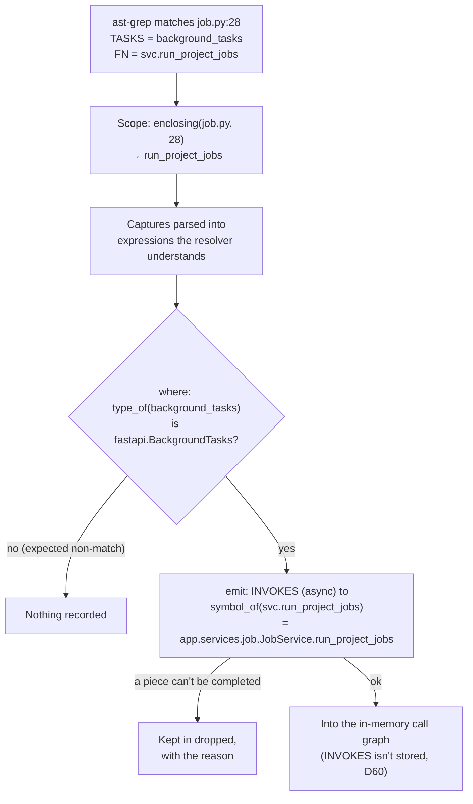

# Stages, step by step

Each ingestion stage taken apart: what it reads, what it does, what it leaves for the next one. Examples are real output from ingesting [Contextualized](https://github.com/KBavis/contextualized) at commit `ac93a3b` (190 files, 112 Python modules, 486 functions, 9 rule packs, 33 endpoints, 33 flows).

> **In one minute**
> - **Parse** prepares and never interprets: picks packs, lists files once, builds symbol tables and syntax trees.
> - **Extract** runs every rule on every file. ast-grep finds shapes; the symbol resolver says what they mean; each match yields a fact, a fact with a blank, or a clue.
> - **Assemble** fills the blanks: URL prefix chains, an entity's table, SDK client calls, partial references.
> - **Flows** fits facts into the tree, builds the call graph in memory, and walks it from every entry point into flows, traces, and steps.
> - **Write** compares with the graph by stable ID and writes only differences, in one transaction.
>
> Code: `backend/src/steno/ingestion/pipeline.py` (one function per stage).

---

## 1. Who does what

Eight parts. The first three are data people write; the rest is code.

| Part | Its one job | Think of it as | Code |
|---|---|---|---|
| **Rule pack** | A folder of rules for one library, plus `enabled_when` | A phrasebook for one dialect | `rule-packs/<ecosystem>/steno-pack-*/` |
| **Rule** | One code shape and what it means: `match`, optional `where`, `emit` | One phrasebook entry | `rules/<id>.yaml` |
| **Test case** | A trimmed copy of real code and the facts it must produce | The entry's worked example | `tests/<rule>/<case>/` |
| **Rule engine** | Reads the code once (parse), then runs every enabled rule on every file (extract) | The clerk reading every page with the phrasebook | `extraction/engine.py` |
| **Symbol resolver** | Answers *what is this?* | The directory of who's who | `resolvers/python.py`, `resolvers/java.py` (`resolvers/base.py`) |
| **Assemblers** | Fill in facts' blanks from clues found in other files | Pinning together index cards that belong together | `assemblers/assemble.py` |
| **Graph builder** | Turns facts and the call graph into nodes and edges with stable IDs | Filing cards into folders | `graph/structure.py`, `graph/build.py` |
| **Graph writer** | Saves the plan into Neo4j and removes what's gone | Putting the folders in the archive | `graph/writer.py` |

## 2. clone and deps

- **clone** fetches the code into `/tmp/steno-workspaces/job-N/`, deleted when the job ends, success or failure. The commit SHA is saved on the job and stamped onto every fact, so every node says which commit it describes. See [Connectors](./connectors.md#3-cloning-decided).
- **deps** exists for Java dependency JARs, so the Java resolver can answer questions about library types (what `WebClient#post()` returns). Java starts from source and the JDK (D69), so the stage records itself as skipped.

## 3. parse

Reads the clone and every pack's `pack.yaml`. Leaves the rule engine in memory, holding the symbol tables and the syntax trees. **No rule runs here.**

1. **Decide what to prepare.** Each pack says when it applies (`enabled_when`); parse checks every pack against this repository. Enabled packs decide which languages need a symbol resolver and which files need syntax trees.
2. **List the files once,** never entering `.git`, `node_modules`, `.venv`, `build`, and similar folders. (Before this, walking a working copy with `node_modules` took 3.5 minutes; now about 7 seconds.)
3. **Find source roots.** Every folder with a `pyproject.toml`, `setup.py`, `setup.cfg`, or `requirements*.txt` is a root module names start from. `apps/backend/app/api/routers/job.py` becomes `app.api.routers.job`, the name its own imports use.
4. **Build the symbol tables.** Python's `ast` reads every non-test `.py` file. Java's JVM helper reads every module in one pass and writes its answers (D69).
5. **Build the syntax trees.** ast-grep (tree-sitter) turns every file a code rule will look at into a tree: 112 of the 190 files.

| | In parse | In extract |
|---|---|---|
| Rule packs | Which packs apply | The rules inside them run |
| ast-grep | Builds a syntax tree per file | Searches the trees with each rule's pattern |
| Symbol resolver | Builds its symbol table | Answers questions about each match |

**Which packs are enabled, for Contextualized:**

| Pack | Rules | On? | Because |
|---|---|---|---|
| `steno-pack-fastapi` | 4 | on | dependency `fastapi`, and imported |
| `steno-pack-sqlalchemy` | 7 | on | dependency `sqlalchemy`, and imported |
| `steno-pack-llama-index` | 4 | on | dependency `llama-index-core`, and imported |
| `steno-pack-llama-index-chroma` | 2 | on | dependency, and imported |
| `steno-pack-chromadb` | 1 | on | dependency `chromadb`, and imported |
| `steno-pack-pydantic-settings` | 1 | on | dependency `pydantic-settings`, and imported |
| `steno-pack-httpx`, `steno-pack-requests` | 1 each | on | imported only: not in `requirements.txt` |
| `steno-pack-python-stdlib` | 1 | on | `always`, and the repository has `.py` files |

**The symbol table is a table of contents, not answers.** For every module it files imports, values, functions (parameters, annotations, line spans), and classes (bases, methods, class attributes, every `self.x = …`). Nothing is worked out during parse: `router` is stored as the code `APIRouter(prefix='/jobs', …)`, not as "a router whose prefix is `/jobs`". Answers are computed later, only when asked.

```
# module app.api.routers.job (apps/backend/app/api/routers/job.py)
imports    APIRouter      → fastapi.APIRouter
           JobService     → app.services.job.JobService
           get_job_svc    → app.api.svc_deps.get_job_svc        # 1,293 import entries in 112 modules
values     router = APIRouter(prefix='/jobs', tags=['Jobs'])    # kept as code, not run
functions  run_project_jobs  lines 16–…  params: project_id: UUID,
           background_tasks: BackgroundTasks, svc: JobService
```

**Two parsers per Python file.** Python's own `ast` gives exact names, imports, and annotations for the symbol table; tree-sitter gives the trees rules match against, the same way for every language. Each file is read twice; cheap so far, worth revisiting on a large repository.

## 4. extract

Reads the syntax trees, the enabled rules, and the symbol resolver. Runs config rules first (so their `property` clues can feed value lookups), then code rules. Leaves facts, facts with blanks, and clues: for Contextualized, 75 nodes, 230 edges, 91 clues, 33 entry points.

### What ast-grep sees

ast-grep finds subtrees that fit a pattern. It knows **shape, nothing about meaning**. `$TASKS.add_task($FN $$$)` means: a call named `add_task` on anything (call it `TASKS`) whose first argument is anything (`FN`), followed by anything:

```python
# job.py, line 28
background_tasks.add_task(svc.run_project_jobs, project_id)
#   $TASKS                $FN                    $$$
```

ast-grep can't tell whether `background_tasks` is FastAPI's `BackgroundTasks`, or which function `svc.run_project_jobs` is. That's what the engine asks the symbol resolver. Patterns can be broad on purpose: `$CLIENT.$VERB($URL $$$)` matches 246 places in Contextualized, every `dict.get(…)` included; only 24 are httpx calls, and the rule's `where` throws the other 222 away.

### Anatomy of a rule

```yaml
# rule-packs/python/steno-pack-fastapi/rules/fastapi-endpoint.yaml
id: fastapi-endpoint
match:                         # read by ast-grep: the shape
  rule:
    kind: decorated_definition
    has:
      kind: decorator
      has: { pattern: $ROUTER.$METHOD($PATH $$$) }
  constraints:
    METHOD: { regex: "^(get|post|put|patch|delete)$" }
where:                         # read by the engine, answered by the resolver
  $ROUTER: { type: [fastapi.APIRouter, fastapi.FastAPI] }
emit:                          # read by the engine: what it means
  - node: [Interface, HttpEndpoint]
    as: endpoint
    method: $METHOD            # a value → its text
    path: $PATH                # a value → value_of → "/projects/{project_id}"
    prefixed_by: $ROUTER       # a blank: symbol_of → app.api.routers.job.router
  - edge: EXPOSES
    from: "@app"               # an anchor: the application being ingested
    to: endpoint
  - entry_point: { trigger: endpoint, function: "@function" }
```

The engine reads each `emit` field **by its role**, not by what's written: the same `$ROUTER` becomes a qualified name in `prefixed_by` but would become a constant in `path`.

| You write | Where | Becomes | By asking |
|---|---|---|---|
| `$X` | an ordinary property (`path`, `url`, a clue value) | the constant it holds, or `<unresolved>` | `value_of` |
| `$X` | `prefixed_by`, clue `owner` / `parent` / `child`, `{Function: {symbol: $X}}` | a qualified name, the same everywhere the object is used; dropped if it can't be found | `symbol_of` |
| `$X` | clue `type` | the class it names | `class_of` |
| `"@function"`, `"@class"`, `"@file"` | anywhere | the function, class, or file the match sits in | `enclosing` |
| `"@app"` | edge end | a marker; the graph builder decides which application | — |
| `{table_of: $X}` | edge end | a blank: "the table of whatever this is", filled by assemble | — |
| `{http: {method, url}}` | edge end | an outbound target; the builder turns its host into an application or `ExternalSystem` | `value_of` |
| `{DataStore: {vendor: chroma}}` | edge end | a blank: "the one data store that matches", filled by assemble | — |

### Life of one match



The two ways out differ on purpose: a failed `where` is an expected non-match (a dict's `.get`), so nothing is recorded; an emit that can't be completed means the rule applied but a piece is unknown, so it's kept with the reason and shows in the facts JSON and the coverage report.

### What comes out: three kinds

| Kind | Example | Done? | Contextualized |
|---|---|---|---|
| **Fact** | Class `Job` maps to table `job` | Yes | Most nodes and edges |
| **Fact with a blank** | Endpoint `POST /projects/{project_id}`, prefixed by `router` | Waits for assemble | 33 `prefixed_by`, 142 `table_of`, 2 partial references |
| **Clue** | `router` has prefix `/jobs` | Never stored; fills a blank | 62 property, 13 client, 8 prefix, 8 mount |

## 5. assemble

Reads the facts with blanks, the clues, and the resolver. Six steps, always in this order. Leaves completed facts and the facts JSON.

| Step | What it does | Edges after | Blanks left |
|---|---|---|---|
| (after extract) | — | 230 | 33 prefix · 142 table_of · 2 partial |
| 1 · Dedupe clues | The same clue seen twice counts once (91 → 87) | 230 | unchanged |
| 2 · Prefix chains | Prepend each endpoint's router prefixes | 230 | 0 prefix |
| 3 · `table_of` | Swap each "table of X" for the real table, or drop it | 193 (37 dropped) | 0 table_of |
| 4 · Clients | Turn method calls on SDK objects into edges | 209 (+16) | — |
| 5 · Partial references | Swap each "the one X that matches" for that node | 209 | 0 partial |
| 6 · Dedupe edges | Same type, same ends, same properties: kept once | 199 | none |

**Prefix chains.** Two lookups are built from the clues: owner → prefix, and child → parent + mount prefix. For every endpoint, walk from its owner up through its parents, joining prefixes on the way down: `/api` + `/jobs` + `/projects/{project_id}`. Three rules in three files, none knowing about the others; they line up because the resolver gave `router` in `job.py` and `job_router` in `__init__.py` the same name.

**`table_of`.** Collect every `Entity -MAPS_TO-> Table` (20 pairs, such as `app.models.job.Job → job`). For each blank, ask which entity class is behind the expression (`class_of`, else `type_of`) and look it up:

```
WRITES_TO {table_of: job}     from session.add(job), services/job.py:53
  class_of(job)  → none       an instance, not a class
  type_of(job)   → app.models.job.Job
  → JobService.create_job WRITES_TO Table job
```

No entity found → dropped with `table_of: not a mapped entity`. Of 37 dropped: 24 are string joins like `", ".join(…)` the shape also matches (correct), 12 are real writes on an untyped value (a resolver gap).

**Clients.** A `client` clue says "calls on objects of this type talk to that system". The assembler first teaches the resolver the clue's `returns` hints, so chained calls keep their type, then visits every `receiver.method(…)` call (1,751 in Contextualized) and asks `type_of(receiver)`:

```
self.client.get_collection(name)      services/chroma.py:77
  type_of(self.client) → chromadb.api.ClientAPI      (set in __init__)
  get_collection → read
  → get_real_chroma_collection READS_FROM DataStore chroma
```

**Partial references.** `{DataStore: {vendor: chroma}}` resolves to the application's single matching node; several mark the edge `ambiguous`; none becomes a stub.

**The facts JSON.** Assemble ends by writing every completed fact (with rule, file, and line) and every dropped match (with its reason) to `job-N-facts.json`. `steno extract <folder> --json out.json` writes the same file without a job.

## 6. structure, identify, flows

Reads the completed facts, entry points, the resolver, and build files. Leaves a **graph plan** in memory: nodes and edges with stable IDs (513 nodes and 1,291 edges in one run). Pure planning; nothing is written, so it's testable without a database.

1. **Structure.** Every folder with a build file is a `Module`. A module with an entry point is a `:Service` and gets an `Application`, joined by `BUILT_FROM`. *Today the application is named after the repository plus the folder (`contextualized-backend`); the **identify** step (planned, stage A) replaces that with a Steno ID and the canonical name. See [identify and reconcile](./identify-and-reconcile.md).*
2. **Fact nodes.** Every extracted node gets its stable ID: endpoints and entities under their application, tables under their data store, external systems by host. Each gets `BELONGS_TO` its owner.
3. **Fact edges.** Each extracted edge with its ends filled in: `@app` becomes the application whose module holds the file; an `{http: …}` target becomes an endpoint of another application or an `ExternalSystem` ([Joins](./joins.md)).
4. **Call graph, in memory.** Ask the resolver for the invocations of every function the entry points reach; merge in async calls rules found (background tasks); walk from the entry points (278 of 460 functions reached). A call to an inherited method follows the subclass it was made on; a call to an abstract method chosen at runtime goes to every implementation, marked `candidate` (D58). A function is **significant** when it, or anything below it, reads, writes, or calls out; a **utility** when 3 or more functions call it and nothing architectural is below it.
5. **Flows, traces, steps.** One `Flow` per entry point, `STARTS` from its trigger. Walking from the handler gives the **trace**: every function it calls, in order, once per call site, stored on the flow with file and lines. Each significant entry becomes a `Step` (`FIRST_STEP` / `SUBSTEP` / `NEXT`) carrying its effects; every effect is also rolled up onto the flow. Work nothing in the code starts gets an **inferred** flow (D74).
6. **Files.** A `File` node for each file a flow runs through.

**One flow, as it lands in the graph:** the real `WRITES_TO job` sits on the step for `create_job`; the flow gets a copy marked `rollup`, so the architecture side can say what a flow touches without opening its steps. Every other function, helpers included, is in the trace. Without the background-task rule's async call, this flow would stop at the handler; without following `Task.run` into each task's methods, it would miss most of its 86 steps.

**Every node and edge carries where it came from:**

| Property | Example | Used for |
|---|---|---|
| `repo` | `contextualized` | Which repository wrote it (what write compares against) |
| `ingestion_job` | `7` | The job that last changed it |
| `commit` | `ac93a3b…` | Which code it describes; code tools read at this commit |
| `extracted_by` | `sqlalchemy-session-add`, `call-graph`, `flow-rollup`, `structure` | Which rule or step produced it |
| `source_file`, `source_line` | `apps/backend/app/services/job.py`, `53` | Citations |
| `confidence`, `first_seen`, `last_seen` | `1.0`, timestamps | Confidence levels are Open |
| *(planned)* `sources`, `agreement` | `[CODE, PLATFORM]`, `confirmed` | [Trust](../../concepts/trust.md) |

## 7. write

Reads the graph plan. In **one Neo4j transaction**, compares it with what Neo4j holds for this repository and writes only the differences. Leaves the graph matching this commit, a `fact_change` row per change, and `last_ingested_sha` moved.

**What "schema" means in Neo4j.** Neo4j has no tables to create: a node is labels plus properties, an edge a type plus properties. Steno's schema lives in two places: the [graph reference](../graph-reference.md) (which labels and edges exist, and what they mean; the builder only produces these) and `graph/schema.py` (`steno graph init`: a uniqueness constraint on `id` per label, a full-text index on `:Searchable`; a vector index once the embedding model is chosen).

**Stable IDs: the whole trick.** Every `id` is built from *what* a thing is, never *when* it was seen, so the same commit twice gives the same IDs:

| Node | ID built from | Example |
|---|---|---|
| Organization, Space | Postgres row ID | `org:1`, `space:3` |
| Application | name today; **Steno ID** after stage A | `app:contextualized-backend` |
| HttpEndpoint | application, method, path | `endpoint:contextualized-backend:POST:/api/jobs/projects/{project_id}` |
| Flow | application, trigger | `flow:contextualized-backend:POST /api/jobs/projects/{project_id}` |
| Step | flow, the function it runs (and which occurrence), not its position | `step:flow:…:app.services.job.JobService.create_job` |
| Table | data store, schema, name | `table:datastore:…::job` |
| ExternalSystem | host, or service name | `external:localhost:11434` |

**The write, step by step:**

1. **Read** every node and edge whose `repo` is this repository, plus any plan node another repository wrote (a shared table, a channel).
2. **Compare** by stable ID (`graph/delta.py`). A fact changed only if something other than provenance (job, commit, line) or code pointers differs. Moving a function down a file isn't a change; editing it is (each trace entry carries a hash of the function's syntax tree).
3. **Remove** what this repository had that the plan doesn't. Shared nodes are kept while anything else points at them.
4. **Write** new and changed nodes in batches of 500 (`MERGE … ON CREATE SET first_seen … SET n += props`, vanished properties set to null), then edges the same way. Unchanged facts aren't touched, so they keep the commit their lines were read at.
5. **Record** each change in `fact_change` (before and after); for a flow whose trace changed, one row listing the functions added, removed, or modified.

**Why re-running is safe:** a failed write changes nothing; the same commit writes nothing; a deleted function drops out of its flows' traces, and its Step is removed.

## 8. coverage and cards

- **coverage** collects what no rule explained and stores a `coverage_item` per gap, carrying triage over from the last run. See [Coverage report](./coverage-report.md).
- **cards** (not built) will write LLM purposes and narratives for flows, applications, spaces, and the organization, gated so unchanged inputs are never paid for twice. See [Retrieval: cards](../retrieval-and-mcp.md#summary-cards-decided).

## 9. One endpoint, end to end

`POST /api/jobs/projects/{project_id}`, from source to Neo4j:

| Stage | What happens |
|---|---|
| clone | The repository lands in `/tmp/steno-workspaces/job-N/`. |
| parse | `fastapi` is in `requirements.txt`, so `steno-pack-fastapi` is on. `job.py` is filed as `app.api.routers.job`, with `router` kept as code. |
| extract | `fastapi-router-prefix` pins a `prefix` clue `/jobs` on `app.api.routers.job.router` (and `/api` on `app_router`). |
| extract | `fastapi-include-router` pins `mount` clues: `job.router` inside `app_router`, `app_router` inside the app. |
| extract | `fastapi-endpoint` matches line 16; `where` checks `type_of(router)` is `fastapi.APIRouter`. Emits `HttpEndpoint POST /projects/{project_id}` with a `prefixed_by` blank, an `EXPOSES`, and an entry point. |
| extract | `fastapi-background-task` matches line 28 and emits an async `INVOKES` to `JobService.run_project_jobs`. |
| assemble | The prefix chain fills the path: `/api/jobs/projects/{project_id}`. Down the call path, `session.add(job)`'s `table_of` becomes table `job`. |
| flows | `apps/backend` holds entry points, so it's a Service; the application is `contextualized-backend`. |
| flows | The call graph, plus the async edge, reaches 115 functions: `Task.run` as `DiffTaskRunner`, then as `EmbedTaskRunner`. Providers chosen at runtime (GitHub, Bitbucket, Jira, Confluence) are linked as candidates. Effects roll up onto the flow. |
| write | `MERGE (n:Interface {id: "endpoint:contextualized-backend:POST:/api/jobs/projects/{project_id}"})`, then the flow, its trace, its steps, their edges. A later run of the same commit writes none of it again. |
