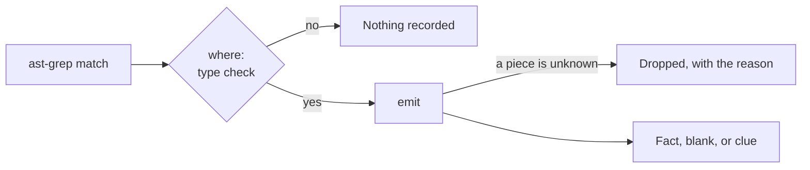

# Stages, step by step

Each stage: what it reads, does, and leaves. Examples come from [Contextualized](https://github.com/KBavis/contextualized) (190 files, 486 functions, 33 flows). Code: `backend/src/steno/ingestion/pipeline.py`.

> **In one minute**
> - **Parse** prepares and never interprets.
> - **Extract** runs every rule on every file. ast-grep finds shapes; the resolver says what they mean.
> - **Assemble** fills in the blanks.
> - **Flows** builds the call graph in memory and walks it into flows, traces, and steps.
> - **Write** compares by stable ID and writes only differences (D135).

## 1. Who does what

| Part | Its one job | Code |
|---|---|---|
| **Rule pack, rule, test case** | Data people write | `rule-packs/` |
| **Rule engine** | Reads the code, runs every enabled rule on every file | `extraction/engine.py` |
| **Symbol resolver** | Answers *what is this?* | `resolvers/` |
| **Assemblers** | Fill blanks from clues | `assemblers/assemble.py` |
| **Graph builder** | Facts and call graph into nodes and edges | `graph/structure.py`, `graph/build.py` |
| **Graph writer** | Saves the plan; removes what's gone | `graph/writer.py` |

## 2. clone and deps

**clone** fetches into `/tmp/steno-workspaces/job-N/`, deleted when the job ends. The commit SHA is stamped on every fact. **deps** is skipped: Java starts from source and the JDK (D69).

## 3. parse

**No rule runs here.**

1. Check each pack's `enabled_when`.
2. List files once, skipping `.git`, `node_modules`, `build`, and similar.
3. Find source roots, so `apps/backend/app/api/job.py` becomes `app.api.job`.
4. Build symbol tables: Python's `ast`; Java's JVM helper ([Large repositories](./large-repositories.md)).

**The symbol table is a table of contents, not answers.** Everything is worked out only when asked.

## 4. extract

Config rules run first, so their `property` clues can feed value lookups. Then code rules. Each file's syntax tree is built, used, and dropped.

ast-grep knows **shape, nothing about meaning**. `$CLIENT.$VERB($URL $$$)` matches 246 places in Contextualized, each `dict.get` included; the rule's `where` keeps the 24 that are httpx calls.

The engine reads each `emit` field by its role:

| You write | Where | Becomes | By asking |
|---|---|---|---|
| `$X` | an ordinary property | the constant, or `<unresolved>` | `value_of` |
| `$X` | `prefixed_by`, clue `owner` / `parent` / `child`, `{Function: {symbol: $X}}` | a qualified name; dropped if not found | `symbol_of` |
| `$X` | clue `type` | the class it names | `class_of` |
| `"@function"`, `"@class"`, `"@file"` | anywhere | what the match sits in | `enclosing` |
| `"@app"` | edge end | a marker for the builder | — |
| `{table_of: $X}` | edge end | a blank, filled by assemble | — |
| `{http: {method, url}}` | edge end | an outbound target | `value_of` |
| `{DataStore: {vendor: chroma}}` | edge end | a blank: the one that matches | — |

A failed `where` is an expected non-match, so nothing is recorded. An emit that can't be completed is kept with its reason, and shows in the facts file and coverage.

| Output | Example | Done? |
|---|---|---|
| **Fact** | Class `Job` maps to table `job` | Yes |
| **Fact with a blank** | An endpoint prefixed by `router` | Waits for assemble |
| **Clue** | `router` has prefix `/jobs` | Never stored; fills a blank |

## 5. assemble

Six steps, always in this order. Ends by writing `job-N-facts.json`.

| Step | What it does |
|---|---|
| 1 Dedupe clues | The same clue twice counts once |
| 2 Prefix chains | `/api` + `/jobs` + `/projects/{id}` |
| 3 `table_of` | Swap "table of X" for the real table, or drop it |
| 4 Clients | Method calls on SDK objects become edges |
| 5 Partial references | Swap "the one X that matches" for that node |
| 6 Dedupe edges | Same type, ends, and properties: kept once |

Three rules in three files line up because the resolver gives one object one name in every file.

## 6. structure, identify, flows

Leaves a **graph plan** in memory. Nothing is written, so it's testable without a database.

1. **Structure.** A folder with a build file is a `Module`. A module with an entry point is `:Deployable` and gets an `Application`.
2. **Identify.** Steno IDs and names ([identify](./identify-and-reconcile.md#2-identify)).
3. **Fact nodes and edges** get stable IDs. `@app` becomes the application holding the file; `{http: …}` becomes an endpoint or `ExternalSystem` ([Joins](./joins.md)).
4. **Call graph, in memory.** Ask the resolver for each function's calls and merge async calls from rules. Inherited methods follow the subclass; abstract calls go to every implementation, marked `candidate` (D58). A function is **significant** when it or anything below it has an effect, and a **utility** when 3 or more functions call it and nothing architectural is below it.
5. **Flows, traces, steps.** One `Flow` per entry point. Walking from the handler gives the trace, once per call site. Each significant entry is a `Step` with its effects; effects also roll up onto the flow. Unstarted work gets an **inferred** flow (D74).
6. **Digests** ([reference](../graph-reference.md#the-flow-digest-built-d143)) and `File` nodes.

Every node and edge records `repo`, `ingestion_job`, `commit`, `extracted_by`, `source_file`, `source_line`, `confidence`, `first_seen`, and `last_seen`.

## 7. write

Compares the plan with what Neo4j holds for this repository and writes differences in small transactions (D135).

**Stable IDs** are built from *what* a thing is, never *when* it was seen ([examples](../graph-reference.md#properties-every-fact-carries)).

**The steps:**

1. **Read** every node and edge of this repository, plus plan nodes others wrote.
2. **Compare** by ID (`graph/delta.py`). Moving a function down a file isn't a change; editing it is.
3. **Mark** the repository *writing* (a `GraphWrite` node).
4. **Write**, merging on stable ID: nodes outside flows, then their edges, then flows in groups (`graph_write_chunk_mb` 32, `graph_write_node_rows` 2,000). A flow stays with its steps, and each edge goes with its later end. A batch Neo4j can't hold is halved.
5. **Remove,** only if everything succeeded: a failure leaves stale facts, never a hole.
6. **Record** `fact_change` as each transaction commits.
7. **Mark** *complete*, or *incomplete* with what failed. MCP answers report that.

**Shared nodes** keep their first writer, decided in the database. **Edges whose end is missing** are counted (`edges_missing`) and written by a later run.

## 8. coverage and cards

- **coverage** stores a `coverage_item` per gap, carrying triage forward ([Coverage report](./coverage-report.md)).
- **cards** writes LLM summaries for applications, spaces, and the organization, only when inputs change, and optional embeddings ([Retrieval](../retrieval-and-mcp.md#summaries-and-digests-built-d143)).
