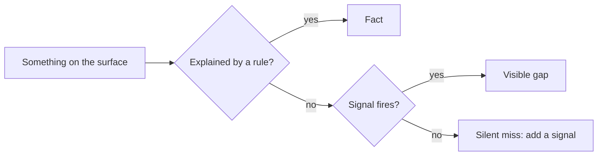

# What Steno must see

Every way an application talks to the outside world, what sees it, and the signal when it's missed. The [coverage report](./coverage-report.md) implements the signals.

> **In one minute**
> - **Steno may miss things; it must never miss them silently.**
> - This list covers the **surface** (D136). Connections between applications rank first.
> - **The rule:** every mechanism has a signal or is a listed blind spot. A miss found any other way gets a row and a signal before a fix.

## Why this page exists

Independent checks catch misses from different directions:

| Check | Catches a miss by | Needs the mechanism? |
|---|---|---|
| Coverage signals | Code no rule explained | Partly |
| One-sided joins | One side found, the other missing | No |
| Other witnesses | Disagreeing with the code | No |
| Completeness in answers (D118) | Saying "couldn't see" | — |
| The question set | What the trial finds | — |
| Runtime evidence (`v2`) | What actually ran | No |

## 1. How to read the catalog

Rows don't depend on language: a new language adds packs and a resolver, not rows. **Built:** seen, with a signal for misses. **Partial:** common forms seen; the rest signal. **Needs design:** the fix needs a decision. **Blind spot:** accepted for now.

## 2. The catalog

### 2.1 Ways in

| Mechanism | Example | Status | When missed |
|---|---|---|---|
| HTTP endpoints | `@GetMapping`, FastAPI | Built | `unknown_hook` |
| gRPC servers | `*ImplBase` | Built | `unknown_hook` |
| Message listeners | `@KafkaListener`, `consumer.subscribe` | Built | `unknown_hook` |
| Other servers | GraphQL, WebSocket | Partial | `unknown_hook` |
| Commands and tools | Typer, `@mcp.tool()` | Needs design | `unknown_hook` |
| Schedules in code | `@Scheduled` | Built | `unknown_hook` |
| Schedules outside code | CronJob | Partial (stored, not compared) | `no_trigger_application`, `inferred_entry` |
| Framework callbacks | `@EventListener` | Built (D101) | `unknown_hook` |
| Work nothing starts | A worker loop | Built (D74) | `inferred_entry` |
| Binding by config | Spring Cloud Stream | Built for Kafka; pollable sources partial | `unread_config` |
| Frontends | A web app's `fetch` | Blind spot, `v2` | Routing marks public endpoints |
| Scripts outside applications | A backfill script | Blind spot, `v2` | — |

### 2.2 Calls and messages out

| Mechanism | Example | Status | When missed |
|---|---|---|---|
| HTTP clients | `RestTemplate`, `httpx` | Built | `external_call`, `unknown_host` |
| Declarative clients | Feign, `@HttpExchange` | Built | `unknown_host` |
| Generated clients | OpenAPI, gRPC stubs | Partial: the call stops at an unseen type | `internal_library`, `external_library` |
| Message sends | `KafkaTemplate.send` | Built | `external_call` |
| Topics in config | `${app.topics.orders}` | Built | `config_unset` |
| Topics per environment | XLD, Helm | Partial | `config_unset` |
| Stream processors | Kafka Streams | Partial | `external_call` |

### 2.3 Data stores and files

| Mechanism | Example | Status | When missed |
|---|---|---|---|
| Repository calls | `orderRepository.save` | Built | `external_call`, `dropped_match` |
| Entity to table | `@Entity`, `__tablename__` | Built | `dropped_match` |
| Cascaded writes | JPA cascade (D102) | Built | — |
| ORM sessions | SQLAlchemy | Built | `external_call` |
| Raw SQL | `jdbcTemplate`, `cursor.execute` | Partial | `external_call` |
| Document and search stores | `@Document`, Chroma | Partial | `external_call`, `library` |
| Caches | Redis | Partial; key joins **need design** | `external_call` |
| Files and object stores | `Files.write`, S3 | Partial; joins **need design** | `file_call`, `external_call` |
| Database-side logic | Triggers | Blind spot, `v1` | — |
| Change data capture | Debezium outbox | Needs design | `silent_repository` |

### 2.4 External systems

| Mechanism | Example | Status | When missed |
|---|---|---|---|
| SaaS APIs by host | Plaid, Jira | Built (D64) | `unknown_host` |
| Vendor SDKs | Stripe, cloud SDKs | Partial | `library`, `external_call`, `external_library` |
| LLM providers | OpenAI, Ollama | Built | `external_call` |
| Email | `smtplib`, Jakarta Mail | Partial | `external_call`, `external_library` |

### 2.5 Libraries and internal frameworks

| Mechanism | Example | Status | When missed |
|---|---|---|---|
| Internal library wrapper | `OrdersClient#create` hides a call | Signal built; not followed | `internal_library` |
| Internal framework | Own messaging, annotations | Partial: organization packs | `unknown_hook`, `internal_library` |
| Behavior a library brings | Auto-configured filter | Needs A1 (stage B) | Completeness note |
| Shared contracts | One DTO library | Blind spot, `v1` (D108) | — |

### 2.6 Routing and names

| Mechanism | Example | Status | When missed |
|---|---|---|---|
| Gateways and routes | Spring Cloud Gateway; nginx, Ingress | Partial (D132) | A stub; `silent_repository` |
| Service discovery | `lb://vets-service` | Built | `unmatched_name` |
| Hosts set at runtime | `${ORDERS_URL}` | Built (D100) | `unknown_host`, `config_unset` |
| Service mesh | Istio | No pack | `silent_repository` |

### 2.7 Other witnesses

| Mechanism | Status | When missed |
|---|---|---|
| A grant no code shows | Built | `disagreement` (`declared_only`) |
| Code with no grant | Built | `disagreement` (`code_only`) |
| A name matching no application | Built | `unmatched_name` |

### 2.8 Whole repositories and one-sided connections

| Mechanism | Status | When missed |
|---|---|---|
| A repository that produced nothing | Built | `silent_repository` |
| A witness pack that said nothing | Built | `silent_witness` |
| One side of a connection missing | Built (topics, endpoints) | `one_sided` |

### 2.9 Dynamic code and languages

| Mechanism | Status | When missed |
|---|---|---|
| Reflection, runtime URLs | Partial (D71) | `dropped_match`, metrics |
| A language with no pack | Partial | `unread_file` |

## 3. When a miss is found

1. **A row here,** or a changed status.
2. **A signal,** or the row becomes a blind spot.
3. **Then the fix.** Fixing the instance alone leaves the next one silent.

## 4. Open

Tracked in [the decision log](../../plan/decisions.md#open-questions): shared keys for caches and object stores; change data capture; commands and tools as ways in; local files as stores; whether a graph query reads or writes.
