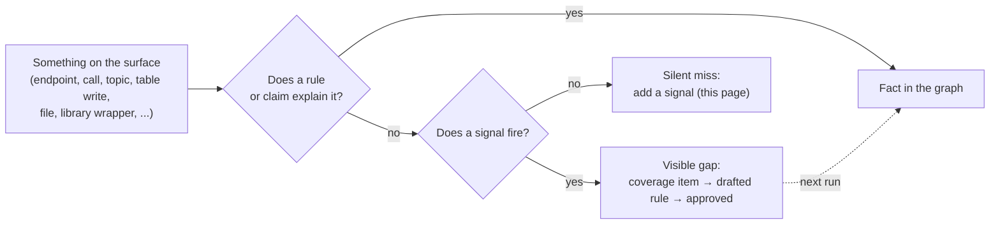

# What Steno must see

Every way an application talks to the outside world, what in Steno sees each one, and the signal that fires when Steno misses it. It's the completeness spec: the [coverage report](./coverage-report.md) implements the signals, and new rules are written against the rows. Part of [Ingestion](./README.md).

> **In one minute**
> - **Steno may miss things; it must never miss them silently.** Reading architecture from code can't be proven complete. What can be guaranteed is that every miss shows up: as a coverage item, a one-sided join, a disagreement with another witness, or a gap listed in the answer itself.
> - This page is the list that makes that checkable. It covers the **surface** (D136): every way into an application (endpoints, consumed topics and queues, schedules) and every way out (calls, publishes, table reads and writes, files, external systems). `JpaRepository.save(order)` writing the `orders` table is surface, even when only one application uses that table.
> - **Connections between applications rank first**: a missed call from A to B in another space is the worst miss. Data stores, external systems, and entry points follow.
> - For each mechanism, Steno either **sees it** (a rule or claim turns it into a fact), reports a **visible gap** (a coverage item fires), or has a **silent miss** (nothing fires). Each silent miss says whether it's **fixable now** or **needs design**.
> - **The rule of this page:** every mechanism has a signal, or is listed as a known blind spot. A miss found any other way gets a row here and a signal before it gets a fix.

---

## Why this page exists: never miss silently

The worst thing Steno can do is be confidently wrong: an impact answer that leaves out a consumer leads straight to a broken release ([Trust](../../concepts/trust.md)). Hand-written catalogs and consumer lists avoid that risk by having people declare everything, but they rot, and nothing checks them. Deriving from code has its own limit: static analysis stops at internal frameworks and at config set where the app runs, which is exactly where every organization differs.

Steno derives the architecture from code, so it works at any organization without hand-written declarations, and accepts that it will sometimes miss something. Its bar is that **no miss is silent**. Independent checks catch a miss from different directions:

| Check | Catches a miss by | Needs to know the mechanism? |
|---|---|---|
| **Coverage signals** ([coverage report](./coverage-report.md)) | Code no rule explained: an unknown hook, an I/O call, an unread config key | Partly: the code must look like something |
| **One-sided joins** ([joins §6](./joins.md#6-measuring-joins)) | A topic produced but never consumed; an endpoint called that no application exposes | No: one side found means the other was missed |
| **Other witnesses** ([claims and reconcile](./claims-and-reconcile.md)) | ACLs, manifests, and deploy config that disagree with the code | No |
| **Completeness in each answer** (D118) | Listing the open gaps that could affect *this* answer, so a miss reads as "couldn't see", not as a confident answer | — |
| **Measurement** ([roadmap §4](../../plan/roadmap.md#4-evaluation)) | The question set at the trial; every miss it finds gets a row here | — |
| **Runtime evidence** (OBSERVED, `v2`) | What actually ran | No |

This page holds the first check to account: each row is a mechanism and the signal that fires when it's missed. A row with no signal is a silent miss, and it's listed so it can be fixed or accepted on purpose.

## 1. How to read the catalog

Each row gives the mechanism, an example, what sees it today, its status, and the signal when it's missed. Signal names are the ids in `backend/src/steno/coverage/collect.py`.

**The rows don't depend on language.** A mechanism (a message listener, a repository save) exists in every language. The examples and the "Seen by" column name today's packs, which are Java and Python, and each example says which language it's from. A new language adds packs and a resolver, not rows. A row changes only when a new mechanism appears.

| Status | Meaning |
|---|---|
| **Built** | Rules or claims see it; a signal fires for what they miss |
| **Partial** | Common forms are seen; the rest fire a signal |
| **Silent · fixable now** | Not seen and no signal fires, but Steno's current design supports the fix: a rule pack or a signal nobody has written yet |
| **Silent · needs design** | Not seen, and the fix needs a decision first (a new kind of fact, or a planned piece not built) |
| **Blind spot** | Known and accepted for now, with the scope it's planned for |

## 2. The catalog

### 2.1 Ways in

| Mechanism | Example | Seen by | Status | When missed |
|---|---|---|---|---|
| HTTP endpoints | Java: `@GetMapping`. Python: FastAPI `@app.get` | `spring-web`, `fastapi` | Built | `unknown_hook` |
| gRPC servers | Java: `extends UserServiceGrpc.UserServiceImplBase` | `grpc-java` | Built | `unknown_hook` |
| Message listeners | Java: `@KafkaListener`, `@RabbitListener`, `@JmsListener`, `consumer.subscribe` | `spring-kafka`, `kafka-clients`, `spring-amqp`, `spring-jms` | Built | `unknown_hook` |
| Other servers | Java: GraphQL `@QueryMapping`, WebSocket and SSE handlers | No rules | Partial | `unknown_hook` (framework annotations and types) |
| Schedules in code | Java: `@Scheduled(cron = …)` | `spring-boot` | Built | `unknown_hook` |
| Schedules outside the code | Kubernetes CronJob, an enterprise scheduler | `schedule` claims (stored, not compared) | Partial | `no_trigger_application`, `inferred_entry` |
| Framework callbacks | Java: `@EventListener`, listeners registered in config. Python: `@mcp.tool()` | The hooks ledger (D101) | Built | `unknown_hook` |
| Work nothing in the code starts | Any language: a worker loop, a CLI command | Inferred flows (D74) | Built | `inferred_entry` |
| Binding by config | Java: Spring Cloud Stream, a `Consumer<Order>` bean plus `spring.cloud.stream.bindings.*` | No rules | Silent · fixable now | A pack over config and bean methods; until then, unread config under a messaging prefix stays an item ([coverage report §6.3](./coverage-report.md#63-the-plan)) |
| Frontends calling backends | JavaScript: a web app's `fetch('/api/…')` | `v2` (D92) | Blind spot | Routing marks public endpoints, so an endpoint only a UI calls doesn't look unused |
| Scripts outside every application | Python: a backfill script | `v2` (D74) | Blind spot | — |

### 2.2 Calls and messages out

| Mechanism | Example | Seen by | Status | When missed |
|---|---|---|---|---|
| HTTP clients called directly | Java: `RestTemplate`, `WebClient`, OkHttp, Apache HttpClient, `java.net.http`. Python: `requests`, `httpx` | Core packs; URL templates keep config keys (D64, D100) | Built | `external_call`; `unknown_host` when the host is set where the app runs |
| Declarative clients | Java: Feign by name or URL, `@HttpExchange` | `spring-cloud-openfeign`, `spring-web` | Built | `unknown_host`; a Feign name matching no application becomes a stub |
| Generated clients | Any language: OpenAPI-generated clients, gRPC stubs from `.proto` | The generated code lives in the build folder, so calls stop at a type Steno can't see | Silent · fixable now | The internal library item ([coverage report §6.1](./coverage-report.md#61-library-gaps-internal-and-external)) flags it. Seeing it: rules over the `.proto` or OpenAPI spec files in the repository |
| Message sends | Java: `KafkaTemplate.send`, `RabbitTemplate`, `JmsTemplate` | Messaging packs | Built | `external_call` |
| Topics named in config | Java: `${app.topics.orders}`. Python: `os.getenv("ORDERS_TOPIC")` | `property` clues resolve the repository's own config | Built | `config_unset` when set outside the repository |
| Topics set per environment | Deploy config: XLD dictionaries, Helm values | Platform witnesses; the environments design is open | Partial | `config_unset` |
| Stream processors | Java: Kafka Streams topologies | `org.apache.kafka` is on the I/O list | Partial | `external_call` |

### 2.3 Data stores and files

| Mechanism | Example | Seen by | Status | When missed |
|---|---|---|---|---|
| Repository saves, reads, deletes | Java: `orderRepository.save(order)` writes the entity's table | `spring-data` (the repository's entity type gives the table) | Built | `external_call` on `org.springframework.data`; `dropped_match` when the entity's table can't be found |
| Entity to table | Java: `@Entity @Table(name = "orders")`, a default table name. Python: SQLAlchemy `__tablename__` | `jpa`, `spring-data`, `sqlalchemy` | Built | `dropped_match` |
| Cascaded writes | Java (JPA): saving an order also writes `order_items` | D102 | Built | — |
| ORM sessions | Python: SQLAlchemy `session.add(x)`, `select(Order)` | `sqlalchemy` | Built | `external_call` |
| Raw SQL | Java: `jdbcTemplate.update("INSERT INTO …")`. Python: psycopg2 `cursor.execute` | `psycopg2` (connection); SQL strings only partly | Partial | `external_call` |
| Document and search stores | Java: MongoDB `@Document`. Python: Elasticsearch, Chroma | `spring-data` (Mongo), `chromadb`, `llama-index-chroma` | Partial | `external_call`, `library` |
| Caches | Any language: Redis, Memcached | `redis` and `io.lettuce` are on the I/O list | Partial | `external_call`. Whether a key one app writes and another reads joins them **needs design** |
| Files and object stores | Java: `Files.write`. Python: `open`, `joblib.load`. Either: S3 | Files are effects (D101) | Partial | `external_call`. Whether an S3 prefix joins two applications **needs design** |
| Database-side logic | SQL: triggers, stored procedures | Not seen | Blind spot | Schemas are issue #8 (`v1`) |
| Change data capture, outbox | The app writes `outbox`; Debezium publishes it to a topic | The table write is seen; the topic isn't | Silent · needs design | "This table becomes this topic" is a new kind of fact. The connector config's repository shows as silent ([coverage report §6.2](./coverage-report.md#62-silent-repositories)) |

### 2.4 External systems

| Mechanism | Example | Seen by | Status | When missed |
|---|---|---|---|---|
| SaaS APIs by host | Any language: Plaid, Jira, Slack | HTTP signatures (`saas-http`, D64) | Built | `unknown_host` |
| Vendor SDKs | Any language: Stripe, Twilio, cloud SDKs | Only when the SDK is on the I/O list (`IO_LIBRARIES`) | Partial | `library`, `external_call`. An SDK not on the list is **silent · fixable now**: the external library item ([coverage report §6.1](./coverage-report.md#61-library-gaps-internal-and-external)) |
| LLM providers | Python: OpenAI, Azure OpenAI, Ollama | `llama-index` packs; `openai`, `anthropic` on the I/O list | Built | `external_call` |
| Email | Python: `smtplib`. Java: Jakarta Mail | `smtplib` on the I/O list; Java mail isn't | Partial | `external_call`; Java: [coverage report §6.1](./coverage-report.md#61-library-gaps-internal-and-external) |

### 2.5 Libraries and internal frameworks

| Mechanism | Example | Seen by | Status | When missed |
|---|---|---|---|---|
| **Internal library wrapper** | Java: `com.acme.client.OrdersClient#create` hides an HTTP call. Python: `acme_clients.orders.create()` | Steno knows which method is called (from imports) but not what it does | Silent · fixable now (a number in the metrics only) | The internal library item ([coverage report §6.1](./coverage-report.md#61-library-gaps-internal-and-external)) |
| **Internal framework** | Any language: the organization's messaging or HTTP helper, or its own annotations or decorators | Organization packs, once written | Partial | `unknown_hook` for annotations and base types; calls: [coverage report §6.1](./coverage-report.md#61-library-gaps-internal-and-external) |
| Behavior a library brings in | Java: a library's Spring Boot auto-configuration adds a listener or a filter the app never calls | Artifacts A1 (D116) | Silent · needs design | A1 is decided but not built (stage B) |
| Shared contracts | Any language: two applications use one DTO library | D108, `v1` | Blind spot | — |

### 2.6 Routing and names

| Mechanism | Example | Seen by | Status | When missed |
|---|---|---|---|---|
| Gateways and routes | Java: Spring Cloud Gateway. Platform: nginx, Kubernetes Ingress | `route` claims (D132) | Partial (Spring Cloud Gateway built) | A route whose target matches nothing becomes a stub; unread nginx or Ingress files: [silent repositories](./coverage-report.md#62-silent-repositories) |
| Service discovery names | Java: `lb://vets-service`, Eureka | Identity resolves the name | Built | `unmatched_name`; stubs |
| Hosts set where the app runs | Any language: `${ORDERS_URL}` set in Helm or XLD | `unknown_host` with `config_keys` and `possible_targets` (D100) | Built | `unknown_host`, `config_unset` |
| Service mesh rules | Platform: Istio `VirtualService` | No pack | Silent · fixable now | A PLATFORM pack emitting `route` claims; until then, [silent repositories](./coverage-report.md#62-silent-repositories) |

### 2.7 Other witnesses

| Mechanism | Example | Seen by | Status | When missed |
|---|---|---|---|---|
| A platform grant no code shows | An ACL lets `billing` consume `orders.created`; no code does | Reconcile | Built | `disagreement` (`declared_only`) |
| Code with no platform grant | Code consumes a topic no ACL grants | Reconcile | Built | `disagreement` (`code_only`) |
| A name no application matches | An ACL user or manifest component with no app | Identity | Built | `unmatched_name` |

### 2.8 Whole repositories and one-sided connections

| Mechanism | Example | Seen by | Status | When missed |
|---|---|---|---|---|
| A repository that produced nothing | A deploy or config repository no pack reads | Only as scattered unread files | Silent · fixable now | The silent repository item ([coverage report §6.2](./coverage-report.md#62-silent-repositories)) |
| A witness pack that said nothing | The XLD pack matched files but stated no claims | Not checked | Silent · fixable now | The silent witness item ([coverage report §6.2](./coverage-report.md#62-silent-repositories)) |
| One side of a connection missing | A topic produced but never consumed; an endpoint called that no application exposes | Planned with the coverage report rebuild ([joins §6](./joins.md#6-measuring-joins)) | Silent · fixable now | A query over the graph after ingestion: cross-application inconsistencies ([coverage report §6.3](./coverage-report.md#63-the-plan)) |

### 2.9 Dynamic code and languages

| Mechanism | Example | Seen by | Status | When missed |
|---|---|---|---|---|
| Reflection, dynamic dispatch, URLs built at runtime | Java: `Class.forName`. Python: `getattr`. Any: a handler map | Candidates marked `ambiguous`; unresolved calls kept visible (D71) | Partial | `dropped_match`; metrics |
| A language with no pack or resolver | A Go or Node service | Unread files per language | Partial | `unread_file`, one item per language |

## 3. When a miss is found

A miss found any other way (the trial, a user's report, a wrong answer, a one-sided join) is handled in this order:

1. **A row here**, or a change to an existing row's status.
2. **A signal** for it in the [coverage report](./coverage-report.md), or the row is marked a blind spot with the scope it's planned for.
3. **Then the fix**: a rule, a pack, a witness, or a design decision.

Fixing the instance without the signal leaves the next one silent.

## 4. Open

In [the decision log](../../plan/decisions.md#open-questions):
- Shared keys for caches and object stores (a Redis key, an S3 prefix): §2.3.
- Change data capture: how "this table becomes this topic" is stated: §2.3.
- The coverage report's final signal list, and the library and silent-repository items: [coverage report §6](./coverage-report.md#6-focusing-the-report-on-the-surface-decided-d146).
