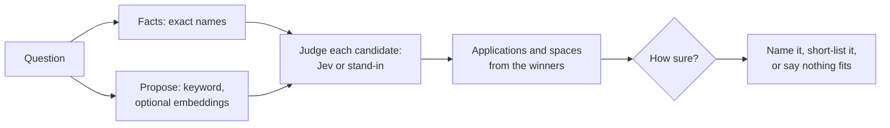

# Retrieval and MCP

How agents get context out of Steno quickly and accurately.

> **In one minute**
> - **Round trips dominate latency,** so tools answer typical questions in ≤ 3 calls.
> - **Built:** `search`, `get_node`, `get_flow`, `view_flow_code`, `find_dependents`, `route_request`. Every call is logged.
> - **Routing is flows first (D150):** propose widely, judge each candidate alone, and work out applications and spaces from the winners.
> - **Every result is cited** and says what Steno couldn't see.
> - **No file contents stored,** and no LLM runs at query time.



## 1. The speed problem

A graph query takes milliseconds, a Jev decision 70–500 ms, and **an agent round trip seconds.** So the goal is fewer, better-shaped calls: bounded search text, batch tools, progressive disclosure, and token budgets. Every tool takes `max_tokens`; a cut answer says what was left out.

## 2. Routing and search

### Routing, as built (D142, D150)

Every `search` without a `scope` carries a `routing` block (`backend/src/steno/routing/`).

- **Facts first:** a named application or space (`named_in_question`) leads the answer but never hides the rest.
- **Propose:** names, keyword search, and optional embeddings. Without embeddings, every flow is read when a graph has at most 300.
- **Judge:** Jev reads each candidate alone (Q4). Topics, tables, data stores, and external systems are judged too (`entities`). Q0 classifies the question. Q1 and Q2 no longer run.
- **Roll up:** applications and spaces follow from top flows.
- **Say how sure:** `band` is high above 0.9, medium 0.5–0.9, low below 0.5, shown only once calibrated. Nothing above 0.5 gives `nothing_fits`.
- **Close calls keep both branches** (within 0.15). `shortlist` holds at most 25 flows.

| Backend | `STENO_DECISION_BACKEND` | Behavior |
|---|---|---|
| Stand-in | `stand_in` (default) | From search's signals; `confidence: uncalibrated`, no bands |
| Jev | `jev` | [Reaching Jev](../plan/later/jev.md#reaching-jev-built). Falls back to the stand-in if unavailable. |
| Off | `disabled` | No decisions |

Every decision is logged in `jev_decision`. `steno route "<question>"` shows each candidate and score.

**Measured** on 4 applications and 166 flows ([routing design](../plan/routing-design.md)):

| Backend | 15 direct questions | 11 vague questions |
|---|---|---|
| Jev: right flow first / in the answer | 14 / 15 | 8 / 11 |
| Stand-in: right flow first / in the answer | 9 / 13 | Not measured here |

A small test written by people who knew the flows: it shows a direction, not accuracy at scale.

### How a query is read

Deterministic (`graph/query.py`), with no LLM:

- Stop words are dropped, and `words` says what was searched.
- Each word matches exactly, by prefix, by stem, with a typo at five letters or more, and by name abbreviations (`clt` for client).
- Names are indexed split into words (`git_commit` → git commit).
- Every word must match. Otherwise one is dropped at a time, never below half, and `dropped` says which.
- `kind` limits to a node kind. `matched` says why each hit came back.

### Summaries and digests (Built, D143)

| Node | Text | Written by |
|---|---|---|
| Flow | [Digest](./graph-reference.md#the-flow-digest-built-d143) | Deterministic |
| Application, Space, Organization | `summary`, `summary_line` | LLM, bottom up |

**Why no LLM purpose per flow:** cost would follow the number of flows rather than questions asked.

**Summaries:** written in the `cards` stage or `steno graph summaries [--repo R] [--dry-run]`, and cached in `llm_output` by a hash of instructions and inputs, so an unchanged application costs nothing. Inputs are bounded (150 flows, 40 targets per kind, 60 entities, 4,000 characters of README). The instructions say to use only the inputs and to say when a purpose isn't stated.

**The LLM (D149):** the organization's choice on the Settings page, through LiteLLM. A key is a reference (`env:NAME`). `steno llm-check` tests it. If it can't be reached, summaries are skipped and ingestion goes on.

**Embeddings (D150):** `STENO_EMBEDDINGS_ENABLED=true` with a local model. Vectors live in Neo4j. Run in `cards` or `steno graph embed`.

**Not built:** one-sentence flow purposes (agreed, details Open), an admin's correction of a summary, and a glossary lookup.

## 3. Parallelism

The server fans out **retrieval** in one tool call. The client handles **reasoning,** including subagents.

## 4. Code access and breadth (Decided, D17, D119)

Every code tool reads the git host API at the ingested commit, so code always matches the graph. `search_code` (D90) will use the git host's search API.

| Rung | What | Who |
|---|---|---|
| 1 Facts | Flows, dependents, completeness | Steno |
| 2 Code | `view_flow_code`, later `view_file`, `search_code` | Steno serves, the agent reads |
| 3 Clone | Only cited sources, sparse if possible | The consumer; locally, the investigation plugin (D133, not built) |

**Clone when** a task edits, builds, runs tests, needs wide exploration, or concerns code newer than the ingested commit. **Don't clone** to find consumers or understand a flow.

Every answer citing code carries `sources`:

```json
"sources": [{
  "kind": "git", "repo": "acme/order-service",
  "clone_url": "git@github.com:acme/order-service.git",
  "branch": "main", "commit": "a1b2c3d…", "head_moved": true,
  "paths": ["src/main/java/com/acme/orders/"],
  "why": ["consumes orders.created"]
}]
```

## 5. MCP tools (Decided)

MCP over Streamable HTTP. Every tool accepts `max_tokens`. Calls are logged in `tool_call`.

### How the tools work together (built)

Use them **top-down**: find where, narrow, then go deeper. The server sends this to agents as its instructions (`mcp/server.py`). Keep the instructions and tool descriptions in step with this page.

| Step | Tool | Read | Then |
|---|---|---|---|
| 1 Where? | `search(words)` | `routing`, `where` (all matches with counts), `results`, `more` | Several places: `search(words, scope=…)` in parallel |
| 2 What? | `get_node(id or name)` | Flows, data, calls, names, `messaging`, `also_named` | The right flow |
| 3 What happens? | `get_flow(flow)` | Steps, `interceptor` steps, `stops`, `host_unknown`, `possible_targets` | `under=<path>`; `expand="sync"` |
| 4 Show me | `view_flow_code(flow, paths)` | Code at the commit | Only if steps don't answer it |
| From a URL | `route_request(path, method)` | The route, rewritten request, endpoint, and flow (D132) | `get_flow` |
| 5 Who depends? | `find_dependents(id)` | By application and space, with `agreement` and `possible_callers` | `direction="downstream"`; `via` |

**Ask when ambiguous.** If several applications fit a name, list them and ask.

**Read before saying "only" or "all".** `where` lists every match, so a page of ten can't hide an application.

| Field | Means | Do |
|---|---|---|
| `where`, `more` | Every match; more exists | Check before saying "only" |
| `completeness` | `checked`, `not_checked`, `unexplained`, `graph_update` (D118, D135). Never claims complete. | Say so |
| `sources` | What to fetch | Clone only if needed |
| `agreement` | `confirmed`, `code_only`, `declared_only` | Report as findings |
| `possible_callers`, `possible_targets` | Unconfirmed | Say "possibly" |
| `ingested: false`, `stub` | Known only from a witness | Don't describe its behavior |
| `provisional` | Named only by its folder | Say so |
| `citations` | File, lines, commit, link | Pass them on |

**Budget:** `get_flow` returns about 25 steps with deeper ones folded (`inside`, `inside_does`, D68). Read code last.

**Trace ablation (D140):** `STENO_FLOW_VIEW=reach` makes `get_flow` return trigger, effects, and functions by file, with no order.

### Citations (Decided; built)

```json
"citations": [{
  "claim": "writes clients (insert)",
  "space": "Onboarding", "app": "users-svc", "repo": "microservices",
  "file": "src/main/java/.../ClientService.java", "lines": "57", "commit": "a1b2c3d",
  "url": "https://<git host>/.../ClientService.java?at=a1b2c3d#lines-57"
}],
"searched": ["space:Onboarding", "space:Identity"]
```

Cite each claim, not every file. `searched` shows what was looked at.

### What `get_node` returns

| Node | View |
|---|---|
| Organization | Spaces and the communication map |
| Space | Applications, stores, topics, ins and outs |
| Application | Endpoints, calls, topics, data, modules, flows, names, `messaging` |
| Flow | Trigger, steps, flows it leads to |
| Interface, Table, … | Owner and edges by type; a topic lists every application's use |

### Planned tools

| Tool | Purpose | Scope |
|---|---|---|
| `get_interface(id)` | Everything needed to call an interface: trigger, interceptors, fields, validation pointers, a skeleton, callers (D117, D137) | Stage B |
| `find_paths(from, to)` | How two things connect | As needed |
| `analyze_change(prs \| branch \| diff)` | What a change affects, including related PRs, by a dry-run ingestion into a temporary overlay | `v1` |
| `get_changes(scope, since)` | Before and after | `v1` |
| `find_symbols(symbols \| stack_trace)` | Frames to flows | As needed |
| `search_code`, `view_file`, `list_directory`, `glossary` | Code outside flows; terms | As needed |

## 6. Latency targets (Proposed)

Graph tools p95 < 300 ms; `search` with routing p95 < 1.5 s; a typical question in ≤ 3 calls.

## 7. LLM use and cost

- **An LLM writes summaries and drafts rules, never facts.** No LLM at query time.
- **Cost follows a few nodes,** cached by input hash, so a rebuilt graph costs nothing new.
- **Measured before spend (D26):** a dry run counts tokens. Calls are logged in `llm_call`.
- **Jev is priced separately:** about $0.17 for the whole 4.1M-token routing test.
