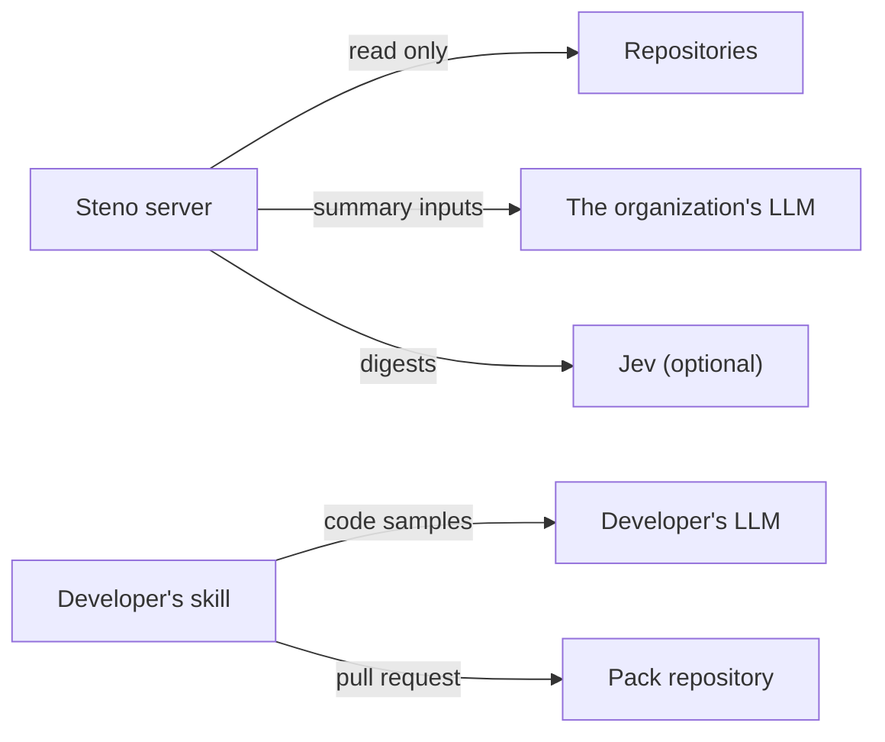

# Security and privacy

What Steno holds, what leaves the organization, and who may see what.

> **In one minute**
> - **No file contents stored,** but facts and citations describe the code, and the MCP server holds git credentials. Apply the same access controls as the repositories.
> - **Secret values are never ingested.**
> - **Confirm the organization's policy** before data leaves it.
> - **MCP authentication and scoping** are required before any client deployment (`v1`).
> - **Steno pushes nothing.** A developer's skill opens rule pull requests (D147).

| Area | Position | Status |
|---|---|---|
| **Source code** | No contents stored; read from the git host at the ingested commit | Decided |
| **Secrets** | Never ingested. Secret-looking config keys are skipped by every rule. Credentials are references. | Built |
| **Deployment values** | Stripped of credentials, secret keys refused, never sent to an LLM | Proposed |
| **Data leaving** | The server sends summary inputs (facts and README text) to the organization's LLM, and digests to Jev if turned on. The skill sends code samples to the developer's LLM provider. A local model is possible. **Jev's retention has no stated number of days.** | Policy check Decided; our answer **Open** |
| **Clone tokens** | Can appear on the git command line. Direction: a credential helper. | Open |
| **Credentials for many systems** (`v1`) | Read-only, narrow scope, reviewed per connector | Direction |
| **MCP access** | OAuth and scoping by space or role | **Open**, `v1` |
| **Auditing** | Tool calls, decisions, and LLM calls are logged | Built |
| **Organization repositories** | Read-only | Decided |
| **Rule pull requests** | Opened by the skill as the developer, with the developer's credentials. Steno holds no write credential (D147). | Decided |
| **Core-pack tests** | Minimal and synthetic, so organization code stays out of Steno's repository | Guardrail in the skill |
| **Deployment** | One per organization. Where it runs is **Open**. | Open |
