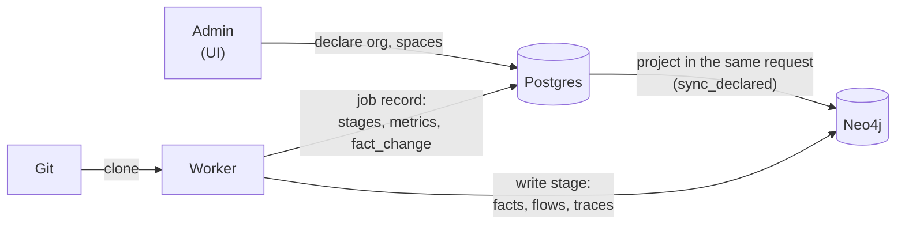
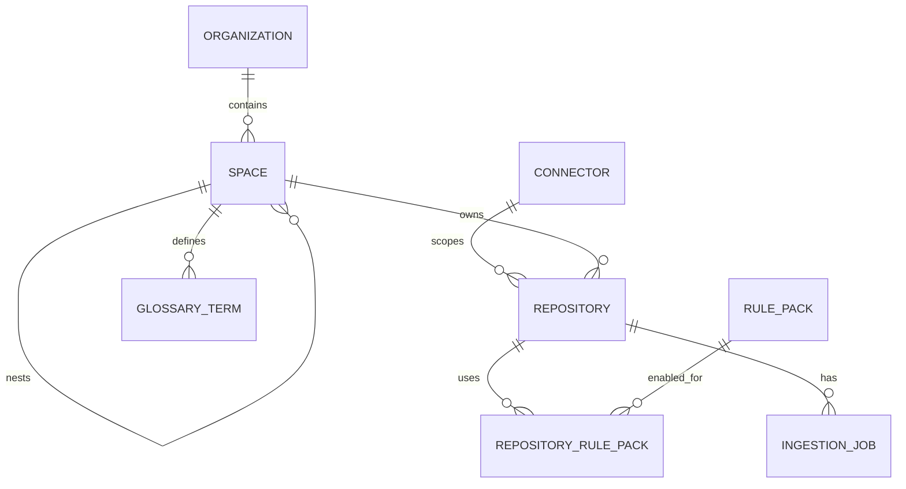
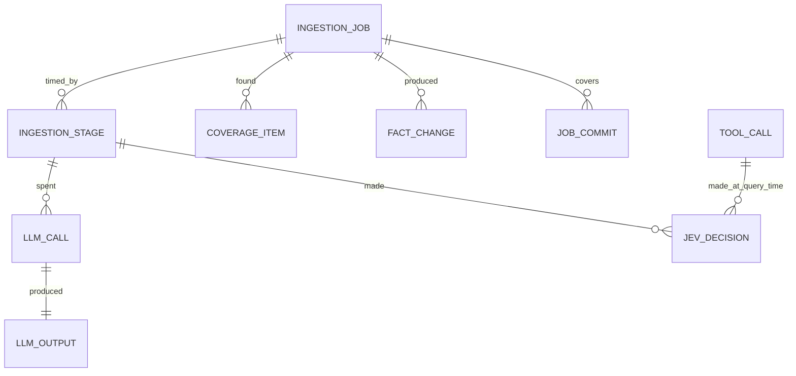

# Storage

Where Steno keeps things: **Postgres holds what Steno is told and what it did; Neo4j holds what it knows.** Part of [How it works](./README.md).

> **In one minute**
> - **Postgres:** the organization, spaces, connectors, repositories; every job and stage; coverage items; change history; logs of LLM, decision, and tool calls. Also the work queue. Planned: the identity registry and the claim store.
> - **Neo4j:** the graph. Declared structure (organization, spaces) is projected into it from Postgres; everything else comes from ingestion.
> - **Neo4j can always be rebuilt** from Postgres plus git, without re-spending on the LLM. Postgres is what must be backed up.
> - No facts and no file contents are stored in Postgres.

## 1. Two roads into Neo4j

**Road 1 · Declared: Postgres first, projected into Neo4j.** The organization and its spaces are typed in by an admin. They live in Postgres and Neo4j gets a copy, so the Organization → Space tree exists before anything is ingested:

1. The API saves the change and flushes: Postgres checks it (unique names, valid parent) but doesn't commit yet.
2. `sync_declared` makes Neo4j match Postgres exactly in one Neo4j transaction: merge the Organization, delete Space nodes whose row is gone, merge every Space, reset each space's `BELONGS_TO`.
3. If Neo4j fails, the request fails and Postgres rolls back, so the two never disagree. `steno graph init` runs the same sync to repair or rebuild.

**Road 2 · Ingested: git to Neo4j, Postgres keeps the record.** A job reads code from git and writes facts only to Neo4j. Postgres gets the job's record: the job row, one row per stage, `fact_change`, coverage items. It never stores the facts themselves; they can always be produced again from git.

**Where the two meet:**

| Link | In Postgres | In Neo4j |
|---|---|---|
| Organization | `organization.id = 1` | `(:Organization {id: "org:1"})` |
| Space | `space.id`, `space.parent_id` | `(:Space {id: "space:3"})`, its `BELONGS_TO` |
| Which space a repository is in | `repository.space_id` | `Repository -BELONGS_TO-> Space`, written at ingestion |
| Which job wrote a fact | `ingestion_job.id` | the `ingestion_job` property on every node and edge |
| Which commit | `ingestion_job.to_sha` | the `commit` property |
| *(planned)* Which application | `application_identity.steno_id` | the application's ID, and every child ID |

**Rebuilding Neo4j from scratch:** `steno graph init` (constraints, organization, spaces), then one ingestion job per repository. LLM text comes back from `llm_output` without new spend.

**Where they can drift today:** moving or deleting a repository doesn't touch Neo4j. A moved repository keeps its old `BELONGS_TO` until re-ingested; a deleted one's nodes stay. Direction: remove a repository's facts (and orphaned shared nodes) in the same request as the delete, and re-point `BELONGS_TO` on a move. The identity lifecycle (removed applications as tombstones) builds on this.

## 2. Principles (Decided)

- **Declared structure** (the organization, spaces, glossary) has its **source of truth in Postgres** and is **projected into Neo4j** as nodes and edges. (Decided)
- **Neo4j can be rebuilt** from Postgres plus the repositories, **without re-spending on the LLM**, because every generated text is cached in `llm_output`. Nothing is stored only in Neo4j. (Decided)
- **One Steno deployment per organization**, so no tables carry an `organization_id`. The organization itself is the single row in `organization`. (Decided)
- **The work queue lives in Postgres:** workers claim `queued` jobs with `SELECT … FOR UPDATE SKIP LOCKED`, so no separate broker is needed. (Decided)
- **Identity and external claims live in Postgres (Decided, D81, D87).** Steno IDs can't be recreated from git, and claims from systems reached through an API aren't in git, so both must be in Postgres for Neo4j to stay rebuildable.

## 3. Tables

**Configuration and jobs:**

**What each job records:**

**Planned tables** (stage A and B):

| Table | Holds | Design |
|---|---|---|
| `application_identity`, `application_alias`, `application_link`, `unmatched_name` | The identity registry: Steno IDs, names and their sources, lifecycle, admin renames, names no application matched | [Identify and reconcile §2](./ingestion/identify-and-reconcile.md#2-identify-decided) |
| claim store (name to decide) | Non-CODE claims per facet and subject, with witness, provider, source, and as-of time | [Identify and reconcile §3](./ingestion/identify-and-reconcile.md#3-reconcile-open-technical-design-before-stage-b) (Open) |
| setup sheet (name to decide) | Per organization: providers per facet, their witness types and precedence, naming patterns | [Onboarding](../plan/onboarding.md) |

### Columns

| Table | Columns |
|---|---|
| `organization` | `id` (always 1), `name`, `description`, `onboarded_at` |
| `connector` | `id`, `name`, `kind` (bitbucket / github / gitlab), `base_url`, `scope` (json: workspace, project, org), `credentials_ref` |
| `repository` | `id`, `connector_id`, `space_id`, `name`, `clone_url`, `default_branch`, `selection` (included / discovered / excluded), `last_ingested_sha`, `status` |
| `space` | `id`, `parent_id`, `name`, `description` |
| `glossary_term` | `id`, `space_id`, `term`, `target_node_id`, `definition` |
| `rule_pack` | `id`, `name`, `version`, `source` (core / org) |
| `repository_rule_pack` | `repository_id`, `rule_pack_id`, `enabled`, `reason` (auto / manual) |
| `ingestion_job` | `id`, `repository_id`, `trigger` (initial / nightly / manual), `mode` (full / dry_run), `from_sha`, `to_sha`, `status` (queued / running / succeeded / failed), `queued_at`, `started_at`, `finished_at`, `error`, `stats` (json) |
| `ingestion_stage` | `id`, `job_id`, `stage` (clone / deps / parse / extract / assemble / flows / write / cards), `started_at`, `finished_at`, `status`, `metrics` (json), `llm_cost`, `jev_cost` |
| `coverage_item` | `id`, `job_id`, `repository_id`, `kind` (external call / library / unreachable / unmet join / inconsistency / config), `target_symbol`, `occurrences`, `samples` (json), `status` (unexplained / ignored / explained) |
| `fact_change` | `id`, `job_id`, `fact_id`, `fact_type`, `change` (added / removed / modified), `before` (json), `after` (json), `commit_sha` |
| `job_commit` | `job_id`, `commit_sha`, `pr_number`, `pr_url`, `merged_at` |
| `llm_call` | `id`, `job_id`, `stage_id`, `node_id`, `purpose`, `model`, `input_tokens`, `output_tokens`, `cached_tokens`, `cost`, `latency_ms` |
| `llm_output` | `id`, `llm_call_id`, `node_id`, `kind`, `input_hash`, `text`, `is_current` |
| `jev_decision` | `id`, `stage_id` (ingestion) or `request_id` (query), `decision`, `input` (json), `output` (json), `confidence`, `latency_ms` |
| `tool_call` | `id`, `session_id`, `request_id`, `tool`, `params` (json), `latency_ms`, `result_count`, `at` |

### Configuration: what Steno is told

| Table | Why |
|---|---|
| `organization` | The organization this deployment serves: one row, entered in onboarding. The root of the space tree. Projected into Neo4j. |
| `connector` | A source system plus a scope (a Bitbucket workspace or project, a GitHub org). `credentials_ref` points into a secret manager; secrets are never stored. |
| `repository` | The include list now, discovery later (`selection`: included / discovered / excluded). `space_id` places it in the org. `last_ingested_sha` decides whether the nightly run includes it. |
| `space` | Admin-declared spaces, which can nest. Projected into Neo4j. |
| `glossary_term` | Human-declared vocabulary: a term, its definition, and the node it refers to. Projected into Neo4j. |
| `rule_pack`, `repository_rule_pack` | Which rule packs (and versions) apply to which repository, and whether each was auto-enabled from dependencies or added manually. |

### Operations: what Steno did

| Table | Why |
|---|---|
| `ingestion_job` | Every job (`trigger`: initial / nightly / manual; `mode`: full / **dry_run**) and its status (**queued** / running / succeeded / failed). **It's also the work queue.** |
| `ingestion_stage` | Per stage (clone, deps, parse, extract, assemble, flows, write, cards): timings, metrics (files, functions, flows), and **cost** (`llm_cost`, `jev_cost`, summed from the calls made in that stage). This is the dry-run report. |
| `coverage_item` | What **no rule explained** but looks like it matters (the coverage signals; see [Coverage report](./ingestion/coverage-report.md)), with occurrence counts and sample locations. `status` is unexplained / ignored / explained, so it's tracked across jobs, noise stays hidden once ignored, and open items measure how complete an app's graph is. The org-wide report groups items by `target_symbol` across repositories. |

### Change history

| Table | Why |
|---|---|
| `fact_change` | One row per fact a job **added, removed, or modified**, with `before` and `after`. It backs "what changed today?" (`get_changes`), delta-driven testing, and debugging. Re-ingesting the same commit must produce **zero rows**, which makes it an automated idempotency test. `commit_sha` is set when exactly one commit in the range touched the change's file, which attributes it to one PR. |
| `job_commit` | Every commit (and its PR) that a job covered. It enables "introduced in PR #123" in citations, and it's the bridge Contextualized will use for PR → Project. |

**What `fact_change` records.** The graph itself always reflects **every** change in full; this table is only the **history log**:
- **Architecture nodes:** every change to flows, steps, interfaces, effects, entities, and tables, including LLM text that was regenerated.
- **Traces:** one row per flow whose trace changed, listing the functions added, removed, or modified (signature or body, detected by a body hash). Any effect of that change on flows and steps is logged in full on the architecture side.

### Audit, cost, and caching

| Table | Why |
|---|---|
| `llm_call` | Every LLM call: purpose (flow purpose, flow narrative, app card, …), model, tokens (including cached), cost, latency, and the stage it ran in |
| `llm_output` | The text each call produced, tied to its `llm_call` and its node. Looked up by `(node_id, kind, input_hash)` before calling the LLM, so unchanged inputs are never paid for twice. `is_current` keeps earlier versions. |
| `jev_decision` | Every Jev input, output, confidence, and latency. From ingestion, it's linked to the stage; at query time, to the request. |
| `tool_call` | Every MCP tool call from agents: tool, parameters, latency, result count, grouped by `session_id`. It measures round trips per question and the latency targets, shows chatty patterns worth a batch tool, and joins with `jev_decision` to debug a bad answer. |

**Built vs. defined.** `job_commit`, `llm_call`, `llm_output`, `jev_decision`, `glossary_term`, `rule_pack`, and `repository_rule_pack` are defined in the schema but not written yet (pack versions per job are a known gap). `coverage_item`, `fact_change`, and `tool_call` are written.

Admins declare the organization, spaces, connectors, and repositories in the UI, starting with the [onboarding flow](../plan/onboarding.md). After changing `db/models.py`, create a migration with `cd backend && uv run alembic revision --autogenerate -m "..."` and review it.
