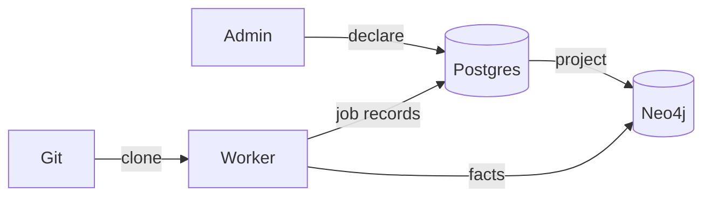

# Storage

**Postgres holds what Steno is told and what it did. Neo4j holds what it knows.**

> **In one minute**
> - **Postgres:** configuration, jobs (also the work queue), identity, claims, coverage, history, logs. Back this up.
> - **Neo4j:** the graph. Declared structure is copied in; the rest comes from ingestion.
> - **Neo4j can be rebuilt** from Postgres plus git, without new LLM spend.
> - No facts and no file contents in Postgres.

## 1. Two roads into Neo4j

**Declared.** The organization and spaces are saved in Postgres and made to match in Neo4j in the same request (`sync_declared`). If Neo4j fails, Postgres rolls back.

**Ingested.** A job writes facts only to Neo4j, and Postgres keeps the record.

**They meet on:** `organization.id`, `space.id`, `repository.space_id`, `ingestion_job.id`, `ingestion_job.to_sha`, and `application_identity.steno_id`.

**Rebuilding:** `steno graph init`, then one job per repository.

**Known drift:** moving or deleting a repository doesn't touch Neo4j until it's re-ingested. Direction: `v2`.

## 2. Principles (Decided)

- **One deployment per organization,** so no `organization_id` (D34).
- **The queue lives in Postgres** (`SKIP LOCKED`, D35).
- **One queued-or-running job per repository** (D99).
- **Work fits the machine** (D128, D134, [Large repositories §5](./ingestion/large-repositories.md#5-failures-and-fitting-the-machine-d128-d134)).
- **Identity and claims live in Postgres,** because they can't be recreated from git (D81, D109).

## 3. Tables

| Group | Table | Holds |
|---|---|---|
| **Configuration** | `organization` | One row: `id`, `name`, `description`, `onboarded_at`, `settings` (JSON, e.g. the LLM choice; keys only as references) |
| | `connector` | `name`, `kind`, `base_url`, `scope`, `credentials_ref` |
| | `repository` | `connector_id`, `space_id`, `name`, `clone_url`, `default_branch`, `selection`, `last_ingested_sha`, `status` |
| | `space` | `parent_id`, `name`, `description` |
| | `glossary_term` † | `space_id`, `term`, `target_node_id`, `definition` |
| | `rule_pack` †, `repository_rule_pack` † | Pack versions per repository |
| **Jobs** | `ingestion_job` | `repository_id`, `trigger`, `mode`, `from_sha`, `to_sha`, `status`, timestamps, `error`, `stats`, `host`, `memory_reserved_mb`, `cancel_requested_at`. **Also the queue.** |
| | `ingestion_stage` | `job_id`, `stage`, timestamps, `status`, `metrics`, `llm_cost`, `jev_cost` |
| | `coverage_item` | `job_id`, `repository_id`, `kind`, `target_symbol`, `occurrences`, `samples`, `status`, `quiet` |
| **History** | `fact_change` | `job_id`, `fact_id`, `fact_type`, `change`, `before`, `after`, `commit_sha`. Zero rows on the same commit. |
| | `job_commit` † | `job_id`, `commit_sha`, `pr_number`, `pr_url`, `merged_at` |
| **Identity** | `application_identity`, `application_alias`, `application_link`, `unmatched_name` | [Identify §2](./ingestion/identify-and-reconcile.md#2-identify) |
| **Claims** | `claim` | [Claims §5](./ingestion/claims-and-reconcile.md#5-the-claim-store) |
| **Rule state** | `coverage_pattern` | Fingerprint, `kind`, `signal`, `label`, `owner`, reach, `score`, `state`, `quiet`, `first_seen_job`, `note` |
| | `coverage_occurrence` | `pattern_id`, `repository_id`, `file`, `symbol`, `application`, `first_seen_job` |
| | `ignored_file` | `fingerprint`, `name`, `note` |
| | `rule_health` † | Planned (D126) |
| **Audit** | `llm_call` | `job_id`, `stage_id`, `node_id`, `purpose`, `model`, tokens, `cost`, `latency_ms` |
| | `llm_output` | `llm_call_id`, `node_id`, `kind`, `input_hash`, `text`, `is_current`. The cache. |
| | `jev_decision` | `stage_id` or `request_id`, `decision`, `input`, `output`, `confidence`, `latency_ms` |
| | `tool_call` | `session_id`, `request_id`, `tool`, `params`, `latency_ms`, `result_count`, `at` |

† Defined but not written yet, or planned. **Planned:** the setup sheet.

Rules stay YAML in git; these tables hold only state about them (D147).

After changing `db/models.py`: `cd backend && uv run alembic revision --autogenerate -m "..."`, then review it.
