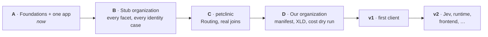

# Plan

Where Steno is, where it's going, how an organization gets onboarded, and every decision made along the way.

> **In one minute**
> - **Now:** proof of concept, stage **A** (foundations + one application). Python and Java ingest end to end; MCP tools are live; the coverage report works.
> - **Next:** application identity (Steno IDs, the name ladder), witness types on facts, a completeness block in answers, the reconcile design, and a scored question set compared against an agent without Steno.
> - **Then:** a stub organization built to exercise every facet and identity case (B), real multi-service code (C), our own organization (D).
> - **Stops:** v1 adds what a client deployment needs; v2 holds Jev, runtime evidence, frontends, and more.

## Pages

| Page | What it covers |
|---|---|
| [Roadmap](./roadmap.md) | The POC stages with scope and exit criteria, how accuracy is measured, v1, v2, and risks |
| [Onboarding](./onboarding.md) | The nine-step flow every organization goes through, and what the UI is for |
| [Decisions](./decisions.md) | Every numbered decision (D1–D112) and the open questions |
| [Later](./later/README.md) | Parked designs: Jev, runtime evidence, frontends, data schemas, the UI's long-term vision |

## Stage A, in order

1. **Identity:** the registry and identify step; child IDs built on Steno IDs; manual renames ([Identity](../concepts/identity.md)).
2. **Application kinds** from triggers ([Graph](../concepts/graph.md#5-application-kinds)).
3. **Witness type and sources on every fact** (CODE today) ([Witnesses and facets](../concepts/witnesses-and-facets.md)).
4. **Completeness block** on impact and dependents answers ([Trust](../concepts/trust.md#5-what-an-agent-sees)).
5. **Reconcile technical design**, ready before stage B ([Identify and reconcile](../how-it-works/ingestion/identify-and-reconcile.md)).
6. **Question set** drawn from the [lead use cases](../purpose/use-cases.md#lead-use-cases-in-detail), for budgeting-app and Contextualized, scored, with the comparison without Steno ([Roadmap §4](./roadmap.md#4-evaluation)).
