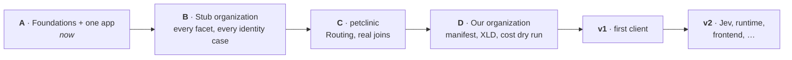

# Plan

Where Steno is, where it's going, how an organization gets onboarded, and every decision made along the way.

> **In one minute**
> - **Now:** proof of concept, stage **A** (foundations + one application). Python and Java ingest end to end; MCP tools are live; the coverage report works.
> - **Next:** application kinds, a scored question set compared against an agent without Steno, and the work decided on 2026-10-20 (D115–D127): answers that say what they checked, Java at scale, and **rule curation** (Steno drafts rules, a person approves). See the [build order](./roadmap.md#5-build-order-for-d115d127).
> - **Then:** a stub organization built to exercise every facet and identity case (B), real multi-service code (C), our own organization (D).
> - **Stops:** v1 adds what a client deployment needs; v2 holds Jev, runtime evidence, frontends, and more.

## Pages

| Page | What it covers |
|---|---|
| [Roadmap](./roadmap.md) | The POC stages with scope and exit criteria, how accuracy is measured, v1, v2, and risks |
| [Onboarding](./onboarding.md) | The nine-step flow every organization goes through, and what the UI is for |
| [Decisions](./decisions.md) | Every numbered decision (D1–D130) and the open questions |
| [Later](./later/README.md) | Parked designs: Jev, runtime evidence, frontends, data schemas, the UI's long-term vision |

## Stage A, in order

Built: identity (registry, identify step, Steno IDs, renames), witness types and sources, the completeness block (with what was checked, D118), `sources` in answers (D119), claims and reconcile. Remaining:

1. **Application kinds** from triggers ([Graph](../concepts/graph.md#5-application-kinds)).
2. **Java at scale** (D127) ([Resolvers §5.3](../how-it-works/ingestion/resolvers.md#53-large-repositories-decided-d127-partly-built)).
3. **Patterns and rule curation** (D120–D126) ([Rule curation](../how-it-works/ingestion/rule-curation.md)), continuing into stage B.
4. **Question set** drawn from the [lead use cases](../purpose/use-cases.md#lead-use-cases-in-detail), for budgeting-app and Contextualized, scored, with the comparison without Steno ([Roadmap §4](./roadmap.md#4-evaluation)).
