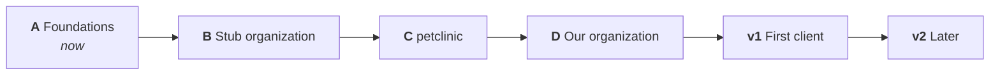

# Plan

Where Steno is, where it's going, and every decision made along the way.

> **In one minute**
> - **Now:** POC stage **A**. Python and Java ingest end to end, MCP tools are live, and coverage works.
> - **Next:** a scored question set with **routing accuracy** as its headline, the trace ablation (D140), and the investigation plugin (D133).
> - **Then:** a stub organization (B), real multi-service code (C), and our organization (D). Whether B and C stay is open.
> - **After:** `v1` adds what a client needs, plus Projects and Constraints. `v2` holds the rest.

## Pages

| Page | Covers |
|---|---|
| [Roadmap](./roadmap.md) | Stages, exit criteria, evaluation, build order, risks |
| [Decisions](./decisions.md) | D1–D150 and the open questions |
| [Onboarding](./onboarding.md) | The nine steps for an organization |
| [Routing design](./routing-design.md) | What was measured behind D150, and what's still open |
| [Organization standards](./organization-standards.md) | **Proposed.** What Steno must learn about an organization |
| [Later](./later/README.md) | Parked designs, including Jev |
